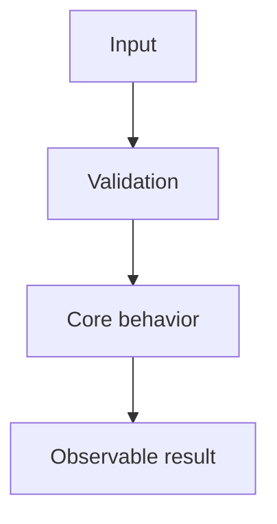
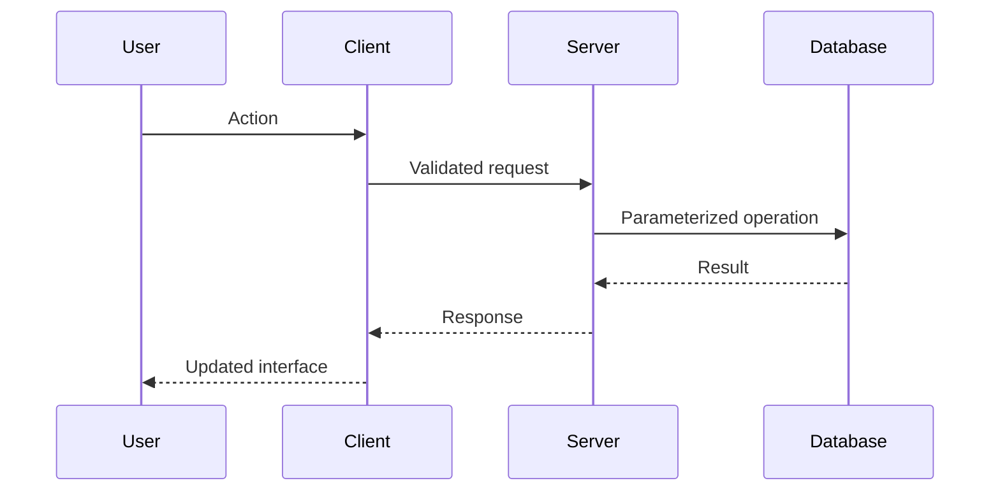

# Document templates

Adapt names and sections to the selected product and stack.

## Application overview

```markdown
# <App> — Application Overview

> **Project:** <name> · **Stack:** <stack>
> **Purpose:** <learning and product purpose>
> **Status:** <active learner milestone and reference milestone>

## 1. What are we building?
## 2. What does the app look like?
## 3. Core capabilities and delivery order
## 4. Example user journey
## 5. How does it work technically?
## 6. Why these technologies?
## 7. Learning days
## 8. What are we intentionally not building?
## 9. Feature-to-interview-concept map
## 10. Completion criteria
```

Include visual references only when they clarify the product. Label mockups as
references rather than screenshots of implemented behavior.

## Roadmap

```markdown
# Complete <App> roadmap

## Completion definition
## Progress at a glance
## Architecture and data-flow diagrams

## Day N — <milestone>
**Lesson:** [Day N](../lessons/day-NN.md)
**Milestone:** <observable outcome>

### Steps and substeps
### Concepts to know
### Interview questions

## Whole-app completion checklist
## Optional infrastructure track
```

Every milestone must be observable. “Learn React” is not a milestone; “browser
creates and persists an item through the API” is.

## Lesson

````markdown
# Day N — <outcome>

**Time:** <sessions>

**Starting point:** <verified prior behavior>

**Goal:** <observable result>

[Previous](day-NN.md) · [Roadmap](../docs/APP_BUILD_ROADMAP.md) · [Next](day-NN.md)

## Learning objectives

## 1. Understand the boundary



## 2. Implement <first increment>

Use exact filenames, complete code, comments for non-obvious decisions, and
commands with expected observations.

## 3. Trace the request or event



## Debugging exercise

Break one behavior at a time, predict the outcome, diagnose the root cause, and
restore it.

## Tricky interview questions and answers (20 min)

### Q1. <Question?>

**Interview-ready answer:** <30–60 second answer>

**Example:** <specific code or scenario>

**Senior follow-up:** <trade-off, failure mode, or deeper design point>

## Complexity

Discuss algorithmic cost where meaningful. For I/O, security, deployment, and
operations, discuss round trips, resources, latency, failure modes, and cost.

## Exit checklist

- [ ] <verified behavior>
- [ ] <failure behavior>
- [ ] <explanation learner can give aloud>

**Suggested commit:** `<message>`
````

## Architecture

Document:

- trust boundaries;
- browser/client, server, data, identity, and external-service responsibilities;
- read and mutation paths;
- persistence and migration strategy;
- session and authorization boundaries;
- test layers;
- deployment and recovery;
- current trade-offs and explicitly deferred work.

## Interview index

Use a table:

```markdown
| Concept | Where to study | Question to explain aloud |
|---|---|---|
| <concept> | `lessons/day-NN.md` | <question> |
```

## Notes

Provide empty sections without overwriting the learner's entries:

```markdown
## Day N — <topic>

- What:
- Why:
- How:
- Code:
- Trick:
```
