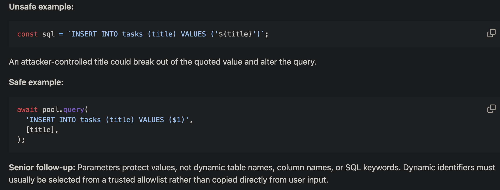

const closu = () =>{
    let count = 0
    return function test(){
        return count++
    }
}

const check = closu()
const check1 = closu()

console.log(check())
console.log(check())
console.log(check())
console.log(check())

// promises 

// Promise --> represent result or error available later 
// promise represents results or error available later 
// await --> its call the async function or promise -> it pauses until the promise settles 
// await is used to call a promise and pause until it settles -> it does not stop execution 
// closures --> it retains the variable value and passes on to the callback function 
// stream --> http request bodies or payload arrive in chunks --> these are called streams 


// postgress DB install 
// run the db -> start postgresql@17
// createdb minitrack --> this creates the database

//Now we create the table schema in the database --> 
// CREATE TABLE if NOT exists tasks (
// ID  -- BIGINT (64 bit integer) GENERATED ALWAYS AS IDENTITY PRIMARY KEY
// TITLE -- TEXT NOT NULL CHECK (char_length(title) BETWEEN 1 and 200)
// DONE BOOLEAN NOT NULL DEFAULT false
// created_at -- TIMESTAMPTZ NOT NULL DEFAULT now())

// Here is the final schema 
```
-- Re-runnable Week 1 schema. Do not DROP the table each time you run this.
CREATE TABLE IF NOT EXISTS tasks (
  id BIGINT GENERATED ALWAYS AS IDENTITY PRIMARY KEY,
  title TEXT NOT NULL CHECK (char_length(title) BETWEEN 1 AND 200),
  done BOOLEAN NOT NULL DEFAULT FALSE,
  created_at TIMESTAMPTZ NOT NULL DEFAULT now()
);

-- A small starter set, only inserted if the table is still empty.
INSERT INTO tasks (title, done)
SELECT 'Learn the JavaScript event loop', TRUE
WHERE NOT EXISTS (SELECT 1 FROM tasks);
INSERT INTO tasks (title, done)
SELECT 'Build a full-stack task tracker', FALSE
WHERE (SELECT COUNT(*) FROM tasks) = 1;

```
-- in summary create table IF NOT EXISTS tasks (
// ID TYPE, -> int, string, date, condition default value etc)
// insert the dummy data in the table --> why ?  so as to seed the table 

// INSERT INTO tasks (title,done)
// SELECT 'learn js' TRUE
// WHERE NOT EXISTS (SELECT 1 FROM TASKS) --> this checks if 1 rows already existed --> whether the table was empty or not

// Now we will create a db driver 
// what does the db driver do? --> it creates the pool in the connection 
// keeping a small number of reusable connections is cheaper that creating new 
// connection every time
// what does the pool do? --> one http connection to the db can support multiple db tranactions -->
// for example say if have pool of 5 --> 5 parallel interactions can happen with the db 
// how we come up with the pool size? --> later --> depends upon the traffic I think?
-- we will create this db driver in the frontend/lib/db.ts 
>[!WARNING]  
 > we use this in the db driver so that -  In Next.js development, hot reloading can reload modules, causing Option 2 to create additional pools. Your original globalThis version helps avoid that problem.
 > const globalForPg = globalThis as typeof globalThis & { taskPool?: Pool };
- Now we will create a functions that we are going to use in the BE calls for DB interactions 
- listtask and create tasks --> so obviously we need task object 
- since we need task object we need to define the type of the task object 
- we will read and write in this function 
- learn about using the pool for query 
- import the getPool function that returned the pool we created
- we use getPool.query<TaskRow>(`SELECT ..) --> to query the DB 
- to insert/write data in the DB 
> `INSERT INTO tasks (title) VALUES ($1) RETURNING id, title, done, created_at`,[title]
- Note that if we define the type of an object say 
> type Person = {
    fname: string;
    lname: string
} 
and then we want to use the array of this object then 
we use Person[]
[Open frontend/lib/tasks.ts](../../frontend/lib/tasks.ts)
- Ok we learned how to read and write into the postgres DB 
- Note that PG returns the id as a string even though we defined it as a bigint in the schema 
- Now what are we going to do? 
- validate the input request --> whether the incoming json is correct
- if the object is correct
- if yes then create the record in the db; if not send back the error 
- we will do all this in the route handler
- note that all the functions (GET, PUT, POST etc) in route handler are async 
- always use try/catch inside the async function
- note that the GET --> we respond with the headers with Cache-Control; can we send this hearsd with the POST? may be
- also create a route for the healthcheck 
- SQL Interview drill - find all the done tasks 
> SELECT id, title, done, created_at from tasks WHERE done = true ORDER BY id;
- updating the SQL table  use SET 
> UPDATE tasks SET done = true WHERE id = 1 RETURNING *;
- count the items 
> SELECT COUNT(*) FROM tasks WHERE done = false 
###### Q1. Why use $###### Q1. Why use $1 parameters instead of building SQL with template strings?
- so that sql query is separate from the data --> to avoid sql injection
- so that sql query cannot be used as executable as is 

- 
###### Q2. Why use postgres RETURING clause? 
- so that user know what data/row is updated, deleted or inserted on the same round trip
###### Q3. Is a generated database ID guaranteed to be gap-free?
- no, only uniqueness is guaranteed; 
- don't use ids for receipts etc.. because hacker would find out the sequence. 
- Senior follow-up: IDs should not be used as business-visible sequence numbers such as invoice numbers when the business requires a special gap policy. That requirement needs separate domain logic and careful concurrency design.
###### Q4.What happens when the database connection pool is full?
- waits in the pool queue
- timeout if nothing is available in a given timeout 
- Example: With a pool limit of 10, the first 10 long-running
queries can use connections while the 11th request waits. If requests arrive faster than queries finish, latency and queue length grow.
- Senior follow-up: Production configuration should coordinate application-instance count, pool size, PostgreSQL's connection limit, query timeouts, and pool wait timeouts. Scaling to 20 app instances with a pool of 20 could potentially request 400 database connections.
###### Q5 What should happen if PostgreSQL becomes unavailable?
- code should catch it 
> try {
  const tasks = await listTasks();
  return Response.json(tasks);
} catch (error) {
  console.error('Unable to list tasks', error);
  return Response.json(
    { error: 'Service temporarily unavailable' },
    { status: 503 },
  );
}
- 
> Senior follow-up: Retries are safest for transient failures and idempotent operations. Blindly retrying an INSERT after an uncertain network failure can create duplicates, so creation APIs may need an idempotency key or another deduplication strategy.

- now we will start the FE with create-next-app rather than completed code 
- here we start with deleting the existing main page.tsx code 


