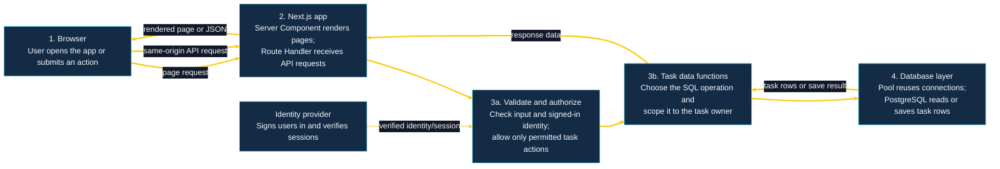
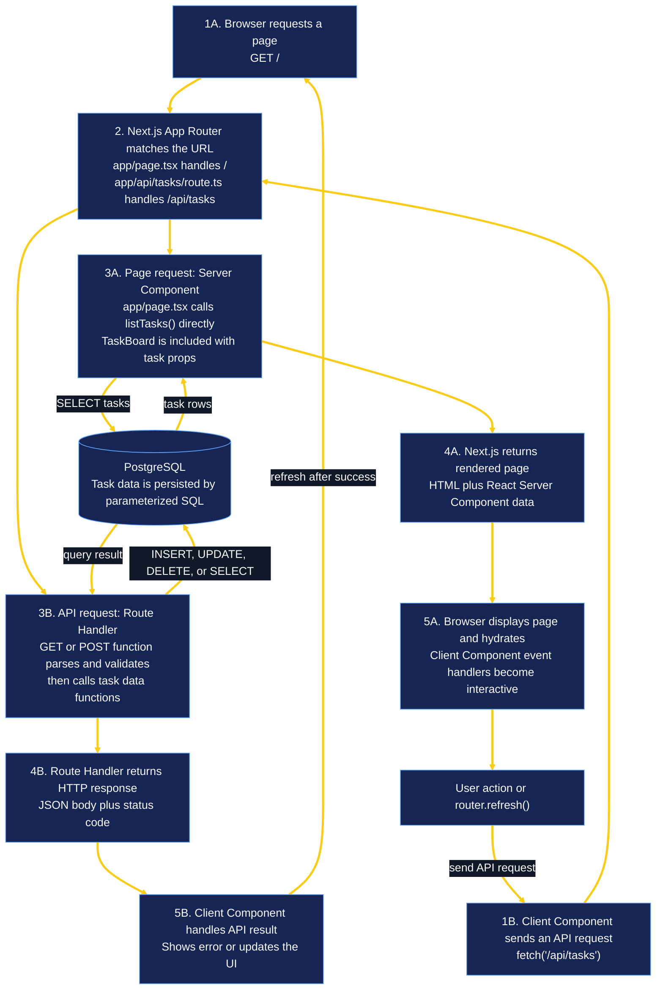
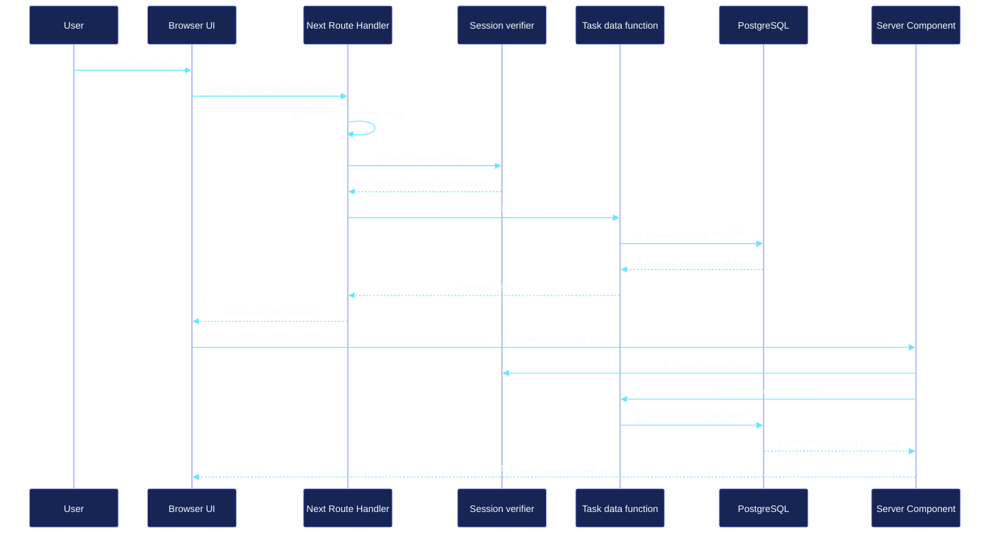
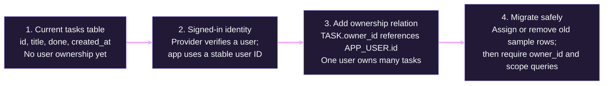
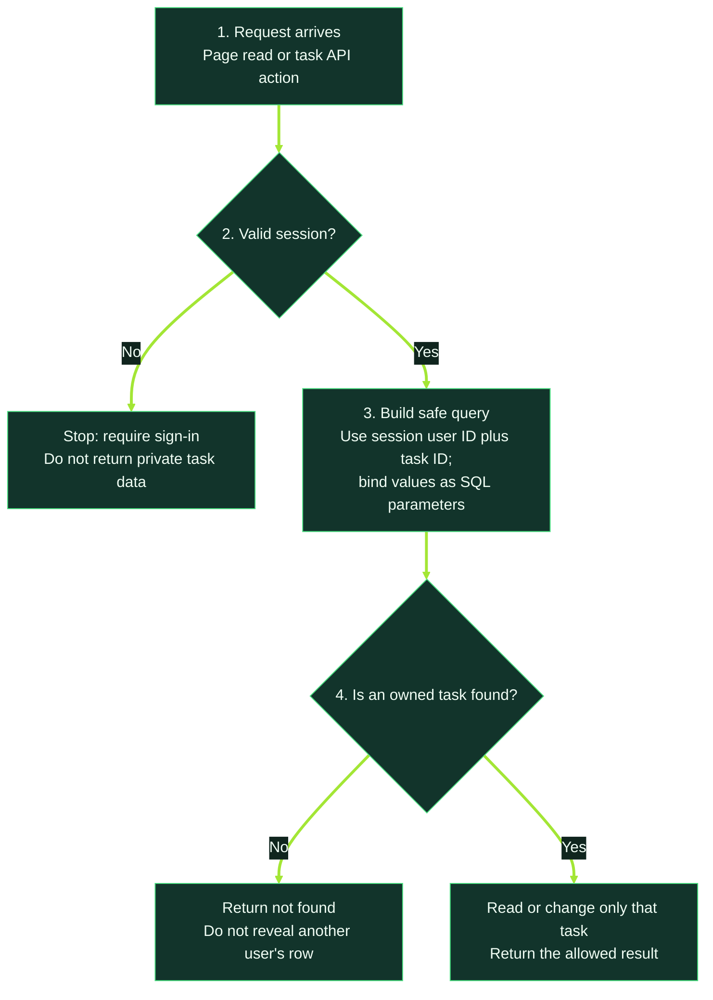
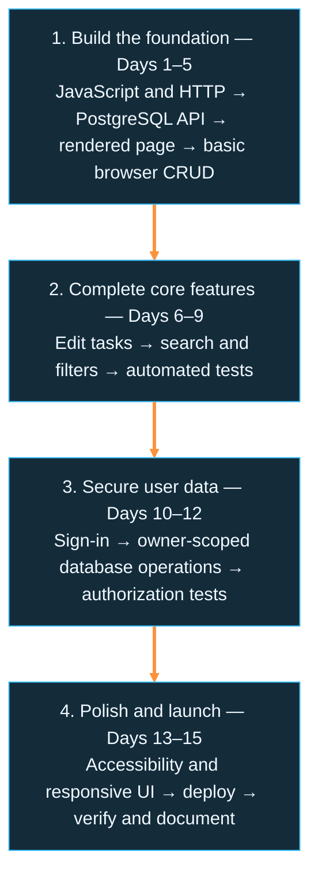

# Complete MiniTrack app roadmap

This roadmap expands the Week 1 MVP into a complete, deployed personal task
tracker. It shows the build steps, the day to cover each step, the concepts to
practice, and interview questions to review. Work through the checkboxes in
order. Check a box only after you have built or verified that step yourself.

**Your current position:** You said you are starting Day 1. Begin with the
Day 1 section below; the boxes are intentionally unchecked so you can track
your own progress.

**Important:** The repository currently has full-stack app lessons for Days
1–5. The Days 6–15 below are the recommended continuation for this app; the
existing numbered lessons after Day 5 are a separate Python DSA track. Do not
mistake those DSA lesson numbers for app progress.

## What “the whole app is finished” means

An authenticated user can sign in, see only their own tasks, create, edit,
complete, search, filter, and delete them, and use the app after deployment.
The app also has automated checks for its important behavior, accessible
controls, documented environment setup, and no committed secrets.

This is a complete learning-project milestone, not a claim of enterprise
production readiness. Multi-factor authentication, team sharing, billing,
real-time collaboration, and advanced operational controls are optional future
work.

## Progress at a glance

| Day | Main milestone | Progress |
|---|---|---|
| 1 | Understand JavaScript execution and serve `GET /tasks` | [ ] Not started |
| 2 | Handle asynchronous request bodies and create tasks in memory | [ ] Not started |
| 3 | Persist tasks in PostgreSQL and create `GET`/`POST` API routes | [ ] Not started |
| 4 | Render database tasks with a Next.js Server Component | [ ] Not started |
| 5 | Add browser interactions and finish basic task CRUD | [ ] Not started |
| 6 | Add title editing to the database/API | [ ] Not started |
| 7 | Add the edit experience to the browser | [ ] Not started |
| 8 | Add persistent search and server-side filtering | [ ] Not started |
| 9 | Add automated tests for app and database behavior | [ ] Not started |
| 10 | Add sign-in using a maintained authentication provider | [ ] Not started |
| 11 | Restrict task data and mutations to the signed-in owner | [ ] Not started |
| 12 | Test authentication, authorization, and user-data isolation | [ ] Not started |
| 13 | Polish responsive layout and accessibility | [ ] Not started |
| 14 | Deploy the app and configure production services | [ ] Not started |
| 15 | Verify, document, and launch the complete app | [ ] Not started |

Update the Progress column as you go: change `[ ] Not started` to `[x] Done`.

---

## Visual guide: how the app fits together

These diagrams show the **target app after Day 15**, unless marked otherwise.
Days 1–5 build the current single-user version incrementally. Authentication,
the owner relationship, and deployment are future steps in this roadmap.
Each diagram uses its own high-contrast dark palette, so arrow lines and
connectors remain visible in a Markdown preview. The page itself still follows
your editor's selected theme.

### 1. Target architecture

**Read left to right:** (1) the browser starts a page read or task action;
(2) Next.js sends it through a Server Component or Route Handler; (3a) the
server checks input and access; (3b) the task data function prepares the
operation; (4) the pool and PostgreSQL read or save the task and return the
result. The identity provider supplies a verified session to step 3a; it does
not decide whether a particular task belongs to that user.

### 2. How the Next.js App Router handles the page and API

**What each part means:**

1. The browser requests a page or makes an API request. These are different
   HTTP requests, even though both are handled by the same Next.js app.
2. The App Router matches the URL to files under `frontend/app/`. A `page.tsx`
   file renders a page; a `route.ts` file handles HTTP methods for an API path.
3. For `/`, the Server Component reads tasks directly from the server-side
   data layer. For `/api/tasks`, the Route Handler validates the HTTP request
   and calls the data layer. Either path may query PostgreSQL.
4. A page request returns rendered HTML and React Server Component data. An
   API request returns the Route Handler's JSON and HTTP status.
5. In the browser, the page becomes interactive where it includes a Client
   Component. User actions can call an API Route Handler; after a successful
   mutation, `router.refresh()` asks Next.js to render fresh server data.

The Client Component may be server-rendered as part of the initial page; it
needs the client bundle for its hooks and event handlers to work in the
browser. The `use client` directive marks a client module boundary, not a
separate server.

### 3. Create-task timing / request sequence

**Learning checkpoints:** Days 3–5 implement steps 1, 3, and 4 without a user
session. Days 10–12 add the trusted identity and owner check in step 2 and
scope step 3's database query. `router.refresh()` re-reads server data; it is
not itself an authorization or persistence mechanism.

### 4. Database: how task ownership is added

This is a **schema-change sequence**, not a runtime request. The final
relationship is one user to many tasks, with a foreign key from
`TASK.owner_id` to `APP_USER.id`. On Day 3, the tasks table has no owner. The
exact user table and key type depend on the provider chosen on Day 10. Never
enable accounts while existing unowned tasks can be exposed across users.

### 5. Every task query must respect ownership

The owner ID comes from the verified server-side session, not a request body,
URL parameter, or hidden form field. Apply this rule to list, create, search,
update, and delete operations. For creating a new task, scope the `INSERT` with
the session owner ID; for existing tasks, scope reads and mutations by both
task ID and owner ID.

### 6. Build sequence and learning layers

Follow the numbered blocks from 1 to 4, then use the day-by-day checklists
below for the exact substeps. The repository's existing Days 6–45 in the DSA
track are unrelated to this app timeline.

---

## Day 1 — JavaScript execution and the first HTTP endpoint

**Lesson:** [Day 1](../lessons/day-01.md)  
**Milestone:** Run a Node server that returns an in-memory task list from
`GET /tasks`.

### Steps and substeps

- [ ] **1. Predict JavaScript execution order**
  - Identify which statements run synchronously on the call stack.
  - Predict when a Promise microtask and a timer callback run.
  - Run the example and explain why a zero-delay timer does not run immediately.
- [ ] **2. Create the first server**
  - Create `checkpoints/day1/server.cjs`.
  - Use Node's built-in `node:http` module to create and listen on a server.
  - Match the request method and path for `GET /tasks`.
  - Send a JSON response with status `200`; return `404` for an unknown path.
- [ ] **3. Run and inspect the HTTP responses**
  - Start the server and request `/tasks` with `curl -i`.
  - Request an unknown path and verify the `404`.
  - Explain the roles of the request, response, JSON serialization, and `res.end()`.
- [ ] **4. Debug and explain the lifecycle**
  - Try the lesson's experiments: remove `res.end()`, change the path, and add a short blocking loop.
  - Restore the working code and explain why a long synchronous callback delays other JavaScript work.

### Concepts to know

Call stack; synchronous execution; event loop; Promise microtasks; timers;
Node.js request handlers; HTTP method and path; JSON serialization; status
codes; completing a response; blocking JavaScript.

### Interview questions

1. **What is the call stack?** — The stack of currently executing function
   calls; synchronous work runs to completion on it.
2. **Why does a Promise `.then()` run before `setTimeout(..., 0)` here?** —
   Promise callbacks use the microtask queue, which is drained after the
   synchronous stack and before the timer callback becomes eligible.
3. **Does a zero-millisecond timer run immediately?** — No. It schedules a
   callback for a later event-loop turn; it cannot interrupt current
   synchronous work.
4. **Why must an HTTP response be ended?** — The server needs to know the
   response is complete so the client can finish reading it.
5. **What does HTTP 404 mean?** — The requested route or resource was not found.

---

## Day 2 — Promises, request streams, and creating a task

**Lesson:** [Day 2](../lessons/day-02.md)  
**Milestone:** Accept `POST /tasks`, validate JSON, and return a created
in-memory task.

### Steps and substeps

- [ ] **1. Review asynchronous JavaScript**
  - Predict the order of logs around an `async` function and `await`.
  - Explain that `await` suspends its async function, not the whole Node process.
  - Explain how a request-handler closure can access the shared task array and ID counter.
- [ ] **2. Read and parse the HTTP request body**
  - Create `checkpoints/day2/server.cjs`.
  - Read request chunks from the stream and combine them before parsing.
  - Wrap the event-based stream in a Promise so the handler can use `await`.
  - Handle malformed JSON and an oversized body without crashing the server.
- [ ] **3. Validate input and create the task**
  - Check that the parsed body has a non-empty title within the length limit.
  - Create an ID and add the task to the in-memory array.
  - Return `201 Created` for a successful POST and an appropriate error for invalid input.
- [ ] **4. Verify success, failure, and data lifetime**
  - Test GET, valid POST, invalid JSON, and invalid title with `curl`.
  - Add the lesson's `GET /count` experiment.
  - Restart the server and confirm that in-memory tasks disappear; explain why persistence is needed.

### Concepts to know

Promises; `async`/`await`; resolve and reject paths; `try/catch`; closures;
HTTP request streams and chunks; JSON parsing; input validation; `201 Created`;
in-memory state and process lifetime.

### Interview questions

1. **Does `await` block Node.js?** — It pauses the current async function
   until the Promise settles; Node can continue processing other work.
2. **What happens when an awaited Promise rejects?** — The `await` expression
   throws, so the error can be handled with `try/catch` or propagated.
3. **What is a closure?** — A function together with access to the lexical
   variables from the scope where it was created.
4. **Why read a request body as a stream?** — HTTP body data may arrive in
   multiple chunks over time; the handler must wait for the complete body
   before parsing it.
5. **Why does this server lose tasks on restart?** — The array exists only
   in process memory; it is not durable storage.

---

## Day 3 — PostgreSQL, TypeScript, and the collection API

**Lesson:** [Day 3](../lessons/day-03.md)  
**Milestone:** Store tasks in PostgreSQL and expose `GET /api/tasks` and
`POST /api/tasks` from Next.js.

### Steps and substeps

- [ ] **1. Create the database schema**
  - Create or start a local PostgreSQL instance and create the `minitrack` database.
  - Run `backend/sql/schema.sql`.
  - Inspect the `tasks` table and explain its identity ID, constraints, default values, and timestamp.
- [ ] **2. Configure the Next.js app**
  - Install the frontend dependencies.
  - Copy `frontend/.env.local.example` to `frontend/.env.local` and set `DATABASE_URL`.
  - Keep credentials local; do not commit `.env.local`.
- [ ] **3. Add the typed database and task layers**
  - Create `frontend/lib/db.ts` with a server-only PostgreSQL connection pool.
  - Create `frontend/app/types.ts`; keep PostgreSQL `BIGINT` IDs as strings.
  - Create `frontend/lib/tasks.ts` with `listTasks` and `createTask`.
  - Use parameterized SQL and convert database timestamps to ISO strings for the app.
- [ ] **4. Validate requests and add collection routes**
  - Create `frontend/lib/validation.ts` with `unknown` inputs and type guards.
  - Create `frontend/app/api/tasks/route.ts` with `GET` and `POST`.
  - Create `frontend/app/api/health/route.ts` for the health check.
  - Return validation errors to the caller; log database errors on the server and return a generic `500`.
- [ ] **5. Verify the API and persistence**
  - Start Next.js and call the health, list, and create endpoints.
  - Verify invalid JSON and invalid titles return a client error.
  - Restart Next.js and confirm PostgreSQL still contains the task.

### Concepts to know

Relational tables; primary keys; identity columns; constraints and defaults;
SQL `SELECT`/`INSERT`; parameterized queries; SQL injection prevention;
connection pooling; server-only modules; TypeScript types and `unknown`;
JSON and HTTP status codes; persistence.

### Interview questions

1. **Why use `$1` in SQL instead of inserting a string into the query?** —
   Bound parameters keep data separate from SQL syntax and prevent SQL injection.
2. **Why use a connection pool?** — It reuses a bounded set of database
   connections rather than opening a new connection for every query.
3. **Why represent a PostgreSQL `BIGINT` ID as a string in JavaScript?** —
   Some 64-bit integers exceed JavaScript's safe integer range.
4. **Why accept request data as `unknown`?** — Parsed JSON is untrusted;
   TypeScript requires narrowing it before treating it as a particular shape.
5. **What is the difference between HTTP 400 and 500?** — A 400 indicates an
   invalid client request; a 500 indicates an unexpected server-side failure.

---

## Day 4 — Render PostgreSQL data with Next.js

**Lesson:** [Day 4](../lessons/day-04.md)  
**Milestone:** Open the app and see the task list loaded on the server from
PostgreSQL.

### Steps and substeps

- [ ] **1. Review the shared task type**
  - Reuse `frontend/app/types.ts` from Day 3; do not define a competing task shape.
  - Explain why the database-facing row timestamp is converted to the app's string representation.
- [ ] **2. Create the app layout and page**
  - Create or update `frontend/app/layout.tsx`.
  - Implement `frontend/app/page.tsx` as an async Server Component.
  - Call `listTasks()` directly on the server instead of making an HTTP request to the app's own API.
  - Render loading errors clearly and show each task with a stable React key.
- [ ] **3. Run and verify the read path**
  - Start the app and open `http://localhost:3000`.
  - Add a task through `POST /api/tasks`, reload, and confirm it appears.
  - Trace the request: browser → Next.js page → PostgreSQL → rendered response.

### Concepts to know

Next.js App Router; Server Components; server-side data access; async rendering;
server-only database code; React rendering; stable list keys; error handling;
avoiding an unnecessary internal HTTP hop.

### Interview questions

1. **What is a Server Component?** — A component rendered on the server; it
   can access server-side resources and does not ship its component logic as
   browser JavaScript.
2. **Why read PostgreSQL directly from the Server Component?** — The page
   already runs on the server, so it can call the data layer without making an
   extra HTTP request back to its own app.
3. **When should a component be a Client Component?** — When it needs browser
   interactivity such as state, event handlers, or browser-only APIs.
4. **Why does a mapped list need a stable `key`?** — React uses keys to
   associate rendered items with their identity across updates.

---

## Day 5 — Complete the browser-based task tracker

**Lesson:** [Day 5](../lessons/day-05.md)  
**Milestone:** Create, complete, filter, and delete tasks from the browser.

### Steps and substeps

- [ ] **1. Add the remaining database operations**
  - Extend `frontend/lib/tasks.ts` with `setDone` and `deleteTask`.
  - Extend `frontend/lib/validation.ts` to validate task IDs.
  - Keep all SQL parameterized and return a clear not-found result when an ID does not exist.
- [ ] **2. Add the per-task Route Handler**
  - Create `frontend/app/api/tasks/[id]/route.ts`.
  - Implement `PATCH` to update the completion state and `DELETE` to remove a task.
  - Await Next.js dynamic route params and validate the ID and request body.
  - Verify successful, invalid-input, and not-found responses.
- [ ] **3. Build the interactive Client Component**
  - Create `frontend/app/TaskBoard.tsx` with `'use client'`.
  - Add a controlled title input and submit handler for creating tasks.
  - Add checkbox and delete handlers that call the same-origin API.
  - Derive the visible tasks from the selected filter instead of storing duplicate list state.
  - Show busy and error states while requests are in progress or fail.
- [ ] **4. Connect server and client rendering**
  - Update `frontend/app/page.tsx` to load tasks on the server and pass them to `TaskBoard`.
  - Call `router.refresh()` after a successful mutation so the server-rendered task data is re-read.
  - Explain that the database remains the source of truth; client state controls the input and filter.
- [ ] **5. Test the complete user journey**
  - Create a task; verify it appears.
  - Mark it complete; verify the status and filter results.
  - Delete it; verify it disappears.
  - Reload or restart Next.js; verify persisted tasks remain.
  - From `frontend/`, run `npm test`, `npx tsc --noEmit`, and `npm run build`.

### Concepts to know

Client Components; controlled inputs; React state; event handlers;
derived state; `fetch`; `PATCH` versus `DELETE`; dynamic route params;
validation and not-found responses; server/client component boundaries;
`router.refresh()`; source of truth; loading and error states; testing.

### Interview questions

1. **What makes an input controlled in React?** — Its displayed value comes
   from React state, and an event handler updates that state when the user types.
2. **Why derive filtered tasks instead of keeping a second task list in state?** —
   Derived values avoid duplicated state that can become inconsistent.
3. **What is the difference between `PATCH` and `DELETE` here?** — `PATCH`
   partially updates a task; `DELETE` removes the task resource.
4. **What does `router.refresh()` do?** — It requests a fresh server-rendered
   result for the current route so server data can be loaded again.
5. **Why is PostgreSQL the source of truth instead of the browser?** — The
   database persists across requests and restarts and is shared by server
   requests; browser state is temporary and user-specific.
6. **Does disabling a button guarantee a mutation happens only once?** — No.
   It improves the UI experience, but reliable duplicate prevention requires
   server-side behavior such as idempotency controls where appropriate.

---

## Day 6 — Add task-title editing to the data layer and API

**Lesson:** Recommended continuation; create `lessons/app-day-06.md` when
working through this day.  
**Milestone:** A task title can be updated through a validated API request.

### Steps and substeps

- [ ] **1. Define the update contract**
  - Decide whether `PATCH` accepts `title`, `done`, or both optional fields.
  - Validate that at least one supported field is present and valid.
  - Keep the existing completion checkbox behavior working.
- [ ] **2. Update the database function**
  - Extend `frontend/lib/tasks.ts` with a typed task-update operation.
  - Use bound SQL parameters and `RETURNING` to get the updated row.
  - Distinguish a missing task from a database error.
- [ ] **3. Update the item Route Handler**
  - Extend `PATCH` in `frontend/app/api/tasks/[id]/route.ts` to accept title updates.
  - Keep ID and body validation at the HTTP boundary.
  - Return `400` for invalid input, `404` for a missing task, and a generic `500` for unexpected failures.
- [ ] **4. Verify behavior**
  - Use `curl` to update a title, update completion, and send invalid payloads.
  - Confirm the task is persisted after restarting Next.js.

### Concepts to know

HTTP `PATCH`; partial updates; request contracts; validation at API boundaries;
parameterized `UPDATE`; `RETURNING`; nullable/not-found outcomes; separation
between route, validation, and database layers.

### Interview questions

1. **Why use `PATCH` for this update?** — It changes selected fields without
   replacing the entire resource.
2. **How should an API distinguish invalid input from a missing resource?** —
   Use `400` for an invalid request and `404` when a valid ID has no matching row.
3. **Why use `UPDATE ... RETURNING`?** — PostgreSQL can return the changed row
   in the same statement, avoiding a separate read.

---

## Day 7 — Add the edit experience to the browser

**Lesson:** Recommended continuation; create `lessons/app-day-07.md` when
working through this day.  
**Milestone:** A user can edit a task title and see success or failure clearly.

### Steps and substeps

- [ ] **1. Design the edit interaction**
  - Choose a small inline form or an edit/cancel mode for one task.
  - Keep the current title visible and make cancel restore the non-editing view.
- [ ] **2. Implement the Client Component behavior**
  - Track the edited task ID and draft title in React state.
  - Submit the title to the `PATCH` endpoint.
  - Handle empty input, pending requests, API errors, and successful completion.
- [ ] **3. Refresh the server-rendered list**
  - Refresh after a successful update so PostgreSQL-backed props are reloaded.
  - Avoid mutating the incoming `tasks` prop.
- [ ] **4. Verify keyboard and failure behavior**
  - Test save, cancel, empty title, server error, and editing a different task.
  - Confirm the form has a label and sensible keyboard behavior.

### Concepts to know

Controlled forms; local versus server state; immutable props; component state
transitions; async UI; optimistic updates versus refresh; accessible form labels.

### Interview questions

1. **Why should a component not mutate props?** — Props are inputs owned by
   the parent; mutating them bypasses React's predictable data flow.
2. **When would you use an optimistic update?** — When immediate feedback is
   worth the extra rollback and stale-response complexity.
3. **How can you model edit/cancel/save UI clearly?** — Use explicit state for
   the active task and draft, and define the transitions for each action.

---

## Day 8 — Add search and persistent server-side filters

**Lesson:** Recommended continuation; create `lessons/app-day-08.md` when
working through this day.  
**Milestone:** Search and status filters are shareable through the URL and
applied by PostgreSQL.

### Steps and substeps

- [ ] **1. Specify query behavior**
  - Support a search term and a status filter such as `all`, `open`, or `done`.
  - Decide and document case-sensitivity and whitespace behavior.
  - Keep a no-query request equivalent to the current list endpoint.
- [ ] **2. Implement validated database filtering**
  - Add a typed query function that uses SQL parameters for search and status.
  - Do not concatenate user input into SQL.
  - Add an index only if a measured query pattern justifies it; document search limitations.
- [ ] **3. Connect the URL and UI**
  - Represent search and filter values in URL search parameters.
  - Submit or debounce search deliberately; avoid stale responses overwriting newer results.
  - Preserve the selected filter when the user reloads or shares the URL.
- [ ] **4. Verify edge cases**
  - Test empty search, whitespace, no matches, each status, and URL reload.
  - Check behavior with SQL wildcard characters and non-ASCII text.

### Concepts to know

URL search parameters; server-side filtering; SQL `WHERE`; safe parameter
binding; wildcard matching; debouncing; request races; database indexes and
measured optimization.

### Interview questions

1. **Why put filters in the URL?** — The state can be bookmarked, shared, and
   restored by reloading.
2. **How do parameterized queries help with search?** — They separate values
   from SQL structure even when the value contains special characters.
3. **What can go wrong with debounced requests?** — Responses may return out
   of order; stale results should not replace newer query results.

---

## Day 9 — Add automated tests for the app

**Lesson:** Recommended continuation; create `lessons/app-day-09.md` when
working through this day.  
**Milestone:** Important route, UI, and database behavior has repeatable tests.

### Steps and substeps

- [ ] **1. Review the current tests**
  - Run the existing frontend tests and identify the validation behavior already covered.
  - Separate pure unit tests from tests that require PostgreSQL or a browser.
- [ ] **2. Test request and data behavior**
  - Test valid and invalid request bodies, IDs, filters, and update combinations.
  - Add Route Handler tests for success, validation errors, missing rows, and server failures.
  - Use an isolated test database for database integration tests; never point tests at personal data.
- [ ] **3. Test the user journey**
  - Add browser-level checks for create, complete, edit, search/filter, and delete.
  - Include empty states, error states, and a reload where useful.
- [ ] **4. Run checks together**
  - Run `npm test`, `npx tsc --noEmit`, and `npm run build` from `frontend/`.
  - Fix regressions introduced by this app's changes, not unrelated old failures.

### Concepts to know

Unit, integration, and end-to-end testing; test isolation; fixtures; mocking
versus real dependencies; deterministic tests; regression testing; type checking.

### Interview questions

1. **What belongs in a unit test versus an integration test?** — Unit tests
   isolate a small unit; integration tests verify connected components such as
   a route and database.
2. **Why use a separate test database?** — Tests must not corrupt development
   or real user data and should be repeatable.
3. **What makes an end-to-end test valuable?** — It verifies a user-visible
   workflow across multiple layers rather than one isolated function.

---

## Day 10 — Add sign-in with a maintained authentication provider

**Lesson:** Recommended continuation; create `lessons/app-day-10.md` when
working through this day.  
**Milestone:** Users can sign in and sign out using a maintained provider.

### Steps and substeps

- [ ] **1. Choose and document the authentication approach**
  - Compare a maintained auth library/provider with implementing credentials yourself.
  - Prefer a maintained provider for this learning app; record the chosen provider and required local environment variables.
  - Keep provider secrets out of source control and browser bundles.
- [ ] **2. Add the provider's supported Next.js integration**
  - Follow the provider's current official setup guide for this app's Next.js version.
  - Add sign-in and sign-out controls and a clear unauthenticated state.
  - Verify session state is available only through the supported server/client interfaces.
- [ ] **3. Protect app entry points**
  - Require a valid session before rendering private task data.
  - Redirect or show a sign-in screen for anonymous visitors.
  - Do not treat hiding a button or UI as authorization.
- [ ] **4. Verify session behavior**
  - Test sign-in, sign-out, expired/missing session, and direct navigation to task routes.
  - Do not log tokens, cookies, or provider secrets.

### Concepts to know

Authentication versus authorization; identity provider; session lifecycle;
server-side session checks; cookies; secret management; redirect flows; trust
boundaries.

### Interview questions

1. **What is the difference between authentication and authorization?** —
   Authentication establishes who the user is; authorization decides what that
   user may access.
2. **Why prefer a maintained authentication provider for a small app?** —
   Session and identity security are complex, and a supported provider reduces
   custom security-sensitive code.
3. **Why is hiding a page link not access control?** — A user can call an API
   directly; authorization must be enforced on the server for every protected
   operation.

---

## Day 11 — Associate tasks with owners and enforce authorization

**Lesson:** Recommended continuation; create `lessons/app-day-11.md` when
working through this day.  
**Milestone:** Every task belongs to one signed-in user and users cannot access
one another's tasks.

### Steps and substeps

- [ ] **1. Plan the schema change**
  - Add a stable owner identifier to the task model and a foreign-key relationship to the provider's user identity.
  - Decide how to handle existing sample tasks before enforcing a non-null owner.
  - Write a forward migration and document how to apply and roll back it safely.
- [ ] **2. Scope every database operation**
  - Pass the authenticated user ID from the server-side session into task data functions.
  - Scope list, create, update, delete, search, and filter queries by owner.
  - Include owner ID in mutation predicates so a guessed task ID cannot cross user boundaries.
- [ ] **3. Enforce access on the server**
  - Check the session in every protected Route Handler and server-rendered page/data path.
  - Derive owner identity from the verified session, never from a client-supplied owner ID.
  - Return a consistent unauthorized or not-found response without leaking another user's task data.
- [ ] **4. Verify ownership**
  - Create two test users and tasks for both.
  - Confirm each user sees and mutates only their own tasks.
  - Confirm an unauthenticated request cannot read or change private data.

### Concepts to know

Foreign keys; schema migrations; tenant/user data isolation; least privilege;
server-side authorization; IDOR prevention; ownership-scoped SQL; safe migration
planning.

### Interview questions

1. **Where should the user ID come from for an authorized write?** — From a
   verified server-side session, not a request-body field.
2. **Why include owner ID in the SQL predicate?** — The database operation
   itself is constrained to the authorized row, reducing cross-user access bugs.
3. **What is an IDOR vulnerability?** — A user changes an object identifier
   and gains access to an object they are not authorized to use.
4. **How do you migrate existing rows when adding ownership?** — Define an
   explicit backfill or cleanup path before enforcing the required owner
   constraint.

---

## Day 12 — Test authentication and user-data isolation

**Lesson:** Recommended continuation; create `lessons/app-day-12.md` when
working through this day.  
**Milestone:** Automated tests prove protected routes and owner scoping work.

### Steps and substeps

- [ ] **1. Test anonymous and authenticated access**
  - Test every protected read and mutation with no session.
  - Test allowed actions with a valid session.
  - Test malformed, expired, or insufficient session state through supported test seams.
- [ ] **2. Test cross-user isolation**
  - Create two users and verify list, search, update, and delete operations are scoped.
  - Attempt to access another user's task ID and verify no data or mutation leaks.
- [ ] **3. Test migration and failure paths**
  - Run schema migrations against a clean test database and an existing fixture.
  - Verify rollback/recovery instructions and database failure behavior.
- [ ] **4. Keep secrets out of tests and logs**
  - Use test credentials and environment variables, not real provider secrets.
  - Ensure assertions and diagnostics do not print session tokens or cookies.

### Concepts to know

Authorization test matrices; negative tests; test fixtures; migration testing;
mocking identity safely; privacy-preserving logs; defense in depth.

### Interview questions

1. **Why test forbidden access, not only successful access?** — Security
   properties are about preventing unauthorized outcomes, which happy-path tests
   cannot establish.
2. **How do you test tenant isolation?** — Use distinct users and verify each
   user's reads and mutations cannot affect the other's records.
3. **What should not appear in logs?** — Passwords, session tokens, cookies,
   provider secrets, and unnecessary sensitive personal data.

---

## Day 13 — Improve responsive design and accessibility

**Lesson:** Recommended continuation; create `lessons/app-day-13.md` when
working through this day.  
**Milestone:** The app remains understandable and usable on keyboard, screen
reader, and narrow-screen layouts.

### Steps and substeps

- [ ] **1. Establish a simple visual system**
  - Group task list, search/filter, edit, and account controls into clear regions.
  - Use consistent spacing, readable text, and visible focus indicators.
  - Keep the design focused; do not add a component library unless it solves a real need.
- [ ] **2. Make controls accessible**
  - Give inputs and buttons accessible names and associate form labels correctly.
  - Preserve keyboard operation and logical focus order.
  - Announce request errors and important status changes with appropriate semantics.
  - Do not rely on color alone to communicate completion or errors.
- [ ] **3. Check responsive behavior**
  - Test narrow mobile and desktop widths.
  - Avoid horizontal overflow and ensure task actions remain usable.
- [ ] **4. Verify**
  - Navigate the full task flow with keyboard only.
  - Inspect with browser accessibility tools and fix concrete findings.

### Concepts to know

Semantic HTML; accessible names; keyboard interaction; focus management;
responsive layout; status announcements; contrast; progressive enhancement.

### Interview questions

1. **Why prefer semantic HTML over clickable generic elements?** — Native
   controls provide expected keyboard and assistive-technology behavior.
2. **How should async form errors be exposed?** — Provide visible text and
   appropriate live/status semantics so the change is perceivable.
3. **What does responsive design require beyond shrinking the page?** —
   Controls and content need to remain usable and understandable at different
   viewport sizes.

---

## Day 14 — Deploy the app and configure production services

**Lesson:** Recommended continuation; create `lessons/app-day-14.md` when
working through this day.  
**Milestone:** A production build is deployed with a managed PostgreSQL
database and authentication callback configuration.

### Steps and substeps

- [ ] **1. Choose and document hosting**
  - Choose a deployment host compatible with the Next.js app and a managed PostgreSQL service.
  - Record the app URL, database service, supported Node version, and required environment variables.
  - Check current provider documentation for supported deployment and auth callback setup.
- [ ] **2. Prepare production configuration**
  - Create a production database and apply schema migrations deliberately.
  - Configure production `DATABASE_URL`, auth secrets, and callback/redirect URLs in the host's secret manager.
  - Keep production credentials separate from local and test credentials.
- [ ] **3. Build and deploy**
  - Run tests, type checking, and a production build before deployment.
  - Deploy the app and confirm the provider's build output is successful.
  - Ensure production builds do not depend on a developer's local `.env.local`.
- [ ] **4. Verify production**
  - Open the deployed app and test sign-in, owner-scoped reads, create, edit, complete, search/filter, and delete.
  - Verify redirects, cookies, and API routes use the production domain and HTTPS.
  - Confirm no secret values are exposed in browser responses or source maps.

### Concepts to know

Build versus runtime configuration; deployment environments; managed databases;
database migrations; secret managers; HTTPS; callback URLs; production smoke tests;
environment parity.

### Interview questions

1. **Why separate development, test, and production credentials?** — It
   limits the impact of mistakes and prevents tests or local work from touching
   production resources.
2. **What belongs in an environment variable or secret manager?** — Values
   that differ by environment or must remain confidential, such as database
   URLs and authentication secrets.
3. **What is a smoke test after deployment?** — A small set of checks that
   confirms the deployed service's critical paths work.

---

## Day 15 — Final verification, documentation, and launch

**Lesson:** Recommended continuation; create `lessons/app-day-15.md` when
working through this day.  
**Milestone:** The deployed app is usable, its critical flows are verified,
and another developer can run it from the documentation.

### Steps and substeps

- [ ] **1. Run the release checklist**
  - Run unit, integration, and browser tests.
  - Run TypeScript checking and a production build.
  - Review the final diff and confirm local secrets, generated files, and personal data are not included.
- [ ] **2. Walk through the deployed user journey**
  - Sign in as a user and create, edit, complete, search, filter, and delete tasks.
  - Sign in as a second user and confirm there is no cross-account visibility.
  - Sign out and confirm protected data is no longer available.
  - Reload and verify persisted state and shareable filters behave as designed.
- [ ] **3. Review operational behavior**
  - Confirm unexpected server errors are logged without leaking secrets or task contents.
  - Verify the app has a health check and the database backup/restore expectations are documented.
  - Record known limitations and the recovery steps for a failed deployment or migration.
- [ ] **4. Finish the project documentation**
  - Document local setup, database creation/migrations, environment variable names, test commands, and deployment.
  - Document the API routes and authentication/ownership model.
  - Update the architecture and app overview to match the shipped implementation.
- [ ] **5. Capture what you learned**
  - Explain the complete request path from browser to Route Handler to PostgreSQL and back.
  - Answer the interview questions without reading, then note weak areas in `docs/MY_NOTES.md`.

### Concepts to know

Release verification; health checks; backups and recovery; deployment rollback;
documentation as an interface; privacy-aware logging; end-to-end system tracing.

### Interview questions

1. **How would you debug a failure that happens only in production?** —
   Compare safe configuration and runtime behavior, inspect privacy-safe logs,
   reproduce with production-like data shape, and narrow the failing layer.
2. **What is your recovery plan for a bad schema migration?** — Use a reviewed
   migration and documented backup/rollback strategy; avoid improvising destructive
   production SQL.
3. **How would you explain this app end to end?** — Trace identity, request
   validation, authorization, parameterized SQL, persistence, response, and UI
   refresh.

---

## Whole-app completion checklist

- [ ] PostgreSQL schema exists and `DATABASE_URL` is configured locally.
- [ ] `GET /api/health` returns success.
- [ ] Users can sign in and sign out.
- [ ] Unauthenticated users cannot read or change private tasks.
- [ ] Users can only read and mutate their own tasks.
- [ ] The browser can create, view, edit, complete, search, filter, and delete tasks.
- [ ] Search and filters can be restored by reloading or sharing the URL.
- [ ] Task data survives app restarts and is isolated by owner.
- [ ] Unit, integration, and end-to-end tests cover critical flows and access boundaries.
- [ ] Keyboard and narrow-screen use are verified.
- [ ] Frontend tests, TypeScript checking, and the production build pass.
- [ ] The deployed app's critical user flows pass smoke tests.
- [ ] Local, test, and production secrets are configured separately and never committed.
- [ ] Setup, migrations, tests, deployment, and recovery are documented.

## Still optional after the complete app

Team workspaces, task sharing, reminders, file attachments, real-time updates,
advanced analytics, billing, multi-factor authentication, extensive rate
limiting, and high-availability operations can be separate future milestones.
Add them only when there is a clear product or learning goal.
