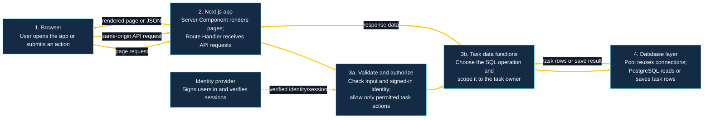
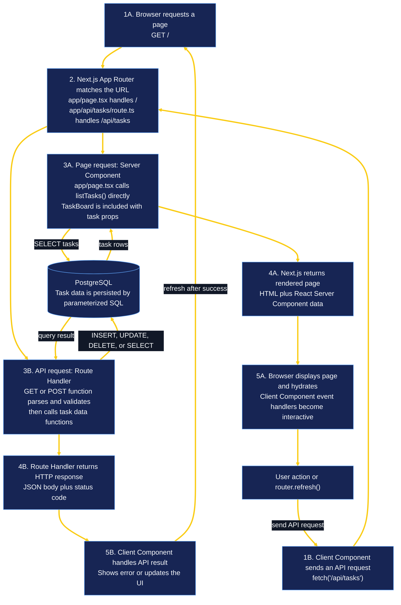
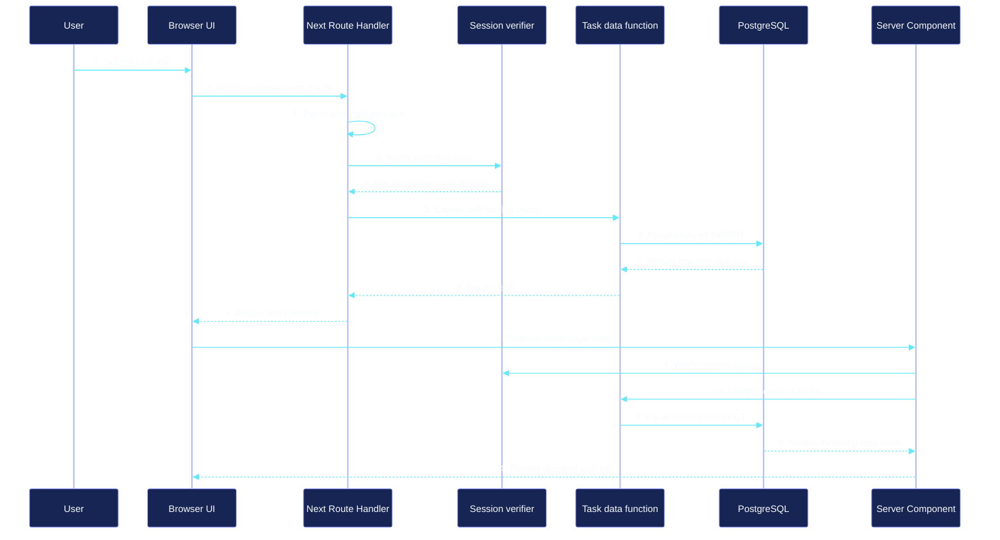
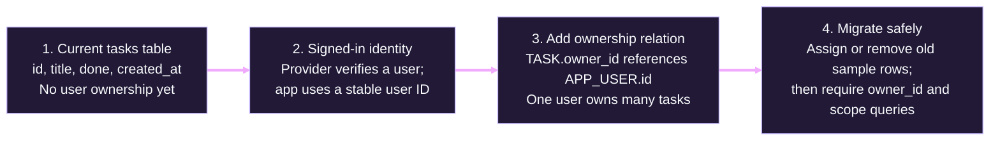
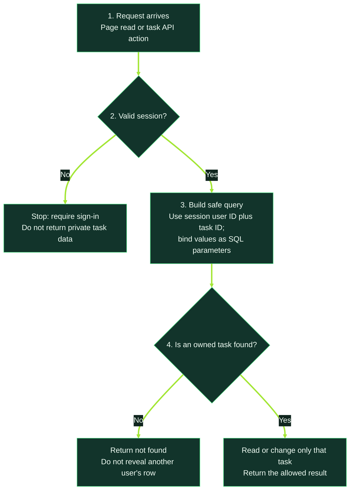
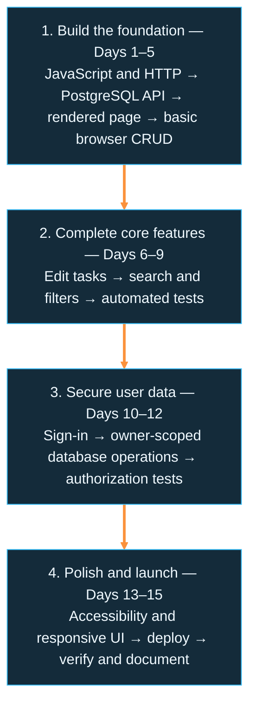

# Complete MiniTrack app roadmap

This roadmap expands the Week 1 MVP into a complete, deployed personal task
tracker. It shows the build steps, the day to cover each step, the concepts to
practice, and interview questions to review. Work through the checkboxes in
order. Check a box only after you have built or verified that step yourself.

The active `frontend/` workspace begins as the untouched `create-next-app`
scaffold. Build it in lesson order; completed future code is isolated under
`reference/frontend-complete/`. The boxes remain unchecked so you can track
your own progress.

**Important:** The repository has full-stack app lessons for Days 1–15. The
canonical Python DSA track uses `dsa-python/lessons/dsa-day-XX.md` filenames so
it does not collide with the app sequence. Days 16–25 below are an optional
infrastructure and scaling track; detailed lesson files have not been written
yet.

## What “the whole app is finished” means

An authenticated user can sign in, see only their own tasks, create, edit,
complete, search, filter, and delete them, and use the app after deployment.
The app also has automated checks for its important behavior, accessible
controls, documented environment setup, and no committed secrets.

This is a complete learning-project milestone, not a claim of enterprise
production readiness. Multi-factor authentication, team sharing, billing,
real-time collaboration, and advanced operational controls are optional future
work.

## Progress at a glance

| Day | Main milestone | Progress |
|---|---|---|
| 1 | Understand JavaScript execution and serve `GET /tasks` | [ ] Not started |
| 2 | Handle asynchronous request bodies and create tasks in memory | [ ] Not started |
| 3 | Scaffold Next.js, then persist tasks and create `GET`/`POST` routes | [ ] Not started |
| 4 | Render database tasks with a Next.js Server Component | [ ] Not started |
| 5 | Add browser interactions and finish basic task CRUD | [ ] Not started |
| 6 | Add title editing to the database/API | [ ] Not started |
| 7 | Add the edit experience to the browser | [ ] Not started |
| 8 | Add persistent search and server-side filtering | [ ] Not started |
| 9 | Add automated tests for app and database behavior | [ ] Not started |
| 10 | Add GitHub sign-in using Auth.js | [ ] Not started |
| 11 | Restrict task data and mutations to the signed-in owner | [ ] Not started |
| 12 | Test authentication, authorization, and user-data isolation | [ ] Not started |
| 13 | Polish responsive layout and accessibility | [ ] Not started |
| 14 | Deploy the app and configure production services | [ ] Not started |
| 15 | Verify, document, and launch the complete app | [ ] Not started |

Update the Progress column as you go: change `[ ] Not started` to `[x] Done`.

### Optional infrastructure and scaling track

| Day | Main milestone | Progress |
|---|---|---|
| 16 | Build a secure production Docker image | [ ] Not started |
| 17 | Run the complete local stack with Docker Compose | [ ] Not started |
| 18 | Add a continuous integration pipeline | [ ] Not started |
| 19 | Measure and optimize PostgreSQL queries and pagination | [ ] Not started |
| 20 | Plan database connection, replica, backup, and failover scaling | [ ] Not started |
| 21 | Add measured caching with explicit invalidation | [ ] Not started |
| 22 | Load test and add logs, metrics, and traces | [ ] Not started |
| 23 | Scale stateless app instances behind a load balancer | [ ] Not started |
| 24 | Run MiniTrack on local Kubernetes | [ ] Not started |
| 25 | Build a delivery pipeline and run resilience drills | [ ] Not started |

---

## Visual guide: how the app fits together

These diagrams show the **target app after Day 15**, unless marked otherwise.
Days 1–5 build the current single-user version incrementally. Authentication,
the owner relationship, and deployment are future steps in this roadmap.
Each diagram uses its own high-contrast dark palette, so arrow lines and
connectors remain visible in a Markdown preview. The page itself still follows
your editor's selected theme.

### 1. Target architecture

**Read left to right:** (1) the browser starts a page read or task action;
(2) Next.js sends it through a Server Component or Route Handler; (3a) the
server checks input and access; (3b) the task data function prepares the
operation; (4) the pool and PostgreSQL read or save the task and return the
result. The identity provider supplies a verified session to step 3a; it does
not decide whether a particular task belongs to that user.

### 2. How the Next.js App Router handles the page and API

**What each part means:**

1. The browser requests a page or makes an API request. These are different
   HTTP requests, even though both are handled by the same Next.js app.
2. The App Router matches the URL to files under `frontend/app/`. A `page.tsx`
   file renders a page; a `route.ts` file handles HTTP methods for an API path.
3. For `/`, the Server Component reads tasks directly from the server-side
   data layer. For `/api/tasks`, the Route Handler validates the HTTP request
   and calls the data layer. Either path may query PostgreSQL.
4. A page request returns rendered HTML and React Server Component data. An
   API request returns the Route Handler's JSON and HTTP status.
5. In the browser, the page becomes interactive where it includes a Client
   Component. User actions can call an API Route Handler; after a successful
   mutation, `router.refresh()` asks Next.js to render fresh server data.

The Client Component may be server-rendered as part of the initial page; it
needs the client bundle for its hooks and event handlers to work in the
browser. The `use client` directive marks a client module boundary, not a
separate server.

### 3. Create-task timing / request sequence

**Learning checkpoints:** Days 3–5 implement steps 1, 3, and 4 without a user
session. Days 10–12 add the trusted identity and owner check in step 2 and
scope step 3's database query. `router.refresh()` re-reads server data; it is
not itself an authorization or persistence mechanism.

### 4. Database: how task ownership is added

This is a **schema-change sequence**, not a runtime request. The final
relationship is one user to many tasks, with a foreign key from
`TASK.owner_id` to `APP_USER.id`. On Day 3, the tasks table has no owner. The
exact user table and key type depend on the provider chosen on Day 10. Never
enable accounts while existing unowned tasks can be exposed across users.

### 5. Every task query must respect ownership

The owner ID comes from the verified server-side session, not a request body,
URL parameter, or hidden form field. Apply this rule to list, create, search,
update, and delete operations. For creating a new task, scope the `INSERT` with
the session owner ID; for existing tasks, scope reads and mutations by both
task ID and owner ID.

### 6. Build sequence and learning layers

Follow the numbered blocks from 1 to 4, then use the day-by-day checklists
below for the exact substeps. The repository's existing Days 6–45 in the DSA
track are unrelated to this app timeline.

---

## Day 1 — JavaScript execution and the first HTTP endpoint

**Lesson:** [Day 1](../lessons/day-01.md)  
**Milestone:** Run a Node server that returns an in-memory task list from
`GET /tasks`.

### Steps and substeps

- [ ] **1. Predict JavaScript execution order**
  - Identify which statements run synchronously on the call stack.
  - Predict when a Promise microtask and a timer callback run.
  - Run the example and explain why a zero-delay timer does not run immediately.
- [ ] **2. Create the first server**
  - Create `checkpoints/day1/server.cjs`.
  - Use Node's built-in `node:http` module to create and listen on a server.
  - Match the request method and path for `GET /tasks`.
  - Send a JSON response with status `200`; return `404` for an unknown path.
- [ ] **3. Run and inspect the HTTP responses**
  - Start the server and request `/tasks` with `curl -i`.
  - Request an unknown path and verify the `404`.
  - Explain the roles of the request, response, JSON serialization, and `res.end()`.
- [ ] **4. Debug and explain the lifecycle**
  - Try the lesson's experiments: remove `res.end()`, change the path, and add a short blocking loop.
  - Restore the working code and explain why a long synchronous callback delays other JavaScript work.

### Concepts to know

Call stack; synchronous execution; event loop; Promise microtasks; timers;
Node.js request handlers; HTTP method and path; JSON serialization; status
codes; completing a response; blocking JavaScript.

### Interview questions

1. **What is the call stack?** — The stack of currently executing function
   calls; synchronous work runs to completion on it.
2. **Why does a Promise `.then()` run before `setTimeout(..., 0)` here?** —
   Promise callbacks use the microtask queue, which is drained after the
   synchronous stack and before the timer callback becomes eligible.
3. **Does a zero-millisecond timer run immediately?** — No. It schedules a
   callback for a later event-loop turn; it cannot interrupt current
   synchronous work.
4. **Why must an HTTP response be ended?** — The server needs to know the
   response is complete so the client can finish reading it.
5. **What does HTTP 404 mean?** — The requested route or resource was not found.

---

## Day 2 — Promises, request streams, and creating a task

**Lesson:** [Day 2](../lessons/day-02.md)  
**Milestone:** Accept `POST /tasks`, validate JSON, and return a created
in-memory task.

### Steps and substeps

- [ ] **1. Review asynchronous JavaScript**
  - Predict the order of logs around an `async` function and `await`.
  - Explain that `await` suspends its async function, not the whole Node process.
  - Explain how a request-handler closure can access the shared task array and ID counter.
- [ ] **2. Read and parse the HTTP request body**
  - Create `checkpoints/day2/server.cjs`.
  - Read request chunks from the stream and combine them before parsing.
  - Wrap the event-based stream in a Promise so the handler can use `await`.
  - Handle malformed JSON and an oversized body without crashing the server.
- [ ] **3. Validate input and create the task**
  - Check that the parsed body has a non-empty title within the length limit.
  - Create an ID and add the task to the in-memory array.
  - Return `201 Created` for a successful POST and an appropriate error for invalid input.
- [ ] **4. Verify success, failure, and data lifetime**
  - Test GET, valid POST, invalid JSON, and invalid title with `curl`.
  - Add the lesson's `GET /count` experiment.
  - Restart the server and confirm that in-memory tasks disappear; explain why persistence is needed.

### Concepts to know

Promises; `async`/`await`; resolve and reject paths; `try/catch`; closures;
HTTP request streams and chunks; JSON parsing; input validation; `201 Created`;
in-memory state and process lifetime.

### Interview questions

1. **Does `await` block Node.js?** — It pauses the current async function
   until the Promise settles; Node can continue processing other work.
2. **What happens when an awaited Promise rejects?** — The `await` expression
   throws, so the error can be handled with `try/catch` or propagated.
3. **What is a closure?** — A function together with access to the lexical
   variables from the scope where it was created.
4. **Why read a request body as a stream?** — HTTP body data may arrive in
   multiple chunks over time; the handler must wait for the complete body
   before parsing it.
5. **Why does this server lose tasks on restart?** — The array exists only
   in process memory; it is not durable storage.

---

## Day 3 — Create Next.js, add PostgreSQL, and build the collection API

**Lesson:** [Day 3](../lessons/day-03.md)  
**Milestone:** Understand the generated Next.js and Tailwind setup, then store
tasks in PostgreSQL and expose `GET /api/tasks` and `POST /api/tasks`.

### Steps and substeps

- [ ] **1. Create and inspect the Next.js application**
  - Run the documented `create-next-app` command, or confirm the provided active `frontend/` is its untouched output.
  - Start the development server and verify the default page before adding MiniTrack code.
  - Identify the jobs of `app/page.tsx`, `app/layout.tsx`, `package.json`, and `tsconfig.json`.
  - Explain how `@import "tailwindcss"` and `postcss.config.mjs` generate utilities.
  - Replace only the starter page with the first Tailwind-styled MiniTrack card.
- [ ] **2. Create the database schema**
  - Create or start a local PostgreSQL instance and create the `minitrack` database.
  - Run `backend/sql/schema.sql`.
  - Inspect the `tasks` table and explain its identity ID, constraints, default values, and timestamp.
- [ ] **3. Configure the PostgreSQL driver**
  - Install `pg` and its TypeScript definitions in the generated frontend.
  - Create `frontend/.env.local.example`, copy it to `.env.local`, and set `DATABASE_URL`.
  - Keep credentials local; do not commit `.env.local`.
- [ ] **4. Add the typed database and task layers**
  - Create `frontend/lib/db.ts` with a server-only PostgreSQL connection pool.
  - Create `frontend/app/types.ts`; keep PostgreSQL `BIGINT` IDs as strings.
  - Create `frontend/lib/tasks.ts` with `listTasks` and `createTask`.
  - Use parameterized SQL and convert database timestamps to ISO strings for the app.
- [ ] **5. Validate requests and add collection routes**
  - Create `frontend/lib/validation.ts` with `unknown` inputs and type guards.
  - Create `frontend/app/api/tasks/route.ts` with `GET` and `POST`.
  - Create `frontend/app/api/health/route.ts` for the health check.
  - Return validation errors to the caller; log database errors on the server and return a generic `500`.
- [ ] **6. Verify the API and persistence**
  - Start Next.js and call the health, list, and create endpoints.
  - Verify invalid JSON and invalid titles return a client error.
  - Restart Next.js and confirm PostgreSQL still contains the task.

### Concepts to know

`create-next-app`; App Router file conventions; npm scripts; Tailwind utilities;
PostCSS; responsive prefixes; relational tables;
primary keys; identity columns; constraints and defaults;
SQL `SELECT`/`INSERT`; parameterized queries; SQL injection prevention;
connection pooling; server-only modules; TypeScript types and `unknown`;
JSON and HTTP status codes; persistence.

### Interview questions

1. **Why use `$1` in SQL instead of inserting a string into the query?** —
   Bound parameters keep data separate from SQL syntax and prevent SQL injection.
2. **Why use a connection pool?** — It reuses a bounded set of database
   connections rather than opening a new connection for every query.
3. **Why represent a PostgreSQL `BIGINT` ID as a string in JavaScript?** —
   Some 64-bit integers exceed JavaScript's safe integer range.
4. **Why accept request data as `unknown`?** — Parsed JSON is untrusted;
   TypeScript requires narrowing it before treating it as a particular shape.
5. **What is the difference between HTTP 400 and 500?** — A 400 indicates an
   invalid client request; a 500 indicates an unexpected server-side failure.

---

## Day 4 — Render PostgreSQL data with Next.js

**Lesson:** [Day 4](../lessons/day-04.md)  
**Milestone:** Open the app and see the task list loaded on the server from
PostgreSQL.

### Steps and substeps

- [ ] **1. Review the shared task type**
  - Reuse `frontend/app/types.ts` from Day 3; do not define a competing task shape.
  - Explain why the database-facing row timestamp is converted to the app's string representation.
- [ ] **2. Create the app layout and page**
  - Create or update `frontend/app/layout.tsx`.
  - Keep the page shell static and move the asynchronous task read into a Server Component.
  - Wrap that component in `<Suspense>` and call `io()` before request-time database work.
  - Call `listTasks()` directly on the server instead of making an HTTP request to the app's own API.
  - Render loading errors clearly and show each task with a stable React key.
  - Use Tailwind spacing, width, color, border, and state utilities; explain their CSS meaning.
- [ ] **3. Run and verify the read path**
  - Start the app and open `http://localhost:3000`.
  - Add a task through `POST /api/tasks`, reload, and confirm it appears.
  - Trace the request: browser → Next.js page → PostgreSQL → rendered response.

### Concepts to know

Next.js App Router; Server Components; server-side data access; async rendering;
Cache Components; `io()`; Suspense boundaries; static shells; request-time
server-only database code; React rendering; stable list keys; error handling;
avoiding an unnecessary internal HTTP hop; Tailwind layout and state utilities.

### Interview questions

1. **What is a Server Component?** — A component rendered on the server; it
   can access server-side resources and does not ship its component logic as
   browser JavaScript.
2. **Why read PostgreSQL directly from the Server Component?** — The page
   already runs on the server, so it can call the data layer without making an
   extra HTTP request back to its own app.
3. **When should a component be a Client Component?** — When it needs browser
   interactivity such as state, event handlers, or browser-only APIs.
4. **Why does a mapped list need a stable `key`?** — React uses keys to
   associate rendered items with their identity across updates.

---

## Day 5 — Complete the browser-based task tracker

**Lesson:** [Day 5](../lessons/day-05.md)  
**Milestone:** Create, complete, filter, and delete tasks from the browser.

### Steps and substeps

- [ ] **1. Add the remaining database operations**
  - Extend `frontend/lib/tasks.ts` with `setDone` and `deleteTask`.
  - Extend `frontend/lib/validation.ts` to validate task IDs.
  - Keep all SQL parameterized and return a clear not-found result when an ID does not exist.
- [ ] **2. Add the per-task Route Handler**
  - Create `frontend/app/api/tasks/[id]/route.ts`.
  - Implement `PATCH` to update the completion state and `DELETE` to remove a task.
  - Await Next.js dynamic route params and validate the ID and request body.
  - Verify successful, invalid-input, and not-found responses.
- [ ] **3. Build the interactive Client Component**
  - Create `frontend/app/TaskBoard.tsx` with `'use client'`.
  - Add a controlled title input and submit handler for creating tasks.
  - Add checkbox and delete handlers that call the same-origin API.
  - Derive the visible tasks from the selected filter instead of storing duplicate list state.
  - Show busy and error states while requests are in progress or fail.
  - Use responsive Tailwind prefixes and conditional utilities for task states.
- [ ] **4. Connect server and client rendering**
  - Update `frontend/app/page.tsx` to load tasks on the server and pass them to `TaskBoard`.
  - Call `router.refresh()` after a successful mutation so the server-rendered task data is re-read.
  - Explain that the database remains the source of truth; client state controls the input and filter.
- [ ] **5. Test the complete user journey**
  - Create a task; verify it appears.
  - Mark it complete; verify the status and filter results.
  - Delete it; verify it disappears.
  - Reload or restart Next.js; verify persisted tasks remain.
  - From `frontend/`, run `npm test`, `npx tsc --noEmit`, and `npm run build`.

### Concepts to know

Client Components; controlled inputs; React state; event handlers;
derived state; `fetch`; `PATCH` versus `DELETE`; dynamic route params;
validation and not-found responses; server/client component boundaries;
`router.refresh()`; source of truth; loading and error states; responsive
Tailwind utilities; conditional classes; testing.

### Interview questions

1. **What makes an input controlled in React?** — Its displayed value comes
   from React state, and an event handler updates that state when the user types.
2. **Why derive filtered tasks instead of keeping a second task list in state?** —
   Derived values avoid duplicated state that can become inconsistent.
3. **What is the difference between `PATCH` and `DELETE` here?** — `PATCH`
   partially updates a task; `DELETE` removes the task resource.
4. **What does `router.refresh()` do?** — It requests a fresh server-rendered
   result for the current route so server data can be loaded again.
5. **Why is PostgreSQL the source of truth instead of the browser?** — The
   database persists across requests and restarts and is shared by server
   requests; browser state is temporary and user-specific.
6. **Does disabling a button guarantee a mutation happens only once?** — No.
   It improves the UI experience, but reliable duplicate prevention requires
   server-side behavior such as idempotency controls where appropriate.

---

## Day 6 — Add task-title editing to the data layer and API

**Lesson:** [Day 6 — Edit task titles](../lessons/day-06.md)

**Milestone:** A task title can be updated through a validated API request.

### Steps and substeps

- [ ] **1. Define the update contract**
  - Accept exactly one supported field per `PATCH`: `title` or `done`.
  - Reject missing fields, both fields together, and invalid values.
  - Keep the existing completion checkbox behavior working.
- [ ] **2. Update the database function**
  - Extend `frontend/lib/tasks.ts` with a typed task-update operation.
  - Use bound SQL parameters and `RETURNING` to get the updated row.
  - Distinguish a missing task from a database error.
- [ ] **3. Update the item Route Handler**
  - Extend `PATCH` in `frontend/app/api/tasks/[id]/route.ts` to accept title updates.
  - Keep ID and body validation at the HTTP boundary.
  - Return `400` for invalid input, `404` for a missing task, and a generic `500` for unexpected failures.
- [ ] **4. Verify behavior**
  - Use `curl` to update a title, update completion, and send invalid payloads.
  - Confirm the task is persisted after restarting Next.js.

### Concepts to know

HTTP `PATCH`; partial updates; request contracts; validation at API boundaries;
parameterized `UPDATE`; `RETURNING`; nullable/not-found outcomes; separation
between route, validation, and database layers.

### Interview questions

1. **Why use `PATCH` for this update?** — It changes selected fields without
   replacing the entire resource.
2. **How should an API distinguish invalid input from a missing resource?** —
   Use `400` for an invalid request and `404` when a valid ID has no matching row.
3. **Why use `UPDATE ... RETURNING`?** — PostgreSQL can return the changed row
   in the same statement, avoiding a separate read.

---

## Day 7 — Add the edit experience to the browser

**Lesson:** [Day 7 — Build the browser editing UI](../lessons/day-07.md)

**Milestone:** A user can edit a task title and see success or failure clearly.

### Steps and substeps

- [ ] **1. Design the edit interaction**
  - Choose a small inline form or an edit/cancel mode for one task.
  - Keep the current title visible and make cancel restore the non-editing view.
- [ ] **2. Implement the Client Component behavior**
  - Track the edited task ID and draft title in React state.
  - Submit the title to the `PATCH` endpoint.
  - Handle empty input, pending requests, API errors, and successful completion.
- [ ] **3. Refresh the server-rendered list**
  - Refresh after a successful update so PostgreSQL-backed props are reloaded.
  - Avoid mutating the incoming `tasks` prop.
- [ ] **4. Verify keyboard and failure behavior**
  - Test save, cancel, empty title, server error, and editing a different task.
  - Confirm the form has a label and sensible keyboard behavior.

### Concepts to know

Controlled forms; local versus server state; immutable props; component state
transitions; async UI; optimistic updates versus refresh; accessible form labels.

### Interview questions

1. **Why should a component not mutate props?** — Props are inputs owned by
   the parent; mutating them bypasses React's predictable data flow.
2. **When would you use an optimistic update?** — When immediate feedback is
   worth the extra rollback and stale-response complexity.
3. **How can you model edit/cancel/save UI clearly?** — Use explicit state for
   the active task and draft, and define the transitions for each action.

---

## Day 8 — Add search and persistent server-side filters

**Lesson:** [Day 8 — Add URL search and server-side filters](../lessons/day-08.md)

**Milestone:** Search and status filters are shareable through the URL and
applied by PostgreSQL.

### Steps and substeps

- [ ] **1. Specify query behavior**
  - Support a search term and a status filter such as `all`, `open`, or `done`.
  - Decide and document case-sensitivity and whitespace behavior.
  - Keep a no-query request equivalent to the current list endpoint.
- [ ] **2. Implement validated database filtering**
  - Add a typed query function that uses SQL parameters for search and status.
  - Do not concatenate user input into SQL.
  - Add an index only if a measured query pattern justifies it; document search limitations.
- [ ] **3. Connect the URL and UI**
  - Represent search and filter values in URL search parameters.
  - Submit or debounce search deliberately; avoid stale responses overwriting newer results.
  - Preserve the selected filter when the user reloads or shares the URL.
- [ ] **4. Verify edge cases**
  - Test empty search, whitespace, no matches, each status, and URL reload.
  - Check behavior with SQL wildcard characters and non-ASCII text.

### Concepts to know

URL search parameters; server-side filtering; SQL `WHERE`; safe parameter
binding; wildcard matching; debouncing; request races; database indexes and
measured optimization.

### Interview questions

1. **Why put filters in the URL?** — The state can be bookmarked, shared, and
   restored by reloading.
2. **How do parameterized queries help with search?** — They separate values
   from SQL structure even when the value contains special characters.
3. **What can go wrong with debounced requests?** — Responses may return out
   of order; stale results should not replace newer query results.

---

## Day 9 — Add automated tests for the app

**Lesson:** [Day 9 — Add unit, integration, and browser tests](../lessons/day-09.md)

**Milestone:** Important route, UI, and database behavior has repeatable tests.

### Steps and substeps

- [ ] **1. Review the current tests**
  - Run the existing frontend tests and identify the validation behavior already covered.
  - Separate pure unit tests from tests that require PostgreSQL or a browser.
- [ ] **2. Test request and data behavior**
  - Test pure title and filter normalization with the Node test runner.
  - Add a PostgreSQL integration test that proves a task update persists.
  - Use an isolated test database with a safety guard; never point tests at personal data.
- [ ] **3. Test the user journey**
  - Add browser-level checks for create, complete, edit, search/filter, and delete.
  - Include empty states, error states, and a reload where useful.
- [ ] **4. Run checks together**
  - Run `npm test`, `npx tsc --noEmit`, and `npm run build` from `frontend/`.
  - Fix regressions introduced by this app's changes, not unrelated old failures.

### Concepts to know

Unit, integration, and end-to-end testing; test isolation; fixtures; mocking
versus real dependencies; deterministic tests; regression testing; type checking.

### Interview questions

1. **What belongs in a unit test versus an integration test?** — Unit tests
   isolate a small unit; integration tests verify connected components such as
   a route and database.
2. **Why use a separate test database?** — Tests must not corrupt development
   or real user data and should be repeatable.
3. **What makes an end-to-end test valuable?** — It verifies a user-visible
   workflow across multiple layers rather than one isolated function.

---

## Day 10 — Add GitHub sign-in with Auth.js

**Lesson:** [Day 10 — Add GitHub sign-in with Auth.js](../lessons/day-10.md)

**Milestone:** Users can sign in and sign out using a maintained provider.

### Steps and substeps

- [ ] **1. Document the authentication approach**
  - Use Auth.js with GitHub OAuth instead of implementing credentials.
  - Record `AUTH_SECRET`, `AUTH_GITHUB_ID`, and `AUTH_GITHUB_SECRET`.
  - Keep provider secrets out of source control and browser bundles.
- [ ] **2. Add Auth.js using its supported Next.js integration**
  - Recheck the current official Auth.js setup guide before installing `next-auth@beta`.
  - Create root `auth.ts` and the `app/api/auth/[...nextauth]/route.ts` handler.
  - Add sign-in and sign-out controls and a clear unauthenticated state.
  - Verify session state is available only through the supported server/client interfaces.
- [ ] **3. Protect app entry points**
  - Require a valid session before rendering private task data.
  - Redirect or show a sign-in screen for anonymous visitors.
  - Do not treat hiding a button or UI as authorization.
- [ ] **4. Verify session behavior**
  - Test sign-in, sign-out, expired/missing session, and direct navigation to task routes.
  - Do not log tokens, cookies, or provider secrets.

### Concepts to know

Authentication versus authorization; identity provider; session lifecycle;
server-side session checks; cookies; secret management; redirect flows; trust
boundaries.

### Interview questions

1. **What is the difference between authentication and authorization?** —
   Authentication establishes who the user is; authorization decides what that
   user may access.
2. **Why prefer Auth.js and GitHub OAuth for this learning app?** —
   Session and identity security are complex, and a supported provider reduces
   custom security-sensitive code.
3. **Why is hiding a page link not access control?** — A user can call an API
   directly; authorization must be enforced on the server for every protected
   operation.

---

## Day 11 — Associate tasks with owners and enforce authorization

**Lesson:** [Day 11 — Add task ownership and authorization](../lessons/day-11.md)
**Milestone:** Every task belongs to one signed-in user and users cannot access
one another's tasks.

### Steps and substeps

- [ ] **1. Plan the schema change**
  - Add a stable owner identifier to the task model and a foreign-key relationship to the provider's user identity.
  - Decide how to handle existing sample tasks before enforcing a non-null owner.
  - Write a forward migration and document how to apply and roll back it safely.
- [ ] **2. Scope every database operation**
  - Pass the authenticated user ID from the server-side session into task data functions.
  - Scope list, create, update, delete, search, and filter queries by owner.
  - Include owner ID in mutation predicates so a guessed task ID cannot cross user boundaries.
- [ ] **3. Enforce access on the server**
  - Check the session in every protected Route Handler and server-rendered page/data path.
  - Derive owner identity from the verified session, never from a client-supplied owner ID.
  - Return a consistent unauthorized or not-found response without leaking another user's task data.
- [ ] **4. Verify ownership**
  - Create two test users and tasks for both.
  - Confirm each user sees and mutates only their own tasks.
  - Confirm an unauthenticated request cannot read or change private data.

### Concepts to know

Foreign keys; schema migrations; tenant/user data isolation; least privilege;
server-side authorization; IDOR prevention; ownership-scoped SQL; safe migration
planning.

### Interview questions

1. **Where should the user ID come from for an authorized write?** — From a
   verified server-side session, not a request-body field.
2. **Why include owner ID in the SQL predicate?** — The database operation
   itself is constrained to the authorized row, reducing cross-user access bugs.
3. **What is an IDOR vulnerability?** — A user changes an object identifier
   and gains access to an object they are not authorized to use.
4. **How do you migrate existing rows when adding ownership?** — Define an
   explicit backfill or cleanup path before enforcing the required owner
   constraint.

---

## Day 12 — Test authentication and user-data isolation

**Lesson:** [Day 12 — Test authentication and user isolation](../lessons/day-12.md)
**Milestone:** Automated tests prove protected routes and owner scoping work.

### Steps and substeps

- [ ] **1. Test anonymous and authenticated access**
  - Test every protected read and mutation with no session.
  - Test allowed actions with a valid session.
  - Test malformed, expired, or insufficient session state through supported test seams.
- [ ] **2. Test cross-user isolation**
  - Create two users and verify list, search, update, and delete operations are scoped.
  - Attempt to access another user's task ID and verify no data or mutation leaks.
- [ ] **3. Test migration and failure paths**
  - Run schema migrations against a clean test database and an existing fixture.
  - Verify rollback/recovery instructions and database failure behavior.
- [ ] **4. Keep secrets out of tests and logs**
  - Use test credentials and environment variables, not real provider secrets.
  - Ensure assertions and diagnostics do not print session tokens or cookies.

### Concepts to know

Authorization test matrices; negative tests; test fixtures; migration testing;
mocking identity safely; privacy-preserving logs; defense in depth.

### Interview questions

1. **Why test forbidden access, not only successful access?** — Security
   properties are about preventing unauthorized outcomes, which happy-path tests
   cannot establish.
2. **How do you test tenant isolation?** — Use distinct users and verify each
   user's reads and mutations cannot affect the other's records.
3. **What should not appear in logs?** — Passwords, session tokens, cookies,
   provider secrets, and unnecessary sensitive personal data.

---

## Day 13 — Improve responsive design and accessibility

**Lesson:** [Day 13 — Improve accessibility and responsive design](../lessons/day-13.md)
**Milestone:** The app remains understandable and usable on keyboard, screen
reader, and narrow-screen layouts.

### Steps and substeps

- [ ] **1. Establish a simple visual system**
  - Group task list, search/filter, edit, and account controls into clear regions.
  - Use consistent spacing, readable text, and visible focus indicators.
  - Keep the design focused; do not add a component library unless it solves a real need.
- [ ] **2. Make controls accessible**
  - Give inputs and buttons accessible names and associate form labels correctly.
  - Preserve keyboard operation and logical focus order.
  - Announce request errors and important status changes with appropriate semantics.
  - Do not rely on color alone to communicate completion or errors.
- [ ] **3. Check responsive behavior**
  - Test narrow mobile and desktop widths.
  - Avoid horizontal overflow and ensure task actions remain usable.
- [ ] **4. Verify**
  - Navigate the full task flow with keyboard only.
  - Inspect with browser accessibility tools and fix concrete findings.

### Concepts to know

Semantic HTML; accessible names; keyboard interaction; focus management;
responsive layout; status announcements; contrast; progressive enhancement.

### Interview questions

1. **Why prefer semantic HTML over clickable generic elements?** — Native
   controls provide expected keyboard and assistive-technology behavior.
2. **How should async form errors be exposed?** — Provide visible text and
   appropriate live/status semantics so the change is perceivable.
3. **What does responsive design require beyond shrinking the page?** —
   Controls and content need to remain usable and understandable at different
   viewport sizes.

---

## Day 14 — Deploy the app and configure production services

**Lesson:** [Day 14 — Deploy with production services](../lessons/day-14.md)
**Milestone:** A production build is deployed with a managed PostgreSQL
database and authentication callback configuration.

### Steps and substeps

- [ ] **1. Choose and document hosting**
  - Choose a deployment host compatible with the Next.js app and a managed PostgreSQL service.
  - Record the app URL, database service, supported Node version, and required environment variables.
  - Check current provider documentation for supported deployment and auth callback setup.
- [ ] **2. Prepare production configuration**
  - Create a production database and apply schema migrations deliberately.
  - Configure production `DATABASE_URL`, auth secrets, and callback/redirect URLs in the host's secret manager.
  - Keep production credentials separate from local and test credentials.
- [ ] **3. Build and deploy**
  - Run tests, type checking, and a production build before deployment.
  - Deploy the app and confirm the provider's build output is successful.
  - Ensure production builds do not depend on a developer's local `.env.local`.
- [ ] **4. Verify production**
  - Open the deployed app and test sign-in, owner-scoped reads, create, edit, complete, search/filter, and delete.
  - Verify redirects, cookies, and API routes use the production domain and HTTPS.
  - Confirm no secret values are exposed in browser responses or source maps.

### Concepts to know

Build versus runtime configuration; deployment environments; managed databases;
database migrations; secret managers; HTTPS; callback URLs; production smoke tests;
environment parity.

### Interview questions

1. **Why separate development, test, and production credentials?** — It
   limits the impact of mistakes and prevents tests or local work from touching
   production resources.
2. **What belongs in an environment variable or secret manager?** — Values
   that differ by environment or must remain confidential, such as database
   URLs and authentication secrets.
3. **What is a smoke test after deployment?** — A small set of checks that
   confirms the deployed service's critical paths work.

---

## Day 15 — Final verification, documentation, and launch

**Lesson:** [Day 15 — Verify, document, and launch](../lessons/day-15.md)
**Milestone:** The deployed app is usable, its critical flows are verified,
and another developer can run it from the documentation.

### Steps and substeps

- [ ] **1. Run the release checklist**
  - Run unit, integration, and browser tests.
  - Run TypeScript checking and a production build.
  - Review the final diff and confirm local secrets, generated files, and personal data are not included.
- [ ] **2. Walk through the deployed user journey**
  - Sign in as a user and create, edit, complete, search, filter, and delete tasks.
  - Sign in as a second user and confirm there is no cross-account visibility.
  - Sign out and confirm protected data is no longer available.
  - Reload and verify persisted state and shareable filters behave as designed.
- [ ] **3. Review operational behavior**
  - Confirm unexpected server errors are logged without leaking secrets or task contents.
  - Verify the app has a health check and the database backup/restore expectations are documented.
  - Record known limitations and the recovery steps for a failed deployment or migration.
- [ ] **4. Finish the project documentation**
  - Document local setup, database creation/migrations, environment variable names, test commands, and deployment.
  - Document the API routes and authentication/ownership model.
  - Update the architecture and app overview to match the shipped implementation.
- [ ] **5. Capture what you learned**
  - Explain the complete request path from browser to Route Handler to PostgreSQL and back.
  - Answer the interview questions without reading, then note weak areas in `docs/MY_NOTES.md`.

### Concepts to know

Release verification; health checks; backups and recovery; deployment rollback;
documentation as an interface; privacy-aware logging; end-to-end system tracing.

### Interview questions

1. **How would you debug a failure that happens only in production?** —
   Compare safe configuration and runtime behavior, inspect privacy-safe logs,
   reproduce with production-like data shape, and narrow the failing layer.
2. **What is your recovery plan for a bad schema migration?** — Use a reviewed
   migration and documented backup/rollback strategy; avoid improvising destructive
   production SQL.
3. **How would you explain this app end to end?** — Trace identity, request
   validation, authorization, parameterized SQL, persistence, response, and UI
   refresh.

---

## Optional Day 16 — Build a production Docker image

**Milestone:** The tested Next.js application runs in a small, non-root,
reproducible container image.

### Steps and substeps

- [ ] **1. Define the container boundary**
  - Enable Next.js standalone output and identify build-time versus runtime files.
  - Add `.dockerignore` entries for dependencies, build output, local environment files, logs, and test artifacts.
- [ ] **2. Write a multi-stage Dockerfile**
  - Separate dependency installation, build, and runtime stages.
  - Copy only production runtime output into the final image.
  - Run as a non-root user and expose the application port.
- [ ] **3. Keep configuration external**
  - Inject `DATABASE_URL`, Auth.js variables, and service URLs at runtime.
  - Never copy `.env.local` or secrets into an image layer.
- [ ] **4. Verify the image**
  - Build with a deterministic tag and run it against a non-production database.
  - Check image size, startup, health, graceful shutdown, and container logs.
  - Scan the image and explain any accepted finding.

### Concepts to know

Images versus containers; build layers; multi-stage builds; immutable artifacts;
non-root execution; runtime configuration; signals; supply-chain scanning.

### Interview questions

1. **Why use a multi-stage build?** — Build tools stay out of the runtime
   image, reducing size and attack surface.
2. **Why must secrets stay out of image layers?** — Deleted or overwritten
   files can remain recoverable from prior immutable layers.
3. **What does graceful shutdown require?** — The process must receive the
   termination signal, stop accepting work, finish bounded in-flight requests,
   and close database connections.

---

## Optional Day 17 — Run the local stack with Docker Compose

**Milestone:** One command starts Next.js, PostgreSQL, migrations, and durable
local data with explicit health dependencies.

### Steps and substeps

- [ ] **1. Define services and networking**
  - Add app and PostgreSQL services on a private Compose network.
  - Use the database service name, not `localhost`, in the container connection URL.
- [ ] **2. Persist database data**
  - Mount a named volume for PostgreSQL.
  - Document how to reset only the learning database deliberately.
- [ ] **3. Add health checks and migrations**
  - Check PostgreSQL readiness before migrations.
  - Run migrations as a one-shot service, not from every app replica.
  - Start the app only after the required schema is ready.
- [ ] **4. Use environment-specific configuration**
  - Keep a committed example file containing names and safe placeholders.
  - Keep real values in ignored files or a supported secrets mechanism.
- [ ] **5. Verify lifecycle behavior**
  - Start, stop, rebuild, and restart the stack.
  - Confirm task data survives ordinary container recreation.

### Concepts to know

Compose services; DNS-based discovery; volumes; health checks; startup order
versus readiness; one-shot jobs; development parity.

### Interview questions

1. **Why does `localhost` fail between containers?** — It points to the
   current container, not another service.
2. **Why use a named volume?** — Container filesystems are disposable; the
   volume gives PostgreSQL an explicit durable lifecycle.
3. **Why not run migrations in every app container?** — Concurrent migration
   attempts can race and make rollout behavior unpredictable.

---

## Optional Day 18 — Add continuous integration

**Milestone:** Every proposed change runs repeatable quality and security gates
before it can be merged.

### Steps and substeps

- [ ] **1. Create a CI workflow**
  - Trigger on pull requests and protected-branch pushes.
  - Use the repository's pinned Node version and `npm ci`.
- [ ] **2. Split useful jobs**
  - Run lint, unit tests, type checking, and production build.
  - Start an isolated PostgreSQL service for migration and integration tests.
  - Run browser tests only after the application and database are ready.
- [ ] **3. Cache safely**
  - Cache package-manager downloads, not `node_modules` or secret-bearing output.
  - Key caches from the lockfile and runtime version.
- [ ] **4. Handle artifacts and secrets**
  - Upload failure traces only when useful and control their retention.
  - Use test-only credentials; never expose production OAuth or database secrets.
- [ ] **5. Enforce the gate**
  - Require successful jobs before merge.
  - Cancel superseded runs and keep failures actionable.

### Concepts to know

Continuous integration; reproducible installation; service containers; job
dependencies; artifacts; cache keys; branch protection; least-privilege tokens.

### Interview questions

1. **What belongs in CI?** — Fast, deterministic checks that provide useful
   evidence before merge, with slower suites separated deliberately.
2. **Why use `npm ci`?** — It installs exactly from the lockfile and fails when
   the manifest and lockfile disagree.
3. **What is the difference between a cache and an artifact?** — A cache speeds
   later work and may disappear; an artifact is retained output from a run.

---

## Optional Day 19 — Measure PostgreSQL query performance

**Milestone:** Search, owner-scoped listing, and pagination have measured query
plans and indexes justified by representative data.

### Steps and substeps

- [ ] **1. Create a representative dataset**
  - Generate enough users and tasks to reveal scan and sort behavior.
  - Keep generated load-test data out of personal and production databases.
- [ ] **2. Inspect real plans**
  - Run `EXPLAIN (ANALYZE, BUFFERS)` for owner list, status filter, title search, and task mutation queries.
  - Record rows estimated versus rows observed, scan type, sort, and buffer activity.
- [ ] **3. Add only justified indexes**
  - Compare composite indexes such as `(owner_id, done, id)`.
  - Evaluate `pg_trgm` for leading-wildcard `ILIKE` search.
  - Measure write and storage cost after each index.
- [ ] **4. Add cursor pagination**
  - Replace unbounded result sets with a stable order and bounded page size.
  - Use an `(owner_id, id)` cursor predicate rather than large offsets.
- [ ] **5. Re-measure**
  - Store before/after plans and latency with the same data and query shape.

### Concepts to know

Query plans; sequential and index scans; composite and covering indexes;
cardinality estimates; buffer reads; cursor versus offset pagination; trigrams.

### Interview questions

1. **Why not add indexes to every column?** — Indexes consume storage and make
   writes, vacuuming, and maintenance more expensive.
2. **Why can `%term%` bypass a B-tree?** — A leading wildcard removes the
   ordered prefix a normal B-tree search depends on.
3. **Why prefer cursor pagination at scale?** — It avoids scanning and
   discarding an ever-growing offset and behaves more predictably under inserts.

---

## Optional Day 20 — Scale PostgreSQL connections and availability

**Milestone:** Database capacity, connection budgets, backups, replicas, and
failure expectations are documented and tested without premature sharding.

### Steps and substeps

- [ ] **1. Calculate the connection budget**
  - Multiply app replicas by per-process pool maximum and include migrations,
    administration, and monitoring connections.
  - Keep the total below the provider limit with safety margin.
- [ ] **2. Add timeouts and backpressure**
  - Configure connection acquisition, statement, and idle transaction timeouts.
  - Return explicit overload errors rather than allowing unbounded queues.
- [ ] **3. Evaluate connection proxies**
  - Use a managed pooler or PgBouncer when many ephemeral instances would
    otherwise exhaust PostgreSQL connections.
  - Verify session features are compatible with the selected pooling mode.
- [ ] **4. Understand read replicas**
  - Route only safe read workloads to replicas.
  - Document replication lag and read-after-write consistency requirements.
- [ ] **5. Prove recovery**
  - Configure backups or provider restore points.
  - Perform a restore drill and record recovery point and recovery time.
  - Understand automatic failover before claiming high availability.

### Concepts to know

Connection budgets; backpressure; PgBouncer; read replicas; replication lag;
primary failover; backups; point-in-time recovery; RPO and RTO.

### Interview questions

1. **Why can adding app replicas overload PostgreSQL?** — Each process can open
   its own pool, multiplying total connections and concurrent queries.
2. **When is a read replica unsafe?** — When a request requires immediate
   read-after-write consistency and the replica may lag.
3. **Why is a backup not proven until restored?** — Configuration or retained
   data may be incomplete; a restore drill verifies the recovery path.

> Sharding is intentionally deferred. First exhaust query design, indexes,
> pagination, pooling, vertical capacity, replicas, and data-lifecycle options.

---

## Optional Day 21 — Add caching with explicit invalidation

**Milestone:** One measured read path uses a correctly scoped cache, mutations
invalidate it, and the app remains correct when the cache is unavailable.

### Steps and substeps

- [ ] **1. Choose a cacheable problem**
  - Measure before adding a cache.
  - Prefer shared, expensive, read-heavy data; task lists may be a teaching
    example but are highly user-specific and mutation-heavy.
- [ ] **2. Define keys and lifetime**
  - Include owner identity, filters, pagination cursor, and schema/version
    information in private-data keys.
  - Set a bounded TTL and document acceptable staleness.
- [ ] **3. Implement cache-aside behavior**
  - Read cache, fall back to PostgreSQL, then populate on success.
  - Invalidate or update affected keys after create, edit, complete, and delete.
- [ ] **4. Prevent correctness and security bugs**
  - Never share one user's cached response with another user.
  - Avoid caching error responses or partial authorization results.
  - Mitigate stampedes with bounded request coalescing where justified.
- [ ] **5. Test failure modes**
  - Stop Redis or the selected cache and verify PostgreSQL remains the source of truth.
  - Compare hit rate, p95 latency, database queries, and operational cost.

### Concepts to know

Cache-aside; TTL; invalidation; key design; cache stampede; stale data;
distributed caches; private-data isolation; hit rate.

### Interview questions

1. **What are the two hard problems in caching?** — Invalidation and knowing
   what data belongs in which key/identity boundary.
2. **Why is owner identity part of the key?** — Without it, cached private data
   can leak across users.
3. **Should cache failure take down the app?** — Usually no for cache-aside
   reads; degrade to the database with bounded load and visible monitoring.

---

## Optional Day 22 — Load test and add observability

**Milestone:** MiniTrack has a measured baseline, performance budget, and enough
telemetry to identify whether latency comes from the app, database, or cache.

### Steps and substeps

- [ ] **1. Define a workload**
  - Model list/search-heavy traffic plus bounded writes and authenticated users.
  - Run only against an isolated performance environment.
- [ ] **2. Choose service-level indicators**
  - Track request rate, error rate, and p50/p95/p99 latency.
  - Track event-loop delay, CPU, memory, pool wait time, query duration, cache
    hit rate, and database saturation.
- [ ] **3. Add structured telemetry**
  - Emit privacy-safe structured logs with request IDs.
  - Add metrics and optional distributed traces across HTTP, cache, and SQL.
  - Never attach secrets, cookies, raw task text, or unbounded user IDs.
- [ ] **4. Increase load gradually**
  - Establish a baseline, ramp load, hold it, and observe saturation.
  - Stop when the agreed environment limit or error budget is reached.
- [ ] **5. Change one variable**
  - Compare before and after one index, pool, cache, or replica change.

### Concepts to know

Load versus stress testing; throughput; percentiles; saturation; SLI/SLO;
structured logs; metrics; traces; correlation IDs; coordinated omission.

### Interview questions

1. **Why report p95 instead of only average latency?** — Averages hide the
   slower experience affecting a meaningful fraction of users.
2. **What should a load test model?** — Realistic operation mix, data shape,
   authentication, pacing, and environment limits.
3. **How do logs, metrics, and traces differ?** — Logs describe events, metrics
   summarize trends, and traces connect work across components.

---

## Optional Day 23 — Scale app instances behind a load balancer

**Milestone:** Multiple stateless Next.js instances serve traffic through a
load balancer without losing sessions or multiplying database load blindly.

### Steps and substeps

- [ ] **1. Remove process-local assumptions**
  - Keep sessions in Auth.js/PostgreSQL and shared cache data in Redis.
  - Do not rely on in-memory task state, local files, or one instance receiving
    every request.
- [ ] **2. Configure health semantics**
  - Liveness says the process should be restarted.
  - Readiness says the instance can receive traffic.
  - Keep dependency checks bounded so an outage does not trigger a restart storm.
- [ ] **3. Add a load balancer**
  - Route traffic only to ready instances.
  - Preserve original HTTPS and host information needed by Auth.js callbacks.
  - Avoid sticky sessions unless a documented dependency truly requires them.
- [ ] **4. Recalculate shared capacity**
  - Revisit PostgreSQL pools, Redis connections, provider rate limits, and
    distributed rate limiting.
- [ ] **5. Verify horizontal behavior**
  - Alternate requests across instances and test sign-in, mutations, refresh,
    graceful termination, and one-instance failure.

### Concepts to know

Horizontal scaling; stateless services; load-balancing algorithms; health
probes; graceful draining; sticky sessions; shared state; distributed limits.

### Interview questions

1. **What makes an app instance stateless?** — Any instance can handle the next
   request because durable/shared state is external to process memory.
2. **Readiness versus liveness?** — Readiness controls traffic; liveness decides
   whether the process should restart.
3. **Why can scaling the web tier hurt the database?** — More instances create
   more concurrency and connection pools against the same bottleneck.

---

## Optional Day 24 — Run MiniTrack on local Kubernetes

**Milestone:** A local cluster runs the container through a Deployment, Service,
Ingress, probes, resource limits, and a controlled migration Job.

### Steps and substeps

- [ ] **1. Create a local cluster**
  - Use a learning cluster such as kind, Minikube, or Docker Desktop Kubernetes.
  - Load the immutable MiniTrack image into the cluster.
- [ ] **2. Define workload and networking**
  - Create a Deployment with at least two replicas.
  - Add a ClusterIP Service and local Ingress.
  - Configure readiness, liveness, graceful termination, and rolling updates.
- [ ] **3. Configure resources and settings**
  - Add CPU/memory requests and limits based on measurement.
  - Use ConfigMaps for non-secret settings and Secrets for sensitive values.
  - Treat Kubernetes Secrets as encoded configuration unless encryption and
    access controls are configured.
- [ ] **4. Run migrations once**
  - Use a versioned Job before the application rollout.
  - Make migration failure block promotion.
- [ ] **5. Keep state external**
  - Use managed/external PostgreSQL and Redis for the realistic architecture.
  - Run a PostgreSQL StatefulSet only as a separate storage-learning exercise.

### Concepts to know

Pods; Deployments; Services; Ingress; ConfigMaps; Secrets; Jobs; probes;
requests and limits; rolling updates; declarative reconciliation.

### Interview questions

1. **Deployment versus Service?** — A Deployment manages pod replicas and
   rollout; a Service provides stable discovery and traffic distribution.
2. **Why set requests and limits?** — The scheduler needs capacity information,
   and limits bound noisy-container resource use.
3. **Why keep PostgreSQL external initially?** — Reliable database operation
   requires storage, backups, failover, upgrades, and recovery beyond a simple
   StatefulSet manifest.

---

## Optional Day 25 — Build delivery and resilience workflows

**Milestone:** A reviewed pipeline publishes immutable images, promotes them
through an environment, verifies rollout, and demonstrates rollback under
controlled failures.

### Steps and substeps

- [ ] **1. Publish immutable artifacts**
  - Build once after CI passes.
  - Sign or attest the image where supported and tag it with an immutable
    commit identifier, not only `latest`.
- [ ] **2. Promote through environments**
  - Deploy the same image to a staging environment.
  - Run migrations, smoke tests, authorization tests, and performance checks.
  - Require approval before production promotion.
- [ ] **3. Configure rollout and rollback**
  - Use rolling updates first; compare blue/green or canary strategies.
  - Monitor error and latency signals and roll back automatically or manually
    using explicit thresholds.
- [ ] **4. Run resilience drills**
  - Terminate an app pod, make Redis unavailable, exhaust a safe test pool, and
    simulate a database failover in a non-production environment.
  - Verify degradation, alerts, recovery, and data correctness.
- [ ] **5. Review the complete architecture**
  - Document load balancer, app replicas, Auth.js, cache, primary/replica
    PostgreSQL, telemetry, CI/CD, backups, and trust boundaries.
  - Record cost and complexity added by each component.

### Concepts to know

Continuous delivery; immutable promotion; registries; provenance; rolling,
blue/green, and canary deployment; rollback; resilience testing; error budgets.

### Interview questions

1. **Why build once and promote the same image?** — Rebuilding per environment
   can produce different artifacts, weakening test evidence.
2. **What should trigger rollback?** — Predefined user-impact signals such as
   error rate, latency, failed health checks, or correctness violations.
3. **What happens when Redis fails?** — Cache-aside reads should degrade
   carefully to PostgreSQL while monitoring protects the database from a surge.
4. **When is Kubernetes not justified?** — When its operational cost exceeds
   the application's scale, reliability, team, or learning requirements.

---

## Infrastructure learning completion checklist

- [ ] A non-root multi-stage image runs without embedded secrets.
- [ ] Docker Compose starts app, PostgreSQL, and one-shot migrations.
- [ ] CI gates lint, tests, type checking, build, migrations, and browser tests.
- [ ] Query plans and indexes are measured with representative data.
- [ ] Pagination bounds result size and avoids large offsets.
- [ ] App replica count and pool size fit the PostgreSQL connection budget.
- [ ] Backup restore and documented recovery objectives are tested.
- [ ] Cached private data is owner-scoped and invalidated on mutation.
- [ ] Cache failure degrades safely without hiding errors.
- [ ] Load tests report throughput, errors, and latency percentiles.
- [ ] Logs, metrics, and traces are privacy-safe and correlated.
- [ ] Multiple app instances work through a load balancer without sticky state.
- [ ] Kubernetes uses probes, requests/limits, external state, and migration Jobs.
- [ ] The delivery pipeline promotes immutable images and verifies rollback.
- [ ] Each added component has a measured reason, owner, cost, and failure plan.

## Whole-app completion checklist

- [ ] PostgreSQL schema exists and `DATABASE_URL` is configured locally.
- [ ] `GET /api/health` returns success.
- [ ] Users can sign in and sign out.
- [ ] Unauthenticated users cannot read or change private tasks.
- [ ] Users can only read and mutate their own tasks.
- [ ] The browser can create, view, edit, complete, search, filter, and delete tasks.
- [ ] Search and filters can be restored by reloading or sharing the URL.
- [ ] Task data survives app restarts and is isolated by owner.
- [ ] Unit, integration, and end-to-end tests cover critical flows and access boundaries.
- [ ] Keyboard and narrow-screen use are verified.
- [ ] Frontend tests, TypeScript checking, and the production build pass.
- [ ] The deployed app's critical user flows pass smoke tests.
- [ ] Local, test, and production secrets are configured separately and never committed.
- [ ] Setup, migrations, tests, deployment, and recovery are documented.

## Still optional after the infrastructure track

Team workspaces, task sharing, reminders, file attachments, real-time updates,
advanced analytics, billing, multi-factor authentication, multi-region
operation, sharding, service meshes, and event-driven microservices can be
separate future milestones. Add them only when there is a clear product or
learning goal.
