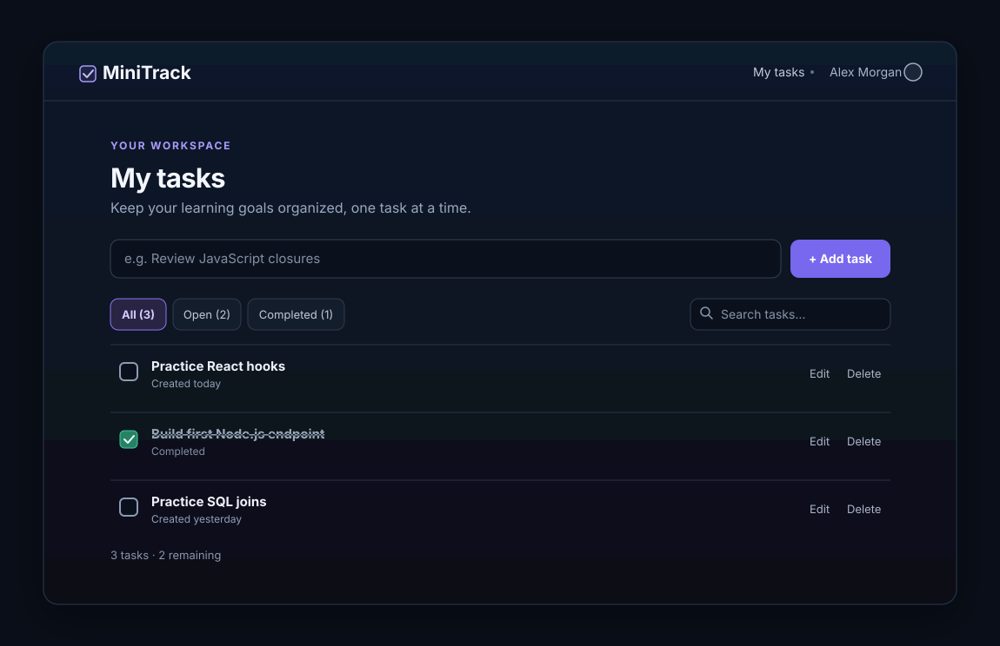
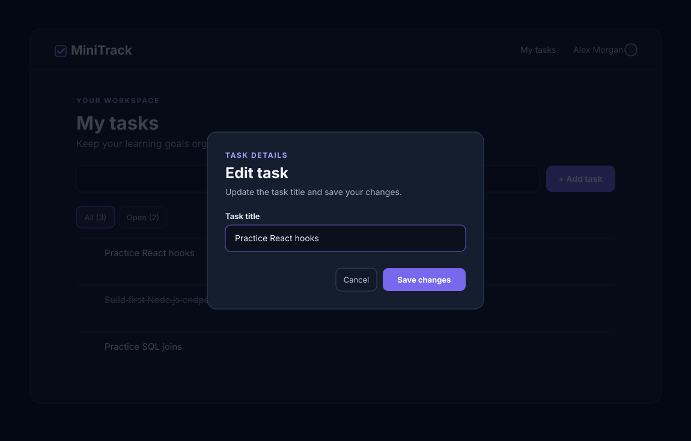
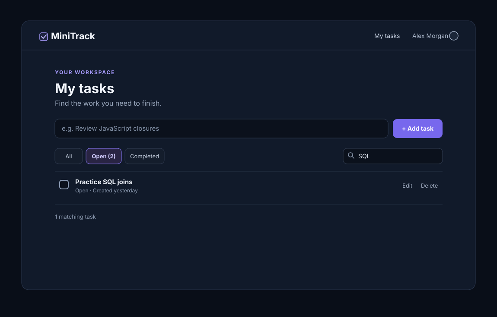
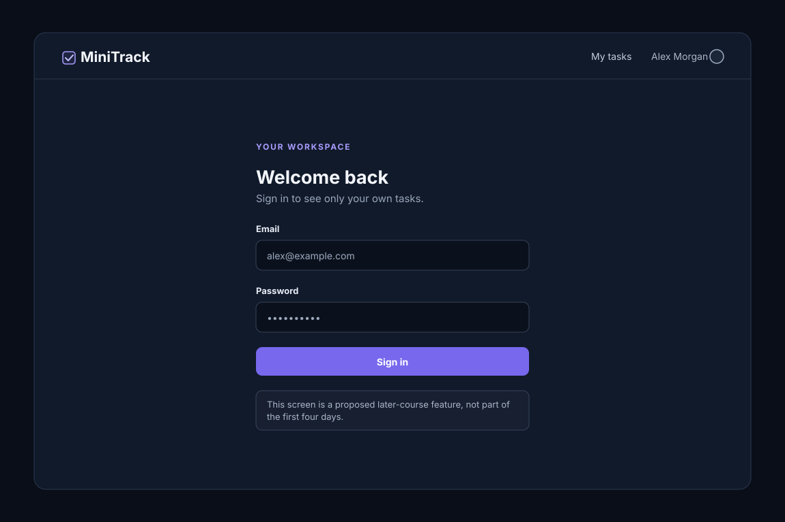

# MiniTrack — Application Overview

> **Project:** MiniTrack · **Stack:** Next.js + React + TypeScript, PostgreSQL
> **Purpose:** Learn full-stack engineering by building a tiny, useful application and practicing interview questions against real code.  
> **Status:** The dark mockups below are design references. The task list is implemented; sign-in/profile screens remain planned.

## 1. What are we building?

**MiniTrack is a simple personal task tracker.** A person adds a task, sees their tasks, marks work complete, and can later edit, delete, search, and filter tasks. Eventually each person signs in and sees only their own data.

Think of it as a deliberately tiny version of Trello or Jira **without** boards, teams, complex workflows, or flashy design.

**Example:** While preparing for interviews, you add *Practice React hooks*, *Build a Node.js endpoint*, and *Practice SQL joins*. As you finish a task, you check it off. When the list grows, you filter for unfinished tasks or search for *SQL*.

The application is kept simple so that the interesting complexity is in **JavaScript, TypeScript, Node.js fundamentals, React, SQL, HTTP, testing, and system design**, not in implementing an elaborate product.

## 2. What does the app look like?

### Screen A — My tasks (main screen)



**What a user can do:** View tasks, see completed/open state, and (after the initial lessons) add a new task or open edit/delete actions.

**Learning concepts:** HTTP GET and POST, React rendering, client/server boundaries, component state, database persistence.

### Screen B — Edit a task



**What a user can do:** Change an existing task title and save.

**Learning concepts:** HTTP PATCH, controlled forms, state updates, request errors, stale data, and eventually concurrent edits.

### Screen C — Search and filter



**What a user can do:** Search for `SQL` and show only open tasks.

**Learning concepts:** URL query parameters, SQL `WHERE`, debouncing, network race conditions, indexes, pagination.

### Screen D — Sign in (later module)



**What a user can do:** Sign in and access tasks belonging to their account.

**Learning concepts:** Authentication, authorization, sessions/cookies, password hashing, protecting API endpoints.

> **Scope note:** Screens B–D are later-course target designs. On **Day 4**, the frontend initially **only displays tasks**. You will add interactive controls in later lessons. We are not promising these screens exist on Day 4.

## 3. Core capabilities and delivery order

| Capability | User experience | When |
|---|---|---|
| View tasks | Open the page and see stored tasks | App Days 1–4 (end-to-end read path) |
| Create a task via API | Send a POST request to add a task | App Day 2 with memory, App Day 3 with PostgreSQL |
| Add a task through the webpage | Type title and click Add | App Day 5 |
| Complete / reopen | Check or uncheck a task | App Day 5 |
| Edit / delete | Rename or remove a task | App Days 5–7 |
| Search / filter | Find matching tasks; show open vs. done | App Day 8 |
| Automated testing | Verify routes, database integration, UI flow, and access rules | App Days 9 and 12 |
| Sign in | Authenticate with a maintained provider | App Day 10 |
| Per-user task ownership | Show each person only their own tasks | App Days 11–12 |
| Responsive and accessible UI | Use the tracker across screen sizes and input modes | App Day 13 |
| Deploy | Run the application with production services | App Days 14–15 |
| Handle conflicting edits | Avoid silently overwriting changes | Optional advanced module |

For the complete day-by-day steps, progress checkboxes, concepts, and interview
questions, see the [Complete MiniTrack app roadmap](APP_BUILD_ROADMAP.md).

## 4. Example user journey

1. Open MiniTrack and see three tasks.
2. Add **Practice React hooks**.
3. The new task appears in the list and persists after refresh.
4. Complete **Build first Node.js endpoint**.
5. Filter to **Open** tasks.
6. Search for **SQL** and edit the matching task.
7. Later, sign in on another device and see your own tasks.

## 5. How does it work technically?

```text
Browser
  |
  v
Next.js app (UI + TypeScript Route Handlers, port 3000)
  |
  | SQL with parameterized queries
  v
PostgreSQL database
```

**When reading tasks:** the Next.js Server Component calls a server-only task function → `pg` runs a PostgreSQL `SELECT` → Next renders the task list. It does not need to make an HTTP request back to its own app.

**When creating tasks:** the user submits a title → the browser sends same-origin `POST /api/tasks` → a Next.js Route Handler validates and calls a server-only task function → PostgreSQL runs a parameterized `INSERT` → the Route Handler returns the new task → the frontend refreshes the displayed list.

### Example API (target, added incrementally)

| Request | Purpose |
|---|---|
| `GET /api/tasks` | Read tasks |
| `POST /api/tasks` | Add a task |
| `PATCH /api/tasks/:id` | Edit task title or completion status |
| `DELETE /api/tasks/:id` | Delete a task |
| `GET /api/tasks?search=sql&status=open` | Search and filter (later) |

Example task response:

```json
{
  "id": "3",
  "title": "Practice SQL joins",
  "done": false
}
```

The task representation and API routes may evolve as we learn; we'll document meaningful decisions instead of adding complexity prematurely.

## 6. Why we chose these technologies

| Technology | Why we're using it | What we'll avoid initially |
|---|---|---|
| **Next.js + React + TypeScript** | Learn rendering, hooks, component boundaries, SSR vs. client behavior | Complex CSS, heavy UI libraries |
| **Node.js built-in HTTP in checkpoints** | Understand the raw request/response lifecycle and streams before using a framework | Hiding fundamentals behind a framework immediately |
| **Next.js Route Handlers** | Implement a TypeScript API in the same app as the UI | Maintaining a separate local API server for a single Next.js project |
| **PostgreSQL + `pg`** | Learn real SQL, transactions, safe parameterized queries and pooling | Starting with an ORM |
| **Same-origin UI and API** | Keep browser HTTP requests visible without local CORS configuration | Microservices and containers as prerequisites |

## 7. First four learning days

| Day | Build outcome | Core ideas | Interview question examples |
|---|---|---|---|
| **1** | `GET /tasks` returns sample JSON | JS event loop, HTTP server, request/response | Why does a Promise run before a timer? What if `res.end()` is missing? |
| **2** | `POST /tasks` adds an in-memory task | Request streams, `async/await`, closures, errors | How does Node parse a request body? What does `await` actually do? |
| **3** | TypeScript Route Handlers persist tasks in PostgreSQL | SQL, parameters, connection pools, route handlers | Why parameterize queries? What happens when the pool is exhausted? |
| **4** | Next.js Server Component displays database tasks | React and Next.js Server Components, server-only database access | Why avoid a server-to-self HTTP request? |

Days 1–5 are the Week 1 MVP track. The complete app roadmap continues through
Day 15 with editing, search, testing, sign-in, user-data isolation, accessibility,
and deployment. The repository's Python DSA days are a separate learning track.

## 8. What we're intentionally NOT building

- No payments, reservations, drag-and-drop board, real-time chat, or mobile app.
- No complex dashboard, intricate CSS, or elaborate validation flows.
- No Redis, queues, Docker, Kubernetes, or microservices needed to reach the first working version.
- No unnecessary abstractions or libraries when built-in functionality teaches the concept more clearly.

Advanced ideas can be **small isolated interview exercises** instead of new product features.

## 9. How features map to interview concepts

| Simple feature | Important concepts and tricky questions |
|---|---|
| Read tasks | SSR vs. CSR; Server vs. Client Components; server-only database access |
| Create task | POST vs. PUT; JSON parsing; idempotency; duplicate requests |
| Edit task | React closures and state; lost updates; optimistic locking |
| Query database | SQL injection; connection pooling; indexes; query plans |
| Handle two simultaneous edits | Transactions; isolation; MVCC; race conditions |
| Search | Debouncing; cancellation; stale responses; cursor vs. offset pagination |
| Run Node server | Event loop; microtasks; timers; asynchronous I/O; blocking CPU work |
| Login | Session security; cookies; password hashing; authorization vs. authentication |

## 10. When is MiniTrack considered complete?

The course project is complete when it can:

- Create, read, update, complete, and delete tasks.
- Persist tasks in PostgreSQL.
- Search and filter the list.
- Associate tasks with authenticated users.
- Handle common errors and concurrent updates sensibly.
- Pass a small set of backend and frontend tests.
- Be explained end to end in a full-stack interview, including the reasoning behind key design choices.

## 11. How we'll study

Every ~90-minute session follows:

**What → Why → How → Code → Break/debug → Interview questions → Notes**

We will write meaningful comments where a choice or tricky behavior deserves explanation, and maintain an interview index linking concepts back to real project files. The app stays intentionally small while the engineering knowledge grows.

---

*Images in `assets/` are illustrative proposed UI mockups, not actual screenshots of the running MiniTrack app.*
