# Complete full-stack interview preparation master guide

**Study window:** November 25–December 23, 2026
**Travel date:** December 24, 2026
**Schedule:** 7 hours a day, 6 days a week, with Sundays off
**Starting point:** MiniTrack App Days 1–4 are complete; preparation begins
with the canonical [App Day 5](../lessons/day-05.md).

This is the single-file version of the complete preparation course. It combines
the study system, frontend and backend interview index, Python DSA reference,
and all 25 guided preparation lessons. The smaller individual lessons remain
available under [`lessons/interview-prep/`](../lessons/interview-prep/README.md)
for easier daily navigation.

## How to use this file

1. Work through one preparation day at a time.
2. Write recall notes before reading the lesson.
3. Attempt the DSA problem before opening its solution.
4. Type MiniTrack code in the active learner workspace.
5. Complete the debugging exercise and speak every interview answer aloud.
6. Stop at the exit checklist; do not skip ahead because later lessons assume
   the earlier boundary is understood.

## Table of contents

### Preparation system and references

- [Where to begin](#where-to-begin)
- [What success means](#what-success-means-by-december-23)
- [Daily seven-hour structure](#daily-seven-hour-structure)
- [Notebook method](#notebook-method)
- [DSA method](#dsa-method-for-every-study-day)
- [Full-stack interview concept index](#full-stack-interview-concept-index)
- [Python DSA quick reference](#python-dsa-quick-reference)
- [Slow-day fallback](#slow-day-fallback)
- [Weekly review scorecard](#weekly-review-scorecard)

### Complete daily lessons

1. [Prep Day 01 — Finish add-task from React to PostgreSQL](#prep-day-01)
2. [Prep Day 02 — Complete, delete, and filter tasks](#prep-day-02)
3. [Prep Day 03 — Add safe title editing to the API](#prep-day-03)
4. [Prep Day 04 — Build accessible browser editing](#prep-day-04)
5. [Prep Day 05 — Make search and filters shareable](#prep-day-05)
6. [Prep Day 06 — Implement safe PostgreSQL search](#prep-day-06)
7. [Prep Day 07 — Add focused unit tests](#prep-day-07)
8. [Prep Day 08 — Test database and browser behavior](#prep-day-08)
9. [Prep Day 09 — Add authentication and client session Context](#prep-day-09)
10. [Prep Day 10 — Finish authentication and run the first mock](#prep-day-10)
11. [Prep Day 11 — Migrate from shared tasks to owned tasks](#prep-day-11)
12. [Prep Day 12 — Enforce owner authorization in SQL](#prep-day-12)
13. [Prep Day 13 — Prove authorization with negative tests](#prep-day-13)
14. [Prep Day 14 — Make the complete flow accessible](#prep-day-14)
15. [Prep Day 15 — Measure responsive rendering and memoization](#prep-day-15)
16. [Prep Day 16 — Run the quality gate and a full-stack mock](#prep-day-16)
17. [Prep Day 17 — Deploy with production-safe configuration](#prep-day-17)
18. [Prep Day 18 — Verify release and recovery](#prep-day-18)
19. [Prep Day 19 — Run a frontend interview deep review](#prep-day-19)
20. [Prep Day 20 — Run a backend and PostgreSQL deep review](#prep-day-20)
21. [Prep Day 21 — Design MiniTrack for realistic scale](#prep-day-21)
22. [Prep Day 22 — Complete a four-part mock interview](#prep-day-22)
23. [Prep Day 23 — Rebuild one vertical slice from memory](#prep-day-23)
24. [Prep Day 24 — Run the final mock and project pitch](#prep-day-24)
25. [Prep Day 25 — Consolidate, verify, and stop on time](#prep-day-25)

---

## Where to begin

The rough notes show progress through:

- JavaScript closures, promises, streams, and HTTP basics;
- PostgreSQL schema design, SQL, parameterized queries, and connection pools;
- Next.js Server Components, Suspense, task rendering, and React list keys;
- most of the Day 5 PATCH and DELETE backend work.

Start by finishing the Day 5 Client Component. Do not restart the whole course
unless a short recall exercise shows a real gap.

## What success means by December 23

By the end of this plan, aim to be able to:

- [ ] build and explain MiniTrack from browser event to PostgreSQL and back;
- [ ] explain React state, effects, refs, Context, rendering, and memoization;
- [ ] design and test REST-style APIs with validation and useful status codes;
- [ ] write safe SQL and explain indexes, transactions, pools, and pagination;
- [ ] explain authentication, authorization, accessibility, and deployment;
- [ ] solve 25 representative DSA problems without copying the solution;
- [ ] communicate brute force, optimization, correctness, and complexity aloud;
- [ ] complete two full-stack mocks and several smaller interview drills;
- [ ] draw a practical MiniTrack system design and discuss scaling trade-offs;
- [ ] give a clear 5-minute project walkthrough without relying on notes.

The goal is interview readiness, not perfect completion of every optional
infrastructure topic.

## Daily seven-hour structure

Use the following structure on normal study days. Breaks and meals are outside
the seven study hours.

| Block | Time | Purpose |
|---|---:|---|
| Notebook recall | 45 min | Write what you remember before opening the lesson |
| Python DSA | 1 hr 45 min | Learn one pattern, solve it, test it, explain complexity |
| Frontend | 1 hr 30 min | React, Next.js rendering, browser behavior, accessibility |
| Backend | 1 hr 30 min | API, Node.js, PostgreSQL, auth, testing, deployment |
| MiniTrack integration | 1 hr | Connect the day’s FE and BE ideas in working code |
| Interview explanation | 30 min | Answer questions aloud and record gaps |
| **Total** | **7 hr** | |

Frontend and backend time can be combined into one three-hour project block
when a lesson crosses both layers.

### Use 50/10 focus cycles

For each long block:

1. work for 50 minutes;
2. take a 10-minute break away from the screen;
3. begin the next block by writing the immediate goal in one sentence.

Do not use the break to watch tutorials or browse interview content.

## Notebook method

Use `checkpoints/ROUGH/Notes.md` for rough learning. Do not spend time making it
look polished.

For each concept, write only:

1. **What is it?** One or two simple sentences.
2. **Why do we need it?** The problem it solves.
3. **How does MiniTrack use it?** Point to one real file or request.
4. **What can go wrong?** One bug or failure mode.
5. **Interview answer:** Explain it aloud in 60–90 seconds.

At the end of the day, add:

```md
## YYYY-MM-DD

- Built:
- DSA pattern:
- I can explain:
- Still confusing:
- First task tomorrow:
```

Writing is useful, but avoid copying whole lessons. Close the lesson and
recreate the explanation in your own words.

## DSA method for every study day

Follow one numbered lesson from `dsa-python/lessons/` each study day.

1. **10 min:** Read the problem and state assumptions.
2. **15 min:** Describe the brute-force solution and complexity.
3. **35 min:** Code in `dsa-python/practice/day-NN.py` without the solution.
4. **15 min:** Test empty, smallest, normal, duplicate, and boundary inputs.
5. **15 min:** Compare with the reference and fix the idea, not just the code.
6. **15 min:** Re-code the key part from memory.
7. **15 min:** Explain the invariant and time/space complexity aloud.

If stuck for 25 minutes, take a small hint. Do not spend the entire day blocked
on one problem.

## Full-stack interview concept index


For a calendar-based combination of these app concepts with Python DSA,
debugging, system design, and mock interviews, use the
[25-day guided interview-preparation lessons](../lessons/interview-prep/README.md).

| Concept | Where to study | Question to explain aloud |
|---|---|---|
| Call stack | `lessons/day-01.md`, `exercises/js-predictions.js` | Why does synchronous code print before callbacks? |
| Event loop / microtasks | `lessons/day-01.md`, `exercises/js-predictions.js` | Why does Promise `.then` beat a timer? |
| Node-specific `nextTick` | `lessons/day-02.md` | What is the Node-specific queue nuance? |
| Promise / async-await | `lessons/day-02.md` | What is the difference between awaiting and blocking? |
| Closures | `lessons/day-02.md`, `exercises/js-predictions.js` | What variables does a returned function retain? |
| HTTP / status codes | `checkpoints/day1/server.cjs`, `frontend/app/api/tasks/route.ts` | Why 200 vs. 201 vs. 404? |
| JSON request body stream | `checkpoints/day2/server.cjs`, `frontend/app/api/tasks/route.ts` | How does a Route Handler parse JSON? |
| Next.js Route Handlers | `frontend/app/api/` | How do HTTP methods map to exported functions? |
| SQL injection / placeholders | `frontend/lib/tasks.ts`, `lessons/day-03.md` | Why `$1` instead of concatenating values? |
| Connection pooling | `frontend/lib/db.ts` | Why reuse connections? What if pool exhausted? |
| Server vs Client Component | `frontend/app/page.tsx`, `frontend/app/TaskBoard.tsx` | Which code runs on server vs browser? |
| Controlled input / state | `frontend/app/TaskBoard.tsx` | Why not mutate `tasks` array directly? |
| `router.refresh()` | `frontend/app/TaskBoard.tsx` | What happens after mutation? |
| Race conditions | `lessons/day-05.md` | Why disable submit while request is pending? |
| HTTP idempotency | `lessons/day-05.md` | Can retrying POST create duplicates? |
| Partial updates | `lessons/day-06.md` | Why use PATCH and `UPDATE ... RETURNING`? |
| Controlled edit state | `lessons/day-07.md` | Which edit values belong in React state? |
| `useRef` / `useEffect` | `lessons/day-07.md` | Why is focus an effect but filtering is not? |
| URL-backed state | `lessons/day-08.md` | Why store shareable filters in the URL? |
| SQL wildcard behavior | `lessons/day-08.md` | Does parameterization escape `%` and `_`? |
| Test pyramid / isolation | `lessons/day-09.md` | Which behavior belongs at each test level? |
| Authentication / authorization | `lessons/day-10.md` | Why does a valid session not prove row access? |
| Context / `SessionProvider` | `lessons/day-10.md` | What can auth Context do, and what can it not secure? |
| Server-side access control | `lessons/day-10.md` | Why is hiding a button not protection? |
| Ownership-scoped SQL / IDOR | `lessons/day-11.md` | Why include owner ID in every task predicate? |
| Schema migration safety | `lessons/day-11.md` | How do you add a required owner to existing rows? |
| Authorization test matrix | `lessons/day-12.md` | Why test both the response and unchanged data? |
| Semantic HTML / focus | `lessons/day-13.md` | Why prefer native controls and deliberate focus? |
| Responsive accessibility | `lessons/day-13.md` | What must remain usable beyond visual resizing? |
| React memoization | `lessons/day-13.md` | How do `useMemo`, `useCallback`, and `React.memo` differ? |
| Deployment configuration | `lessons/day-14.md` | What differs between build-time and runtime config? |
| Migration rollback | `lessons/day-14.md`, `lessons/day-15.md` | Why is app rollback different from schema recovery? |
| End-to-end system trace | `lessons/day-15.md` | Can I explain one PATCH from browser to PostgreSQL and back? |

**Review method:** look at the question, say your answer aloud, then open referenced code. Note what you got wrong in `docs/MY_NOTES.md`.

### Where the executable explanations live

Each [day lesson](../lessons/day-01.md), including the
[Days 6–15 continuation](../lessons/day-06.md), has flow and timing diagrams,
commented source, and scenario-based Q&A. Review the diagrams first, predict
the behavior, and then open the source file.


## Python DSA quick reference


| Pattern | Signal | Key invariant | Common pitfall |
|---|---|---|---|
| Hash map | pairs / frequencies | previously seen keys | duplicate element reuse |
| Two pointers | sorted or palindrome | discard impossible area | off-by-one |
| Sliding window | contiguous segment | valid window | negatives may break monotonicity |
| Monotonic stack | next greater/smaller | unresolved indices | confusing values with indices |
| Binary search | ordered search space | answer remains inside bounds | wrong midpoint boundary |
| Linked list | rearrange nodes | never lose next pointer | node identity vs values |
| Trees | hierarchy | subtree recursion or BFS depth | cross-subtree BST violations |
| Graphs | connectivity / dependency | visited set / indegree | cycles, edge direction |
| DP | optimal substructure | transition from smaller answers | greedy when invalid |
| Backtracking | enumerate choices | restore state after recursion | aliasing shared path |

### Python-specific interview pitfalls

- `list.pop(0)` takes O(n); `collections.deque.popleft()` is O(1).
- `x in list` is O(n); `x in set` is expected O(1).
- A mutable default argument (e.g. `def f(items=[])`) persists across calls.
- `[[0] * cols] * rows` shares nested row objects. Use a comprehension.
- `path.copy()` is needed when storing mutable backtracking paths.
- Slicing (`arr[:]`) and sorting (`sorted`) allocate memory; discuss it.
- Recursive DFS can exceed Python's recursion limit on deep graphs; iterative stacks can be safer.
- `heapq` implements a min-heap; push negatives for a max-heap when appropriate.
- Name the invariant aloud; explain the edge cases before coding.


---

# Complete daily guided lessons

<a id="prep-day-01"></a>

## Prep Day 01 — Finish add-task from React to PostgreSQL

**Date:** Wednesday, November 25, 2026
**Time:** 7 study hours plus breaks
**Starting point:** App Days 1–4 are complete. Continue from the current learner workspace and the previous preparation-day exit checklist.
**Goal:** Finish add-task from React to PostgreSQL.

[Track home](../lessons/interview-prep/README.md) · [Preparation plan](./FULL_STACK_INTERVIEW_PREP_PLAN.md) · [Track home](../lessons/interview-prep/README.md) · [Prep Day 02](../lessons/interview-prep/prep-day-02.md)

**Canonical study material:** [App Day 5](../lessons/day-05.md) · [DSA Day 01](../dsa-python/lessons/dsa-day-01.md)

### Learning objectives

- explain controlled inputs and form submission in beginner-friendly language;
- explain post validation and persistence and its failure boundary;
- implement or verify the listed MiniTrack milestone;
- solve DSA Day 01 using the hash map pattern;
- record the result in your rough notebook and explain it without reading.

### 1. Start with notebook recall (45 minutes)

Before opening a lesson, write answers in
[`checkpoints/ROUGH/Notes.md`](../checkpoints/ROUGH/Notes.md):

1. What did yesterday's browser action send to the server?
2. Where is persistent task data stored, and what state is only temporary?
3. What error or edge case can you already predict for today's topic?
4. What do you remember about the **hash map** pattern?

Use this format:

```md
### Wednesday, November 25, 2026

- What:
- Why:
- How MiniTrack uses it:
- What can go wrong:
- First task:
```

Do not copy the source paragraph. Write what you remember, then compare.

### 2. Understand today's full-stack boundary (20 minutes)

**Frontend focus — Controlled inputs and form submission:** React owns a controlled input through its value prop, and onChange updates the state used for the next render. onSubmit handles the form as one user action and preventDefault stops the browser's traditional page navigation.

**Backend focus — POST validation and persistence:** The Route Handler parses untrusted JSON, validates the title, calls the data function, and returns a 201 response. PostgreSQL remains the source of truth; React state only holds the temporary input.

**Today's connection:** A browser event becomes validated JSON, a parameterized INSERT, a 201 response, and a refreshed Server Component.

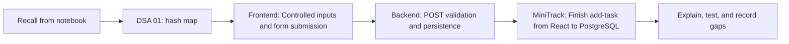

### 3. Python DSA practice (1 hour 45 minutes)

**Problem and reference:** [DSA Day 01](../dsa-python/lessons/dsa-day-01.md)
**Practice file:** [`dsa-python/practice/day-01.py`](../dsa-python/practice/day-01.py)
**Pattern:** hash map

#### Invariant to say aloud

Store each visited number by index and check for the needed complement before inserting the current value.

#### Work in this order

1. Restate the problem and ask about constraints.
2. Give a brute-force approach and its cost before optimizing.
3. Write the invariant above in your own words.
4. Implement without opening the solution for 25 minutes.
5. Test empty, smallest, typical, duplicate, and boundary cases where relevant.
6. Use a small hint if blocked; do not spend the entire block stuck.
7. Compare with the commented reference and re-code the key loop from memory.

From the repository root:

```bash
python3 dsa-python/scripts/check_practice.py 1
python3 -m unittest discover -s dsa-python/tests -v
```

**Expected observation:** the day-specific checker accepts your implementation,
and the completed reference suite still passes.

### 4. Frontend guided study (1 hour 30 minutes)

#### What

React owns a controlled input through its value prop, and onChange updates the state used for the next render. onSubmit handles the form as one user action and preventDefault stops the browser's traditional page navigation.

#### Why

The browser layer should make state and feedback understandable without taking
ownership of persistent data or security decisions that belong on the server.

#### How

Read the relevant canonical app lesson linked above. Before revealing its full
code, sketch the component state, user event, request, success result, and
failure result.

Files to open deliberately:

- `frontend/app/TaskBoard.tsx`
- `frontend/app/api/tasks/route.ts`
- `frontend/lib/tasks.ts`

Answer before coding:

- Which value is persistent, and which value is temporary interaction state?
- What starts this behavior?
- What should the user see while work is pending?
- What should remain unchanged when the operation fails?

### 5. Backend guided study (1 hour 30 minutes)

#### What

The Route Handler parses untrusted JSON, validates the title, calls the data function, and returns a 201 response. PostgreSQL remains the source of truth; React state only holds the temporary input.

#### Boundary checklist

- Validate untrusted path, query, and body values.
- Authenticate identity when the route is protected.
- Authorize the resource separately from authentication.
- Bind SQL values rather than concatenating untrusted data.
- Return an explicit success or error status.
- Log internal failures on the server without exposing secrets.

Use the canonical app lesson for complete implementation code. Type the new
code yourself in the learner workspace; do not copy from
`reference/frontend-complete/` before attempting it.

### 6. MiniTrack implementation (1 hour)

**Milestone source:** Day 5 sections on the controlled form and POST flow

1. Create the Client Component and controlled title input.
2. Submit JSON to POST /api/tasks and handle HTTP and network failures.
3. Refresh server data after success and clear the input.

Run the smallest checks that cover today's change. Use the exact commands from
the canonical lesson or the relevant package scripts.

**Expected observation:** the user-visible milestone works, its important
failure path is explicit, and existing behavior remains intact.

### 7. Trace the event or request

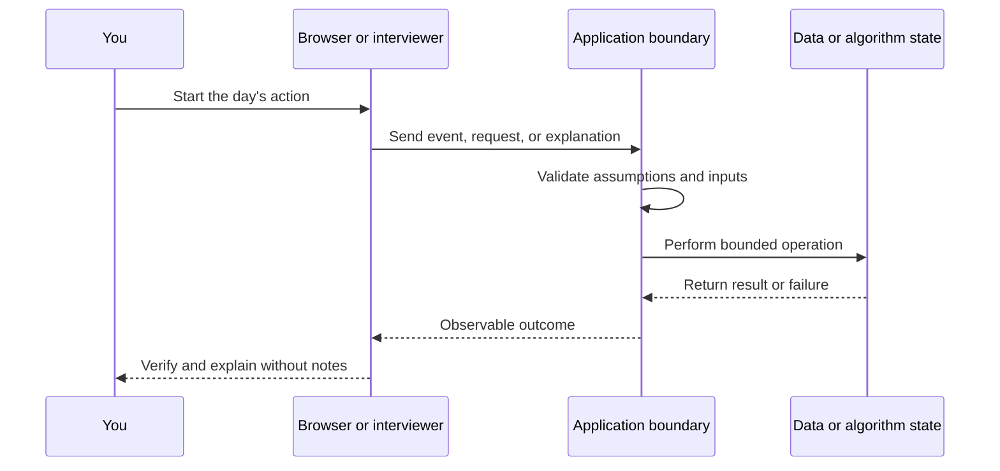

Trace one concrete input. Name every boundary, value, and possible failure.

### 8. Deliberate debugging exercise (25 minutes)

**Break it:** Remove event.preventDefault() from the submit handler.

**Predict before running:** write the expected symptom in your notebook.

**Expected symptom:** The browser performs a traditional form navigation and the React flow is interrupted.

**Root cause:** A form submits through the browser by default; React must deliberately take control.

**Restore and verify:** Restore preventDefault(), submit again, and verify the page does not navigate.

Do not stop after making the symptom disappear. Explain why the repair restores
the intended invariant.

### 9. Interview questions and answers (30 minutes)

#### Q1. What is controlled inputs and form submission?

**Interview-ready answer:** React owns a controlled input through its value prop, and onChange updates the state used for the next render. onSubmit handles the form as one user action and preventDefault stops the browser's traditional page navigation.

**Example:** Use `frontend/app/TaskBoard.tsx` and point to the state, event, or rendered
behavior involved in today's milestone.

**Senior follow-up:** Explain when this frontend choice would become difficult
to maintain and what measurement or requirement would justify a different
design.

#### Q2. How should the backend handle post validation and persistence?

**Interview-ready answer:** The Route Handler parses untrusted JSON, validates the title, calls the data function, and returns a 201 response. PostgreSQL remains the source of truth; React state only holds the temporary input.

**Example:** Trace the relevant Route Handler or server boundary into the
MiniTrack data function and back to its response.

**Senior follow-up:** Describe the failure mode, logging requirement, and what
must remain private when the dependency is unavailable.

#### Q3. What invariant makes the hash map solution correct?

**Interview-ready answer:** Store each visited number by index and check for the needed complement before inserting the current value.

**Example:** Dry-run the first non-trivial sample from DSA Day 01 and
show the state after each iteration.

**Senior follow-up:** State the assumptions under which the claimed complexity
holds and how changed constraints might require another approach.

#### Q4. How does today's work fit the complete MiniTrack system?

**Interview-ready answer:** A browser event becomes validated JSON, a parameterized INSERT, a 201 response, and a refreshed Server Component.

**Example:** Begin with one user action and finish with the visible result or
verified system state.

**Senior follow-up:** Identify the first bottleneck, security risk, or
operational signal you would measure before adding infrastructure.

### 10. Complexity and operational cost

- **DSA:** O(n) time and O(n) auxiliary space.
- **Application:** The client does constant local work, while inserting is normally dominated by one network round trip and one indexed database write.
- **Learning:** Attempting, retrieving, and correcting is more valuable than
  copying several solutions. Keep the scope to one understood pattern today.

### Exit checklist

- [ ] I completed DSA Day 01 before reading its solution.
- [ ] I can state the invariant and complexity without notes.
- [ ] I completed or verified the MiniTrack milestone.
- [ ] I tested one success path and one failure path.
- [ ] I completed the deliberate debugging exercise.
- [ ] I answered all four interview questions aloud.
- [ ] I recorded what remains confusing and tomorrow's first task.

**Suggested commit:** `prep day 01: finish add-task from react to postgresql`
<a id="prep-day-02"></a>

## Prep Day 02 — Complete, delete, and filter tasks

**Date:** Thursday, November 26, 2026
**Time:** 7 study hours plus breaks
**Starting point:** App Days 1–4 are complete. Continue from the current learner workspace and the previous preparation-day exit checklist.
**Goal:** Complete, delete, and filter tasks.

[Prep Day 01](../lessons/interview-prep/prep-day-01.md) · [Preparation plan](./FULL_STACK_INTERVIEW_PREP_PLAN.md) · [Track home](../lessons/interview-prep/README.md) · [Prep Day 03](../lessons/interview-prep/prep-day-03.md)

**Canonical study material:** [App Day 5](../lessons/day-05.md) · [DSA Day 02](../dsa-python/lessons/dsa-day-02.md)

### Learning objectives

- explain event handlers and derived state in beginner-friendly language;
- explain patch and delete by resource id and its failure boundary;
- implement or verify the listed MiniTrack milestone;
- solve DSA Day 02 using the frequency counting pattern;
- record the result in your rough notebook and explain it without reading.

### 1. Start with notebook recall (45 minutes)

Before opening a lesson, write answers in
[`checkpoints/ROUGH/Notes.md`](../checkpoints/ROUGH/Notes.md):

1. What did yesterday's browser action send to the server?
2. Where is persistent task data stored, and what state is only temporary?
3. What error or edge case can you already predict for today's topic?
4. What do you remember about the **frequency counting** pattern?

Use this format:

```md
### Thursday, November 26, 2026

- What:
- Why:
- How MiniTrack uses it:
- What can go wrong:
- First task:
```

Do not copy the source paragraph. Write what you remember, then compare.

### 2. Understand today's full-stack boundary (20 minutes)

**Frontend focus — Event handlers and derived state:** A checkbox uses onChange, a delete button uses onClick, and visible tasks are derived from task props plus the selected filter. Derived values should not be copied into a second state variable.

**Backend focus — PATCH and DELETE by resource ID:** The dynamic Route Handler validates the path ID, validates the PATCH body, and calls parameterized UPDATE or DELETE functions. Missing tasks return 404 instead of success-shaped data.

**Today's connection:** The task ID travels in the URL, the new value travels in JSON when needed, and router.refresh requests authoritative rows after mutation.

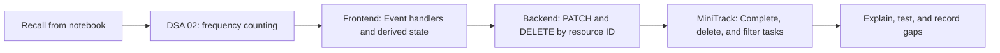

### 3. Python DSA practice (1 hour 45 minutes)

**Problem and reference:** [DSA Day 02](../dsa-python/lessons/dsa-day-02.md)
**Practice file:** [`dsa-python/practice/day-02.py`](../dsa-python/practice/day-02.py)
**Pattern:** frequency counting

#### Invariant to say aloud

Count characters from one string and subtract matches from the other; every final count must balance.

#### Work in this order

1. Restate the problem and ask about constraints.
2. Give a brute-force approach and its cost before optimizing.
3. Write the invariant above in your own words.
4. Implement without opening the solution for 25 minutes.
5. Test empty, smallest, typical, duplicate, and boundary cases where relevant.
6. Use a small hint if blocked; do not spend the entire block stuck.
7. Compare with the commented reference and re-code the key loop from memory.

From the repository root:

```bash
python3 dsa-python/scripts/check_practice.py 2
python3 -m unittest discover -s dsa-python/tests -v
```

**Expected observation:** the day-specific checker accepts your implementation,
and the completed reference suite still passes.

### 4. Frontend guided study (1 hour 30 minutes)

#### What

A checkbox uses onChange, a delete button uses onClick, and visible tasks are derived from task props plus the selected filter. Derived values should not be copied into a second state variable.

#### Why

The browser layer should make state and feedback understandable without taking
ownership of persistent data or security decisions that belong on the server.

#### How

Read the relevant canonical app lesson linked above. Before revealing its full
code, sketch the component state, user event, request, success result, and
failure result.

Files to open deliberately:

- `frontend/app/TaskBoard.tsx`
- `frontend/app/api/tasks/[id]/route.ts`
- `frontend/lib/validation.ts`

Answer before coding:

- Which value is persistent, and which value is temporary interaction state?
- What starts this behavior?
- What should the user see while work is pending?
- What should remain unchanged when the operation fails?

### 5. Backend guided study (1 hour 30 minutes)

#### What

The dynamic Route Handler validates the path ID, validates the PATCH body, and calls parameterized UPDATE or DELETE functions. Missing tasks return 404 instead of success-shaped data.

#### Boundary checklist

- Validate untrusted path, query, and body values.
- Authenticate identity when the route is protected.
- Authorize the resource separately from authentication.
- Bind SQL values rather than concatenating untrusted data.
- Return an explicit success or error status.
- Log internal failures on the server without exposing secrets.

Use the canonical app lesson for complete implementation code. Type the new
code yourself in the learner workspace; do not copy from
`reference/frontend-complete/` before attempting it.

### 6. MiniTrack implementation (1 hour)

**Milestone source:** Day 5 checkbox, delete, filtering, and error-state sections

1. Connect checkbox changes to PATCH.
2. Connect Delete to DELETE and show failures.
3. Implement all/open/done filtering without useEffect.

Run the smallest checks that cover today's change. Use the exact commands from
the canonical lesson or the relevant package scripts.

**Expected observation:** the user-visible milestone works, its important
failure path is explicit, and existing behavior remains intact.

### 7. Trace the event or request


Trace one concrete input. Name every boundary, value, and possible failure.

### 8. Deliberate debugging exercise (25 minutes)

**Break it:** Change the filter to store a separate visibleTasks state value.

**Predict before running:** write the expected symptom in your notebook.

**Expected symptom:** The list can become stale when fresh task props arrive.

**Root cause:** Duplicated state has two sources that must be synchronized.

**Restore and verify:** Delete the duplicate state and compute visible tasks during rendering.

Do not stop after making the symptom disappear. Explain why the repair restores
the intended invariant.

### 9. Interview questions and answers (30 minutes)

#### Q1. What is event handlers and derived state?

**Interview-ready answer:** A checkbox uses onChange, a delete button uses onClick, and visible tasks are derived from task props plus the selected filter. Derived values should not be copied into a second state variable.

**Example:** Use `frontend/app/TaskBoard.tsx` and point to the state, event, or rendered
behavior involved in today's milestone.

**Senior follow-up:** Explain when this frontend choice would become difficult
to maintain and what measurement or requirement would justify a different
design.

#### Q2. How should the backend handle patch and delete by resource id?

**Interview-ready answer:** The dynamic Route Handler validates the path ID, validates the PATCH body, and calls parameterized UPDATE or DELETE functions. Missing tasks return 404 instead of success-shaped data.

**Example:** Trace the relevant Route Handler or server boundary into the
MiniTrack data function and back to its response.

**Senior follow-up:** Describe the failure mode, logging requirement, and what
must remain private when the dependency is unavailable.

#### Q3. What invariant makes the frequency counting solution correct?

**Interview-ready answer:** Count characters from one string and subtract matches from the other; every final count must balance.

**Example:** Dry-run the first non-trivial sample from DSA Day 02 and
show the state after each iteration.

**Senior follow-up:** State the assumptions under which the claimed complexity
holds and how changed constraints might require another approach.

#### Q4. How does today's work fit the complete MiniTrack system?

**Interview-ready answer:** The task ID travels in the URL, the new value travels in JSON when needed, and router.refresh requests authoritative rows after mutation.

**Example:** Begin with one user action and finish with the visible result or
verified system state.

**Senior follow-up:** Identify the first bottleneck, security risk, or
operational signal you would measure before adding infrastructure.

### 10. Complexity and operational cost

- **DSA:** O(n) time and O(k) space for k distinct characters.
- **Application:** Filtering is O(n) per render for n tasks. PATCH and DELETE each use one database round trip; the refresh adds a read round trip.
- **Learning:** Attempting, retrieving, and correcting is more valuable than
  copying several solutions. Keep the scope to one understood pattern today.

### Exit checklist

- [ ] I completed DSA Day 02 before reading its solution.
- [ ] I can state the invariant and complexity without notes.
- [ ] I completed or verified the MiniTrack milestone.
- [ ] I tested one success path and one failure path.
- [ ] I completed the deliberate debugging exercise.
- [ ] I answered all four interview questions aloud.
- [ ] I recorded what remains confusing and tomorrow's first task.

**Suggested commit:** `prep day 02: complete, delete, and filter tasks`
<a id="prep-day-03"></a>

## Prep Day 03 — Add safe title editing to the API

**Date:** Friday, November 27, 2026
**Time:** 7 study hours plus breaks
**Starting point:** App Days 1–4 are complete. Continue from the current learner workspace and the previous preparation-day exit checklist.
**Goal:** Add safe title editing to the API.

[Prep Day 02](../lessons/interview-prep/prep-day-02.md) · [Preparation plan](./FULL_STACK_INTERVIEW_PREP_PLAN.md) · [Track home](../lessons/interview-prep/README.md) · [Prep Day 04](../lessons/interview-prep/prep-day-04.md)

**Canonical study material:** [App Day 6](../lessons/day-06.md) · [DSA Day 03](../dsa-python/lessons/dsa-day-03.md)

### Learning objectives

- explain designing the edit request in beginner-friendly language;
- explain patch contracts and update returning and its failure boundary;
- implement or verify the listed MiniTrack milestone;
- solve DSA Day 03 using the set membership pattern;
- record the result in your rough notebook and explain it without reading.

### 1. Start with notebook recall (45 minutes)

Before opening a lesson, write answers in
[`checkpoints/ROUGH/Notes.md`](../checkpoints/ROUGH/Notes.md):

1. What did yesterday's browser action send to the server?
2. Where is persistent task data stored, and what state is only temporary?
3. What error or edge case can you already predict for today's topic?
4. What do you remember about the **set membership** pattern?

Use this format:

```md
### Friday, November 27, 2026

- What:
- Why:
- How MiniTrack uses it:
- What can go wrong:
- First task:
```

Do not copy the source paragraph. Write what you remember, then compare.

### 2. Understand today's full-stack boundary (20 minutes)

**Frontend focus — Designing the edit request:** The browser sends only the field being changed. A narrow PATCH body makes intent clear and prevents unrelated values from being overwritten.

**Backend focus — PATCH contracts and UPDATE RETURNING:** A partial-update endpoint validates that exactly one supported field is present, binds values in SQL, and uses RETURNING to obtain the updated row in the same database round trip.

**Today's connection:** The API boundary protects the data layer from malformed partial updates before SQL runs.

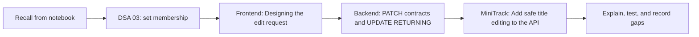

### 3. Python DSA practice (1 hour 45 minutes)

**Problem and reference:** [DSA Day 03](../dsa-python/lessons/dsa-day-03.md)
**Practice file:** [`dsa-python/practice/day-03.py`](../dsa-python/practice/day-03.py)
**Pattern:** set membership

#### Invariant to say aloud

Insert each value into a set and stop when a value is already present.

#### Work in this order

1. Restate the problem and ask about constraints.
2. Give a brute-force approach and its cost before optimizing.
3. Write the invariant above in your own words.
4. Implement without opening the solution for 25 minutes.
5. Test empty, smallest, typical, duplicate, and boundary cases where relevant.
6. Use a small hint if blocked; do not spend the entire block stuck.
7. Compare with the commented reference and re-code the key loop from memory.

From the repository root:

```bash
python3 dsa-python/scripts/check_practice.py 3
python3 -m unittest discover -s dsa-python/tests -v
```

**Expected observation:** the day-specific checker accepts your implementation,
and the completed reference suite still passes.

### 4. Frontend guided study (1 hour 30 minutes)

#### What

The browser sends only the field being changed. A narrow PATCH body makes intent clear and prevents unrelated values from being overwritten.

#### Why

The browser layer should make state and feedback understandable without taking
ownership of persistent data or security decisions that belong on the server.

#### How

Read the relevant canonical app lesson linked above. Before revealing its full
code, sketch the component state, user event, request, success result, and
failure result.

Files to open deliberately:

- `frontend/app/api/tasks/[id]/route.ts`
- `frontend/lib/tasks.ts`
- `frontend/lib/validation.ts`

Answer before coding:

- Which value is persistent, and which value is temporary interaction state?
- What starts this behavior?
- What should the user see while work is pending?
- What should remain unchanged when the operation fails?

### 5. Backend guided study (1 hour 30 minutes)

#### What

A partial-update endpoint validates that exactly one supported field is present, binds values in SQL, and uses RETURNING to obtain the updated row in the same database round trip.

#### Boundary checklist

- Validate untrusted path, query, and body values.
- Authenticate identity when the route is protected.
- Authorize the resource separately from authentication.
- Bind SQL values rather than concatenating untrusted data.
- Return an explicit success or error status.
- Log internal failures on the server without exposing secrets.

Use the canonical app lesson for complete implementation code. Type the new
code yourself in the learner workspace; do not copy from
`reference/frontend-complete/` before attempting it.

### 6. MiniTrack implementation (1 hour)

**Milestone source:** Day 6 partial-update contract and title validation

1. Extend validation for a title update.
2. Add the parameterized UPDATE function.
3. Verify valid, malformed, missing, and not-found cases with curl or tests.

Run the smallest checks that cover today's change. Use the exact commands from
the canonical lesson or the relevant package scripts.

**Expected observation:** the user-visible milestone works, its important
failure path is explicit, and existing behavior remains intact.

### 7. Trace the event or request


Trace one concrete input. Name every boundary, value, and possible failure.

### 8. Deliberate debugging exercise (25 minutes)

**Break it:** Allow both title and done in a request that is meant to update exactly one field.

**Predict before running:** write the expected symptom in your notebook.

**Expected symptom:** The endpoint contract becomes ambiguous and tests cannot prove which change was intended.

**Root cause:** Loose object checks accept states outside the designed API contract.

**Restore and verify:** Require exactly one supported key and reject extra or conflicting fields.

Do not stop after making the symptom disappear. Explain why the repair restores
the intended invariant.

### 9. Interview questions and answers (30 minutes)

#### Q1. What is designing the edit request?

**Interview-ready answer:** The browser sends only the field being changed. A narrow PATCH body makes intent clear and prevents unrelated values from being overwritten.

**Example:** Use `frontend/app/api/tasks/[id]/route.ts` and point to the state, event, or rendered
behavior involved in today's milestone.

**Senior follow-up:** Explain when this frontend choice would become difficult
to maintain and what measurement or requirement would justify a different
design.

#### Q2. How should the backend handle patch contracts and update returning?

**Interview-ready answer:** A partial-update endpoint validates that exactly one supported field is present, binds values in SQL, and uses RETURNING to obtain the updated row in the same database round trip.

**Example:** Trace the relevant Route Handler or server boundary into the
MiniTrack data function and back to its response.

**Senior follow-up:** Describe the failure mode, logging requirement, and what
must remain private when the dependency is unavailable.

#### Q3. What invariant makes the set membership solution correct?

**Interview-ready answer:** Insert each value into a set and stop when a value is already present.

**Example:** Dry-run the first non-trivial sample from DSA Day 03 and
show the state after each iteration.

**Senior follow-up:** State the assumptions under which the claimed complexity
holds and how changed constraints might require another approach.

#### Q4. How does today's work fit the complete MiniTrack system?

**Interview-ready answer:** The API boundary protects the data layer from malformed partial updates before SQL runs.

**Example:** Begin with one user action and finish with the visible result or
verified system state.

**Senior follow-up:** Identify the first bottleneck, security risk, or
operational signal you would measure before adding infrastructure.

### 10. Complexity and operational cost

- **DSA:** O(n) expected time and O(n) space.
- **Application:** Validation is proportional to the small request body. An UPDATE by primary key is typically O(log n) index lookup plus the write.
- **Learning:** Attempting, retrieving, and correcting is more valuable than
  copying several solutions. Keep the scope to one understood pattern today.

### Exit checklist

- [ ] I completed DSA Day 03 before reading its solution.
- [ ] I can state the invariant and complexity without notes.
- [ ] I completed or verified the MiniTrack milestone.
- [ ] I tested one success path and one failure path.
- [ ] I completed the deliberate debugging exercise.
- [ ] I answered all four interview questions aloud.
- [ ] I recorded what remains confusing and tomorrow's first task.

**Suggested commit:** `prep day 03: add safe title editing to the api`
<a id="prep-day-04"></a>

## Prep Day 04 — Build accessible browser editing

**Date:** Saturday, November 28, 2026
**Time:** 7 study hours plus breaks
**Starting point:** App Days 1–4 are complete. Continue from the current learner workspace and the previous preparation-day exit checklist.
**Goal:** Build accessible browser editing.

[Prep Day 03](../lessons/interview-prep/prep-day-03.md) · [Preparation plan](./FULL_STACK_INTERVIEW_PREP_PLAN.md) · [Track home](../lessons/interview-prep/README.md) · [Prep Day 05](../lessons/interview-prep/prep-day-05.md)

**Canonical study material:** [App Day 7](../lessons/day-07.md) · [DSA Day 04](../dsa-python/lessons/dsa-day-04.md)

### Learning objectives

- explain explicit edit state, useref, and useeffect in beginner-friendly language;
- explain preserving data when editing fails and its failure boundary;
- implement or verify the listed MiniTrack milestone;
- solve DSA Day 04 using the one-pass invariant pattern;
- record the result in your rough notebook and explain it without reading.

### 1. Start with notebook recall (45 minutes)

Before opening a lesson, write answers in
[`checkpoints/ROUGH/Notes.md`](../checkpoints/ROUGH/Notes.md):

1. What did yesterday's browser action send to the server?
2. Where is persistent task data stored, and what state is only temporary?
3. What error or edge case can you already predict for today's topic?
4. What do you remember about the **one-pass invariant** pattern?

Use this format:

```md
### Saturday, November 28, 2026

- What:
- Why:
- How MiniTrack uses it:
- What can go wrong:
- First task:
```

Do not copy the source paragraph. Write what you remember, then compare.

### 2. Understand today's full-stack boundary (20 minutes)

**Frontend focus — Explicit edit state, useRef, and useEffect:** State stores which task is being edited and the draft title. A ref points to the rendered input, and an effect focuses it because focus synchronizes React with the browser DOM.

**Backend focus — Preserving data when editing fails:** The server rejects invalid or missing updates explicitly. The client should keep edit mode and the draft value when the request fails so the user can correct or retry it.

**Today's connection:** Local draft state supports interaction while PostgreSQL remains the final persisted state.

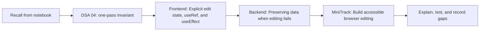

### 3. Python DSA practice (1 hour 45 minutes)

**Problem and reference:** [DSA Day 04](../dsa-python/lessons/dsa-day-04.md)
**Practice file:** [`dsa-python/practice/day-04.py`](../dsa-python/practice/day-04.py)
**Pattern:** one-pass invariant

#### Invariant to say aloud

Track the lowest price seen before today and the best profit available at the current price.

#### Work in this order

1. Restate the problem and ask about constraints.
2. Give a brute-force approach and its cost before optimizing.
3. Write the invariant above in your own words.
4. Implement without opening the solution for 25 minutes.
5. Test empty, smallest, typical, duplicate, and boundary cases where relevant.
6. Use a small hint if blocked; do not spend the entire block stuck.
7. Compare with the commented reference and re-code the key loop from memory.

From the repository root:

```bash
python3 dsa-python/scripts/check_practice.py 4
python3 -m unittest discover -s dsa-python/tests -v
```

**Expected observation:** the day-specific checker accepts your implementation,
and the completed reference suite still passes.

### 4. Frontend guided study (1 hour 30 minutes)

#### What

State stores which task is being edited and the draft title. A ref points to the rendered input, and an effect focuses it because focus synchronizes React with the browser DOM.

#### Why

The browser layer should make state and feedback understandable without taking
ownership of persistent data or security decisions that belong on the server.

#### How

Read the relevant canonical app lesson linked above. Before revealing its full
code, sketch the component state, user event, request, success result, and
failure result.

Files to open deliberately:

- `frontend/app/TaskBoard.tsx`
- `frontend/app/api/tasks/[id]/route.ts`

Answer before coding:

- Which value is persistent, and which value is temporary interaction state?
- What starts this behavior?
- What should the user see while work is pending?
- What should remain unchanged when the operation fails?

### 5. Backend guided study (1 hour 30 minutes)

#### What

The server rejects invalid or missing updates explicitly. The client should keep edit mode and the draft value when the request fails so the user can correct or retry it.

#### Boundary checklist

- Validate untrusted path, query, and body values.
- Authenticate identity when the route is protected.
- Authorize the resource separately from authentication.
- Bind SQL values rather than concatenating untrusted data.
- Return an explicit success or error status.
- Log internal failures on the server without exposing secrets.

Use the canonical app lesson for complete implementation code. Type the new
code yourself in the learner workspace; do not copy from
`reference/frontend-complete/` before attempting it.

### 6. MiniTrack implementation (1 hour)

**Milestone source:** Day 7 edit, save, cancel, ref, and effect sections

1. Add Edit, Save, and Cancel controls.
2. Focus and select the edit input when edit mode begins.
3. Keep the draft visible on failure and leave edit mode only after success or cancel.

Run the smallest checks that cover today's change. Use the exact commands from
the canonical lesson or the relevant package scripts.

**Expected observation:** the user-visible milestone works, its important
failure path is explicit, and existing behavior remains intact.

### 7. Trace the event or request


Trace one concrete input. Name every boundary, value, and possible failure.

### 8. Deliberate debugging exercise (25 minutes)

**Break it:** Call focus directly while the component is rendering.

**Predict before running:** write the expected symptom in your notebook.

**Expected symptom:** The input may not exist yet, and rendering now has an external side effect.

**Root cause:** DOM synchronization must happen after React commits the element.

**Restore and verify:** Move focus into an effect keyed by the editing task ID.

Do not stop after making the symptom disappear. Explain why the repair restores
the intended invariant.

### 9. Interview questions and answers (30 minutes)

#### Q1. What is explicit edit state, useref, and useeffect?

**Interview-ready answer:** State stores which task is being edited and the draft title. A ref points to the rendered input, and an effect focuses it because focus synchronizes React with the browser DOM.

**Example:** Use `frontend/app/TaskBoard.tsx` and point to the state, event, or rendered
behavior involved in today's milestone.

**Senior follow-up:** Explain when this frontend choice would become difficult
to maintain and what measurement or requirement would justify a different
design.

#### Q2. How should the backend handle preserving data when editing fails?

**Interview-ready answer:** The server rejects invalid or missing updates explicitly. The client should keep edit mode and the draft value when the request fails so the user can correct or retry it.

**Example:** Trace the relevant Route Handler or server boundary into the
MiniTrack data function and back to its response.

**Senior follow-up:** Describe the failure mode, logging requirement, and what
must remain private when the dependency is unavailable.

#### Q3. What invariant makes the one-pass invariant solution correct?

**Interview-ready answer:** Track the lowest price seen before today and the best profit available at the current price.

**Example:** Dry-run the first non-trivial sample from DSA Day 04 and
show the state after each iteration.

**Senior follow-up:** State the assumptions under which the claimed complexity
holds and how changed constraints might require another approach.

#### Q4. How does today's work fit the complete MiniTrack system?

**Interview-ready answer:** Local draft state supports interaction while PostgreSQL remains the final persisted state.

**Example:** Begin with one user action and finish with the visible result or
verified system state.

**Senior follow-up:** Identify the first bottleneck, security risk, or
operational signal you would measure before adding infrastructure.

### 10. Complexity and operational cost

- **DSA:** O(n) time and O(1) space.
- **Application:** Finding the edited task is O(n) in a simple rendered list. Focus is constant work; the network update dominates latency.
- **Learning:** Attempting, retrieving, and correcting is more valuable than
  copying several solutions. Keep the scope to one understood pattern today.

### Exit checklist

- [ ] I completed DSA Day 04 before reading its solution.
- [ ] I can state the invariant and complexity without notes.
- [ ] I completed or verified the MiniTrack milestone.
- [ ] I tested one success path and one failure path.
- [ ] I completed the deliberate debugging exercise.
- [ ] I answered all four interview questions aloud.
- [ ] I recorded what remains confusing and tomorrow's first task.

**Suggested commit:** `prep day 04: build accessible browser editing`
<a id="prep-day-05"></a>

## Prep Day 05 — Make search and filters shareable

**Date:** Monday, November 30, 2026
**Time:** 7 study hours plus breaks
**Starting point:** App Days 1–4 are complete. Continue from the current learner workspace and the previous preparation-day exit checklist.
**Goal:** Make search and filters shareable.

[Prep Day 04](../lessons/interview-prep/prep-day-04.md) · [Preparation plan](./FULL_STACK_INTERVIEW_PREP_PLAN.md) · [Track home](../lessons/interview-prep/README.md) · [Prep Day 06](../lessons/interview-prep/prep-day-06.md)

**Canonical study material:** [App Day 8](../lessons/day-08.md) · [DSA Day 05](../dsa-python/lessons/dsa-day-05.md)

### Learning objectives

- explain url state versus local state in beginner-friendly language;
- explain reading and normalizing search parameters and its failure boundary;
- implement or verify the listed MiniTrack milestone;
- solve DSA Day 05 using the two pointers pattern;
- record the result in your rough notebook and explain it without reading.

### 1. Start with notebook recall (45 minutes)

Before opening a lesson, write answers in
[`checkpoints/ROUGH/Notes.md`](../checkpoints/ROUGH/Notes.md):

1. What did yesterday's browser action send to the server?
2. Where is persistent task data stored, and what state is only temporary?
3. What error or edge case can you already predict for today's topic?
4. What do you remember about the **two pointers** pattern?

Use this format:

```md
### Monday, November 30, 2026

- What:
- Why:
- How MiniTrack uses it:
- What can go wrong:
- First task:
```

Do not copy the source paragraph. Write what you remember, then compare.

### 2. Understand today's full-stack boundary (20 minutes)

**Frontend focus — URL state versus local state:** Search and filter values belong in the URL when users should reload, bookmark, or share them. Temporary draft text can stay local until the user applies it.

**Backend focus — Reading and normalizing search parameters:** The server treats query parameters as untrusted strings, normalizes allowed values, and passes a typed filter to the data function.

**Today's connection:** The URL becomes the input to server rendering, so navigation and data selection describe the same state.

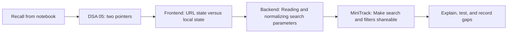

### 3. Python DSA practice (1 hour 45 minutes)

**Problem and reference:** [DSA Day 05](../dsa-python/lessons/dsa-day-05.md)
**Practice file:** [`dsa-python/practice/day-05.py`](../dsa-python/practice/day-05.py)
**Pattern:** two pointers

#### Invariant to say aloud

Move inward from both ends while skipping ignored characters and comparing normalized values.

#### Work in this order

1. Restate the problem and ask about constraints.
2. Give a brute-force approach and its cost before optimizing.
3. Write the invariant above in your own words.
4. Implement without opening the solution for 25 minutes.
5. Test empty, smallest, typical, duplicate, and boundary cases where relevant.
6. Use a small hint if blocked; do not spend the entire block stuck.
7. Compare with the commented reference and re-code the key loop from memory.

From the repository root:

```bash
python3 dsa-python/scripts/check_practice.py 5
python3 -m unittest discover -s dsa-python/tests -v
```

**Expected observation:** the day-specific checker accepts your implementation,
and the completed reference suite still passes.

### 4. Frontend guided study (1 hour 30 minutes)

#### What

Search and filter values belong in the URL when users should reload, bookmark, or share them. Temporary draft text can stay local until the user applies it.

#### Why

The browser layer should make state and feedback understandable without taking
ownership of persistent data or security decisions that belong on the server.

#### How

Read the relevant canonical app lesson linked above. Before revealing its full
code, sketch the component state, user event, request, success result, and
failure result.

Files to open deliberately:

- `frontend/app/page.tsx`
- `frontend/app/TaskBoard.tsx`
- `frontend/lib/tasks.ts`

Answer before coding:

- Which value is persistent, and which value is temporary interaction state?
- What starts this behavior?
- What should the user see while work is pending?
- What should remain unchanged when the operation fails?

### 5. Backend guided study (1 hour 30 minutes)

#### What

The server treats query parameters as untrusted strings, normalizes allowed values, and passes a typed filter to the data function.

#### Boundary checklist

- Validate untrusted path, query, and body values.
- Authenticate identity when the route is protected.
- Authorize the resource separately from authentication.
- Bind SQL values rather than concatenating untrusted data.
- Return an explicit success or error status.
- Log internal failures on the server without exposing secrets.

Use the canonical app lesson for complete implementation code. Type the new
code yourself in the learner workspace; do not copy from
`reference/frontend-complete/` before attempting it.

### 6. MiniTrack implementation (1 hour)

**Milestone source:** Day 8 URL-backed search and status filters

1. Read searchParams in the Server Component.
2. Build a form or navigation update that writes q and status to the URL.
3. Verify reload and copied URLs preserve the result.

Run the smallest checks that cover today's change. Use the exact commands from
the canonical lesson or the relevant package scripts.

**Expected observation:** the user-visible milestone works, its important
failure path is explicit, and existing behavior remains intact.

### 7. Trace the event or request


Trace one concrete input. Name every boundary, value, and possible failure.

### 8. Deliberate debugging exercise (25 minutes)

**Break it:** Keep the active filter only in component state.

**Predict before running:** write the expected symptom in your notebook.

**Expected symptom:** Reloading or sharing the URL loses the selected view.

**Root cause:** Local state is not a durable navigation representation.

**Restore and verify:** Move committed filter state into search parameters.

Do not stop after making the symptom disappear. Explain why the repair restores
the intended invariant.

### 9. Interview questions and answers (30 minutes)

#### Q1. What is url state versus local state?

**Interview-ready answer:** Search and filter values belong in the URL when users should reload, bookmark, or share them. Temporary draft text can stay local until the user applies it.

**Example:** Use `frontend/app/page.tsx` and point to the state, event, or rendered
behavior involved in today's milestone.

**Senior follow-up:** Explain when this frontend choice would become difficult
to maintain and what measurement or requirement would justify a different
design.

#### Q2. How should the backend handle reading and normalizing search parameters?

**Interview-ready answer:** The server treats query parameters as untrusted strings, normalizes allowed values, and passes a typed filter to the data function.

**Example:** Trace the relevant Route Handler or server boundary into the
MiniTrack data function and back to its response.

**Senior follow-up:** Describe the failure mode, logging requirement, and what
must remain private when the dependency is unavailable.

#### Q3. What invariant makes the two pointers solution correct?

**Interview-ready answer:** Move inward from both ends while skipping ignored characters and comparing normalized values.

**Example:** Dry-run the first non-trivial sample from DSA Day 05 and
show the state after each iteration.

**Senior follow-up:** State the assumptions under which the claimed complexity
holds and how changed constraints might require another approach.

#### Q4. How does today's work fit the complete MiniTrack system?

**Interview-ready answer:** The URL becomes the input to server rendering, so navigation and data selection describe the same state.

**Example:** Begin with one user action and finish with the visible result or
verified system state.

**Senior follow-up:** Identify the first bottleneck, security risk, or
operational signal you would measure before adding infrastructure.

### 10. Complexity and operational cost

- **DSA:** O(n) time and O(1) auxiliary space.
- **Application:** Parsing query parameters is constant for this fixed filter set. Database cost depends on selectivity and indexing, which must be measured.
- **Learning:** Attempting, retrieving, and correcting is more valuable than
  copying several solutions. Keep the scope to one understood pattern today.

### Exit checklist

- [ ] I completed DSA Day 05 before reading its solution.
- [ ] I can state the invariant and complexity without notes.
- [ ] I completed or verified the MiniTrack milestone.
- [ ] I tested one success path and one failure path.
- [ ] I completed the deliberate debugging exercise.
- [ ] I answered all four interview questions aloud.
- [ ] I recorded what remains confusing and tomorrow's first task.

**Suggested commit:** `prep day 05: make search and filters shareable`
<a id="prep-day-06"></a>

## Prep Day 06 — Implement safe PostgreSQL search

**Date:** Tuesday, December 1, 2026
**Time:** 7 study hours plus breaks
**Starting point:** App Days 1–4 are complete. Continue from the current learner workspace and the previous preparation-day exit checklist.
**Goal:** Implement safe PostgreSQL search.

[Prep Day 05](../lessons/interview-prep/prep-day-05.md) · [Preparation plan](./FULL_STACK_INTERVIEW_PREP_PLAN.md) · [Track home](../lessons/interview-prep/README.md) · [Prep Day 07](../lessons/interview-prep/prep-day-07.md)

**Canonical study material:** [App Day 8](../lessons/day-08.md) · [DSA Day 06](../dsa-python/lessons/dsa-day-06.md)

### Learning objectives

- explain search loading, empty, and error states in beginner-friendly language;
- explain parameterized ilike and wildcard semantics and its failure boundary;
- implement or verify the listed MiniTrack milestone;
- solve DSA Day 06 using the two pointers on sorted data pattern;
- record the result in your rough notebook and explain it without reading.

### 1. Start with notebook recall (45 minutes)

Before opening a lesson, write answers in
[`checkpoints/ROUGH/Notes.md`](../checkpoints/ROUGH/Notes.md):

1. What did yesterday's browser action send to the server?
2. Where is persistent task data stored, and what state is only temporary?
3. What error or edge case can you already predict for today's topic?
4. What do you remember about the **two pointers on sorted data** pattern?

Use this format:

```md
### Tuesday, December 1, 2026

- What:
- Why:
- How MiniTrack uses it:
- What can go wrong:
- First task:
```

Do not copy the source paragraph. Write what you remember, then compare.

### 2. Understand today's full-stack boundary (20 minutes)

**Frontend focus — Search loading, empty, and error states:** A complete search experience distinguishes pending work, zero matching records, validation failures, and server failures instead of showing an unexplained blank list.

**Backend focus — Parameterized ILIKE and wildcard semantics:** Binding a value prevents SQL injection, but percent and underscore still have wildcard meaning inside LIKE patterns. Decide whether users are allowed to use those wildcards and escape them when literal search is required.

**Today's connection:** Normalized URL input becomes bound SQL data and returns a server-rendered filtered list.

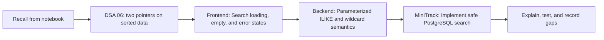

### 3. Python DSA practice (1 hour 45 minutes)

**Problem and reference:** [DSA Day 06](../dsa-python/lessons/dsa-day-06.md)
**Practice file:** [`dsa-python/practice/day-06.py`](../dsa-python/practice/day-06.py)
**Pattern:** two pointers on sorted data

#### Invariant to say aloud

Compare the sum at both ends; move the left pointer for a small sum and the right pointer for a large sum.

#### Work in this order

1. Restate the problem and ask about constraints.
2. Give a brute-force approach and its cost before optimizing.
3. Write the invariant above in your own words.
4. Implement without opening the solution for 25 minutes.
5. Test empty, smallest, typical, duplicate, and boundary cases where relevant.
6. Use a small hint if blocked; do not spend the entire block stuck.
7. Compare with the commented reference and re-code the key loop from memory.

From the repository root:

```bash
python3 dsa-python/scripts/check_practice.py 6
python3 -m unittest discover -s dsa-python/tests -v
```

**Expected observation:** the day-specific checker accepts your implementation,
and the completed reference suite still passes.

### 4. Frontend guided study (1 hour 30 minutes)

#### What

A complete search experience distinguishes pending work, zero matching records, validation failures, and server failures instead of showing an unexplained blank list.

#### Why

The browser layer should make state and feedback understandable without taking
ownership of persistent data or security decisions that belong on the server.

#### How

Read the relevant canonical app lesson linked above. Before revealing its full
code, sketch the component state, user event, request, success result, and
failure result.

Files to open deliberately:

- `frontend/lib/tasks.ts`
- `frontend/app/page.tsx`

Answer before coding:

- Which value is persistent, and which value is temporary interaction state?
- What starts this behavior?
- What should the user see while work is pending?
- What should remain unchanged when the operation fails?

### 5. Backend guided study (1 hour 30 minutes)

#### What

Binding a value prevents SQL injection, but percent and underscore still have wildcard meaning inside LIKE patterns. Decide whether users are allowed to use those wildcards and escape them when literal search is required.

#### Boundary checklist

- Validate untrusted path, query, and body values.
- Authenticate identity when the route is protected.
- Authorize the resource separately from authentication.
- Bind SQL values rather than concatenating untrusted data.
- Return an explicit success or error status.
- Log internal failures on the server without exposing secrets.

Use the canonical app lesson for complete implementation code. Type the new
code yourself in the learner workspace; do not copy from
`reference/frontend-complete/` before attempting it.

### 6. MiniTrack implementation (1 hour)

**Milestone source:** Day 8 SQL filtering and wildcard behavior

1. Add owner-safe or current-stage SQL predicates for status and title.
2. Bind every value instead of concatenating SQL data.
3. Test percent, underscore, empty text, and no-result cases.

Run the smallest checks that cover today's change. Use the exact commands from
the canonical lesson or the relevant package scripts.

**Expected observation:** the user-visible milestone works, its important
failure path is explicit, and existing behavior remains intact.

### 7. Trace the event or request


Trace one concrete input. Name every boundary, value, and possible failure.

### 8. Deliberate debugging exercise (25 minutes)

**Break it:** Concatenate the search text directly into the SQL string.

**Predict before running:** write the expected symptom in your notebook.

**Expected symptom:** Quotes or SQL syntax in the input can change the query and create an injection vulnerability.

**Root cause:** The query structure and untrusted data were mixed.

**Restore and verify:** Restore placeholders and pass search values separately.

Do not stop after making the symptom disappear. Explain why the repair restores
the intended invariant.

### 9. Interview questions and answers (30 minutes)

#### Q1. What is search loading, empty, and error states?

**Interview-ready answer:** A complete search experience distinguishes pending work, zero matching records, validation failures, and server failures instead of showing an unexplained blank list.

**Example:** Use `frontend/lib/tasks.ts` and point to the state, event, or rendered
behavior involved in today's milestone.

**Senior follow-up:** Explain when this frontend choice would become difficult
to maintain and what measurement or requirement would justify a different
design.

#### Q2. How should the backend handle parameterized ilike and wildcard semantics?

**Interview-ready answer:** Binding a value prevents SQL injection, but percent and underscore still have wildcard meaning inside LIKE patterns. Decide whether users are allowed to use those wildcards and escape them when literal search is required.

**Example:** Trace the relevant Route Handler or server boundary into the
MiniTrack data function and back to its response.

**Senior follow-up:** Describe the failure mode, logging requirement, and what
must remain private when the dependency is unavailable.

#### Q3. What invariant makes the two pointers on sorted data solution correct?

**Interview-ready answer:** Compare the sum at both ends; move the left pointer for a small sum and the right pointer for a large sum.

**Example:** Dry-run the first non-trivial sample from DSA Day 06 and
show the state after each iteration.

**Senior follow-up:** State the assumptions under which the claimed complexity
holds and how changed constraints might require another approach.

#### Q4. How does today's work fit the complete MiniTrack system?

**Interview-ready answer:** Normalized URL input becomes bound SQL data and returns a server-rendered filtered list.

**Example:** Begin with one user action and finish with the visible result or
verified system state.

**Senior follow-up:** Identify the first bottleneck, security risk, or
operational signal you would measure before adding infrastructure.

### 10. Complexity and operational cost

- **DSA:** O(n) time and O(1) space.
- **Application:** A leading-wildcard search can scan many rows. Use EXPLAIN with representative data before adding a specialized index.
- **Learning:** Attempting, retrieving, and correcting is more valuable than
  copying several solutions. Keep the scope to one understood pattern today.

### Exit checklist

- [ ] I completed DSA Day 06 before reading its solution.
- [ ] I can state the invariant and complexity without notes.
- [ ] I completed or verified the MiniTrack milestone.
- [ ] I tested one success path and one failure path.
- [ ] I completed the deliberate debugging exercise.
- [ ] I answered all four interview questions aloud.
- [ ] I recorded what remains confusing and tomorrow's first task.

**Suggested commit:** `prep day 06: implement safe postgresql search`
<a id="prep-day-07"></a>

## Prep Day 07 — Add focused unit tests

**Date:** Wednesday, December 2, 2026
**Time:** 7 study hours plus breaks
**Starting point:** App Days 1–4 are complete. Continue from the current learner workspace and the previous preparation-day exit checklist.
**Goal:** Add focused unit tests.

[Prep Day 06](../lessons/interview-prep/prep-day-06.md) · [Preparation plan](./FULL_STACK_INTERVIEW_PREP_PLAN.md) · [Track home](../lessons/interview-prep/README.md) · [Prep Day 08](../lessons/interview-prep/prep-day-08.md)

**Canonical study material:** [App Day 9](../lessons/day-09.md) · [DSA Day 07](../dsa-python/lessons/dsa-day-07.md)

### Learning objectives

- explain testing behavior rather than component internals in beginner-friendly language;
- explain pure validation tests and its failure boundary;
- implement or verify the listed MiniTrack milestone;
- solve DSA Day 07 using the sliding window pattern;
- record the result in your rough notebook and explain it without reading.

### 1. Start with notebook recall (45 minutes)

Before opening a lesson, write answers in
[`checkpoints/ROUGH/Notes.md`](../checkpoints/ROUGH/Notes.md):

1. What did yesterday's browser action send to the server?
2. Where is persistent task data stored, and what state is only temporary?
3. What error or edge case can you already predict for today's topic?
4. What do you remember about the **sliding window** pattern?

Use this format:

```md
### Wednesday, December 2, 2026

- What:
- Why:
- How MiniTrack uses it:
- What can go wrong:
- First task:
```

Do not copy the source paragraph. Write what you remember, then compare.

### 2. Understand today's full-stack boundary (20 minutes)

**Frontend focus — Testing behavior rather than component internals:** A frontend test should interact through labels, roles, text, and user actions, then assert what a user can observe. Internal state names are implementation details.

**Backend focus — Pure validation tests:** Pure normalization and validation functions are fast unit-test targets because they need no server or database. Test valid values and each rejected boundary.

**Today's connection:** Unit tests create a fast safety net at the narrowest deterministic boundary.

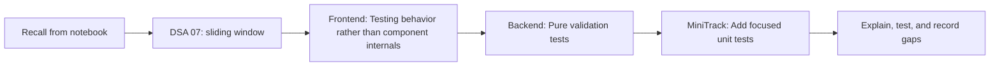

### 3. Python DSA practice (1 hour 45 minutes)

**Problem and reference:** [DSA Day 07](../dsa-python/lessons/dsa-day-07.md)
**Practice file:** [`dsa-python/practice/day-07.py`](../dsa-python/practice/day-07.py)
**Pattern:** sliding window

#### Invariant to say aloud

Expand the right edge and move the left edge past a repeated character while tracking the best valid window.

#### Work in this order

1. Restate the problem and ask about constraints.
2. Give a brute-force approach and its cost before optimizing.
3. Write the invariant above in your own words.
4. Implement without opening the solution for 25 minutes.
5. Test empty, smallest, typical, duplicate, and boundary cases where relevant.
6. Use a small hint if blocked; do not spend the entire block stuck.
7. Compare with the commented reference and re-code the key loop from memory.

From the repository root:

```bash
python3 dsa-python/scripts/check_practice.py 7
python3 -m unittest discover -s dsa-python/tests -v
```

**Expected observation:** the day-specific checker accepts your implementation,
and the completed reference suite still passes.

### 4. Frontend guided study (1 hour 30 minutes)

#### What

A frontend test should interact through labels, roles, text, and user actions, then assert what a user can observe. Internal state names are implementation details.

#### Why

The browser layer should make state and feedback understandable without taking
ownership of persistent data or security decisions that belong on the server.

#### How

Read the relevant canonical app lesson linked above. Before revealing its full
code, sketch the component state, user event, request, success result, and
failure result.

Files to open deliberately:

- `frontend/test/validation.test.ts`
- `frontend/lib/validation.ts`
- `frontend/package.json`

Answer before coding:

- Which value is persistent, and which value is temporary interaction state?
- What starts this behavior?
- What should the user see while work is pending?
- What should remain unchanged when the operation fails?

### 5. Backend guided study (1 hour 30 minutes)

#### What

Pure normalization and validation functions are fast unit-test targets because they need no server or database. Test valid values and each rejected boundary.

#### Boundary checklist

- Validate untrusted path, query, and body values.
- Authenticate identity when the route is protected.
- Authorize the resource separately from authentication.
- Bind SQL values rather than concatenating untrusted data.
- Return an explicit success or error status.
- Log internal failures on the server without exposing secrets.

Use the canonical app lesson for complete implementation code. Type the new
code yourself in the learner workspace; do not copy from
`reference/frontend-complete/` before attempting it.

### 6. MiniTrack implementation (1 hour)

**Milestone source:** Day 9 unit tests and test boundaries

1. Write a success test before changing implementation.
2. Add empty, whitespace, wrong-type, too-long, and unsafe-ID cases.
3. Break one condition deliberately and confirm the test fails for the expected reason.

Run the smallest checks that cover today's change. Use the exact commands from
the canonical lesson or the relevant package scripts.

**Expected observation:** the user-visible milestone works, its important
failure path is explicit, and existing behavior remains intact.

### 7. Trace the event or request


Trace one concrete input. Name every boundary, value, and possible failure.

### 8. Deliberate debugging exercise (25 minutes)

**Break it:** Write a test that only checks an internal helper was called.

**Predict before running:** write the expected symptom in your notebook.

**Expected symptom:** A refactor can fail the test even when user behavior remains correct.

**Root cause:** The test is coupled to implementation instead of the contract.

**Restore and verify:** Assert the returned value, response, or visible result.

Do not stop after making the symptom disappear. Explain why the repair restores
the intended invariant.

### 9. Interview questions and answers (30 minutes)

#### Q1. What is testing behavior rather than component internals?

**Interview-ready answer:** A frontend test should interact through labels, roles, text, and user actions, then assert what a user can observe. Internal state names are implementation details.

**Example:** Use `frontend/test/validation.test.ts` and point to the state, event, or rendered
behavior involved in today's milestone.

**Senior follow-up:** Explain when this frontend choice would become difficult
to maintain and what measurement or requirement would justify a different
design.

#### Q2. How should the backend handle pure validation tests?

**Interview-ready answer:** Pure normalization and validation functions are fast unit-test targets because they need no server or database. Test valid values and each rejected boundary.

**Example:** Trace the relevant Route Handler or server boundary into the
MiniTrack data function and back to its response.

**Senior follow-up:** Describe the failure mode, logging requirement, and what
must remain private when the dependency is unavailable.

#### Q3. What invariant makes the sliding window solution correct?

**Interview-ready answer:** Expand the right edge and move the left edge past a repeated character while tracking the best valid window.

**Example:** Dry-run the first non-trivial sample from DSA Day 07 and
show the state after each iteration.

**Senior follow-up:** State the assumptions under which the claimed complexity
holds and how changed constraints might require another approach.

#### Q4. How does today's work fit the complete MiniTrack system?

**Interview-ready answer:** Unit tests create a fast safety net at the narrowest deterministic boundary.

**Example:** Begin with one user action and finish with the visible result or
verified system state.

**Senior follow-up:** Identify the first bottleneck, security risk, or
operational signal you would measure before adding infrastructure.

### 10. Complexity and operational cost

- **DSA:** O(n) time and O(k) space.
- **Application:** Each pure test is normally O(input size) and runs without I/O, making the suite cheap enough to run frequently.
- **Learning:** Attempting, retrieving, and correcting is more valuable than
  copying several solutions. Keep the scope to one understood pattern today.

### Exit checklist

- [ ] I completed DSA Day 07 before reading its solution.
- [ ] I can state the invariant and complexity without notes.
- [ ] I completed or verified the MiniTrack milestone.
- [ ] I tested one success path and one failure path.
- [ ] I completed the deliberate debugging exercise.
- [ ] I answered all four interview questions aloud.
- [ ] I recorded what remains confusing and tomorrow's first task.

**Suggested commit:** `prep day 07: add focused unit tests`
<a id="prep-day-08"></a>

## Prep Day 08 — Test database and browser behavior

**Date:** Thursday, December 3, 2026
**Time:** 7 study hours plus breaks
**Starting point:** App Days 1–4 are complete. Continue from the current learner workspace and the previous preparation-day exit checklist.
**Goal:** Test database and browser behavior.

[Prep Day 07](../lessons/interview-prep/prep-day-07.md) · [Preparation plan](./FULL_STACK_INTERVIEW_PREP_PLAN.md) · [Track home](../lessons/interview-prep/README.md) · [Prep Day 09](../lessons/interview-prep/prep-day-09.md)

**Canonical study material:** [App Day 9](../lessons/day-09.md) · [DSA Day 08](../dsa-python/lessons/dsa-day-08.md)

### Learning objectives

- explain critical user-flow testing in beginner-friendly language;
- explain isolated real-database integration tests and its failure boundary;
- implement or verify the listed MiniTrack milestone;
- solve DSA Day 08 using the variable sliding window pattern;
- record the result in your rough notebook and explain it without reading.

### 1. Start with notebook recall (45 minutes)

Before opening a lesson, write answers in
[`checkpoints/ROUGH/Notes.md`](../checkpoints/ROUGH/Notes.md):

1. What did yesterday's browser action send to the server?
2. Where is persistent task data stored, and what state is only temporary?
3. What error or edge case can you already predict for today's topic?
4. What do you remember about the **variable sliding window** pattern?

Use this format:

```md
### Thursday, December 3, 2026

- What:
- Why:
- How MiniTrack uses it:
- What can go wrong:
- First task:
```

Do not copy the source paragraph. Write what you remember, then compare.

### 2. Understand today's full-stack boundary (20 minutes)

**Frontend focus — Critical user-flow testing:** An end-to-end test proves that a user can complete a valuable journey through the real browser and server. Keep it focused because it is slower and has more failure sources.

**Backend focus — Isolated real-database integration tests:** SQL behavior should be tested against a real isolated PostgreSQL database because mocks cannot prove constraints, SQL syntax, or transaction behavior.

**Today's connection:** Unit, database, and browser tests cover different boundaries without asking one expensive test to prove everything.

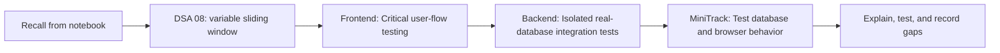

### 3. Python DSA practice (1 hour 45 minutes)

**Problem and reference:** [DSA Day 08](../dsa-python/lessons/dsa-day-08.md)
**Practice file:** [`dsa-python/practice/day-08.py`](../dsa-python/practice/day-08.py)
**Pattern:** variable sliding window

#### Invariant to say aloud

Expand until the sum satisfies the target, then shrink while the window remains valid to find the minimum.

#### Work in this order

1. Restate the problem and ask about constraints.
2. Give a brute-force approach and its cost before optimizing.
3. Write the invariant above in your own words.
4. Implement without opening the solution for 25 minutes.
5. Test empty, smallest, typical, duplicate, and boundary cases where relevant.
6. Use a small hint if blocked; do not spend the entire block stuck.
7. Compare with the commented reference and re-code the key loop from memory.

From the repository root:

```bash
python3 dsa-python/scripts/check_practice.py 8
python3 -m unittest discover -s dsa-python/tests -v
```

**Expected observation:** the day-specific checker accepts your implementation,
and the completed reference suite still passes.

### 4. Frontend guided study (1 hour 30 minutes)

#### What

An end-to-end test proves that a user can complete a valuable journey through the real browser and server. Keep it focused because it is slower and has more failure sources.

#### Why

The browser layer should make state and feedback understandable without taking
ownership of persistent data or security decisions that belong on the server.

#### How

Read the relevant canonical app lesson linked above. Before revealing its full
code, sketch the component state, user event, request, success result, and
failure result.

Files to open deliberately:

- `frontend/test`
- `frontend/playwright.config.ts`
- `frontend/package.json`

Answer before coding:

- Which value is persistent, and which value is temporary interaction state?
- What starts this behavior?
- What should the user see while work is pending?
- What should remain unchanged when the operation fails?

### 5. Backend guided study (1 hour 30 minutes)

#### What

SQL behavior should be tested against a real isolated PostgreSQL database because mocks cannot prove constraints, SQL syntax, or transaction behavior.

#### Boundary checklist

- Validate untrusted path, query, and body values.
- Authenticate identity when the route is protected.
- Authorize the resource separately from authentication.
- Bind SQL values rather than concatenating untrusted data.
- Return an explicit success or error status.
- Log internal failures on the server without exposing secrets.

Use the canonical app lesson for complete implementation code. Type the new
code yourself in the learner workspace; do not copy from
`reference/frontend-complete/` before attempting it.

### 6. MiniTrack implementation (1 hour)

**Milestone source:** Day 9 PostgreSQL integration and Playwright tests

1. Run validation tests.
2. Run an isolated database create/update/delete test.
3. Run the browser create/edit/filter/delete path and inspect one deliberate failure.

Run the smallest checks that cover today's change. Use the exact commands from
the canonical lesson or the relevant package scripts.

**Expected observation:** the user-visible milestone works, its important
failure path is explicit, and existing behavior remains intact.

### 7. Trace the event or request


Trace one concrete input. Name every boundary, value, and possible failure.

### 8. Deliberate debugging exercise (25 minutes)

**Break it:** Point tests at the normal development database.

**Predict before running:** write the expected symptom in your notebook.

**Expected symptom:** Tests can destroy or depend on personal data and become order-dependent.

**Root cause:** The suite lacks data isolation.

**Restore and verify:** Use a dedicated test database and reset known state between tests.

Do not stop after making the symptom disappear. Explain why the repair restores
the intended invariant.

### 9. Interview questions and answers (30 minutes)

#### Q1. What is critical user-flow testing?

**Interview-ready answer:** An end-to-end test proves that a user can complete a valuable journey through the real browser and server. Keep it focused because it is slower and has more failure sources.

**Example:** Use `frontend/test` and point to the state, event, or rendered
behavior involved in today's milestone.

**Senior follow-up:** Explain when this frontend choice would become difficult
to maintain and what measurement or requirement would justify a different
design.

#### Q2. How should the backend handle isolated real-database integration tests?

**Interview-ready answer:** SQL behavior should be tested against a real isolated PostgreSQL database because mocks cannot prove constraints, SQL syntax, or transaction behavior.

**Example:** Trace the relevant Route Handler or server boundary into the
MiniTrack data function and back to its response.

**Senior follow-up:** Describe the failure mode, logging requirement, and what
must remain private when the dependency is unavailable.

#### Q3. What invariant makes the variable sliding window solution correct?

**Interview-ready answer:** Expand until the sum satisfies the target, then shrink while the window remains valid to find the minimum.

**Example:** Dry-run the first non-trivial sample from DSA Day 08 and
show the state after each iteration.

**Senior follow-up:** State the assumptions under which the claimed complexity
holds and how changed constraints might require another approach.

#### Q4. How does today's work fit the complete MiniTrack system?

**Interview-ready answer:** Unit, database, and browser tests cover different boundaries without asking one expensive test to prove everything.

**Example:** Begin with one user action and finish with the visible result or
verified system state.

**Senior follow-up:** Identify the first bottleneck, security risk, or
operational signal you would measure before adding infrastructure.

### 10. Complexity and operational cost

- **DSA:** O(n) time and O(1) space for non-negative inputs.
- **Application:** Unit tests are cheapest, database tests add process and I/O cost, and browser tests are slowest. The suite should have many narrow tests and few critical E2E paths.
- **Learning:** Attempting, retrieving, and correcting is more valuable than
  copying several solutions. Keep the scope to one understood pattern today.

### Exit checklist

- [ ] I completed DSA Day 08 before reading its solution.
- [ ] I can state the invariant and complexity without notes.
- [ ] I completed or verified the MiniTrack milestone.
- [ ] I tested one success path and one failure path.
- [ ] I completed the deliberate debugging exercise.
- [ ] I answered all four interview questions aloud.
- [ ] I recorded what remains confusing and tomorrow's first task.

**Suggested commit:** `prep day 08: test database and browser behavior`
<a id="prep-day-09"></a>

## Prep Day 09 — Add authentication and client session Context

**Date:** Friday, December 4, 2026
**Time:** 7 study hours plus breaks
**Starting point:** App Days 1–4 are complete. Continue from the current learner workspace and the previous preparation-day exit checklist.
**Goal:** Add authentication and client session Context.

[Prep Day 08](../lessons/interview-prep/prep-day-08.md) · [Preparation plan](./FULL_STACK_INTERVIEW_PREP_PLAN.md) · [Track home](../lessons/interview-prep/README.md) · [Prep Day 10](../lessons/interview-prep/prep-day-10.md)

**Canonical study material:** [App Day 10](../lessons/day-10.md) · [DSA Day 09](../dsa-python/lessons/dsa-day-09.md)

### Learning objectives

- explain context for client-visible session data in beginner-friendly language;
- explain server-side authentication checks and its failure boundary;
- implement or verify the listed MiniTrack milestone;
- solve DSA Day 09 using the stack pattern;
- record the result in your rough notebook and explain it without reading.

### 1. Start with notebook recall (45 minutes)

Before opening a lesson, write answers in
[`checkpoints/ROUGH/Notes.md`](../checkpoints/ROUGH/Notes.md):

1. What did yesterday's browser action send to the server?
2. Where is persistent task data stored, and what state is only temporary?
3. What error or edge case can you already predict for today's topic?
4. What do you remember about the **stack** pattern?

Use this format:

```md
### Friday, December 4, 2026

- What:
- Why:
- How MiniTrack uses it:
- What can go wrong:
- First task:
```

Do not copy the source paragraph. Write what you remember, then compare.

### 2. Understand today's full-stack boundary (20 minutes)

**Frontend focus — Context for client-visible session data:** SessionProvider uses React Context to make session state available to descendants without passing props through every level. It improves client ergonomics but is not a security boundary.

**Backend focus — Server-side authentication checks:** Protected Server Components and Route Handlers obtain the verified session on the server. Hiding a button in the browser does not stop a direct HTTP request.

**Today's connection:** The identity provider establishes a session; React Context distributes a display-friendly view while server code enforces access.

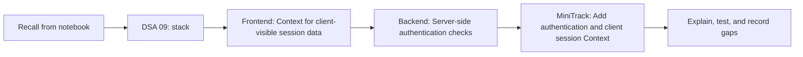

### 3. Python DSA practice (1 hour 45 minutes)

**Problem and reference:** [DSA Day 09](../dsa-python/lessons/dsa-day-09.md)
**Practice file:** [`dsa-python/practice/day-09.py`](../dsa-python/practice/day-09.py)
**Pattern:** stack

#### Invariant to say aloud

Push opening delimiters and require every closing delimiter to match the most recent unmatched opening one.

#### Work in this order

1. Restate the problem and ask about constraints.
2. Give a brute-force approach and its cost before optimizing.
3. Write the invariant above in your own words.
4. Implement without opening the solution for 25 minutes.
5. Test empty, smallest, typical, duplicate, and boundary cases where relevant.
6. Use a small hint if blocked; do not spend the entire block stuck.
7. Compare with the commented reference and re-code the key loop from memory.

From the repository root:

```bash
python3 dsa-python/scripts/check_practice.py 9
python3 -m unittest discover -s dsa-python/tests -v
```

**Expected observation:** the day-specific checker accepts your implementation,
and the completed reference suite still passes.

### 4. Frontend guided study (1 hour 30 minutes)

#### What

SessionProvider uses React Context to make session state available to descendants without passing props through every level. It improves client ergonomics but is not a security boundary.

#### Why

The browser layer should make state and feedback understandable without taking
ownership of persistent data or security decisions that belong on the server.

#### How

Read the relevant canonical app lesson linked above. Before revealing its full
code, sketch the component state, user event, request, success result, and
failure result.

Files to open deliberately:

- `frontend/auth.ts`
- `frontend/app/providers.tsx`
- `frontend/app/layout.tsx`
- `frontend/app/api/auth/[...nextauth]/route.ts`

Answer before coding:

- Which value is persistent, and which value is temporary interaction state?
- What starts this behavior?
- What should the user see while work is pending?
- What should remain unchanged when the operation fails?

### 5. Backend guided study (1 hour 30 minutes)

#### What

Protected Server Components and Route Handlers obtain the verified session on the server. Hiding a button in the browser does not stop a direct HTTP request.

#### Boundary checklist

- Validate untrusted path, query, and body values.
- Authenticate identity when the route is protected.
- Authorize the resource separately from authentication.
- Bind SQL values rather than concatenating untrusted data.
- Return an explicit success or error status.
- Log internal failures on the server without exposing secrets.

Use the canonical app lesson for complete implementation code. Type the new
code yourself in the learner workspace; do not copy from
`reference/frontend-complete/` before attempting it.

### 6. MiniTrack implementation (1 hour)

**Milestone source:** Day 10 Auth.js, SessionProvider, and useSession

1. Configure Auth.js and the provider callback.
2. Wrap the client subtree with SessionProvider.
3. Add sign-in and sign-out controls while keeping server checks authoritative.

Run the smallest checks that cover today's change. Use the exact commands from
the canonical lesson or the relevant package scripts.

**Expected observation:** the user-visible milestone works, its important
failure path is explicit, and existing behavior remains intact.

### 7. Trace the event or request


Trace one concrete input. Name every boundary, value, and possible failure.

### 8. Deliberate debugging exercise (25 minutes)

**Break it:** Protect a mutation only by hiding its button when useSession reports no user.

**Predict before running:** write the expected symptom in your notebook.

**Expected symptom:** An attacker can call the Route Handler directly.

**Root cause:** Browser state is controlled by the client and cannot authorize server resources.

**Restore and verify:** Call auth() at the server boundary and reject missing identity.

Do not stop after making the symptom disappear. Explain why the repair restores
the intended invariant.

### 9. Interview questions and answers (30 minutes)

#### Q1. What is context for client-visible session data?

**Interview-ready answer:** SessionProvider uses React Context to make session state available to descendants without passing props through every level. It improves client ergonomics but is not a security boundary.

**Example:** Use `frontend/auth.ts` and point to the state, event, or rendered
behavior involved in today's milestone.

**Senior follow-up:** Explain when this frontend choice would become difficult
to maintain and what measurement or requirement would justify a different
design.

#### Q2. How should the backend handle server-side authentication checks?

**Interview-ready answer:** Protected Server Components and Route Handlers obtain the verified session on the server. Hiding a button in the browser does not stop a direct HTTP request.

**Example:** Trace the relevant Route Handler or server boundary into the
MiniTrack data function and back to its response.

**Senior follow-up:** Describe the failure mode, logging requirement, and what
must remain private when the dependency is unavailable.

#### Q3. What invariant makes the stack solution correct?

**Interview-ready answer:** Push opening delimiters and require every closing delimiter to match the most recent unmatched opening one.

**Example:** Dry-run the first non-trivial sample from DSA Day 09 and
show the state after each iteration.

**Senior follow-up:** State the assumptions under which the claimed complexity
holds and how changed constraints might require another approach.

#### Q4. How does today's work fit the complete MiniTrack system?

**Interview-ready answer:** The identity provider establishes a session; React Context distributes a display-friendly view while server code enforces access.

**Example:** Begin with one user action and finish with the visible result or
verified system state.

**Senior follow-up:** Identify the first bottleneck, security risk, or
operational signal you would measure before adding infrastructure.

### 10. Complexity and operational cost

- **DSA:** O(n) time and O(n) worst-case space.
- **Application:** Session verification adds work to protected requests. Cache and database choices depend on the configured session strategy.
- **Learning:** Attempting, retrieving, and correcting is more valuable than
  copying several solutions. Keep the scope to one understood pattern today.

### Exit checklist

- [ ] I completed DSA Day 09 before reading its solution.
- [ ] I can state the invariant and complexity without notes.
- [ ] I completed or verified the MiniTrack milestone.
- [ ] I tested one success path and one failure path.
- [ ] I completed the deliberate debugging exercise.
- [ ] I answered all four interview questions aloud.
- [ ] I recorded what remains confusing and tomorrow's first task.

**Suggested commit:** `prep day 09: add authentication and client session context`
<a id="prep-day-10"></a>

## Prep Day 10 — Finish authentication and run the first mock

**Date:** Saturday, December 5, 2026
**Time:** 7 study hours plus breaks
**Starting point:** App Days 1–4 are complete. Continue from the current learner workspace and the previous preparation-day exit checklist.
**Goal:** Finish authentication and run the first mock.

[Prep Day 09](../lessons/interview-prep/prep-day-09.md) · [Preparation plan](./FULL_STACK_INTERVIEW_PREP_PLAN.md) · [Track home](../lessons/interview-prep/README.md) · [Prep Day 11](../lessons/interview-prep/prep-day-11.md)

**Canonical study material:** [App Day 10](../lessons/day-10.md) · [Interview index](./INTERVIEW_INDEX.md) · [DSA Day 10](../dsa-python/lessons/dsa-day-10.md)

### Learning objectives

- explain authenticated loading and signed-out states in beginner-friendly language;
- explain returning 401 for missing identity and its failure boundary;
- implement or verify the listed MiniTrack milestone;
- solve DSA Day 10 using the monotonic stack pattern;
- record the result in your rough notebook and explain it without reading.

### 1. Start with notebook recall (45 minutes)

Before opening a lesson, write answers in
[`checkpoints/ROUGH/Notes.md`](../checkpoints/ROUGH/Notes.md):

1. What did yesterday's browser action send to the server?
2. Where is persistent task data stored, and what state is only temporary?
3. What error or edge case can you already predict for today's topic?
4. What do you remember about the **monotonic stack** pattern?

Use this format:

```md
### Saturday, December 5, 2026

- What:
- Why:
- How MiniTrack uses it:
- What can go wrong:
- First task:
```

Do not copy the source paragraph. Write what you remember, then compare.

### 2. Understand today's full-stack boundary (20 minutes)

**Frontend focus — Authenticated loading and signed-out states:** The UI should represent loading, authenticated, and unauthenticated states explicitly. Rendering the signed-out state is not a substitute for server enforcement.

**Backend focus — Returning 401 for missing identity:** A Route Handler returns 401 when no valid identity is present. Authorization for a particular task is a separate Day 11 decision.

**Today's connection:** Authentication proves who is making a request but does not yet prove which task that user may access.

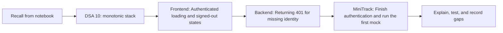

### 3. Python DSA practice (1 hour 45 minutes)

**Problem and reference:** [DSA Day 10](../dsa-python/lessons/dsa-day-10.md)
**Practice file:** [`dsa-python/practice/day-10.py`](../dsa-python/practice/day-10.py)
**Pattern:** monotonic stack

#### Invariant to say aloud

Keep indices whose temperatures form a decreasing stack; a warmer day resolves entries from the top.

#### Work in this order

1. Restate the problem and ask about constraints.
2. Give a brute-force approach and its cost before optimizing.
3. Write the invariant above in your own words.
4. Implement without opening the solution for 25 minutes.
5. Test empty, smallest, typical, duplicate, and boundary cases where relevant.
6. Use a small hint if blocked; do not spend the entire block stuck.
7. Compare with the commented reference and re-code the key loop from memory.

From the repository root:

```bash
python3 dsa-python/scripts/check_practice.py 10
python3 -m unittest discover -s dsa-python/tests -v
```

**Expected observation:** the day-specific checker accepts your implementation,
and the completed reference suite still passes.

### 4. Frontend guided study (1 hour 30 minutes)

#### What

The UI should represent loading, authenticated, and unauthenticated states explicitly. Rendering the signed-out state is not a substitute for server enforcement.

#### Why

The browser layer should make state and feedback understandable without taking
ownership of persistent data or security decisions that belong on the server.

#### How

Read the relevant canonical app lesson linked above. Before revealing its full
code, sketch the component state, user event, request, success result, and
failure result.

Files to open deliberately:

- `frontend/auth.ts`
- `frontend/app/api/tasks/route.ts`
- `frontend/app/api/tasks/[id]/route.ts`

Answer before coding:

- Which value is persistent, and which value is temporary interaction state?
- What starts this behavior?
- What should the user see while work is pending?
- What should remain unchanged when the operation fails?

### 5. Backend guided study (1 hour 30 minutes)

#### What

A Route Handler returns 401 when no valid identity is present. Authorization for a particular task is a separate Day 11 decision.

#### Boundary checklist

- Validate untrusted path, query, and body values.
- Authenticate identity when the route is protected.
- Authorize the resource separately from authentication.
- Bind SQL values rather than concatenating untrusted data.
- Return an explicit success or error status.
- Log internal failures on the server without exposing secrets.

Use the canonical app lesson for complete implementation code. Type the new
code yourself in the learner workspace; do not copy from
`reference/frontend-complete/` before attempting it.

### 6. MiniTrack implementation (1 hour)

**Milestone source:** Day 10 protected requests and authentication review

1. Verify sign-in and sign-out.
2. Call task endpoints while signed out and confirm 401.
3. Run a 30-minute mock covering React state, HTTP, SQL, and authentication.

Run the smallest checks that cover today's change. Use the exact commands from
the canonical lesson or the relevant package scripts.

**Expected observation:** the user-visible milestone works, its important
failure path is explicit, and existing behavior remains intact.

### 7. Trace the event or request


Trace one concrete input. Name every boundary, value, and possible failure.

### 8. Deliberate debugging exercise (25 minutes)

**Break it:** Return 404 whenever the session is missing.

**Predict before running:** write the expected symptom in your notebook.

**Expected symptom:** Clients cannot distinguish missing authentication from a missing resource.

**Root cause:** The response does not describe the failed boundary accurately.

**Restore and verify:** Use 401 for missing or invalid authentication and reserve 404 for resource policy.

Do not stop after making the symptom disappear. Explain why the repair restores
the intended invariant.

### 9. Interview questions and answers (30 minutes)

#### Q1. What is authenticated loading and signed-out states?

**Interview-ready answer:** The UI should represent loading, authenticated, and unauthenticated states explicitly. Rendering the signed-out state is not a substitute for server enforcement.

**Example:** Use `frontend/auth.ts` and point to the state, event, or rendered
behavior involved in today's milestone.

**Senior follow-up:** Explain when this frontend choice would become difficult
to maintain and what measurement or requirement would justify a different
design.

#### Q2. How should the backend handle returning 401 for missing identity?

**Interview-ready answer:** A Route Handler returns 401 when no valid identity is present. Authorization for a particular task is a separate Day 11 decision.

**Example:** Trace the relevant Route Handler or server boundary into the
MiniTrack data function and back to its response.

**Senior follow-up:** Describe the failure mode, logging requirement, and what
must remain private when the dependency is unavailable.

#### Q3. What invariant makes the monotonic stack solution correct?

**Interview-ready answer:** Keep indices whose temperatures form a decreasing stack; a warmer day resolves entries from the top.

**Example:** Dry-run the first non-trivial sample from DSA Day 10 and
show the state after each iteration.

**Senior follow-up:** State the assumptions under which the claimed complexity
holds and how changed constraints might require another approach.

#### Q4. How does today's work fit the complete MiniTrack system?

**Interview-ready answer:** Authentication proves who is making a request but does not yet prove which task that user may access.

**Example:** Begin with one user action and finish with the visible result or
verified system state.

**Senior follow-up:** Identify the first bottleneck, security risk, or
operational signal you would measure before adding infrastructure.

### 10. Complexity and operational cost

- **DSA:** O(n) time and O(n) space.
- **Application:** A monotonic stack processes each index at most twice. Authentication cost should be measured at the protected boundary, not guessed.
- **Learning:** Attempting, retrieving, and correcting is more valuable than
  copying several solutions. Keep the scope to one understood pattern today.

### Exit checklist

- [ ] I completed DSA Day 10 before reading its solution.
- [ ] I can state the invariant and complexity without notes.
- [ ] I completed or verified the MiniTrack milestone.
- [ ] I tested one success path and one failure path.
- [ ] I completed the deliberate debugging exercise.
- [ ] I answered all four interview questions aloud.
- [ ] I recorded what remains confusing and tomorrow's first task.

**Suggested commit:** `prep day 10: finish authentication and run the first mock`
<a id="prep-day-11"></a>

## Prep Day 11 — Migrate from shared tasks to owned tasks

**Date:** Monday, December 7, 2026
**Time:** 7 study hours plus breaks
**Starting point:** App Days 1–4 are complete. Continue from the current learner workspace and the previous preparation-day exit checklist.
**Goal:** Migrate from shared tasks to owned tasks.

[Prep Day 10](../lessons/interview-prep/prep-day-10.md) · [Preparation plan](./FULL_STACK_INTERVIEW_PREP_PLAN.md) · [Track home](../lessons/interview-prep/README.md) · [Prep Day 12](../lessons/interview-prep/prep-day-12.md)

**Canonical study material:** [App Day 11](../lessons/day-11.md) · [DSA Day 11](../dsa-python/lessons/dsa-day-11.md)

### Learning objectives

- explain rendering identity-scoped data in beginner-friendly language;
- explain safe schema migration for required ownership and its failure boundary;
- implement or verify the listed MiniTrack milestone;
- solve DSA Day 11 using the binary search pattern;
- record the result in your rough notebook and explain it without reading.

### 1. Start with notebook recall (45 minutes)

Before opening a lesson, write answers in
[`checkpoints/ROUGH/Notes.md`](../checkpoints/ROUGH/Notes.md):

1. What did yesterday's browser action send to the server?
2. Where is persistent task data stored, and what state is only temporary?
3. What error or edge case can you already predict for today's topic?
4. What do you remember about the **binary search** pattern?

Use this format:

```md
### Monday, December 7, 2026

- What:
- Why:
- How MiniTrack uses it:
- What can go wrong:
- First task:
```

Do not copy the source paragraph. Write what you remember, then compare.

### 2. Understand today's full-stack boundary (20 minutes)

**Frontend focus — Rendering identity-scoped data:** The page should receive only tasks selected for the authenticated owner. The client should not download every user's tasks and filter them locally.

**Backend focus — Safe schema migration for required ownership:** Adding a required owner to existing rows needs an ordered migration: create compatible schema, backfill or deliberately remove teaching data, add constraints, and verify before relying on them.

**Today's connection:** Identity becomes a foreign-key relationship used by every task data operation.

```mermaid
flowchart LR
  Recall["Recall from notebook"] --> DSA["DSA 11: binary search"]
  DSA --> FE["Frontend: Rendering identity-scoped data"]
  FE --> BE["Backend: Safe schema migration for required ownership"]
  BE --> App["MiniTrack: Migrate from shared tasks to owned tasks"]
  App --> Explain["Explain, test, and record gaps"]
```

### 3. Python DSA practice (1 hour 45 minutes)

**Problem and reference:** [DSA Day 11](../dsa-python/lessons/dsa-day-11.md)
**Practice file:** [`dsa-python/practice/day-11.py`](../dsa-python/practice/day-11.py)
**Pattern:** binary search

#### Invariant to say aloud

Maintain a search interval that is guaranteed to contain the target if it exists, and discard half after each comparison.

#### Work in this order

1. Restate the problem and ask about constraints.
2. Give a brute-force approach and its cost before optimizing.
3. Write the invariant above in your own words.
4. Implement without opening the solution for 25 minutes.
5. Test empty, smallest, typical, duplicate, and boundary cases where relevant.
6. Use a small hint if blocked; do not spend the entire block stuck.
7. Compare with the commented reference and re-code the key loop from memory.

From the repository root:

```bash
python3 dsa-python/scripts/check_practice.py 11
python3 -m unittest discover -s dsa-python/tests -v
```

**Expected observation:** the day-specific checker accepts your implementation,
and the completed reference suite still passes.

### 4. Frontend guided study (1 hour 30 minutes)

#### What

The page should receive only tasks selected for the authenticated owner. The client should not download every user's tasks and filter them locally.

#### Why

The browser layer should make state and feedback understandable without taking
ownership of persistent data or security decisions that belong on the server.

#### How

Read the relevant canonical app lesson linked above. Before revealing its full
code, sketch the component state, user event, request, success result, and
failure result.

Files to open deliberately:

- `backend/sql`
- `frontend/lib/tasks.ts`
- `frontend/auth.ts`

Answer before coding:

- Which value is persistent, and which value is temporary interaction state?
- What starts this behavior?
- What should the user see while work is pending?
- What should remain unchanged when the operation fails?

### 5. Backend guided study (1 hour 30 minutes)

#### What

Adding a required owner to existing rows needs an ordered migration: create compatible schema, backfill or deliberately remove teaching data, add constraints, and verify before relying on them.

#### Boundary checklist

- Validate untrusted path, query, and body values.
- Authenticate identity when the route is protected.
- Authorize the resource separately from authentication.
- Bind SQL values rather than concatenating untrusted data.
- Return an explicit success or error status.
- Log internal failures on the server without exposing secrets.

Use the canonical app lesson for complete implementation code. Type the new
code yourself in the learner workspace; do not copy from
`reference/frontend-complete/` before attempting it.

### 6. MiniTrack implementation (1 hour)

**Milestone source:** Day 11 user schema and ownership migration

1. Add the Auth.js user/session schema required by the selected adapter.
2. Add owner_id in a migration-safe sequence.
3. Verify foreign keys and existing-row handling.

Run the smallest checks that cover today's change. Use the exact commands from
the canonical lesson or the relevant package scripts.

**Expected observation:** the user-visible milestone works, its important
failure path is explicit, and existing behavior remains intact.

### 7. Trace the event or request

```mermaid
sequenceDiagram
  participant U as You
  participant B as Browser or interviewer
  participant A as Application boundary
  participant D as Data or algorithm state
  U->>B: Start the day's action
  B->>A: Send event, request, or explanation
  A->>A: Validate assumptions and inputs
  A->>D: Perform bounded operation
  D-->>A: Return result or failure
  A-->>B: Observable outcome
  B-->>U: Verify and explain without notes
```

Trace one concrete input. Name every boundary, value, and possible failure.

### 8. Deliberate debugging exercise (25 minutes)

**Break it:** Add a NOT NULL owner_id column immediately to a populated table without a backfill.

**Predict before running:** write the expected symptom in your notebook.

**Expected symptom:** The migration fails because existing rows have no owner.

**Root cause:** The new constraint is incompatible with current data.

**Restore and verify:** Use an explicit compatibility and backfill sequence before enforcing NOT NULL.

Do not stop after making the symptom disappear. Explain why the repair restores
the intended invariant.

### 9. Interview questions and answers (30 minutes)

#### Q1. What is rendering identity-scoped data?

**Interview-ready answer:** The page should receive only tasks selected for the authenticated owner. The client should not download every user's tasks and filter them locally.

**Example:** Use `backend/sql` and point to the state, event, or rendered
behavior involved in today's milestone.

**Senior follow-up:** Explain when this frontend choice would become difficult
to maintain and what measurement or requirement would justify a different
design.

#### Q2. How should the backend handle safe schema migration for required ownership?

**Interview-ready answer:** Adding a required owner to existing rows needs an ordered migration: create compatible schema, backfill or deliberately remove teaching data, add constraints, and verify before relying on them.

**Example:** Trace the relevant Route Handler or server boundary into the
MiniTrack data function and back to its response.

**Senior follow-up:** Describe the failure mode, logging requirement, and what
must remain private when the dependency is unavailable.

#### Q3. What invariant makes the binary search solution correct?

**Interview-ready answer:** Maintain a search interval that is guaranteed to contain the target if it exists, and discard half after each comparison.

**Example:** Dry-run the first non-trivial sample from DSA Day 11 and
show the state after each iteration.

**Senior follow-up:** State the assumptions under which the claimed complexity
holds and how changed constraints might require another approach.

#### Q4. How does today's work fit the complete MiniTrack system?

**Interview-ready answer:** Identity becomes a foreign-key relationship used by every task data operation.

**Example:** Begin with one user action and finish with the visible result or
verified system state.

**Senior follow-up:** Identify the first bottleneck, security risk, or
operational signal you would measure before adding infrastructure.

### 10. Complexity and operational cost

- **DSA:** O(log n) time and O(1) iterative space.
- **Application:** Migration cost grows with row count and lock behavior. Rehearse on representative data and define recovery before production execution.
- **Learning:** Attempting, retrieving, and correcting is more valuable than
  copying several solutions. Keep the scope to one understood pattern today.

### Exit checklist

- [ ] I completed DSA Day 11 before reading its solution.
- [ ] I can state the invariant and complexity without notes.
- [ ] I completed or verified the MiniTrack milestone.
- [ ] I tested one success path and one failure path.
- [ ] I completed the deliberate debugging exercise.
- [ ] I answered all four interview questions aloud.
- [ ] I recorded what remains confusing and tomorrow's first task.

**Suggested commit:** `prep day 11: migrate from shared tasks to owned tasks`
<a id="prep-day-12"></a>

## Prep Day 12 — Enforce owner authorization in SQL

**Date:** Tuesday, December 8, 2026
**Time:** 7 study hours plus breaks
**Starting point:** App Days 1–4 are complete. Continue from the current learner workspace and the previous preparation-day exit checklist.
**Goal:** Enforce owner authorization in SQL.

[Prep Day 11](../lessons/interview-prep/prep-day-11.md) · [Preparation plan](./FULL_STACK_INTERVIEW_PREP_PLAN.md) · [Track home](../lessons/interview-prep/README.md) · [Prep Day 13](../lessons/interview-prep/prep-day-13.md)

**Canonical study material:** [App Day 11](../lessons/day-11.md) · [DSA Day 12](../dsa-python/lessons/dsa-day-12.md)

### Learning objectives

- explain treating hidden ui as convenience only in beginner-friendly language;
- explain owner-scoped sql and idor prevention and its failure boundary;
- implement or verify the listed MiniTrack milestone;
- solve DSA Day 12 using the binary search in rotated data pattern;
- record the result in your rough notebook and explain it without reading.

### 1. Start with notebook recall (45 minutes)

Before opening a lesson, write answers in
[`checkpoints/ROUGH/Notes.md`](../checkpoints/ROUGH/Notes.md):

1. What did yesterday's browser action send to the server?
2. Where is persistent task data stored, and what state is only temporary?
3. What error or edge case can you already predict for today's topic?
4. What do you remember about the **binary search in rotated data** pattern?

Use this format:

```md
### Tuesday, December 8, 2026

- What:
- Why:
- How MiniTrack uses it:
- What can go wrong:
- First task:
```

Do not copy the source paragraph. Write what you remember, then compare.

### 2. Understand today's full-stack boundary (20 minutes)

**Frontend focus — Treating hidden UI as convenience only:** The UI may hide actions a user cannot take, but that only improves usability. Every request must still be authorized on the server.

**Backend focus — Owner-scoped SQL and IDOR prevention:** Include owner ID in the same SELECT, UPDATE, or DELETE predicate as the task ID. Fetching by ID and checking later creates avoidable race and omission risks.

**Today's connection:** Authorization is enforced where the database operation selects the row, closing the direct-object-reference gap.

```mermaid
flowchart LR
  Recall["Recall from notebook"] --> DSA["DSA 12: binary search in rotated data"]
  DSA --> FE["Frontend: Treating hidden UI as convenience only"]
  FE --> BE["Backend: Owner-scoped SQL and IDOR prevention"]
  BE --> App["MiniTrack: Enforce owner authorization in SQL"]
  App --> Explain["Explain, test, and record gaps"]
```

### 3. Python DSA practice (1 hour 45 minutes)

**Problem and reference:** [DSA Day 12](../dsa-python/lessons/dsa-day-12.md)
**Practice file:** [`dsa-python/practice/day-12.py`](../dsa-python/practice/day-12.py)
**Pattern:** binary search in rotated data

#### Invariant to say aloud

At least one side is sorted; use bounds to decide whether the target lies inside that sorted half.

#### Work in this order

1. Restate the problem and ask about constraints.
2. Give a brute-force approach and its cost before optimizing.
3. Write the invariant above in your own words.
4. Implement without opening the solution for 25 minutes.
5. Test empty, smallest, typical, duplicate, and boundary cases where relevant.
6. Use a small hint if blocked; do not spend the entire block stuck.
7. Compare with the commented reference and re-code the key loop from memory.

From the repository root:

```bash
python3 dsa-python/scripts/check_practice.py 12
python3 -m unittest discover -s dsa-python/tests -v
```

**Expected observation:** the day-specific checker accepts your implementation,
and the completed reference suite still passes.

### 4. Frontend guided study (1 hour 30 minutes)

#### What

The UI may hide actions a user cannot take, but that only improves usability. Every request must still be authorized on the server.

#### Why

The browser layer should make state and feedback understandable without taking
ownership of persistent data or security decisions that belong on the server.

#### How

Read the relevant canonical app lesson linked above. Before revealing its full
code, sketch the component state, user event, request, success result, and
failure result.

Files to open deliberately:

- `frontend/lib/tasks.ts`
- `frontend/app/api/tasks/route.ts`
- `frontend/app/api/tasks/[id]/route.ts`

Answer before coding:

- Which value is persistent, and which value is temporary interaction state?
- What starts this behavior?
- What should the user see while work is pending?
- What should remain unchanged when the operation fails?

### 5. Backend guided study (1 hour 30 minutes)

#### What

Include owner ID in the same SELECT, UPDATE, or DELETE predicate as the task ID. Fetching by ID and checking later creates avoidable race and omission risks.

#### Boundary checklist

- Validate untrusted path, query, and body values.
- Authenticate identity when the route is protected.
- Authorize the resource separately from authentication.
- Bind SQL values rather than concatenating untrusted data.
- Return an explicit success or error status.
- Log internal failures on the server without exposing secrets.

Use the canonical app lesson for complete implementation code. Type the new
code yourself in the learner workspace; do not copy from
`reference/frontend-complete/` before attempting it.

### 6. MiniTrack implementation (1 hour)

**Milestone source:** Day 11 owner-scoped reads and mutations

1. Pass the verified user ID into every task data function.
2. Add owner_id to every read and mutation predicate.
3. Attempt cross-user access and confirm no row is returned or changed.

Run the smallest checks that cover today's change. Use the exact commands from
the canonical lesson or the relevant package scripts.

**Expected observation:** the user-visible milestone works, its important
failure path is explicit, and existing behavior remains intact.

### 7. Trace the event or request

```mermaid
sequenceDiagram
  participant U as You
  participant B as Browser or interviewer
  participant A as Application boundary
  participant D as Data or algorithm state
  U->>B: Start the day's action
  B->>A: Send event, request, or explanation
  A->>A: Validate assumptions and inputs
  A->>D: Perform bounded operation
  D-->>A: Return result or failure
  A-->>B: Observable outcome
  B-->>U: Verify and explain without notes
```

Trace one concrete input. Name every boundary, value, and possible failure.

### 8. Deliberate debugging exercise (25 minutes)

**Break it:** Update a task using only WHERE id = $1.

**Predict before running:** write the expected symptom in your notebook.

**Expected symptom:** Any authenticated user who learns another task ID can mutate it.

**Root cause:** Authentication was mistaken for resource authorization.

**Restore and verify:** Bind both task ID and verified owner ID in the mutation predicate.

Do not stop after making the symptom disappear. Explain why the repair restores
the intended invariant.

### 9. Interview questions and answers (30 minutes)

#### Q1. What is treating hidden ui as convenience only?

**Interview-ready answer:** The UI may hide actions a user cannot take, but that only improves usability. Every request must still be authorized on the server.

**Example:** Use `frontend/lib/tasks.ts` and point to the state, event, or rendered
behavior involved in today's milestone.

**Senior follow-up:** Explain when this frontend choice would become difficult
to maintain and what measurement or requirement would justify a different
design.

#### Q2. How should the backend handle owner-scoped sql and idor prevention?

**Interview-ready answer:** Include owner ID in the same SELECT, UPDATE, or DELETE predicate as the task ID. Fetching by ID and checking later creates avoidable race and omission risks.

**Example:** Trace the relevant Route Handler or server boundary into the
MiniTrack data function and back to its response.

**Senior follow-up:** Describe the failure mode, logging requirement, and what
must remain private when the dependency is unavailable.

#### Q3. What invariant makes the binary search in rotated data solution correct?

**Interview-ready answer:** At least one side is sorted; use bounds to decide whether the target lies inside that sorted half.

**Example:** Dry-run the first non-trivial sample from DSA Day 12 and
show the state after each iteration.

**Senior follow-up:** State the assumptions under which the claimed complexity
holds and how changed constraints might require another approach.

#### Q4. How does today's work fit the complete MiniTrack system?

**Interview-ready answer:** Authorization is enforced where the database operation selects the row, closing the direct-object-reference gap.

**Example:** Begin with one user action and finish with the visible result or
verified system state.

**Senior follow-up:** Identify the first bottleneck, security risk, or
operational signal you would measure before adding infrastructure.

### 10. Complexity and operational cost

- **DSA:** O(log n) time and O(1) space.
- **Application:** Use an index that matches measured owner-scoped query patterns. Extra indexes improve some reads but increase write and storage cost.
- **Learning:** Attempting, retrieving, and correcting is more valuable than
  copying several solutions. Keep the scope to one understood pattern today.

### Exit checklist

- [ ] I completed DSA Day 12 before reading its solution.
- [ ] I can state the invariant and complexity without notes.
- [ ] I completed or verified the MiniTrack milestone.
- [ ] I tested one success path and one failure path.
- [ ] I completed the deliberate debugging exercise.
- [ ] I answered all four interview questions aloud.
- [ ] I recorded what remains confusing and tomorrow's first task.

**Suggested commit:** `prep day 12: enforce owner authorization in sql`
<a id="prep-day-13"></a>

## Prep Day 13 — Prove authorization with negative tests

**Date:** Wednesday, December 9, 2026
**Time:** 7 study hours plus breaks
**Starting point:** App Days 1–4 are complete. Continue from the current learner workspace and the previous preparation-day exit checklist.
**Goal:** Prove authorization with negative tests.

[Prep Day 12](../lessons/interview-prep/prep-day-12.md) · [Preparation plan](./FULL_STACK_INTERVIEW_PREP_PLAN.md) · [Track home](../lessons/interview-prep/README.md) · [Prep Day 14](../lessons/interview-prep/prep-day-14.md)

**Canonical study material:** [App Day 12](../lessons/day-12.md) · [DSA Day 13](../dsa-python/lessons/dsa-day-13.md)

### Learning objectives

- explain clear unauthorized and missing behavior in beginner-friendly language;
- explain anonymous, owner, and cross-owner test matrices and its failure boundary;
- implement or verify the listed MiniTrack milestone;
- solve DSA Day 13 using the linked-list pointer reversal pattern;
- record the result in your rough notebook and explain it without reading.

### 1. Start with notebook recall (45 minutes)

Before opening a lesson, write answers in
[`checkpoints/ROUGH/Notes.md`](../checkpoints/ROUGH/Notes.md):

1. What did yesterday's browser action send to the server?
2. Where is persistent task data stored, and what state is only temporary?
3. What error or edge case can you already predict for today's topic?
4. What do you remember about the **linked-list pointer reversal** pattern?

Use this format:

```md
### Wednesday, December 9, 2026

- What:
- Why:
- How MiniTrack uses it:
- What can go wrong:
- First task:
```

Do not copy the source paragraph. Write what you remember, then compare.

### 2. Understand today's full-stack boundary (20 minutes)

**Frontend focus — Clear unauthorized and missing behavior:** The interface should not expose another user's data and should respond safely when a resource disappears. Exact status details may be intentionally limited to avoid leaking existence.

**Backend focus — Anonymous, owner, and cross-owner test matrices:** Test each operation as anonymous, owner, and other user. For forbidden mutations, verify both the response and that the database row remained unchanged.

**Today's connection:** Negative tests turn owner isolation from an assumption into repeatable evidence.

```mermaid
flowchart LR
  Recall["Recall from notebook"] --> DSA["DSA 13: linked-list pointer reversal"]
  DSA --> FE["Frontend: Clear unauthorized and missing behavior"]
  FE --> BE["Backend: Anonymous, owner, and cross-owner test matrices"]
  BE --> App["MiniTrack: Prove authorization with negative tests"]
  App --> Explain["Explain, test, and record gaps"]
```

### 3. Python DSA practice (1 hour 45 minutes)

**Problem and reference:** [DSA Day 13](../dsa-python/lessons/dsa-day-13.md)
**Practice file:** [`dsa-python/practice/day-13.py`](../dsa-python/practice/day-13.py)
**Pattern:** linked-list pointer reversal

#### Invariant to say aloud

Before changing current.next, save the next node; then reverse the pointer and advance both references.

#### Work in this order

1. Restate the problem and ask about constraints.
2. Give a brute-force approach and its cost before optimizing.
3. Write the invariant above in your own words.
4. Implement without opening the solution for 25 minutes.
5. Test empty, smallest, typical, duplicate, and boundary cases where relevant.
6. Use a small hint if blocked; do not spend the entire block stuck.
7. Compare with the commented reference and re-code the key loop from memory.

From the repository root:

```bash
python3 dsa-python/scripts/check_practice.py 13
python3 -m unittest discover -s dsa-python/tests -v
```

**Expected observation:** the day-specific checker accepts your implementation,
and the completed reference suite still passes.

### 4. Frontend guided study (1 hour 30 minutes)

#### What

The interface should not expose another user's data and should respond safely when a resource disappears. Exact status details may be intentionally limited to avoid leaking existence.

#### Why

The browser layer should make state and feedback understandable without taking
ownership of persistent data or security decisions that belong on the server.

#### How

Read the relevant canonical app lesson linked above. Before revealing its full
code, sketch the component state, user event, request, success result, and
failure result.

Files to open deliberately:

- `frontend/test`
- `frontend/app/api/tasks/[id]/route.ts`
- `frontend/lib/tasks.ts`

Answer before coding:

- Which value is persistent, and which value is temporary interaction state?
- What starts this behavior?
- What should the user see while work is pending?
- What should remain unchanged when the operation fails?

### 5. Backend guided study (1 hour 30 minutes)

#### What

Test each operation as anonymous, owner, and other user. For forbidden mutations, verify both the response and that the database row remained unchanged.

#### Boundary checklist

- Validate untrusted path, query, and body values.
- Authenticate identity when the route is protected.
- Authorize the resource separately from authentication.
- Bind SQL values rather than concatenating untrusted data.
- Return an explicit success or error status.
- Log internal failures on the server without exposing secrets.

Use the canonical app lesson for complete implementation code. Type the new
code yourself in the learner workspace; do not copy from
`reference/frontend-complete/` before attempting it.

### 6. MiniTrack implementation (1 hour)

**Milestone source:** Day 12 authorization matrix and data-isolation tests

1. Create fixtures for two users and their tasks.
2. Test read and mutation behavior for every identity relationship.
3. Query the database after rejected mutations to prove isolation.

Run the smallest checks that cover today's change. Use the exact commands from
the canonical lesson or the relevant package scripts.

**Expected observation:** the user-visible milestone works, its important
failure path is explicit, and existing behavior remains intact.

### 7. Trace the event or request

```mermaid
sequenceDiagram
  participant U as You
  participant B as Browser or interviewer
  participant A as Application boundary
  participant D as Data or algorithm state
  U->>B: Start the day's action
  B->>A: Send event, request, or explanation
  A->>A: Validate assumptions and inputs
  A->>D: Perform bounded operation
  D-->>A: Return result or failure
  A-->>B: Observable outcome
  B-->>U: Verify and explain without notes
```

Trace one concrete input. Name every boundary, value, and possible failure.

### 8. Deliberate debugging exercise (25 minutes)

**Break it:** Assert only that a cross-user PATCH returns an error.

**Predict before running:** write the expected symptom in your notebook.

**Expected symptom:** A bug could still modify the row before returning the error.

**Root cause:** The test checks the HTTP surface but not the security invariant.

**Restore and verify:** Read the row afterward and assert all protected values are unchanged.

Do not stop after making the symptom disappear. Explain why the repair restores
the intended invariant.

### 9. Interview questions and answers (30 minutes)

#### Q1. What is clear unauthorized and missing behavior?

**Interview-ready answer:** The interface should not expose another user's data and should respond safely when a resource disappears. Exact status details may be intentionally limited to avoid leaking existence.

**Example:** Use `frontend/test` and point to the state, event, or rendered
behavior involved in today's milestone.

**Senior follow-up:** Explain when this frontend choice would become difficult
to maintain and what measurement or requirement would justify a different
design.

#### Q2. How should the backend handle anonymous, owner, and cross-owner test matrices?

**Interview-ready answer:** Test each operation as anonymous, owner, and other user. For forbidden mutations, verify both the response and that the database row remained unchanged.

**Example:** Trace the relevant Route Handler or server boundary into the
MiniTrack data function and back to its response.

**Senior follow-up:** Describe the failure mode, logging requirement, and what
must remain private when the dependency is unavailable.

#### Q3. What invariant makes the linked-list pointer reversal solution correct?

**Interview-ready answer:** Before changing current.next, save the next node; then reverse the pointer and advance both references.

**Example:** Dry-run the first non-trivial sample from DSA Day 13 and
show the state after each iteration.

**Senior follow-up:** State the assumptions under which the claimed complexity
holds and how changed constraints might require another approach.

#### Q4. How does today's work fit the complete MiniTrack system?

**Interview-ready answer:** Negative tests turn owner isolation from an assumption into repeatable evidence.

**Example:** Begin with one user action and finish with the visible result or
verified system state.

**Senior follow-up:** Identify the first bottleneck, security risk, or
operational signal you would measure before adding infrastructure.

### 10. Complexity and operational cost

- **DSA:** O(n) time and O(1) space.
- **Application:** The authorization matrix multiplies cases, but table-driven setup keeps the suite understandable. Real-database tests cost more and should share safe setup helpers.
- **Learning:** Attempting, retrieving, and correcting is more valuable than
  copying several solutions. Keep the scope to one understood pattern today.

### Exit checklist

- [ ] I completed DSA Day 13 before reading its solution.
- [ ] I can state the invariant and complexity without notes.
- [ ] I completed or verified the MiniTrack milestone.
- [ ] I tested one success path and one failure path.
- [ ] I completed the deliberate debugging exercise.
- [ ] I answered all four interview questions aloud.
- [ ] I recorded what remains confusing and tomorrow's first task.

**Suggested commit:** `prep day 13: prove authorization with negative tests`
<a id="prep-day-14"></a>

## Prep Day 14 — Make the complete flow accessible

**Date:** Thursday, December 10, 2026
**Time:** 7 study hours plus breaks
**Starting point:** App Days 1–4 are complete. Continue from the current learner workspace and the previous preparation-day exit checklist.
**Goal:** Make the complete flow accessible.

[Prep Day 13](../lessons/interview-prep/prep-day-13.md) · [Preparation plan](./FULL_STACK_INTERVIEW_PREP_PLAN.md) · [Track home](../lessons/interview-prep/README.md) · [Prep Day 15](../lessons/interview-prep/prep-day-15.md)

**Canonical study material:** [App Day 13](../lessons/day-13.md) · [DSA Day 14](../dsa-python/lessons/dsa-day-14.md)

### Learning objectives

- explain semantic html and deliberate focus in beginner-friendly language;
- explain accessible validation responses and its failure boundary;
- implement or verify the listed MiniTrack milestone;
- solve DSA Day 14 using the fast and slow pointers pattern;
- record the result in your rough notebook and explain it without reading.

### 1. Start with notebook recall (45 minutes)

Before opening a lesson, write answers in
[`checkpoints/ROUGH/Notes.md`](../checkpoints/ROUGH/Notes.md):

1. What did yesterday's browser action send to the server?
2. Where is persistent task data stored, and what state is only temporary?
3. What error or edge case can you already predict for today's topic?
4. What do you remember about the **fast and slow pointers** pattern?

Use this format:

```md
### Thursday, December 10, 2026

- What:
- Why:
- How MiniTrack uses it:
- What can go wrong:
- First task:
```

Do not copy the source paragraph. Write what you remember, then compare.

### 2. Understand today's full-stack boundary (20 minutes)

**Frontend focus — Semantic HTML and deliberate focus:** Native controls provide keyboard behavior, roles, and states automatically. Use ARIA to add missing meaning, not to recreate a button from a generic element.

**Backend focus — Accessible validation responses:** The server should return stable, non-secret error information that the client can associate with the affected control and announce appropriately.

**Today's connection:** Accessible behavior spans browser semantics, React state, async feedback, and predictable server errors.

```mermaid
flowchart LR
  Recall["Recall from notebook"] --> DSA["DSA 14: fast and slow pointers"]
  DSA --> FE["Frontend: Semantic HTML and deliberate focus"]
  FE --> BE["Backend: Accessible validation responses"]
  BE --> App["MiniTrack: Make the complete flow accessible"]
  App --> Explain["Explain, test, and record gaps"]
```

### 3. Python DSA practice (1 hour 45 minutes)

**Problem and reference:** [DSA Day 14](../dsa-python/lessons/dsa-day-14.md)
**Practice file:** [`dsa-python/practice/day-14.py`](../dsa-python/practice/day-14.py)
**Pattern:** fast and slow pointers

#### Invariant to say aloud

Advance one pointer twice as fast; if a cycle exists, the pointers eventually meet.

#### Work in this order

1. Restate the problem and ask about constraints.
2. Give a brute-force approach and its cost before optimizing.
3. Write the invariant above in your own words.
4. Implement without opening the solution for 25 minutes.
5. Test empty, smallest, typical, duplicate, and boundary cases where relevant.
6. Use a small hint if blocked; do not spend the entire block stuck.
7. Compare with the commented reference and re-code the key loop from memory.

From the repository root:

```bash
python3 dsa-python/scripts/check_practice.py 14
python3 -m unittest discover -s dsa-python/tests -v
```

**Expected observation:** the day-specific checker accepts your implementation,
and the completed reference suite still passes.

### 4. Frontend guided study (1 hour 30 minutes)

#### What

Native controls provide keyboard behavior, roles, and states automatically. Use ARIA to add missing meaning, not to recreate a button from a generic element.

#### Why

The browser layer should make state and feedback understandable without taking
ownership of persistent data or security decisions that belong on the server.

#### How

Read the relevant canonical app lesson linked above. Before revealing its full
code, sketch the component state, user event, request, success result, and
failure result.

Files to open deliberately:

- `frontend/app/TaskBoard.tsx`
- `frontend/app/page.tsx`

Answer before coding:

- Which value is persistent, and which value is temporary interaction state?
- What starts this behavior?
- What should the user see while work is pending?
- What should remain unchanged when the operation fails?

### 5. Backend guided study (1 hour 30 minutes)

#### What

The server should return stable, non-secret error information that the client can associate with the affected control and announce appropriately.

#### Boundary checklist

- Validate untrusted path, query, and body values.
- Authenticate identity when the route is protected.
- Authorize the resource separately from authentication.
- Bind SQL values rather than concatenating untrusted data.
- Return an explicit success or error status.
- Log internal failures on the server without exposing secrets.

Use the canonical app lesson for complete implementation code. Type the new
code yourself in the learner workspace; do not copy from
`reference/frontend-complete/` before attempting it.

### 6. MiniTrack implementation (1 hour)

**Milestone source:** Day 13 semantics, keyboard behavior, names, states, and focus

1. Complete create, edit, filter, and delete using only the keyboard.
2. Verify every control has an accessible name and visible focus.
3. Associate errors with fields and announce important async failures.

Run the smallest checks that cover today's change. Use the exact commands from
the canonical lesson or the relevant package scripts.

**Expected observation:** the user-visible milestone works, its important
failure path is explicit, and existing behavior remains intact.

### 7. Trace the event or request

```mermaid
sequenceDiagram
  participant U as You
  participant B as Browser or interviewer
  participant A as Application boundary
  participant D as Data or algorithm state
  U->>B: Start the day's action
  B->>A: Send event, request, or explanation
  A->>A: Validate assumptions and inputs
  A->>D: Perform bounded operation
  D-->>A: Return result or failure
  A-->>B: Observable outcome
  B-->>U: Verify and explain without notes
```

Trace one concrete input. Name every boundary, value, and possible failure.

### 8. Deliberate debugging exercise (25 minutes)

**Break it:** Replace a button with a div that has only an onClick handler.

**Predict before running:** write the expected symptom in your notebook.

**Expected symptom:** Keyboard activation and button semantics disappear.

**Root cause:** A visual shape was used instead of the correct interactive element.

**Restore and verify:** Restore a native button and style it as needed.

Do not stop after making the symptom disappear. Explain why the repair restores
the intended invariant.

### 9. Interview questions and answers (30 minutes)

#### Q1. What is semantic html and deliberate focus?

**Interview-ready answer:** Native controls provide keyboard behavior, roles, and states automatically. Use ARIA to add missing meaning, not to recreate a button from a generic element.

**Example:** Use `frontend/app/TaskBoard.tsx` and point to the state, event, or rendered
behavior involved in today's milestone.

**Senior follow-up:** Explain when this frontend choice would become difficult
to maintain and what measurement or requirement would justify a different
design.

#### Q2. How should the backend handle accessible validation responses?

**Interview-ready answer:** The server should return stable, non-secret error information that the client can associate with the affected control and announce appropriately.

**Example:** Trace the relevant Route Handler or server boundary into the
MiniTrack data function and back to its response.

**Senior follow-up:** Describe the failure mode, logging requirement, and what
must remain private when the dependency is unavailable.

#### Q3. What invariant makes the fast and slow pointers solution correct?

**Interview-ready answer:** Advance one pointer twice as fast; if a cycle exists, the pointers eventually meet.

**Example:** Dry-run the first non-trivial sample from DSA Day 14 and
show the state after each iteration.

**Senior follow-up:** State the assumptions under which the claimed complexity
holds and how changed constraints might require another approach.

#### Q4. How does today's work fit the complete MiniTrack system?

**Interview-ready answer:** Accessible behavior spans browser semantics, React state, async feedback, and predictable server errors.

**Example:** Begin with one user action and finish with the visible result or
verified system state.

**Senior follow-up:** Identify the first bottleneck, security risk, or
operational signal you would measure before adding infrastructure.

### 10. Complexity and operational cost

- **DSA:** O(n) time and O(1) space.
- **Application:** Accessibility checks add development time but reduce duplicated custom interaction code and costly late fixes.
- **Learning:** Attempting, retrieving, and correcting is more valuable than
  copying several solutions. Keep the scope to one understood pattern today.

### Exit checklist

- [ ] I completed DSA Day 14 before reading its solution.
- [ ] I can state the invariant and complexity without notes.
- [ ] I completed or verified the MiniTrack milestone.
- [ ] I tested one success path and one failure path.
- [ ] I completed the deliberate debugging exercise.
- [ ] I answered all four interview questions aloud.
- [ ] I recorded what remains confusing and tomorrow's first task.

**Suggested commit:** `prep day 14: make the complete flow accessible`
<a id="prep-day-15"></a>

## Prep Day 15 — Measure responsive rendering and memoization

**Date:** Friday, December 11, 2026
**Time:** 7 study hours plus breaks
**Starting point:** App Days 1–4 are complete. Continue from the current learner workspace and the previous preparation-day exit checklist.
**Goal:** Measure responsive rendering and memoization.

[Prep Day 14](../lessons/interview-prep/prep-day-14.md) · [Preparation plan](./FULL_STACK_INTERVIEW_PREP_PLAN.md) · [Track home](../lessons/interview-prep/README.md) · [Prep Day 16](../lessons/interview-prep/prep-day-16.md)

**Canonical study material:** [App Day 13](../lessons/day-13.md) · [DSA Day 15](../dsa-python/lessons/dsa-day-15.md)

### Learning objectives

- explain responsive layout and measured memoization in beginner-friendly language;
- explain separating render cost from api latency and its failure boundary;
- implement or verify the listed MiniTrack milestone;
- solve DSA Day 15 using the dummy-node list merge pattern;
- record the result in your rough notebook and explain it without reading.

### 1. Start with notebook recall (45 minutes)

Before opening a lesson, write answers in
[`checkpoints/ROUGH/Notes.md`](../checkpoints/ROUGH/Notes.md):

1. What did yesterday's browser action send to the server?
2. Where is persistent task data stored, and what state is only temporary?
3. What error or edge case can you already predict for today's topic?
4. What do you remember about the **dummy-node list merge** pattern?

Use this format:

```md
### Friday, December 11, 2026

- What:
- Why:
- How MiniTrack uses it:
- What can go wrong:
- First task:
```

Do not copy the source paragraph. Write what you remember, then compare.

### 2. Understand today's full-stack boundary (20 minutes)

**Frontend focus — Responsive layout and measured memoization:** Start with the narrow layout, then add breakpoint changes where content needs them. useMemo caches a value, useCallback caches a function reference, and React.memo may skip a child render when props remain shallowly equal.

**Backend focus — Separating render cost from API latency:** A slow interaction may come from rendering, network latency, server work, or SQL. Profile the layer before optimizing it.

**Today's connection:** Performance work uses evidence across React, HTTP, server, and database layers.

```mermaid
flowchart LR
  Recall["Recall from notebook"] --> DSA["DSA 15: dummy-node list merge"]
  DSA --> FE["Frontend: Responsive layout and measured memoization"]
  FE --> BE["Backend: Separating render cost from API latency"]
  BE --> App["MiniTrack: Measure responsive rendering and memoization"]
  App --> Explain["Explain, test, and record gaps"]
```

### 3. Python DSA practice (1 hour 45 minutes)

**Problem and reference:** [DSA Day 15](../dsa-python/lessons/dsa-day-15.md)
**Practice file:** [`dsa-python/practice/day-15.py`](../dsa-python/practice/day-15.py)
**Pattern:** dummy-node list merge

#### Invariant to say aloud

Append the smaller current node to a stable dummy-headed output and advance only that source pointer.

#### Work in this order

1. Restate the problem and ask about constraints.
2. Give a brute-force approach and its cost before optimizing.
3. Write the invariant above in your own words.
4. Implement without opening the solution for 25 minutes.
5. Test empty, smallest, typical, duplicate, and boundary cases where relevant.
6. Use a small hint if blocked; do not spend the entire block stuck.
7. Compare with the commented reference and re-code the key loop from memory.

From the repository root:

```bash
python3 dsa-python/scripts/check_practice.py 15
python3 -m unittest discover -s dsa-python/tests -v
```

**Expected observation:** the day-specific checker accepts your implementation,
and the completed reference suite still passes.

### 4. Frontend guided study (1 hour 30 minutes)

#### What

Start with the narrow layout, then add breakpoint changes where content needs them. useMemo caches a value, useCallback caches a function reference, and React.memo may skip a child render when props remain shallowly equal.

#### Why

The browser layer should make state and feedback understandable without taking
ownership of persistent data or security decisions that belong on the server.

#### How

Read the relevant canonical app lesson linked above. Before revealing its full
code, sketch the component state, user event, request, success result, and
failure result.

Files to open deliberately:

- `frontend/app/TaskBoard.tsx`
- `frontend/app/globals.css`

Answer before coding:

- Which value is persistent, and which value is temporary interaction state?
- What starts this behavior?
- What should the user see while work is pending?
- What should remain unchanged when the operation fails?

### 5. Backend guided study (1 hour 30 minutes)

#### What

A slow interaction may come from rendering, network latency, server work, or SQL. Profile the layer before optimizing it.

#### Boundary checklist

- Validate untrusted path, query, and body values.
- Authenticate identity when the route is protected.
- Authorize the resource separately from authentication.
- Bind SQL values rather than concatenating untrusted data.
- Return an explicit success or error status.
- Log internal failures on the server without exposing secrets.

Use the canonical app lesson for complete implementation code. Type the new
code yourself in the learner workspace; do not copy from
`reference/frontend-complete/` before attempting it.

### 6. MiniTrack implementation (1 hour)

**Milestone source:** Day 13 responsive design and React profiling lab

1. Verify the task row at narrow width and zoom.
2. Record a React Profiler baseline.
3. Try one memoization change, measure again, and remove it if it adds complexity without benefit.

Run the smallest checks that cover today's change. Use the exact commands from
the canonical lesson or the relevant package scripts.

**Expected observation:** the user-visible milestone works, its important
failure path is explicit, and existing behavior remains intact.

### 7. Trace the event or request

```mermaid
sequenceDiagram
  participant U as You
  participant B as Browser or interviewer
  participant A as Application boundary
  participant D as Data or algorithm state
  U->>B: Start the day's action
  B->>A: Send event, request, or explanation
  A->>A: Validate assumptions and inputs
  A->>D: Perform bounded operation
  D-->>A: Return result or failure
  A-->>B: Observable outcome
  B-->>U: Verify and explain without notes
```

Trace one concrete input. Name every boundary, value, and possible failure.

### 8. Deliberate debugging exercise (25 minutes)

**Break it:** Wrap every calculation and callback in memoization before profiling.

**Predict before running:** write the expected symptom in your notebook.

**Expected symptom:** Dependencies become harder to reason about while performance may not improve.

**Root cause:** Optimization was applied without evidence of a bottleneck.

**Restore and verify:** Return to plain code, capture a baseline, and optimize only measured work.

Do not stop after making the symptom disappear. Explain why the repair restores
the intended invariant.

### 9. Interview questions and answers (30 minutes)

#### Q1. What is responsive layout and measured memoization?

**Interview-ready answer:** Start with the narrow layout, then add breakpoint changes where content needs them. useMemo caches a value, useCallback caches a function reference, and React.memo may skip a child render when props remain shallowly equal.

**Example:** Use `frontend/app/TaskBoard.tsx` and point to the state, event, or rendered
behavior involved in today's milestone.

**Senior follow-up:** Explain when this frontend choice would become difficult
to maintain and what measurement or requirement would justify a different
design.

#### Q2. How should the backend handle separating render cost from api latency?

**Interview-ready answer:** A slow interaction may come from rendering, network latency, server work, or SQL. Profile the layer before optimizing it.

**Example:** Trace the relevant Route Handler or server boundary into the
MiniTrack data function and back to its response.

**Senior follow-up:** Describe the failure mode, logging requirement, and what
must remain private when the dependency is unavailable.

#### Q3. What invariant makes the dummy-node list merge solution correct?

**Interview-ready answer:** Append the smaller current node to a stable dummy-headed output and advance only that source pointer.

**Example:** Dry-run the first non-trivial sample from DSA Day 15 and
show the state after each iteration.

**Senior follow-up:** State the assumptions under which the claimed complexity
holds and how changed constraints might require another approach.

#### Q4. How does today's work fit the complete MiniTrack system?

**Interview-ready answer:** Performance work uses evidence across React, HTTP, server, and database layers.

**Example:** Begin with one user action and finish with the visible result or
verified system state.

**Senior follow-up:** Identify the first bottleneck, security risk, or
operational signal you would measure before adding infrastructure.

### 10. Complexity and operational cost

- **DSA:** O(n + m) time and O(1) auxiliary space.
- **Application:** Rendering a small list is O(n) and often cheap. Memoization adds comparison, memory, and cognitive cost that must be justified by measurements.
- **Learning:** Attempting, retrieving, and correcting is more valuable than
  copying several solutions. Keep the scope to one understood pattern today.

### Exit checklist

- [ ] I completed DSA Day 15 before reading its solution.
- [ ] I can state the invariant and complexity without notes.
- [ ] I completed or verified the MiniTrack milestone.
- [ ] I tested one success path and one failure path.
- [ ] I completed the deliberate debugging exercise.
- [ ] I answered all four interview questions aloud.
- [ ] I recorded what remains confusing and tomorrow's first task.

**Suggested commit:** `prep day 15: measure responsive rendering and memoization`
<a id="prep-day-16"></a>

## Prep Day 16 — Run the quality gate and a full-stack mock

**Date:** Saturday, December 12, 2026
**Time:** 7 study hours plus breaks
**Starting point:** App Days 1–4 are complete. Continue from the current learner workspace and the previous preparation-day exit checklist.
**Goal:** Run the quality gate and a full-stack mock.

[Prep Day 15](../lessons/interview-prep/prep-day-15.md) · [Preparation plan](./FULL_STACK_INTERVIEW_PREP_PLAN.md) · [Track home](../lessons/interview-prep/README.md) · [Prep Day 17](../lessons/interview-prep/prep-day-17.md)

**Canonical study material:** [Acceptance checklist](../CHECKLIST.md) · [Interview index](./INTERVIEW_INDEX.md) · [DSA Day 16](../dsa-python/lessons/dsa-day-16.md)

### Learning objectives

- explain explaining the complete browser journey in beginner-friendly language;
- explain running tests, type-check, build, and browser checks and its failure boundary;
- implement or verify the listed MiniTrack milestone;
- solve DSA Day 16 using the recursive tree DFS pattern;
- record the result in your rough notebook and explain it without reading.

### 1. Start with notebook recall (45 minutes)

Before opening a lesson, write answers in
[`checkpoints/ROUGH/Notes.md`](../checkpoints/ROUGH/Notes.md):

1. What did yesterday's browser action send to the server?
2. Where is persistent task data stored, and what state is only temporary?
3. What error or edge case can you already predict for today's topic?
4. What do you remember about the **recursive tree DFS** pattern?

Use this format:

```md
### Saturday, December 12, 2026

- What:
- Why:
- How MiniTrack uses it:
- What can go wrong:
- First task:
```

Do not copy the source paragraph. Write what you remember, then compare.

### 2. Understand today's full-stack boundary (20 minutes)

**Frontend focus — Explaining the complete browser journey:** Start with the user event, describe state and rendering, identify the HTTP request, then explain how the refreshed server data reaches the client.

**Backend focus — Running tests, type-check, build, and browser checks:** Each gate proves a different property: tests prove selected behavior, type-check proves static contracts, build proves production compilation, and browser checks prove the integrated journey.

**Today's connection:** A release candidate needs code, data, security, accessibility, and operational evidence together.

```mermaid
flowchart LR
  Recall["Recall from notebook"] --> DSA["DSA 16: recursive tree DFS"]
  DSA --> FE["Frontend: Explaining the complete browser journey"]
  FE --> BE["Backend: Running tests, type-check, build, and browser checks"]
  BE --> App["MiniTrack: Run the quality gate and a full-stack mock"]
  App --> Explain["Explain, test, and record gaps"]
```

### 3. Python DSA practice (1 hour 45 minutes)

**Problem and reference:** [DSA Day 16](../dsa-python/lessons/dsa-day-16.md)
**Practice file:** [`dsa-python/practice/day-16.py`](../dsa-python/practice/day-16.py)
**Pattern:** recursive tree DFS

#### Invariant to say aloud

The depth of a node is one plus the greater depth of its left and right subtrees, with an empty tree at zero.

#### Work in this order

1. Restate the problem and ask about constraints.
2. Give a brute-force approach and its cost before optimizing.
3. Write the invariant above in your own words.
4. Implement without opening the solution for 25 minutes.
5. Test empty, smallest, typical, duplicate, and boundary cases where relevant.
6. Use a small hint if blocked; do not spend the entire block stuck.
7. Compare with the commented reference and re-code the key loop from memory.

From the repository root:

```bash
python3 dsa-python/scripts/check_practice.py 16
python3 -m unittest discover -s dsa-python/tests -v
```

**Expected observation:** the day-specific checker accepts your implementation,
and the completed reference suite still passes.

### 4. Frontend guided study (1 hour 30 minutes)

#### What

Start with the user event, describe state and rendering, identify the HTTP request, then explain how the refreshed server data reaches the client.

#### Why

The browser layer should make state and feedback understandable without taking
ownership of persistent data or security decisions that belong on the server.

#### How

Read the relevant canonical app lesson linked above. Before revealing its full
code, sketch the component state, user event, request, success result, and
failure result.

Files to open deliberately:

- `frontend/package.json`
- `frontend/test`
- `frontend/app`

Answer before coding:

- Which value is persistent, and which value is temporary interaction state?
- What starts this behavior?
- What should the user see while work is pending?
- What should remain unchanged when the operation fails?

### 5. Backend guided study (1 hour 30 minutes)

#### What

Each gate proves a different property: tests prove selected behavior, type-check proves static contracts, build proves production compilation, and browser checks prove the integrated journey.

#### Boundary checklist

- Validate untrusted path, query, and body values.
- Authenticate identity when the route is protected.
- Authorize the resource separately from authentication.
- Bind SQL values rather than concatenating untrusted data.
- Return an explicit success or error status.
- Log internal failures on the server without exposing secrets.

Use the canonical app lesson for complete implementation code. Type the new
code yourself in the learner workspace; do not copy from
`reference/frontend-complete/` before attempting it.

### 6. MiniTrack implementation (1 hour)

**Milestone source:** Days 5–13 verification and end-to-end explanation

1. Run the repository's focused tests, type-check, and production build.
2. Complete the critical browser journey as an authenticated user.
3. Run a 45-minute mock and record the two highest-value gaps.

Run the smallest checks that cover today's change. Use the exact commands from
the canonical lesson or the relevant package scripts.

**Expected observation:** the user-visible milestone works, its important
failure path is explicit, and existing behavior remains intact.

### 7. Trace the event or request

```mermaid
sequenceDiagram
  participant U as You
  participant B as Browser or interviewer
  participant A as Application boundary
  participant D as Data or algorithm state
  U->>B: Start the day's action
  B->>A: Send event, request, or explanation
  A->>A: Validate assumptions and inputs
  A->>D: Perform bounded operation
  D-->>A: Return result or failure
  A-->>B: Observable outcome
  B-->>U: Verify and explain without notes
```

Trace one concrete input. Name every boundary, value, and possible failure.

### 8. Deliberate debugging exercise (25 minutes)

**Break it:** Treat a successful production build as proof that authorization works.

**Predict before running:** write the expected symptom in your notebook.

**Expected symptom:** Security logic may compile perfectly while allowing cross-user access.

**Root cause:** Compilation and behavior verification answer different questions.

**Restore and verify:** Run the negative authorization tests as a separate required gate.

Do not stop after making the symptom disappear. Explain why the repair restores
the intended invariant.

### 9. Interview questions and answers (30 minutes)

#### Q1. What is explaining the complete browser journey?

**Interview-ready answer:** Start with the user event, describe state and rendering, identify the HTTP request, then explain how the refreshed server data reaches the client.

**Example:** Use `frontend/package.json` and point to the state, event, or rendered
behavior involved in today's milestone.

**Senior follow-up:** Explain when this frontend choice would become difficult
to maintain and what measurement or requirement would justify a different
design.

#### Q2. How should the backend handle running tests, type-check, build, and browser checks?

**Interview-ready answer:** Each gate proves a different property: tests prove selected behavior, type-check proves static contracts, build proves production compilation, and browser checks prove the integrated journey.

**Example:** Trace the relevant Route Handler or server boundary into the
MiniTrack data function and back to its response.

**Senior follow-up:** Describe the failure mode, logging requirement, and what
must remain private when the dependency is unavailable.

#### Q3. What invariant makes the recursive tree DFS solution correct?

**Interview-ready answer:** The depth of a node is one plus the greater depth of its left and right subtrees, with an empty tree at zero.

**Example:** Dry-run the first non-trivial sample from DSA Day 16 and
show the state after each iteration.

**Senior follow-up:** State the assumptions under which the claimed complexity
holds and how changed constraints might require another approach.

#### Q4. How does today's work fit the complete MiniTrack system?

**Interview-ready answer:** A release candidate needs code, data, security, accessibility, and operational evidence together.

**Example:** Begin with one user action and finish with the visible result or
verified system state.

**Senior follow-up:** Identify the first bottleneck, security risk, or
operational signal you would measure before adding infrastructure.

### 10. Complexity and operational cost

- **DSA:** O(n) time and O(h) call-stack space.
- **Application:** A full gate is slower than a focused check, so use focused feedback while coding and the complete gate at milestones.
- **Learning:** Attempting, retrieving, and correcting is more valuable than
  copying several solutions. Keep the scope to one understood pattern today.

### Exit checklist

- [ ] I completed DSA Day 16 before reading its solution.
- [ ] I can state the invariant and complexity without notes.
- [ ] I completed or verified the MiniTrack milestone.
- [ ] I tested one success path and one failure path.
- [ ] I completed the deliberate debugging exercise.
- [ ] I answered all four interview questions aloud.
- [ ] I recorded what remains confusing and tomorrow's first task.

**Suggested commit:** `prep day 16: run the quality gate and a full-stack mock`
<a id="prep-day-17"></a>

## Prep Day 17 — Deploy with production-safe configuration

**Date:** Monday, December 14, 2026
**Time:** 7 study hours plus breaks
**Starting point:** App Days 1–4 are complete. Continue from the current learner workspace and the previous preparation-day exit checklist.
**Goal:** Deploy with production-safe configuration.

[Prep Day 16](../lessons/interview-prep/prep-day-16.md) · [Preparation plan](./FULL_STACK_INTERVIEW_PREP_PLAN.md) · [Track home](../lessons/interview-prep/README.md) · [Prep Day 18](../lessons/interview-prep/prep-day-18.md)

**Canonical study material:** [App Day 14](../lessons/day-14.md) · [DSA Day 17](../dsa-python/lessons/dsa-day-17.md)

### Learning objectives

- explain production urls and user-visible failures in beginner-friendly language;
- explain build-time versus runtime configuration and its failure boundary;
- implement or verify the listed MiniTrack milestone;
- solve DSA Day 17 using the tree BFS pattern;
- record the result in your rough notebook and explain it without reading.

### 1. Start with notebook recall (45 minutes)

Before opening a lesson, write answers in
[`checkpoints/ROUGH/Notes.md`](../checkpoints/ROUGH/Notes.md):

1. What did yesterday's browser action send to the server?
2. Where is persistent task data stored, and what state is only temporary?
3. What error or edge case can you already predict for today's topic?
4. What do you remember about the **tree BFS** pattern?

Use this format:

```md
### Monday, December 14, 2026

- What:
- Why:
- How MiniTrack uses it:
- What can go wrong:
- First task:
```

Do not copy the source paragraph. Write what you remember, then compare.

### 2. Understand today's full-stack boundary (20 minutes)

**Frontend focus — Production URLs and user-visible failures:** The deployed client must use the correct HTTPS origin and present useful failure states without exposing secrets or server internals.

**Backend focus — Build-time versus runtime configuration:** Build-time values are embedded while compiling; runtime secrets and database URLs must be supplied securely to the running service. Publicly prefixed values are not secrets.

**Today's connection:** Deployment connects immutable code, runtime configuration, database state, identity callbacks, and observable smoke tests.

```mermaid
flowchart LR
  Recall["Recall from notebook"] --> DSA["DSA 17: tree BFS"]
  DSA --> FE["Frontend: Production URLs and user-visible failures"]
  FE --> BE["Backend: Build-time versus runtime configuration"]
  BE --> App["MiniTrack: Deploy with production-safe configuration"]
  App --> Explain["Explain, test, and record gaps"]
```

### 3. Python DSA practice (1 hour 45 minutes)

**Problem and reference:** [DSA Day 17](../dsa-python/lessons/dsa-day-17.md)
**Practice file:** [`dsa-python/practice/day-17.py`](../dsa-python/practice/day-17.py)
**Pattern:** tree BFS

#### Invariant to say aloud

Process nodes level by level with a queue, measuring the current queue length before adding the next level.

#### Work in this order

1. Restate the problem and ask about constraints.
2. Give a brute-force approach and its cost before optimizing.
3. Write the invariant above in your own words.
4. Implement without opening the solution for 25 minutes.
5. Test empty, smallest, typical, duplicate, and boundary cases where relevant.
6. Use a small hint if blocked; do not spend the entire block stuck.
7. Compare with the commented reference and re-code the key loop from memory.

From the repository root:

```bash
python3 dsa-python/scripts/check_practice.py 17
python3 -m unittest discover -s dsa-python/tests -v
```

**Expected observation:** the day-specific checker accepts your implementation,
and the completed reference suite still passes.

### 4. Frontend guided study (1 hour 30 minutes)

#### What

The deployed client must use the correct HTTPS origin and present useful failure states without exposing secrets or server internals.

#### Why

The browser layer should make state and feedback understandable without taking
ownership of persistent data or security decisions that belong on the server.

#### How

Read the relevant canonical app lesson linked above. Before revealing its full
code, sketch the component state, user event, request, success result, and
failure result.

Files to open deliberately:

- `frontend/.env.local.example`
- `frontend/package.json`
- `backend/sql`

Answer before coding:

- Which value is persistent, and which value is temporary interaction state?
- What starts this behavior?
- What should the user see while work is pending?
- What should remain unchanged when the operation fails?

### 5. Backend guided study (1 hour 30 minutes)

#### What

Build-time values are embedded while compiling; runtime secrets and database URLs must be supplied securely to the running service. Publicly prefixed values are not secrets.

#### Boundary checklist

- Validate untrusted path, query, and body values.
- Authenticate identity when the route is protected.
- Authorize the resource separately from authentication.
- Bind SQL values rather than concatenating untrusted data.
- Return an explicit success or error status.
- Log internal failures on the server without exposing secrets.

Use the canonical app lesson for complete implementation code. Type the new
code yourself in the learner workspace; do not copy from
`reference/frontend-complete/` before attempting it.

### 6. MiniTrack implementation (1 hour)

**Milestone source:** Day 14 managed deployment, secrets, migrations, and smoke tests

1. Configure managed PostgreSQL and application environment values.
2. Run migrations as an explicit deployment step.
3. Verify HTTPS, OAuth callback, health, sign-in, and the critical task flow.

Run the smallest checks that cover today's change. Use the exact commands from
the canonical lesson or the relevant package scripts.

**Expected observation:** the user-visible milestone works, its important
failure path is explicit, and existing behavior remains intact.

### 7. Trace the event or request

```mermaid
sequenceDiagram
  participant U as You
  participant B as Browser or interviewer
  participant A as Application boundary
  participant D as Data or algorithm state
  U->>B: Start the day's action
  B->>A: Send event, request, or explanation
  A->>A: Validate assumptions and inputs
  A->>D: Perform bounded operation
  D-->>A: Return result or failure
  A-->>B: Observable outcome
  B-->>U: Verify and explain without notes
```

Trace one concrete input. Name every boundary, value, and possible failure.

### 8. Deliberate debugging exercise (25 minutes)

**Break it:** Place a database password in a public client environment variable.

**Predict before running:** write the expected symptom in your notebook.

**Expected symptom:** The credential can be included in browser-delivered code.

**Root cause:** The trust boundary between server configuration and public configuration was violated.

**Restore and verify:** Rotate the credential and keep it only in the deployment platform's server-side secret store.

Do not stop after making the symptom disappear. Explain why the repair restores
the intended invariant.

### 9. Interview questions and answers (30 minutes)

#### Q1. What is production urls and user-visible failures?

**Interview-ready answer:** The deployed client must use the correct HTTPS origin and present useful failure states without exposing secrets or server internals.

**Example:** Use `frontend/.env.local.example` and point to the state, event, or rendered
behavior involved in today's milestone.

**Senior follow-up:** Explain when this frontend choice would become difficult
to maintain and what measurement or requirement would justify a different
design.

#### Q2. How should the backend handle build-time versus runtime configuration?

**Interview-ready answer:** Build-time values are embedded while compiling; runtime secrets and database URLs must be supplied securely to the running service. Publicly prefixed values are not secrets.

**Example:** Trace the relevant Route Handler or server boundary into the
MiniTrack data function and back to its response.

**Senior follow-up:** Describe the failure mode, logging requirement, and what
must remain private when the dependency is unavailable.

#### Q3. What invariant makes the tree BFS solution correct?

**Interview-ready answer:** Process nodes level by level with a queue, measuring the current queue length before adding the next level.

**Example:** Dry-run the first non-trivial sample from DSA Day 17 and
show the state after each iteration.

**Senior follow-up:** State the assumptions under which the claimed complexity
holds and how changed constraints might require another approach.

#### Q4. How does today's work fit the complete MiniTrack system?

**Interview-ready answer:** Deployment connects immutable code, runtime configuration, database state, identity callbacks, and observable smoke tests.

**Example:** Begin with one user action and finish with the visible result or
verified system state.

**Senior follow-up:** Identify the first bottleneck, security risk, or
operational signal you would measure before adding infrastructure.

### 10. Complexity and operational cost

- **DSA:** O(n) time and O(w) space for maximum tree width.
- **Application:** Managed services trade direct infrastructure control for operational convenience. Track application, database, egress, and build costs separately.
- **Learning:** Attempting, retrieving, and correcting is more valuable than
  copying several solutions. Keep the scope to one understood pattern today.

### Exit checklist

- [ ] I completed DSA Day 17 before reading its solution.
- [ ] I can state the invariant and complexity without notes.
- [ ] I completed or verified the MiniTrack milestone.
- [ ] I tested one success path and one failure path.
- [ ] I completed the deliberate debugging exercise.
- [ ] I answered all four interview questions aloud.
- [ ] I recorded what remains confusing and tomorrow's first task.

**Suggested commit:** `prep day 17: deploy with production-safe configuration`
<a id="prep-day-18"></a>

## Prep Day 18 — Verify release and recovery

**Date:** Tuesday, December 15, 2026
**Time:** 7 study hours plus breaks
**Starting point:** App Days 1–4 are complete. Continue from the current learner workspace and the previous preparation-day exit checklist.
**Goal:** Verify release and recovery.

[Prep Day 17](../lessons/interview-prep/prep-day-17.md) · [Preparation plan](./FULL_STACK_INTERVIEW_PREP_PLAN.md) · [Track home](../lessons/interview-prep/README.md) · [Prep Day 19](../lessons/interview-prep/prep-day-19.md)

**Canonical study material:** [App Day 15](../lessons/day-15.md) · [DSA Day 18](../dsa-python/lessons/dsa-day-18.md)

### Learning objectives

- explain production smoke testing in beginner-friendly language;
- explain application rollback versus database recovery and its failure boundary;
- implement or verify the listed MiniTrack milestone;
- solve DSA Day 18 using the DFS with bounds pattern;
- record the result in your rough notebook and explain it without reading.

### 1. Start with notebook recall (45 minutes)

Before opening a lesson, write answers in
[`checkpoints/ROUGH/Notes.md`](../checkpoints/ROUGH/Notes.md):

1. What did yesterday's browser action send to the server?
2. Where is persistent task data stored, and what state is only temporary?
3. What error or edge case can you already predict for today's topic?
4. What do you remember about the **DFS with bounds** pattern?

Use this format:

```md
### Tuesday, December 15, 2026

- What:
- Why:
- How MiniTrack uses it:
- What can go wrong:
- First task:
```

Do not copy the source paragraph. Write what you remember, then compare.

### 2. Understand today's full-stack boundary (20 minutes)

**Frontend focus — Production smoke testing:** A smoke test checks the smallest critical journey after deployment: load, sign in, create, update, and read the expected result.

**Backend focus — Application rollback versus database recovery:** Rolling back application code does not automatically reverse a schema or data migration. Database changes need compatibility planning, backups, and tested recovery steps.

**Today's connection:** A release is complete only when the team can verify it, explain it, and recover from failure.

```mermaid
flowchart LR
  Recall["Recall from notebook"] --> DSA["DSA 18: DFS with bounds"]
  DSA --> FE["Frontend: Production smoke testing"]
  FE --> BE["Backend: Application rollback versus database recovery"]
  BE --> App["MiniTrack: Verify release and recovery"]
  App --> Explain["Explain, test, and record gaps"]
```

### 3. Python DSA practice (1 hour 45 minutes)

**Problem and reference:** [DSA Day 18](../dsa-python/lessons/dsa-day-18.md)
**Practice file:** [`dsa-python/practice/day-18.py`](../dsa-python/practice/day-18.py)
**Pattern:** DFS with bounds

#### Invariant to say aloud

Every BST node must remain strictly inside bounds inherited from all ancestors, not only compare with its parent.

#### Work in this order

1. Restate the problem and ask about constraints.
2. Give a brute-force approach and its cost before optimizing.
3. Write the invariant above in your own words.
4. Implement without opening the solution for 25 minutes.
5. Test empty, smallest, typical, duplicate, and boundary cases where relevant.
6. Use a small hint if blocked; do not spend the entire block stuck.
7. Compare with the commented reference and re-code the key loop from memory.

From the repository root:

```bash
python3 dsa-python/scripts/check_practice.py 18
python3 -m unittest discover -s dsa-python/tests -v
```

**Expected observation:** the day-specific checker accepts your implementation,
and the completed reference suite still passes.

### 4. Frontend guided study (1 hour 30 minutes)

#### What

A smoke test checks the smallest critical journey after deployment: load, sign in, create, update, and read the expected result.

#### Why

The browser layer should make state and feedback understandable without taking
ownership of persistent data or security decisions that belong on the server.

#### How

Read the relevant canonical app lesson linked above. Before revealing its full
code, sketch the component state, user event, request, success result, and
failure result.

Files to open deliberately:

- `README.md`
- `docs/ARCHITECTURE.md`
- `docs/APP_OVERVIEW.md`

Answer before coding:

- Which value is persistent, and which value is temporary interaction state?
- What starts this behavior?
- What should the user see while work is pending?
- What should remain unchanged when the operation fails?

### 5. Backend guided study (1 hour 30 minutes)

#### What

Rolling back application code does not automatically reverse a schema or data migration. Database changes need compatibility planning, backups, and tested recovery steps.

#### Boundary checklist

- Validate untrusted path, query, and body values.
- Authenticate identity when the route is protected.
- Authorize the resource separately from authentication.
- Bind SQL values rather than concatenating untrusted data.
- Return an explicit success or error status.
- Log internal failures on the server without exposing secrets.

Use the canonical app lesson for complete implementation code. Type the new
code yourself in the learner workspace; do not copy from
`reference/frontend-complete/` before attempting it.

### 6. MiniTrack implementation (1 hour)

**Milestone source:** Day 15 release checks, documentation, and recovery

1. Run the clean-install release gate.
2. Document deployment, migration, smoke test, rollback, and recovery commands.
3. Practice the five-minute end-to-end MiniTrack explanation.

Run the smallest checks that cover today's change. Use the exact commands from
the canonical lesson or the relevant package scripts.

**Expected observation:** the user-visible milestone works, its important
failure path is explicit, and existing behavior remains intact.

### 7. Trace the event or request

```mermaid
sequenceDiagram
  participant U as You
  participant B as Browser or interviewer
  participant A as Application boundary
  participant D as Data or algorithm state
  U->>B: Start the day's action
  B->>A: Send event, request, or explanation
  A->>A: Validate assumptions and inputs
  A->>D: Perform bounded operation
  D-->>A: Return result or failure
  A-->>B: Observable outcome
  B-->>U: Verify and explain without notes
```

Trace one concrete input. Name every boundary, value, and possible failure.

### 8. Deliberate debugging exercise (25 minutes)

**Break it:** Assume redeploying the previous commit will undo a destructive migration.

**Predict before running:** write the expected symptom in your notebook.

**Expected symptom:** Old code may start against incompatible or already-lost data.

**Root cause:** Code rollback and data recovery were treated as the same operation.

**Restore and verify:** Use backward-compatible migrations and a rehearsed database restore or forward-fix plan.

Do not stop after making the symptom disappear. Explain why the repair restores
the intended invariant.

### 9. Interview questions and answers (30 minutes)

#### Q1. What is production smoke testing?

**Interview-ready answer:** A smoke test checks the smallest critical journey after deployment: load, sign in, create, update, and read the expected result.

**Example:** Use `README.md` and point to the state, event, or rendered
behavior involved in today's milestone.

**Senior follow-up:** Explain when this frontend choice would become difficult
to maintain and what measurement or requirement would justify a different
design.

#### Q2. How should the backend handle application rollback versus database recovery?

**Interview-ready answer:** Rolling back application code does not automatically reverse a schema or data migration. Database changes need compatibility planning, backups, and tested recovery steps.

**Example:** Trace the relevant Route Handler or server boundary into the
MiniTrack data function and back to its response.

**Senior follow-up:** Describe the failure mode, logging requirement, and what
must remain private when the dependency is unavailable.

#### Q3. What invariant makes the DFS with bounds solution correct?

**Interview-ready answer:** Every BST node must remain strictly inside bounds inherited from all ancestors, not only compare with its parent.

**Example:** Dry-run the first non-trivial sample from DSA Day 18 and
show the state after each iteration.

**Senior follow-up:** State the assumptions under which the claimed complexity
holds and how changed constraints might require another approach.

#### Q4. How does today's work fit the complete MiniTrack system?

**Interview-ready answer:** A release is complete only when the team can verify it, explain it, and recover from failure.

**Example:** Begin with one user action and finish with the visible result or
verified system state.

**Senior follow-up:** Identify the first bottleneck, security risk, or
operational signal you would measure before adding infrastructure.

### 10. Complexity and operational cost

- **DSA:** O(n) time and O(h) call-stack space.
- **Application:** Recovery work has ongoing storage and drill cost, but untested backups have little practical value.
- **Learning:** Attempting, retrieving, and correcting is more valuable than
  copying several solutions. Keep the scope to one understood pattern today.

### Exit checklist

- [ ] I completed DSA Day 18 before reading its solution.
- [ ] I can state the invariant and complexity without notes.
- [ ] I completed or verified the MiniTrack milestone.
- [ ] I tested one success path and one failure path.
- [ ] I completed the deliberate debugging exercise.
- [ ] I answered all four interview questions aloud.
- [ ] I recorded what remains confusing and tomorrow's first task.

**Suggested commit:** `prep day 18: verify release and recovery`
<a id="prep-day-19"></a>

## Prep Day 19 — Run a frontend interview deep review

**Date:** Wednesday, December 16, 2026
**Time:** 7 study hours plus breaks
**Starting point:** App Days 1–4 are complete. Continue from the current learner workspace and the previous preparation-day exit checklist.
**Goal:** Run a frontend interview deep review.

[Prep Day 18](../lessons/interview-prep/prep-day-18.md) · [Preparation plan](./FULL_STACK_INTERVIEW_PREP_PLAN.md) · [Track home](../lessons/interview-prep/README.md) · [Prep Day 20](../lessons/interview-prep/prep-day-20.md)

**Canonical study material:** [Interview index](./INTERVIEW_INDEX.md) · [App architecture](./ARCHITECTURE.md) · [DSA Day 19](../dsa-python/lessons/dsa-day-19.md)

### Learning objectives

- explain event loop, rendering, hydration, state, effects, refs, context, memoization, and accessibility in beginner-friendly language;
- explain how server rendering changes frontend data flow and its failure boundary;
- implement or verify the listed MiniTrack milestone;
- solve DSA Day 19 using the heap selection pattern;
- record the result in your rough notebook and explain it without reading.

### 1. Start with notebook recall (45 minutes)

Before opening a lesson, write answers in
[`checkpoints/ROUGH/Notes.md`](../checkpoints/ROUGH/Notes.md):

1. What did yesterday's browser action send to the server?
2. Where is persistent task data stored, and what state is only temporary?
3. What error or edge case can you already predict for today's topic?
4. What do you remember about the **heap selection** pattern?

Use this format:

```md
### Wednesday, December 16, 2026

- What:
- Why:
- How MiniTrack uses it:
- What can go wrong:
- First task:
```

Do not copy the source paragraph. Write what you remember, then compare.

### 2. Understand today's full-stack boundary (20 minutes)

**Frontend focus — Event loop, rendering, hydration, state, effects, refs, Context, memoization, and accessibility:** A strong frontend explanation connects runtime scheduling to React rendering, distinguishes persistent server data from local interaction state, and uses effects only for external synchronization.

**Backend focus — How server rendering changes frontend data flow:** A Server Component can read server resources directly and send rendered output, while a Client Component adds browser state and events. Mutations still cross an HTTP or server-action boundary.

**Today's connection:** Frontend interviews reward boundary explanations, not isolated hook definitions.

```mermaid
flowchart LR
  Recall["Recall from notebook"] --> DSA["DSA 19: heap selection"]
  DSA --> FE["Frontend: Event loop, rendering, hydration, state, effects, refs, Context, memoization, and accessibility"]
  FE --> BE["Backend: How server rendering changes frontend data flow"]
  BE --> App["MiniTrack: Run a frontend interview deep review"]
  App --> Explain["Explain, test, and record gaps"]
```

### 3. Python DSA practice (1 hour 45 minutes)

**Problem and reference:** [DSA Day 19](../dsa-python/lessons/dsa-day-19.md)
**Practice file:** [`dsa-python/practice/day-19.py`](../dsa-python/practice/day-19.py)
**Pattern:** heap selection

#### Invariant to say aloud

Keep or build a heap so the next most relevant element can be removed without fully sorting all values.

#### Work in this order

1. Restate the problem and ask about constraints.
2. Give a brute-force approach and its cost before optimizing.
3. Write the invariant above in your own words.
4. Implement without opening the solution for 25 minutes.
5. Test empty, smallest, typical, duplicate, and boundary cases where relevant.
6. Use a small hint if blocked; do not spend the entire block stuck.
7. Compare with the commented reference and re-code the key loop from memory.

From the repository root:

```bash
python3 dsa-python/scripts/check_practice.py 19
python3 -m unittest discover -s dsa-python/tests -v
```

**Expected observation:** the day-specific checker accepts your implementation,
and the completed reference suite still passes.

### 4. Frontend guided study (1 hour 30 minutes)

#### What

A strong frontend explanation connects runtime scheduling to React rendering, distinguishes persistent server data from local interaction state, and uses effects only for external synchronization.

#### Why

The browser layer should make state and feedback understandable without taking
ownership of persistent data or security decisions that belong on the server.

#### How

Read the relevant canonical app lesson linked above. Before revealing its full
code, sketch the component state, user event, request, success result, and
failure result.

Files to open deliberately:

- `frontend/app/page.tsx`
- `frontend/app/TaskBoard.tsx`
- `frontend/app/providers.tsx`

Answer before coding:

- Which value is persistent, and which value is temporary interaction state?
- What starts this behavior?
- What should the user see while work is pending?
- What should remain unchanged when the operation fails?

### 5. Backend guided study (1 hour 30 minutes)

#### What

A Server Component can read server resources directly and send rendered output, while a Client Component adds browser state and events. Mutations still cross an HTTP or server-action boundary.

#### Boundary checklist

- Validate untrusted path, query, and body values.
- Authenticate identity when the route is protected.
- Authorize the resource separately from authentication.
- Bind SQL values rather than concatenating untrusted data.
- Return an explicit success or error status.
- Log internal failures on the server without exposing secrets.

Use the canonical app lesson for complete implementation code. Type the new
code yourself in the learner workspace; do not copy from
`reference/frontend-complete/` before attempting it.

### 6. MiniTrack implementation (1 hour)

**Milestone source:** Frontend review across Days 1–15

1. Find one MiniTrack example for each frontend concept.
2. Answer 20 questions aloud before checking the index.
3. Rebuild one small form interaction from memory.

Run the smallest checks that cover today's change. Use the exact commands from
the canonical lesson or the relevant package scripts.

**Expected observation:** the user-visible milestone works, its important
failure path is explicit, and existing behavior remains intact.

### 7. Trace the event or request

```mermaid
sequenceDiagram
  participant U as You
  participant B as Browser or interviewer
  participant A as Application boundary
  participant D as Data or algorithm state
  U->>B: Start the day's action
  B->>A: Send event, request, or explanation
  A->>A: Validate assumptions and inputs
  A->>D: Perform bounded operation
  D-->>A: Return result or failure
  A-->>B: Observable outcome
  B-->>U: Verify and explain without notes
```

Trace one concrete input. Name every boundary, value, and possible failure.

### 8. Deliberate debugging exercise (25 minutes)

**Break it:** Use useEffect to copy every prop into state.

**Predict before running:** write the expected symptom in your notebook.

**Expected symptom:** State can drift and causes an extra render cycle.

**Root cause:** Derived render data was mistaken for external synchronization.

**Restore and verify:** Compute the value during rendering unless the user needs an independent editable draft.

Do not stop after making the symptom disappear. Explain why the repair restores
the intended invariant.

### 9. Interview questions and answers (30 minutes)

#### Q1. What is event loop, rendering, hydration, state, effects, refs, context, memoization, and accessibility?

**Interview-ready answer:** A strong frontend explanation connects runtime scheduling to React rendering, distinguishes persistent server data from local interaction state, and uses effects only for external synchronization.

**Example:** Use `frontend/app/page.tsx` and point to the state, event, or rendered
behavior involved in today's milestone.

**Senior follow-up:** Explain when this frontend choice would become difficult
to maintain and what measurement or requirement would justify a different
design.

#### Q2. How should the backend handle how server rendering changes frontend data flow?

**Interview-ready answer:** A Server Component can read server resources directly and send rendered output, while a Client Component adds browser state and events. Mutations still cross an HTTP or server-action boundary.

**Example:** Trace the relevant Route Handler or server boundary into the
MiniTrack data function and back to its response.

**Senior follow-up:** Describe the failure mode, logging requirement, and what
must remain private when the dependency is unavailable.

#### Q3. What invariant makes the heap selection solution correct?

**Interview-ready answer:** Keep or build a heap so the next most relevant element can be removed without fully sorting all values.

**Example:** Dry-run the first non-trivial sample from DSA Day 19 and
show the state after each iteration.

**Senior follow-up:** State the assumptions under which the claimed complexity
holds and how changed constraints might require another approach.

#### Q4. How does today's work fit the complete MiniTrack system?

**Interview-ready answer:** Frontend interviews reward boundary explanations, not isolated hook definitions.

**Example:** Begin with one user action and finish with the visible result or
verified system state.

**Senior follow-up:** Identify the first bottleneck, security risk, or
operational signal you would measure before adding infrastructure.

### 10. Complexity and operational cost

- **DSA:** O(n log k) time and O(k) space with a size-k heap.
- **Application:** Review time should target retrieval and explanation. Re-reading familiar prose has lower value than attempting an answer and correcting gaps.
- **Learning:** Attempting, retrieving, and correcting is more valuable than
  copying several solutions. Keep the scope to one understood pattern today.

### Exit checklist

- [ ] I completed DSA Day 19 before reading its solution.
- [ ] I can state the invariant and complexity without notes.
- [ ] I completed or verified the MiniTrack milestone.
- [ ] I tested one success path and one failure path.
- [ ] I completed the deliberate debugging exercise.
- [ ] I answered all four interview questions aloud.
- [ ] I recorded what remains confusing and tomorrow's first task.

**Suggested commit:** `prep day 19: run a frontend interview deep review`
<a id="prep-day-20"></a>

## Prep Day 20 — Run a backend and PostgreSQL deep review

**Date:** Thursday, December 17, 2026
**Time:** 7 study hours plus breaks
**Starting point:** App Days 1–4 are complete. Continue from the current learner workspace and the previous preparation-day exit checklist.
**Goal:** Run a backend and PostgreSQL deep review.

[Prep Day 19](../lessons/interview-prep/prep-day-19.md) · [Preparation plan](./FULL_STACK_INTERVIEW_PREP_PLAN.md) · [Track home](../lessons/interview-prep/README.md) · [Prep Day 21](../lessons/interview-prep/prep-day-21.md)

**Canonical study material:** [Interview index](./INTERVIEW_INDEX.md) · [App architecture](./ARCHITECTURE.md) · [DSA Day 20](../dsa-python/lessons/dsa-day-20.md)

### Learning objectives

- explain communicating api failures to users in beginner-friendly language;
- explain http, validation, sql, transactions, pools, auth, caching, and failure handling and its failure boundary;
- implement or verify the listed MiniTrack milestone;
- solve DSA Day 20 using the counting plus heap pattern;
- record the result in your rough notebook and explain it without reading.

### 1. Start with notebook recall (45 minutes)

Before opening a lesson, write answers in
[`checkpoints/ROUGH/Notes.md`](../checkpoints/ROUGH/Notes.md):

1. What did yesterday's browser action send to the server?
2. Where is persistent task data stored, and what state is only temporary?
3. What error or edge case can you already predict for today's topic?
4. What do you remember about the **counting plus heap** pattern?

Use this format:

```md
### Thursday, December 17, 2026

- What:
- Why:
- How MiniTrack uses it:
- What can go wrong:
- First task:
```

Do not copy the source paragraph. Write what you remember, then compare.

### 2. Understand today's full-stack boundary (20 minutes)

**Frontend focus — Communicating API failures to users:** The UI needs stable status and error information, but it should not display stack traces, SQL text, or secrets. Map technical failures to actionable user states.

**Backend focus — HTTP, validation, SQL, transactions, pools, auth, caching, and failure handling:** A backend request crosses trust boundaries: validate input, authenticate identity, authorize the resource, perform a bounded data operation, log internal failure safely, and return a deliberate response.

**Today's connection:** Backend reliability comes from explicit contracts and bounded behavior at every trust and resource boundary.

```mermaid
flowchart LR
  Recall["Recall from notebook"] --> DSA["DSA 20: counting plus heap"]
  DSA --> FE["Frontend: Communicating API failures to users"]
  FE --> BE["Backend: HTTP, validation, SQL, transactions, pools, auth, caching, and failure handling"]
  BE --> App["MiniTrack: Run a backend and PostgreSQL deep review"]
  App --> Explain["Explain, test, and record gaps"]
```

### 3. Python DSA practice (1 hour 45 minutes)

**Problem and reference:** [DSA Day 20](../dsa-python/lessons/dsa-day-20.md)
**Practice file:** [`dsa-python/practice/day-20.py`](../dsa-python/practice/day-20.py)
**Pattern:** counting plus heap

#### Invariant to say aloud

Count frequencies first, then use a heap or bucket strategy to select the k most frequent values.

#### Work in this order

1. Restate the problem and ask about constraints.
2. Give a brute-force approach and its cost before optimizing.
3. Write the invariant above in your own words.
4. Implement without opening the solution for 25 minutes.
5. Test empty, smallest, typical, duplicate, and boundary cases where relevant.
6. Use a small hint if blocked; do not spend the entire block stuck.
7. Compare with the commented reference and re-code the key loop from memory.

From the repository root:

```bash
python3 dsa-python/scripts/check_practice.py 20
python3 -m unittest discover -s dsa-python/tests -v
```

**Expected observation:** the day-specific checker accepts your implementation,
and the completed reference suite still passes.

### 4. Frontend guided study (1 hour 30 minutes)

#### What

The UI needs stable status and error information, but it should not display stack traces, SQL text, or secrets. Map technical failures to actionable user states.

#### Why

The browser layer should make state and feedback understandable without taking
ownership of persistent data or security decisions that belong on the server.

#### How

Read the relevant canonical app lesson linked above. Before revealing its full
code, sketch the component state, user event, request, success result, and
failure result.

Files to open deliberately:

- `frontend/app/api/tasks`
- `frontend/lib/tasks.ts`
- `frontend/lib/db.ts`
- `backend/sql`

Answer before coding:

- Which value is persistent, and which value is temporary interaction state?
- What starts this behavior?
- What should the user see while work is pending?
- What should remain unchanged when the operation fails?

### 5. Backend guided study (1 hour 30 minutes)

#### What

A backend request crosses trust boundaries: validate input, authenticate identity, authorize the resource, perform a bounded data operation, log internal failure safely, and return a deliberate response.

#### Boundary checklist

- Validate untrusted path, query, and body values.
- Authenticate identity when the route is protected.
- Authorize the resource separately from authentication.
- Bind SQL values rather than concatenating untrusted data.
- Return an explicit success or error status.
- Log internal failures on the server without exposing secrets.

Use the canonical app lesson for complete implementation code. Type the new
code yourself in the learner workspace; do not copy from
`reference/frontend-complete/` before attempting it.

### 6. MiniTrack implementation (1 hour)

**Milestone source:** Backend review across Days 1–15

1. Trace POST and PATCH line by line.
2. Write the SQL patterns from memory and explain every placeholder.
3. Answer 20 backend questions aloud and repair the weakest three.

Run the smallest checks that cover today's change. Use the exact commands from
the canonical lesson or the relevant package scripts.

**Expected observation:** the user-visible milestone works, its important
failure path is explicit, and existing behavior remains intact.

### 7. Trace the event or request

```mermaid
sequenceDiagram
  participant U as You
  participant B as Browser or interviewer
  participant A as Application boundary
  participant D as Data or algorithm state
  U->>B: Start the day's action
  B->>A: Send event, request, or explanation
  A->>A: Validate assumptions and inputs
  A->>D: Perform bounded operation
  D-->>A: Return result or failure
  A-->>B: Observable outcome
  B-->>U: Verify and explain without notes
```

Trace one concrete input. Name every boundary, value, and possible failure.

### 8. Deliberate debugging exercise (25 minutes)

**Break it:** Retry every failed POST automatically.

**Predict before running:** write the expected symptom in your notebook.

**Expected symptom:** An uncertain first request may have committed, so a retry can create a duplicate.

**Root cause:** A non-idempotent operation was retried without deduplication.

**Restore and verify:** Use an idempotency key or limit retries to failures and operations with safe semantics.

Do not stop after making the symptom disappear. Explain why the repair restores
the intended invariant.

### 9. Interview questions and answers (30 minutes)

#### Q1. What is communicating api failures to users?

**Interview-ready answer:** The UI needs stable status and error information, but it should not display stack traces, SQL text, or secrets. Map technical failures to actionable user states.

**Example:** Use `frontend/app/api/tasks` and point to the state, event, or rendered
behavior involved in today's milestone.

**Senior follow-up:** Explain when this frontend choice would become difficult
to maintain and what measurement or requirement would justify a different
design.

#### Q2. How should the backend handle http, validation, sql, transactions, pools, auth, caching, and failure handling?

**Interview-ready answer:** A backend request crosses trust boundaries: validate input, authenticate identity, authorize the resource, perform a bounded data operation, log internal failure safely, and return a deliberate response.

**Example:** Trace the relevant Route Handler or server boundary into the
MiniTrack data function and back to its response.

**Senior follow-up:** Describe the failure mode, logging requirement, and what
must remain private when the dependency is unavailable.

#### Q3. What invariant makes the counting plus heap solution correct?

**Interview-ready answer:** Count frequencies first, then use a heap or bucket strategy to select the k most frequent values.

**Example:** Dry-run the first non-trivial sample from DSA Day 20 and
show the state after each iteration.

**Senior follow-up:** State the assumptions under which the claimed complexity
holds and how changed constraints might require another approach.

#### Q4. How does today's work fit the complete MiniTrack system?

**Interview-ready answer:** Backend reliability comes from explicit contracts and bounded behavior at every trust and resource boundary.

**Example:** Begin with one user action and finish with the visible result or
verified system state.

**Senior follow-up:** Identify the first bottleneck, security risk, or
operational signal you would measure before adding infrastructure.

### 10. Complexity and operational cost

- **DSA:** O(n log k) time and O(n) space with a size-k heap.
- **Application:** Latency includes queueing, application work, database pool wait, query execution, and network time. Measure the components before scaling.
- **Learning:** Attempting, retrieving, and correcting is more valuable than
  copying several solutions. Keep the scope to one understood pattern today.

### Exit checklist

- [ ] I completed DSA Day 20 before reading its solution.
- [ ] I can state the invariant and complexity without notes.
- [ ] I completed or verified the MiniTrack milestone.
- [ ] I tested one success path and one failure path.
- [ ] I completed the deliberate debugging exercise.
- [ ] I answered all four interview questions aloud.
- [ ] I recorded what remains confusing and tomorrow's first task.

**Suggested commit:** `prep day 20: run a backend and postgresql deep review`
<a id="prep-day-21"></a>

## Prep Day 21 — Design MiniTrack for realistic scale

**Date:** Friday, December 18, 2026
**Time:** 7 study hours plus breaks
**Starting point:** App Days 1–4 are complete. Continue from the current learner workspace and the previous preparation-day exit checklist.
**Goal:** Design MiniTrack for realistic scale.

[Prep Day 20](../lessons/interview-prep/prep-day-20.md) · [Preparation plan](./FULL_STACK_INTERVIEW_PREP_PLAN.md) · [Track home](../lessons/interview-prep/README.md) · [Prep Day 22](../lessons/interview-prep/prep-day-22.md)

**Canonical study material:** [App roadmap](./APP_BUILD_ROADMAP.md) · [App architecture](./ARCHITECTURE.md) · [DSA Day 21](../dsa-python/lessons/dsa-day-21.md)

### Learning objectives

- explain defining user-visible requirements in beginner-friendly language;
- explain scaling the measured bottleneck and its failure boundary;
- implement or verify the listed MiniTrack milestone;
- solve DSA Day 21 using the grid DFS pattern;
- record the result in your rough notebook and explain it without reading.

### 1. Start with notebook recall (45 minutes)

Before opening a lesson, write answers in
[`checkpoints/ROUGH/Notes.md`](../checkpoints/ROUGH/Notes.md):

1. What did yesterday's browser action send to the server?
2. Where is persistent task data stored, and what state is only temporary?
3. What error or edge case can you already predict for today's topic?
4. What do you remember about the **grid DFS** pattern?

Use this format:

```md
### Friday, December 18, 2026

- What:
- Why:
- How MiniTrack uses it:
- What can go wrong:
- First task:
```

Do not copy the source paragraph. Write what you remember, then compare.

### 2. Understand today's full-stack boundary (20 minutes)

**Frontend focus — Defining user-visible requirements:** Begin system design with user journeys, scale assumptions, latency expectations, consistency needs, accessibility, and failure behavior before choosing infrastructure.

**Backend focus — Scaling the measured bottleneck:** Start with one stateless application and PostgreSQL. Add indexes, pagination, pool budgets, caching, replicas, load balancing, and observability only when requirements or measurements justify them.

**Today's connection:** System design connects product behavior, data correctness, security, performance, operations, and cost.

```mermaid
flowchart LR
  Recall["Recall from notebook"] --> DSA["DSA 21: grid DFS"]
  DSA --> FE["Frontend: Defining user-visible requirements"]
  FE --> BE["Backend: Scaling the measured bottleneck"]
  BE --> App["MiniTrack: Design MiniTrack for realistic scale"]
  App --> Explain["Explain, test, and record gaps"]
```

### 3. Python DSA practice (1 hour 45 minutes)

**Problem and reference:** [DSA Day 21](../dsa-python/lessons/dsa-day-21.md)
**Practice file:** [`dsa-python/practice/day-21.py`](../dsa-python/practice/day-21.py)
**Pattern:** grid DFS

#### Invariant to say aloud

Visit each land cell once, mark it seen, and recursively or iteratively explore its valid neighbors.

#### Work in this order

1. Restate the problem and ask about constraints.
2. Give a brute-force approach and its cost before optimizing.
3. Write the invariant above in your own words.
4. Implement without opening the solution for 25 minutes.
5. Test empty, smallest, typical, duplicate, and boundary cases where relevant.
6. Use a small hint if blocked; do not spend the entire block stuck.
7. Compare with the commented reference and re-code the key loop from memory.

From the repository root:

```bash
python3 dsa-python/scripts/check_practice.py 21
python3 -m unittest discover -s dsa-python/tests -v
```

**Expected observation:** the day-specific checker accepts your implementation,
and the completed reference suite still passes.

### 4. Frontend guided study (1 hour 30 minutes)

#### What

Begin system design with user journeys, scale assumptions, latency expectations, consistency needs, accessibility, and failure behavior before choosing infrastructure.

#### Why

The browser layer should make state and feedback understandable without taking
ownership of persistent data or security decisions that belong on the server.

#### How

Read the relevant canonical app lesson linked above. Before revealing its full
code, sketch the component state, user event, request, success result, and
failure result.

Files to open deliberately:

- `docs/ARCHITECTURE.md`
- `docs/APP_BUILD_ROADMAP.md`
- `frontend/lib/db.ts`

Answer before coding:

- Which value is persistent, and which value is temporary interaction state?
- What starts this behavior?
- What should the user see while work is pending?
- What should remain unchanged when the operation fails?

### 5. Backend guided study (1 hour 30 minutes)

#### What

Start with one stateless application and PostgreSQL. Add indexes, pagination, pool budgets, caching, replicas, load balancing, and observability only when requirements or measurements justify them.

#### Boundary checklist

- Validate untrusted path, query, and body values.
- Authenticate identity when the route is protected.
- Authorize the resource separately from authentication.
- Bind SQL values rather than concatenating untrusted data.
- Return an explicit success or error status.
- Log internal failures on the server without exposing secrets.

Use the canonical app lesson for complete implementation code. Type the new
code yourself in the learner workspace; do not copy from
`reference/frontend-complete/` before attempting it.

### 6. MiniTrack implementation (1 hour)

**Milestone source:** Requirements, APIs, data model, scaling, and observability

1. State functional and non-functional requirements.
2. Draw APIs, schema, read path, write path, and trust boundaries.
3. Discuss bottlenecks, failure modes, metrics, and the next justified scaling step.

Run the smallest checks that cover today's change. Use the exact commands from
the canonical lesson or the relevant package scripts.

**Expected observation:** the user-visible milestone works, its important
failure path is explicit, and existing behavior remains intact.

### 7. Trace the event or request

```mermaid
sequenceDiagram
  participant U as You
  participant B as Browser or interviewer
  participant A as Application boundary
  participant D as Data or algorithm state
  U->>B: Start the day's action
  B->>A: Send event, request, or explanation
  A->>A: Validate assumptions and inputs
  A->>D: Perform bounded operation
  D-->>A: Return result or failure
  A-->>B: Observable outcome
  B-->>U: Verify and explain without notes
```

Trace one concrete input. Name every boundary, value, and possible failure.

### 8. Deliberate debugging exercise (25 minutes)

**Break it:** Begin the design with Kubernetes and microservices before estimating traffic.

**Predict before running:** write the expected symptom in your notebook.

**Expected symptom:** The discussion becomes technology-driven and cannot justify complexity.

**Root cause:** Solutions were chosen before requirements and bottlenecks.

**Restore and verify:** Return to requirements, rough capacity, and the smallest architecture that satisfies them.

Do not stop after making the symptom disappear. Explain why the repair restores
the intended invariant.

### 9. Interview questions and answers (30 minutes)

#### Q1. What is defining user-visible requirements?

**Interview-ready answer:** Begin system design with user journeys, scale assumptions, latency expectations, consistency needs, accessibility, and failure behavior before choosing infrastructure.

**Example:** Use `docs/ARCHITECTURE.md` and point to the state, event, or rendered
behavior involved in today's milestone.

**Senior follow-up:** Explain when this frontend choice would become difficult
to maintain and what measurement or requirement would justify a different
design.

#### Q2. How should the backend handle scaling the measured bottleneck?

**Interview-ready answer:** Start with one stateless application and PostgreSQL. Add indexes, pagination, pool budgets, caching, replicas, load balancing, and observability only when requirements or measurements justify them.

**Example:** Trace the relevant Route Handler or server boundary into the
MiniTrack data function and back to its response.

**Senior follow-up:** Describe the failure mode, logging requirement, and what
must remain private when the dependency is unavailable.

#### Q3. What invariant makes the grid DFS solution correct?

**Interview-ready answer:** Visit each land cell once, mark it seen, and recursively or iteratively explore its valid neighbors.

**Example:** Dry-run the first non-trivial sample from DSA Day 21 and
show the state after each iteration.

**Senior follow-up:** State the assumptions under which the claimed complexity
holds and how changed constraints might require another approach.

#### Q4. How does today's work fit the complete MiniTrack system?

**Interview-ready answer:** System design connects product behavior, data correctness, security, performance, operations, and cost.

**Example:** Begin with one user action and finish with the visible result or
verified system state.

**Senior follow-up:** Identify the first bottleneck, security risk, or
operational signal you would measure before adding infrastructure.

### 10. Complexity and operational cost

- **DSA:** O(rows * columns) time and O(rows * columns) worst-case space.
- **Application:** Every replica, cache, index, and queue has capacity and operational cost. Explain what measured problem pays for that complexity.
- **Learning:** Attempting, retrieving, and correcting is more valuable than
  copying several solutions. Keep the scope to one understood pattern today.

### Exit checklist

- [ ] I completed DSA Day 21 before reading its solution.
- [ ] I can state the invariant and complexity without notes.
- [ ] I completed or verified the MiniTrack milestone.
- [ ] I tested one success path and one failure path.
- [ ] I completed the deliberate debugging exercise.
- [ ] I answered all four interview questions aloud.
- [ ] I recorded what remains confusing and tomorrow's first task.

**Suggested commit:** `prep day 21: design minitrack for realistic scale`
<a id="prep-day-22"></a>

## Prep Day 22 — Complete a four-part mock interview

**Date:** Saturday, December 19, 2026
**Time:** 7 study hours plus breaks
**Starting point:** App Days 1–4 are complete. Continue from the current learner workspace and the previous preparation-day exit checklist.
**Goal:** Complete a four-part mock interview.

[Prep Day 21](../lessons/interview-prep/prep-day-21.md) · [Preparation plan](./FULL_STACK_INTERVIEW_PREP_PLAN.md) · [Track home](../lessons/interview-prep/README.md) · [Prep Day 23](../lessons/interview-prep/prep-day-23.md)

**Canonical study material:** [Prep plan](./FULL_STACK_INTERVIEW_PREP_PLAN.md) · [Interview index](./INTERVIEW_INDEX.md) · [DSA Day 22](../dsa-python/lessons/dsa-day-22.md)

### Learning objectives

- explain explaining while solving in beginner-friendly language;
- explain classifying interview mistakes and its failure boundary;
- implement or verify the listed MiniTrack milestone;
- solve DSA Day 22 using the topological sorting pattern;
- record the result in your rough notebook and explain it without reading.

### 1. Start with notebook recall (45 minutes)

Before opening a lesson, write answers in
[`checkpoints/ROUGH/Notes.md`](../checkpoints/ROUGH/Notes.md):

1. What did yesterday's browser action send to the server?
2. Where is persistent task data stored, and what state is only temporary?
3. What error or edge case can you already predict for today's topic?
4. What do you remember about the **topological sorting** pattern?

Use this format:

```md
### Saturday, December 19, 2026

- What:
- Why:
- How MiniTrack uses it:
- What can go wrong:
- First task:
```

Do not copy the source paragraph. Write what you remember, then compare.

### 2. Understand today's full-stack boundary (20 minutes)

**Frontend focus — Explaining while solving:** State assumptions, outline the plan, narrate meaningful decisions, and test behavior. Silence and code dumping hide reasoning even when the final answer works.

**Backend focus — Classifying interview mistakes:** Separate knowledge gaps, implementation bugs, communication gaps, and time-management problems because each requires a different repair exercise.

**Today's connection:** A mock tests retrieval, reasoning, coding, communication, and pacing together.

```mermaid
flowchart LR
  Recall["Recall from notebook"] --> DSA["DSA 22: topological sorting"]
  DSA --> FE["Frontend: Explaining while solving"]
  FE --> BE["Backend: Classifying interview mistakes"]
  BE --> App["MiniTrack: Complete a four-part mock interview"]
  App --> Explain["Explain, test, and record gaps"]
```

### 3. Python DSA practice (1 hour 45 minutes)

**Problem and reference:** [DSA Day 22](../dsa-python/lessons/dsa-day-22.md)
**Practice file:** [`dsa-python/practice/day-22.py`](../dsa-python/practice/day-22.py)
**Pattern:** topological sorting

#### Invariant to say aloud

Track prerequisites with indegrees or DFS states; processing every node proves the dependency graph has no cycle.

#### Work in this order

1. Restate the problem and ask about constraints.
2. Give a brute-force approach and its cost before optimizing.
3. Write the invariant above in your own words.
4. Implement without opening the solution for 25 minutes.
5. Test empty, smallest, typical, duplicate, and boundary cases where relevant.
6. Use a small hint if blocked; do not spend the entire block stuck.
7. Compare with the commented reference and re-code the key loop from memory.

From the repository root:

```bash
python3 dsa-python/scripts/check_practice.py 22
python3 -m unittest discover -s dsa-python/tests -v
```

**Expected observation:** the day-specific checker accepts your implementation,
and the completed reference suite still passes.

### 4. Frontend guided study (1 hour 30 minutes)

#### What

State assumptions, outline the plan, narrate meaningful decisions, and test behavior. Silence and code dumping hide reasoning even when the final answer works.

#### Why

The browser layer should make state and feedback understandable without taking
ownership of persistent data or security decisions that belong on the server.

#### How

Read the relevant canonical app lesson linked above. Before revealing its full
code, sketch the component state, user event, request, success result, and
failure result.

Files to open deliberately:

- `checkpoints/ROUGH/Notes.md`
- `dsa-python/DSA_PROGRESS.md`
- `docs/MY_NOTES.md`

Answer before coding:

- Which value is persistent, and which value is temporary interaction state?
- What starts this behavior?
- What should the user see while work is pending?
- What should remain unchanged when the operation fails?

### 5. Backend guided study (1 hour 30 minutes)

#### What

Separate knowledge gaps, implementation bugs, communication gaps, and time-management problems because each requires a different repair exercise.

#### Boundary checklist

- Validate untrusted path, query, and body values.
- Authenticate identity when the route is protected.
- Authorize the resource separately from authentication.
- Bind SQL values rather than concatenating untrusted data.
- Return an explicit success or error status.
- Log internal failures on the server without exposing secrets.

Use the canonical app lesson for complete implementation code. Type the new
code yourself in the learner workspace; do not copy from
`reference/frontend-complete/` before attempting it.

### 6. MiniTrack implementation (1 hour)

**Milestone source:** Timed DSA, frontend, backend, and system-design practice

1. Run 45 minutes each of DSA, frontend, backend, and system design.
2. Record evidence instead of a vague confidence score.
3. Select only the three highest-value gaps for final repair.

Run the smallest checks that cover today's change. Use the exact commands from
the canonical lesson or the relevant package scripts.

**Expected observation:** the user-visible milestone works, its important
failure path is explicit, and existing behavior remains intact.

### 7. Trace the event or request

```mermaid
sequenceDiagram
  participant U as You
  participant B as Browser or interviewer
  participant A as Application boundary
  participant D as Data or algorithm state
  U->>B: Start the day's action
  B->>A: Send event, request, or explanation
  A->>A: Validate assumptions and inputs
  A->>D: Perform bounded operation
  D-->>A: Return result or failure
  A-->>B: Observable outcome
  B-->>U: Verify and explain without notes
```

Trace one concrete input. Name every boundary, value, and possible failure.

### 8. Deliberate debugging exercise (25 minutes)

**Break it:** Pause the timer whenever a question becomes uncomfortable.

**Predict before running:** write the expected symptom in your notebook.

**Expected symptom:** The result no longer measures interview pacing.

**Root cause:** The practice conditions do not match the target conditions.

**Restore and verify:** Keep the timer running, state what is blocking you, and review after the section.

Do not stop after making the symptom disappear. Explain why the repair restores
the intended invariant.

### 9. Interview questions and answers (30 minutes)

#### Q1. What is explaining while solving?

**Interview-ready answer:** State assumptions, outline the plan, narrate meaningful decisions, and test behavior. Silence and code dumping hide reasoning even when the final answer works.

**Example:** Use `checkpoints/ROUGH/Notes.md` and point to the state, event, or rendered
behavior involved in today's milestone.

**Senior follow-up:** Explain when this frontend choice would become difficult
to maintain and what measurement or requirement would justify a different
design.

#### Q2. How should the backend handle classifying interview mistakes?

**Interview-ready answer:** Separate knowledge gaps, implementation bugs, communication gaps, and time-management problems because each requires a different repair exercise.

**Example:** Trace the relevant Route Handler or server boundary into the
MiniTrack data function and back to its response.

**Senior follow-up:** Describe the failure mode, logging requirement, and what
must remain private when the dependency is unavailable.

#### Q3. What invariant makes the topological sorting solution correct?

**Interview-ready answer:** Track prerequisites with indegrees or DFS states; processing every node proves the dependency graph has no cycle.

**Example:** Dry-run the first non-trivial sample from DSA Day 22 and
show the state after each iteration.

**Senior follow-up:** State the assumptions under which the claimed complexity
holds and how changed constraints might require another approach.

#### Q4. How does today's work fit the complete MiniTrack system?

**Interview-ready answer:** A mock tests retrieval, reasoning, coding, communication, and pacing together.

**Example:** Begin with one user action and finish with the visible result or
verified system state.

**Senior follow-up:** Identify the first bottleneck, security risk, or
operational signal you would measure before adding infrastructure.

### 10. Complexity and operational cost

- **DSA:** O(vertices + edges) time and O(vertices + edges) space.
- **Application:** Mocks are expensive practice, so their value comes from specific post-mock repair rather than repeatedly taking mocks without analysis.
- **Learning:** Attempting, retrieving, and correcting is more valuable than
  copying several solutions. Keep the scope to one understood pattern today.

### Exit checklist

- [ ] I completed DSA Day 22 before reading its solution.
- [ ] I can state the invariant and complexity without notes.
- [ ] I completed or verified the MiniTrack milestone.
- [ ] I tested one success path and one failure path.
- [ ] I completed the deliberate debugging exercise.
- [ ] I answered all four interview questions aloud.
- [ ] I recorded what remains confusing and tomorrow's first task.

**Suggested commit:** `prep day 22: complete a four-part mock interview`
<a id="prep-day-23"></a>

## Prep Day 23 — Rebuild one vertical slice from memory

**Date:** Monday, December 21, 2026
**Time:** 7 study hours plus breaks
**Starting point:** App Days 1–4 are complete. Continue from the current learner workspace and the previous preparation-day exit checklist.
**Goal:** Rebuild one vertical slice from memory.

[Prep Day 22](../lessons/interview-prep/prep-day-22.md) · [Preparation plan](./FULL_STACK_INTERVIEW_PREP_PLAN.md) · [Track home](../lessons/interview-prep/README.md) · [Prep Day 24](../lessons/interview-prep/prep-day-24.md)

**Canonical study material:** [App Day 5](../lessons/day-05.md) · [App Day 15](../lessons/day-15.md) · [DSA Day 23](../dsa-python/lessons/dsa-day-23.md)

### Learning objectives

- explain reconstructing state and events in beginner-friendly language;
- explain reconstructing a bounded api path and its failure boundary;
- implement or verify the listed MiniTrack milestone;
- solve DSA Day 23 using the one-dimensional dynamic programming pattern;
- record the result in your rough notebook and explain it without reading.

### 1. Start with notebook recall (45 minutes)

Before opening a lesson, write answers in
[`checkpoints/ROUGH/Notes.md`](../checkpoints/ROUGH/Notes.md):

1. What did yesterday's browser action send to the server?
2. Where is persistent task data stored, and what state is only temporary?
3. What error or edge case can you already predict for today's topic?
4. What do you remember about the **one-dimensional dynamic programming** pattern?

Use this format:

```md
### Monday, December 21, 2026

- What:
- Why:
- How MiniTrack uses it:
- What can go wrong:
- First task:
```

Do not copy the source paragraph. Write what you remember, then compare.

### 2. Understand today's full-stack boundary (20 minutes)

**Frontend focus — Reconstructing state and events:** Begin with the user-visible state and event, derive what must be local, and keep persistent data on the server. Add loading and failure behavior as part of the feature.

**Backend focus — Reconstructing a bounded API path:** Define the method, path, input, success response, validation failures, authentication, authorization, and data operation before coding.

**Today's connection:** Reconstruction proves you can combine frontend, API, validation, and database reasoning without following a recipe.

```mermaid
flowchart LR
  Recall["Recall from notebook"] --> DSA["DSA 23: one-dimensional dynamic programming"]
  DSA --> FE["Frontend: Reconstructing state and events"]
  FE --> BE["Backend: Reconstructing a bounded API path"]
  BE --> App["MiniTrack: Rebuild one vertical slice from memory"]
  App --> Explain["Explain, test, and record gaps"]
```

### 3. Python DSA practice (1 hour 45 minutes)

**Problem and reference:** [DSA Day 23](../dsa-python/lessons/dsa-day-23.md)
**Practice file:** [`dsa-python/practice/day-23.py`](../dsa-python/practice/day-23.py)
**Pattern:** one-dimensional dynamic programming

#### Invariant to say aloud

Define dp[i] from already solved smaller states and identify the smallest base cases.

#### Work in this order

1. Restate the problem and ask about constraints.
2. Give a brute-force approach and its cost before optimizing.
3. Write the invariant above in your own words.
4. Implement without opening the solution for 25 minutes.
5. Test empty, smallest, typical, duplicate, and boundary cases where relevant.
6. Use a small hint if blocked; do not spend the entire block stuck.
7. Compare with the commented reference and re-code the key loop from memory.

From the repository root:

```bash
python3 dsa-python/scripts/check_practice.py 23
python3 -m unittest discover -s dsa-python/tests -v
```

**Expected observation:** the day-specific checker accepts your implementation,
and the completed reference suite still passes.

### 4. Frontend guided study (1 hour 30 minutes)

#### What

Begin with the user-visible state and event, derive what must be local, and keep persistent data on the server. Add loading and failure behavior as part of the feature.

#### Why

The browser layer should make state and feedback understandable without taking
ownership of persistent data or security decisions that belong on the server.

#### How

Read the relevant canonical app lesson linked above. Before revealing its full
code, sketch the component state, user event, request, success result, and
failure result.

Files to open deliberately:

- `frontend/app/TaskBoard.tsx`
- `frontend/app/api/tasks/route.ts`
- `frontend/lib/tasks.ts`

Answer before coding:

- Which value is persistent, and which value is temporary interaction state?
- What starts this behavior?
- What should the user see while work is pending?
- What should remain unchanged when the operation fails?

### 5. Backend guided study (1 hour 30 minutes)

#### What

Define the method, path, input, success response, validation failures, authentication, authorization, and data operation before coding.

#### Boundary checklist

- Validate untrusted path, query, and body values.
- Authenticate identity when the route is protected.
- Authorize the resource separately from authentication.
- Bind SQL values rather than concatenating untrusted data.
- Return an explicit success or error status.
- Log internal failures on the server without exposing secrets.

Use the canonical app lesson for complete implementation code. Type the new
code yourself in the learner workspace; do not copy from
`reference/frontend-complete/` before attempting it.

### 6. MiniTrack implementation (1 hour)

**Milestone source:** Timed MiniTrack reconstruction and targeted gap repair

1. Choose one create or update slice.
2. Work for 60 minutes without the lesson.
3. Compare with the canonical lesson, classify omissions, and rebuild the weak section.

Run the smallest checks that cover today's change. Use the exact commands from
the canonical lesson or the relevant package scripts.

**Expected observation:** the user-visible milestone works, its important
failure path is explicit, and existing behavior remains intact.

### 7. Trace the event or request

```mermaid
sequenceDiagram
  participant U as You
  participant B as Browser or interviewer
  participant A as Application boundary
  participant D as Data or algorithm state
  U->>B: Start the day's action
  B->>A: Send event, request, or explanation
  A->>A: Validate assumptions and inputs
  A->>D: Perform bounded operation
  D-->>A: Return result or failure
  A-->>B: Observable outcome
  B-->>U: Verify and explain without notes
```

Trace one concrete input. Name every boundary, value, and possible failure.

### 8. Deliberate debugging exercise (25 minutes)

**Break it:** Open the completed reference as soon as syntax feels uncertain.

**Predict before running:** write the expected symptom in your notebook.

**Expected symptom:** The exercise measures recognition rather than retrieval.

**Root cause:** The desired memory path was never practiced.

**Restore and verify:** Write pseudocode, use editor type feedback, and delay the reference until the timed attempt ends.

Do not stop after making the symptom disappear. Explain why the repair restores
the intended invariant.

### 9. Interview questions and answers (30 minutes)

#### Q1. What is reconstructing state and events?

**Interview-ready answer:** Begin with the user-visible state and event, derive what must be local, and keep persistent data on the server. Add loading and failure behavior as part of the feature.

**Example:** Use `frontend/app/TaskBoard.tsx` and point to the state, event, or rendered
behavior involved in today's milestone.

**Senior follow-up:** Explain when this frontend choice would become difficult
to maintain and what measurement or requirement would justify a different
design.

#### Q2. How should the backend handle reconstructing a bounded api path?

**Interview-ready answer:** Define the method, path, input, success response, validation failures, authentication, authorization, and data operation before coding.

**Example:** Trace the relevant Route Handler or server boundary into the
MiniTrack data function and back to its response.

**Senior follow-up:** Describe the failure mode, logging requirement, and what
must remain private when the dependency is unavailable.

#### Q3. What invariant makes the one-dimensional dynamic programming solution correct?

**Interview-ready answer:** Define dp[i] from already solved smaller states and identify the smallest base cases.

**Example:** Dry-run the first non-trivial sample from DSA Day 23 and
show the state after each iteration.

**Senior follow-up:** State the assumptions under which the claimed complexity
holds and how changed constraints might require another approach.

#### Q4. How does today's work fit the complete MiniTrack system?

**Interview-ready answer:** Reconstruction proves you can combine frontend, API, validation, and database reasoning without following a recipe.

**Example:** Begin with one user action and finish with the visible result or
verified system state.

**Senior follow-up:** Identify the first bottleneck, security risk, or
operational signal you would measure before adding infrastructure.

### 10. Complexity and operational cost

- **DSA:** O(n) time and O(1) space with state compression.
- **Application:** The purpose is retrieval quality, not production speed. Track missing concepts separately from harmless syntax mistakes.
- **Learning:** Attempting, retrieving, and correcting is more valuable than
  copying several solutions. Keep the scope to one understood pattern today.

### Exit checklist

- [ ] I completed DSA Day 23 before reading its solution.
- [ ] I can state the invariant and complexity without notes.
- [ ] I completed or verified the MiniTrack milestone.
- [ ] I tested one success path and one failure path.
- [ ] I completed the deliberate debugging exercise.
- [ ] I answered all four interview questions aloud.
- [ ] I recorded what remains confusing and tomorrow's first task.

**Suggested commit:** `prep day 23: rebuild one vertical slice from memory`
<a id="prep-day-24"></a>

## Prep Day 24 — Run the final mock and project pitch

**Date:** Tuesday, December 22, 2026
**Time:** 7 study hours plus breaks
**Starting point:** App Days 1–4 are complete. Continue from the current learner workspace and the previous preparation-day exit checklist.
**Goal:** Run the final mock and project pitch.

[Prep Day 23](../lessons/interview-prep/prep-day-23.md) · [Preparation plan](./FULL_STACK_INTERVIEW_PREP_PLAN.md) · [Track home](../lessons/interview-prep/README.md) · [Prep Day 25](../lessons/interview-prep/prep-day-25.md)

**Canonical study material:** [App overview](./APP_OVERVIEW.md) · [App architecture](./ARCHITECTURE.md) · [DSA Day 24](../dsa-python/lessons/dsa-day-24.md)

### Learning objectives

- explain explaining the user journey at three depths in beginner-friendly language;
- explain choosing depth based on interviewer signals and its failure boundary;
- implement or verify the listed MiniTrack milestone;
- solve DSA Day 24 using the dynamic-programming state compression pattern;
- record the result in your rough notebook and explain it without reading.

### 1. Start with notebook recall (45 minutes)

Before opening a lesson, write answers in
[`checkpoints/ROUGH/Notes.md`](../checkpoints/ROUGH/Notes.md):

1. What did yesterday's browser action send to the server?
2. Where is persistent task data stored, and what state is only temporary?
3. What error or edge case can you already predict for today's topic?
4. What do you remember about the **dynamic-programming state compression** pattern?

Use this format:

```md
### Tuesday, December 22, 2026

- What:
- Why:
- How MiniTrack uses it:
- What can go wrong:
- First task:
```

Do not copy the source paragraph. Write what you remember, then compare.

### 2. Understand today's full-stack boundary (20 minutes)

**Frontend focus — Explaining the user journey at three depths:** A 30-second pitch states the problem and result, a two-minute pitch adds stack and key decisions, and a five-minute walkthrough traces one request plus trade-offs and testing.

**Backend focus — Choosing depth based on interviewer signals:** Start with the clear boundary-level answer and offer depth. Do not lead with every edge case before establishing the main flow.

**Today's connection:** The final mock turns implementation experience into a concise interview narrative.

```mermaid
flowchart LR
  Recall["Recall from notebook"] --> DSA["DSA 24: dynamic-programming state compression"]
  DSA --> FE["Frontend: Explaining the user journey at three depths"]
  FE --> BE["Backend: Choosing depth based on interviewer signals"]
  BE --> App["MiniTrack: Run the final mock and project pitch"]
  App --> Explain["Explain, test, and record gaps"]
```

### 3. Python DSA practice (1 hour 45 minutes)

**Problem and reference:** [DSA Day 24](../dsa-python/lessons/dsa-day-24.md)
**Practice file:** [`dsa-python/practice/day-24.py`](../dsa-python/practice/day-24.py)
**Pattern:** dynamic-programming state compression

#### Invariant to say aloud

At each house, choose between skipping it and adding its value to the best result that cannot be adjacent.

#### Work in this order

1. Restate the problem and ask about constraints.
2. Give a brute-force approach and its cost before optimizing.
3. Write the invariant above in your own words.
4. Implement without opening the solution for 25 minutes.
5. Test empty, smallest, typical, duplicate, and boundary cases where relevant.
6. Use a small hint if blocked; do not spend the entire block stuck.
7. Compare with the commented reference and re-code the key loop from memory.

From the repository root:

```bash
python3 dsa-python/scripts/check_practice.py 24
python3 -m unittest discover -s dsa-python/tests -v
```

**Expected observation:** the day-specific checker accepts your implementation,
and the completed reference suite still passes.

### 4. Frontend guided study (1 hour 30 minutes)

#### What

A 30-second pitch states the problem and result, a two-minute pitch adds stack and key decisions, and a five-minute walkthrough traces one request plus trade-offs and testing.

#### Why

The browser layer should make state and feedback understandable without taking
ownership of persistent data or security decisions that belong on the server.

#### How

Read the relevant canonical app lesson linked above. Before revealing its full
code, sketch the component state, user event, request, success result, and
failure result.

Files to open deliberately:

- `docs/APP_OVERVIEW.md`
- `docs/ARCHITECTURE.md`
- `docs/INTERVIEW_INDEX.md`

Answer before coding:

- Which value is persistent, and which value is temporary interaction state?
- What starts this behavior?
- What should the user see while work is pending?
- What should remain unchanged when the operation fails?

### 5. Backend guided study (1 hour 30 minutes)

#### What

Start with the clear boundary-level answer and offer depth. Do not lead with every edge case before establishing the main flow.

#### Boundary checklist

- Validate untrusted path, query, and body values.
- Authenticate identity when the route is protected.
- Authorize the resource separately from authentication.
- Bind SQL values rather than concatenating untrusted data.
- Return an explicit success or error status.
- Log internal failures on the server without exposing secrets.

Use the canonical app lesson for complete implementation code. Type the new
code yourself in the learner workspace; do not copy from
`reference/frontend-complete/` before attempting it.

### 6. MiniTrack implementation (1 hour)

**Milestone source:** Final DSA, project, and system-design mock

1. Solve one unseen or weak DSA problem under interview timing.
2. Deliver the project pitch without notes.
3. Answer a system-design extension and record only final critical gaps.

Run the smallest checks that cover today's change. Use the exact commands from
the canonical lesson or the relevant package scripts.

**Expected observation:** the user-visible milestone works, its important
failure path is explicit, and existing behavior remains intact.

### 7. Trace the event or request

```mermaid
sequenceDiagram
  participant U as You
  participant B as Browser or interviewer
  participant A as Application boundary
  participant D as Data or algorithm state
  U->>B: Start the day's action
  B->>A: Send event, request, or explanation
  A->>A: Validate assumptions and inputs
  A->>D: Perform bounded operation
  D-->>A: Return result or failure
  A-->>B: Observable outcome
  B-->>U: Verify and explain without notes
```

Trace one concrete input. Name every boundary, value, and possible failure.

### 8. Deliberate debugging exercise (25 minutes)

**Break it:** Describe MiniTrack as a list of technologies.

**Predict before running:** write the expected symptom in your notebook.

**Expected symptom:** The interviewer cannot see the user problem, architecture decisions, or your contribution.

**Root cause:** Tools replaced the engineering story.

**Restore and verify:** Lead with the user journey, then explain boundaries, trade-offs, and verified outcomes.

Do not stop after making the symptom disappear. Explain why the repair restores
the intended invariant.

### 9. Interview questions and answers (30 minutes)

#### Q1. What is explaining the user journey at three depths?

**Interview-ready answer:** A 30-second pitch states the problem and result, a two-minute pitch adds stack and key decisions, and a five-minute walkthrough traces one request plus trade-offs and testing.

**Example:** Use `docs/APP_OVERVIEW.md` and point to the state, event, or rendered
behavior involved in today's milestone.

**Senior follow-up:** Explain when this frontend choice would become difficult
to maintain and what measurement or requirement would justify a different
design.

#### Q2. How should the backend handle choosing depth based on interviewer signals?

**Interview-ready answer:** Start with the clear boundary-level answer and offer depth. Do not lead with every edge case before establishing the main flow.

**Example:** Trace the relevant Route Handler or server boundary into the
MiniTrack data function and back to its response.

**Senior follow-up:** Describe the failure mode, logging requirement, and what
must remain private when the dependency is unavailable.

#### Q3. What invariant makes the dynamic-programming state compression solution correct?

**Interview-ready answer:** At each house, choose between skipping it and adding its value to the best result that cannot be adjacent.

**Example:** Dry-run the first non-trivial sample from DSA Day 24 and
show the state after each iteration.

**Senior follow-up:** State the assumptions under which the claimed complexity
holds and how changed constraints might require another approach.

#### Q4. How does today's work fit the complete MiniTrack system?

**Interview-ready answer:** The final mock turns implementation experience into a concise interview narrative.

**Example:** Begin with one user action and finish with the visible result or
verified system state.

**Senior follow-up:** Identify the first bottleneck, security risk, or
operational signal you would measure before adding infrastructure.

### 10. Complexity and operational cost

- **DSA:** O(n) time and O(1) space.
- **Application:** Communication should compress detail without losing correctness. Spend depth on decisions relevant to the question.
- **Learning:** Attempting, retrieving, and correcting is more valuable than
  copying several solutions. Keep the scope to one understood pattern today.

### Exit checklist

- [ ] I completed DSA Day 24 before reading its solution.
- [ ] I can state the invariant and complexity without notes.
- [ ] I completed or verified the MiniTrack milestone.
- [ ] I tested one success path and one failure path.
- [ ] I completed the deliberate debugging exercise.
- [ ] I answered all four interview questions aloud.
- [ ] I recorded what remains confusing and tomorrow's first task.

**Suggested commit:** `prep day 24: run the final mock and project pitch`
<a id="prep-day-25"></a>

## Prep Day 25 — Consolidate, verify, and stop on time

**Date:** Wednesday, December 23, 2026
**Time:** 7 study hours plus breaks
**Starting point:** App Days 1–4 are complete. Continue from the current learner workspace and the previous preparation-day exit checklist.
**Goal:** Consolidate, verify, and stop on time.

[Prep Day 24](../lessons/interview-prep/prep-day-24.md) · [Preparation plan](./FULL_STACK_INTERVIEW_PREP_PLAN.md) · [Track home](../lessons/interview-prep/README.md) · [Track home](../lessons/interview-prep/README.md)

**Canonical study material:** [Acceptance checklist](../CHECKLIST.md) · [Interview index](./INTERVIEW_INDEX.md) · [DSA Day 25](../dsa-python/lessons/dsa-day-25.md)

### Learning objectives

- explain retrieving core concepts calmly in beginner-friendly language;
- explain verifying the demo path and its failure boundary;
- implement or verify the listed MiniTrack milestone;
- solve DSA Day 25 using the unbounded knapsack dynamic programming pattern;
- record the result in your rough notebook and explain it without reading.

### 1. Start with notebook recall (45 minutes)

Before opening a lesson, write answers in
[`checkpoints/ROUGH/Notes.md`](../checkpoints/ROUGH/Notes.md):

1. What did yesterday's browser action send to the server?
2. Where is persistent task data stored, and what state is only temporary?
3. What error or edge case can you already predict for today's topic?
4. What do you remember about the **unbounded knapsack dynamic programming** pattern?

Use this format:

```md
### Wednesday, December 23, 2026

- What:
- Why:
- How MiniTrack uses it:
- What can go wrong:
- First task:
```

Do not copy the source paragraph. Write what you remember, then compare.

### 2. Understand today's full-stack boundary (20 minutes)

**Frontend focus — Retrieving core concepts calmly:** Use short prompts to recall rendering, state, effects, Context, accessibility, and performance. Correct one gap, then move on instead of opening a new topic.

**Backend focus — Verifying the demo path:** Run the important checks and one critical user journey. Confirm configuration instructions without exposing or changing secrets.

**Today's connection:** The final day protects reliable recall, a working demo, and enough rest to use what you learned.

```mermaid
flowchart LR
  Recall["Recall from notebook"] --> DSA["DSA 25: unbounded knapsack dynamic programming"]
  DSA --> FE["Frontend: Retrieving core concepts calmly"]
  FE --> BE["Backend: Verifying the demo path"]
  BE --> App["MiniTrack: Consolidate, verify, and stop on time"]
  App --> Explain["Explain, test, and record gaps"]
```

### 3. Python DSA practice (1 hour 45 minutes)

**Problem and reference:** [DSA Day 25](../dsa-python/lessons/dsa-day-25.md)
**Practice file:** [`dsa-python/practice/day-25.py`](../dsa-python/practice/day-25.py)
**Pattern:** unbounded knapsack dynamic programming

#### Invariant to say aloud

Build the minimum coins for every smaller amount and allow each positive coin to be reused.

#### Work in this order

1. Restate the problem and ask about constraints.
2. Give a brute-force approach and its cost before optimizing.
3. Write the invariant above in your own words.
4. Implement without opening the solution for 25 minutes.
5. Test empty, smallest, typical, duplicate, and boundary cases where relevant.
6. Use a small hint if blocked; do not spend the entire block stuck.
7. Compare with the commented reference and re-code the key loop from memory.

From the repository root:

```bash
python3 dsa-python/scripts/check_practice.py 25
python3 -m unittest discover -s dsa-python/tests -v
```

**Expected observation:** the day-specific checker accepts your implementation,
and the completed reference suite still passes.

### 4. Frontend guided study (1 hour 30 minutes)

#### What

Use short prompts to recall rendering, state, effects, Context, accessibility, and performance. Correct one gap, then move on instead of opening a new topic.

#### Why

The browser layer should make state and feedback understandable without taking
ownership of persistent data or security decisions that belong on the server.

#### How

Read the relevant canonical app lesson linked above. Before revealing its full
code, sketch the component state, user event, request, success result, and
failure result.

Files to open deliberately:

- `checkpoints/ROUGH/Notes.md`
- `docs/MY_NOTES.md`
- `dsa-python/docs/DSA_INTERVIEW_CHEATSHEET.md`

Answer before coding:

- Which value is persistent, and which value is temporary interaction state?
- What starts this behavior?
- What should the user see while work is pending?
- What should remain unchanged when the operation fails?

### 5. Backend guided study (1 hour 30 minutes)

#### What

Run the important checks and one critical user journey. Confirm configuration instructions without exposing or changing secrets.

#### Boundary checklist

- Validate untrusted path, query, and body values.
- Authenticate identity when the route is protected.
- Authorize the resource separately from authentication.
- Bind SQL values rather than concatenating untrusted data.
- Return an explicit success or error status.
- Log internal failures on the server without exposing secrets.

Use the canonical app lesson for complete implementation code. Type the new
code yourself in the learner workspace; do not copy from
`reference/frontend-complete/` before attempting it.

### 6. MiniTrack implementation (1 hour)

**Milestone source:** Light review, final verification, and travel-ready notes

1. Complete Coin Change and explain why greedy is unsafe for arbitrary denominations.
2. Run the project verification commands and critical demo.
3. Create one-page FE, BE, DSA, and system-design recall sheets, then stop on time.

Run the smallest checks that cover today's change. Use the exact commands from
the canonical lesson or the relevant package scripts.

**Expected observation:** the user-visible milestone works, its important
failure path is explicit, and existing behavior remains intact.

### 7. Trace the event or request

```mermaid
sequenceDiagram
  participant U as You
  participant B as Browser or interviewer
  participant A as Application boundary
  participant D as Data or algorithm state
  U->>B: Start the day's action
  B->>A: Send event, request, or explanation
  A->>A: Validate assumptions and inputs
  A->>D: Perform bounded operation
  D-->>A: Return result or failure
  A-->>B: Observable outcome
  B-->>U: Verify and explain without notes
```

Trace one concrete input. Name every boundary, value, and possible failure.

### 8. Deliberate debugging exercise (25 minutes)

**Break it:** Start a large new framework or infrastructure topic.

**Predict before running:** write the expected symptom in your notebook.

**Expected symptom:** The final day becomes fragmented and weakens recall and rest.

**Root cause:** Novelty was prioritized over consolidation.

**Restore and verify:** Return to existing evidence, fix only a critical blocker, and finish travel preparation.

Do not stop after making the symptom disappear. Explain why the repair restores
the intended invariant.

### 9. Interview questions and answers (30 minutes)

#### Q1. What is retrieving core concepts calmly?

**Interview-ready answer:** Use short prompts to recall rendering, state, effects, Context, accessibility, and performance. Correct one gap, then move on instead of opening a new topic.

**Example:** Use `checkpoints/ROUGH/Notes.md` and point to the state, event, or rendered
behavior involved in today's milestone.

**Senior follow-up:** Explain when this frontend choice would become difficult
to maintain and what measurement or requirement would justify a different
design.

#### Q2. How should the backend handle verifying the demo path?

**Interview-ready answer:** Run the important checks and one critical user journey. Confirm configuration instructions without exposing or changing secrets.

**Example:** Trace the relevant Route Handler or server boundary into the
MiniTrack data function and back to its response.

**Senior follow-up:** Describe the failure mode, logging requirement, and what
must remain private when the dependency is unavailable.

#### Q3. What invariant makes the unbounded knapsack dynamic programming solution correct?

**Interview-ready answer:** Build the minimum coins for every smaller amount and allow each positive coin to be reused.

**Example:** Dry-run the first non-trivial sample from DSA Day 25 and
show the state after each iteration.

**Senior follow-up:** State the assumptions under which the claimed complexity
holds and how changed constraints might require another approach.

#### Q4. How does today's work fit the complete MiniTrack system?

**Interview-ready answer:** The final day protects reliable recall, a working demo, and enough rest to use what you learned.

**Example:** Begin with one user action and finish with the visible result or
verified system state.

**Senior follow-up:** Identify the first bottleneck, security risk, or
operational signal you would measure before adding infrastructure.

### 10. Complexity and operational cost

- **DSA:** O(amount * number of coins) time and O(amount) space.
- **Application:** The last day's scarce resource is attention. Consolidation has higher expected interview value than low-retention new coverage.
- **Learning:** Attempting, retrieving, and correcting is more valuable than
  copying several solutions. Keep the scope to one understood pattern today.

### Exit checklist

- [ ] I completed DSA Day 25 before reading its solution.
- [ ] I can state the invariant and complexity without notes.
- [ ] I completed or verified the MiniTrack milestone.
- [ ] I tested one success path and one failure path.
- [ ] I completed the deliberate debugging exercise.
- [ ] I answered all four interview questions aloud.
- [ ] I recorded what remains confusing and tomorrow's first task.

**Suggested commit:** `prep day 25: consolidate, verify, and stop on time`

---

## Slow-day fallback

Do not abandon the plan because one day is difficult.

### Yellow day — about four useful hours

1. 60 minutes: notebook recall and review.
2. 75 minutes: current DSA problem.
3. 90 minutes: the day’s MiniTrack milestone.
4. 15 minutes: explain one answer aloud.

Move only the unfinished highest-priority item to Saturday’s gap-repair block.

### Red day — minimum 90 minutes

1. Reattempt one previously solved DSA problem for 30 minutes.
2. Read your own notes for 20 minutes.
3. Trace one MiniTrack request for 25 minutes.
4. Write tomorrow’s first task for 15 minutes.

Do not compensate by studying late into the night or by doubling the next day.

## Weekly review scorecard

Complete this every Saturday:

| Area | Score 1–5 | Evidence |
|---|---:|---|
| DSA problem recognition | | |
| DSA implementation | | |
| Complexity explanation | | |
| Frontend concepts | | |
| Backend and SQL | | |
| Testing and debugging | | |
| System design | | |
| Communication without notes | | |

For any score below 3, write one concrete repair task for the next week. Do not
write “study more”; write something measurable such as “implement binary search
without notes and explain the loop invariant.”

## Rules that prevent overload

1. Finish the core app before optional Docker, caching, or Kubernetes work.
2. Prefer one understood DSA pattern over three copied solutions.
3. Write from memory instead of transcribing the lesson.
4. Keep Sundays free.
5. Use Saturday review blocks as buffers; do not let every missed task roll
   forward.
6. If deployment is blocked by an external service, rehearse locally and record
   the blocker rather than losing multiple days.
7. Stop new learning after December 22; December 23 is consolidation.

## Final readiness checklist

- [ ] I can complete and explain the critical MiniTrack user journey.
- [ ] I can trace a browser event through validation, authorization, SQL, and
      the returned UI state.
- [ ] I can explain React state, effects, refs, Context, and memoization.
- [ ] I can explain HTTP, API validation, PostgreSQL, pooling, and migrations.
- [ ] I can distinguish authentication from owner-scoped authorization.
- [ ] I can solve and explain the 25 DSA patterns in this guide.
- [ ] I can draw the MiniTrack architecture and justify each scaling step.
- [ ] I have completed the mock interviews and repaired the highest-value gaps.
- [ ] I can deliver the 30-second, two-minute, and five-minute project pitches.
- [ ] I have stopped adding new topics and am ready to travel on December 24.
