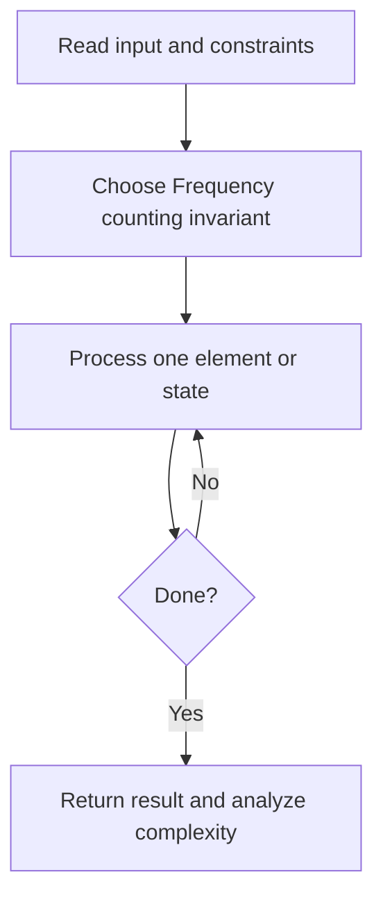
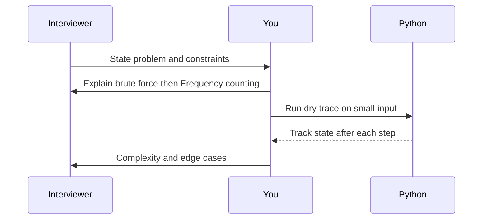

# Day 02 — Valid Anagram

**Pattern:** Frequency counting · **Time:** 35 minutes · **Track:** Python interview DSA

[Course home](../DSA_README.md) · [Practice file](../practice/day-02.py) · [Commented reference](../solutions/day-02.py)

## What and why (5 minutes)

**Problem:** Determine whether two strings contain exactly the same characters with the same counts.

**Why this pattern:** Counting avoids sorting and exposes a common hashing pattern.

**Interview trap:** Length equality is necessary but not sufficient; repeated letters matter.

## Algorithm flow



## Execution / timing diagram



## Try it yourself (15 minutes)

1. Open `practice/day-02.py`. Write `solve(...)` without looking below.
2. Verbally state the invariant and walk through a sample input.
3. Run `python -m unittest discover -s tests -v` from the repository root (reference tests run against completed solutions).
4. Check your practice implementation with `python scripts/check_practice.py 2` when you finish.

### Sample cases

```python
solve('anagram', 'nagaram')  # True
```
```python
solve('rat', 'car')  # False
```

## Commented solution — reveal after attempting

<details>
<summary>Show Python reference implementation</summary>

```python
def solve(s, t):
    if len(s) != len(t):
        return False
    counts = {}
    for ch in s:
        counts[ch] = counts.get(ch, 0) + 1
    for ch in t:
        if counts.get(ch, 0) == 0:
            return False
        counts[ch] -= 1
    return True
```

</details>

## Complexity (5 minutes)

**O(n) time, O(k) space for k distinct characters.** Explain *why*, including auxiliary data structure cost.

## Tricky interview follow-up (10 minutes)

**Question:** When is sorting a better trade-off than hashing?

Before moving on, explain (1) why your implementation is correct, (2) one edge case, (3) a trade-off versus a simpler solution.

**Next:** [Day 03](dsa-day-03.md)
