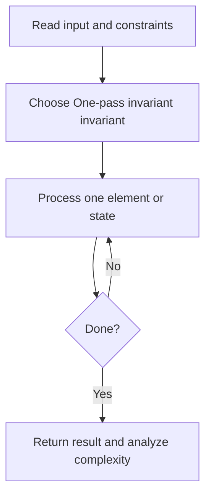
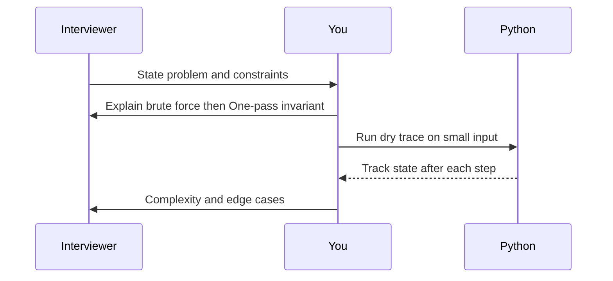

# Day 04 — Best Time to Buy and Sell Stock

**Pattern:** One-pass invariant · **Time:** 35 minutes · **Track:** Python interview DSA

[Course home](../DSA_README.md) · [Practice file](../practice/day-04.py) · [Commented reference](../solutions/day-04.py)

## What and why (5 minutes)

**Problem:** Return the maximum profit from one buy before one sell.

**Why this pattern:** Maintain minimum price seen so far, and best achievable profit.

**Interview trap:** You cannot sell before buying; update profit using earlier prices.

## Algorithm flow



## Execution / timing diagram



## Try it yourself (15 minutes)

1. Open `practice/day-04.py`. Write `solve(...)` without looking below.
2. Verbally state the invariant and walk through a sample input.
3. Run `python -m unittest discover -s tests -v` from the repository root (reference tests run against completed solutions).
4. Check your practice implementation with `python scripts/check_practice.py 4` when you finish.

### Sample cases

```python
solve([7, 1, 5, 3, 6, 4])  # 5
```
```python
solve([7, 6, 4, 3, 1])  # 0
```

## Commented solution — reveal after attempting

<details>
<summary>Show Python reference implementation</summary>

```python
def solve(prices):
    minimum = float('inf')
    best = 0
    for price in prices:
        best = max(best, price - minimum)
        minimum = min(minimum, price)
    return best
```

</details>

## Complexity (5 minutes)

**O(n) time, O(1) space.** Explain *why*, including auxiliary data structure cost.

## Tricky interview follow-up (10 minutes)

**Question:** What if multiple buy/sell transactions are allowed?

Before moving on, explain (1) why your implementation is correct, (2) one edge case, (3) a trade-off versus a simpler solution.

**Next:** [Day 05](dsa-day-05.md)
