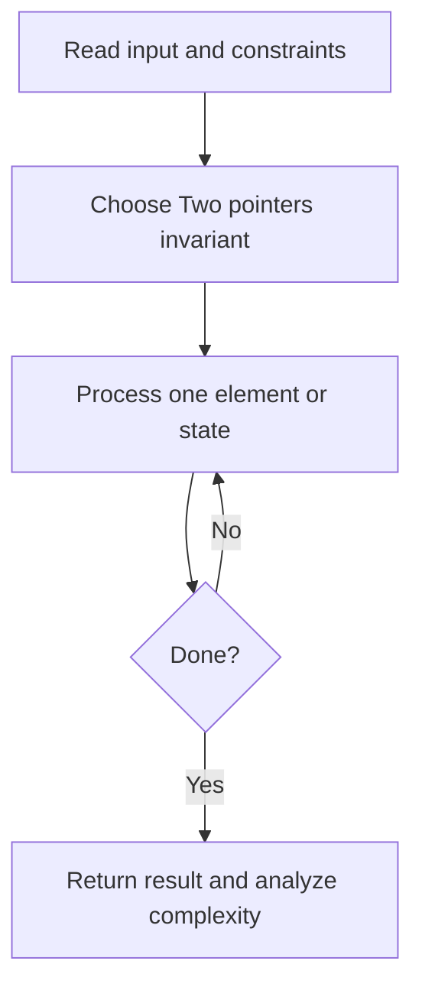
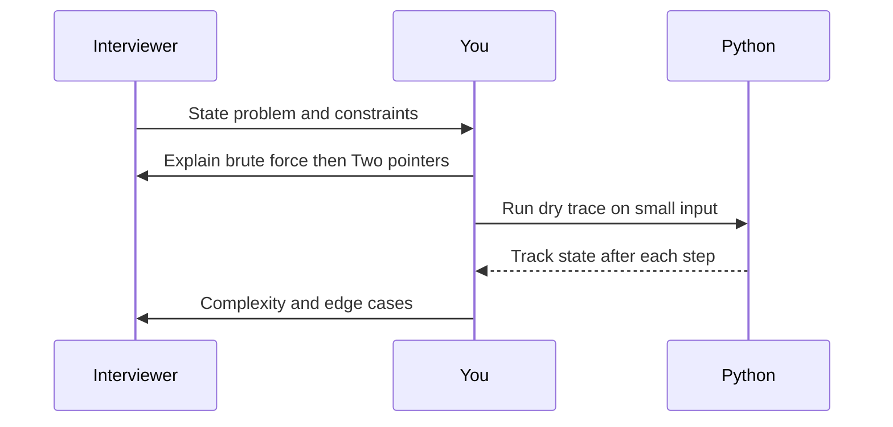

# Day 06 — Two Sum II (Sorted)

**Pattern:** Two pointers · **Time:** 35 minutes · **Track:** Python interview DSA

[Course home](../DSA_README.md) · [Practice file](../practice/day-06.py) · [Commented reference](../solutions/day-06.py)

## What and why (5 minutes)

**Problem:** Given sorted values, return the zero-based indices of two numbers adding to target.

**Why this pattern:** Sorted order lets us move a pointer based on whether the sum is too small or large.

**Interview trap:** This lesson uses zero-based indices, unlike some interview platforms.

## Algorithm flow



## Execution / timing diagram



## Try it yourself (15 minutes)

1. Open `practice/day-06.py`. Write `solve(...)` without looking below.
2. Verbally state the invariant and walk through a sample input.
3. Run `python -m unittest discover -s tests -v` from the repository root (reference tests run against completed solutions).
4. Check your practice implementation with `python scripts/check_practice.py 6` when you finish.

### Sample cases

```python
solve([2, 7, 11, 15], 9)  # [0, 1]
```
```python
solve([1, 2, 4, 6], 8)  # [1, 3]
```

## Commented solution — reveal after attempting

<details>
<summary>Show Python reference implementation</summary>

```python
def solve(nums, target):
    left, right = 0, len(nums) - 1
    while left < right:
        total = nums[left] + nums[right]
        if total == target:
            return [left, right]
        if total < target:  # raise sum
            left += 1
        else:  # lower sum
            right -= 1
    return []
```

</details>

## Complexity (5 minutes)

**O(n) time, O(1) space.** Explain *why*, including auxiliary data structure cost.

## Tricky interview follow-up (10 minutes)

**Question:** Compare space use with the hash-map solution.

Before moving on, explain (1) why your implementation is correct, (2) one edge case, (3) a trade-off versus a simpler solution.

**Next:** [Day 07](dsa-day-07.md)
