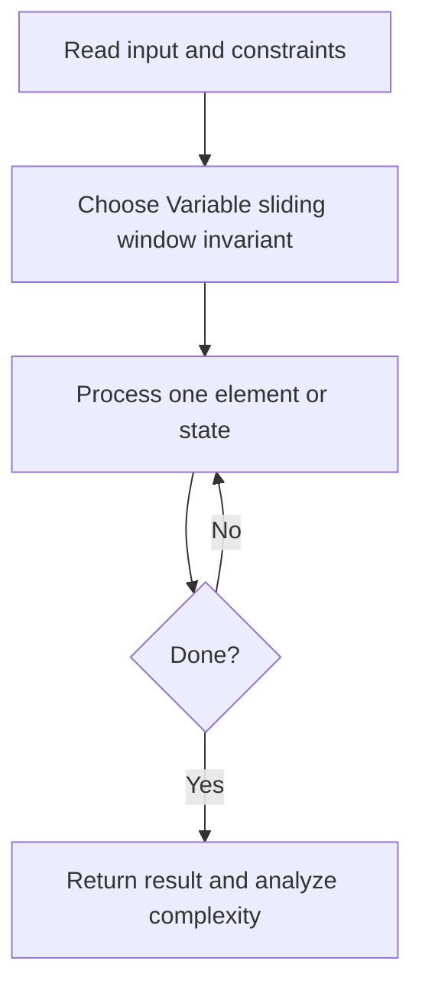
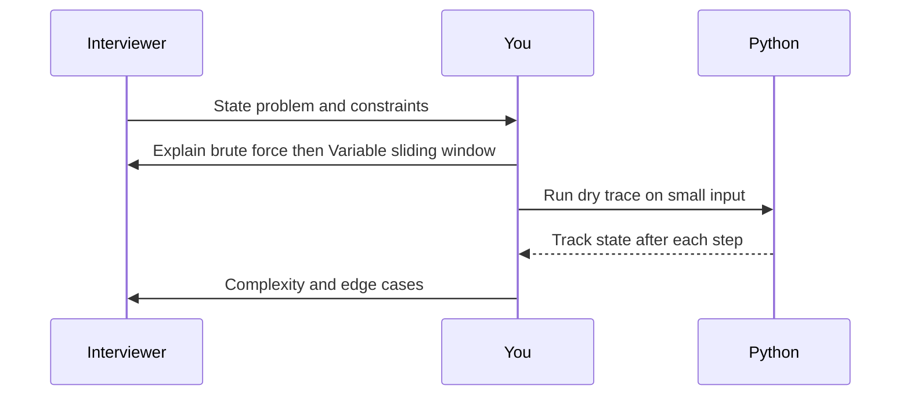

# Day 08 — Minimum Size Subarray Sum

**Pattern:** Variable sliding window · **Time:** 35 minutes · **Track:** Python interview DSA

[Course home](../DSA_README.md) · [Practice file](../practice/day-08.py) · [Commented reference](../solutions/day-08.py)

## What and why (5 minutes)

**Problem:** For positive integers, return minimum length of a contiguous subarray whose sum >= target (or 0).

**Why this pattern:** Monotonicity of positive sums makes shrinking a window safe.

**Interview trap:** This technique breaks with negative numbers.

## Algorithm flow



## Execution / timing diagram



## Try it yourself (15 minutes)

1. Open `practice/day-08.py`. Write `solve(...)` without looking below.
2. Verbally state the invariant and walk through a sample input.
3. Run `python -m unittest discover -s tests -v` from the repository root (reference tests run against completed solutions).
4. Check your practice implementation with `python scripts/check_practice.py 8` when you finish.

### Sample cases

```python
solve(7, [2, 3, 1, 2, 4, 3])  # 2
```
```python
solve(11, [1, 1, 1, 1, 1, 1, 1, 1])  # 0
```

## Commented solution — reveal after attempting

<details>
<summary>Show Python reference implementation</summary>

```python
def solve(target, nums):
    left = 0
    running = 0
    best = float('inf')
    for right, value in enumerate(nums):
        running += value
        while running >= target:
            best = min(best, right - left + 1)
            running -= nums[left]  # shrink while valid
            left += 1
    return 0 if best == float('inf') else best
```

</details>

## Complexity (5 minutes)

**O(n) time, O(1) space.** Explain *why*, including auxiliary data structure cost.

## Tricky interview follow-up (10 minutes)

**Question:** Why do negative integers invalidate the shrinking assumption?

Before moving on, explain (1) why your implementation is correct, (2) one edge case, (3) a trade-off versus a simpler solution.

**Next:** [Day 09](dsa-day-09.md)
