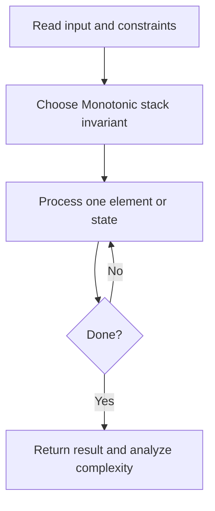
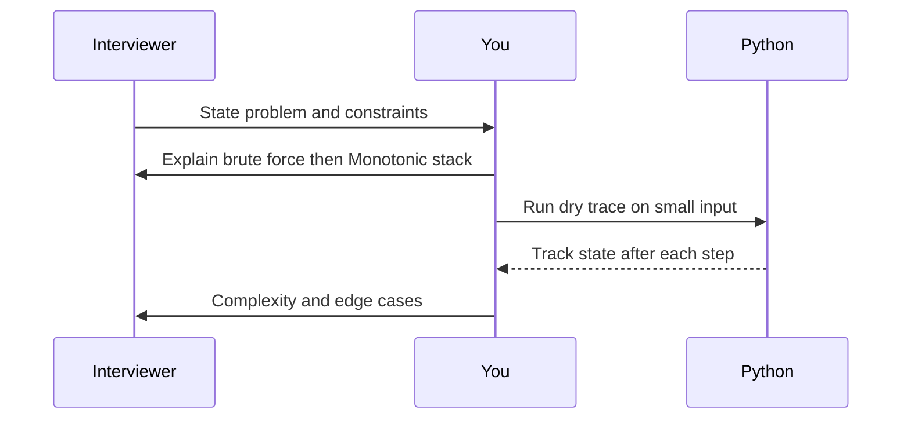

# Day 10 — Daily Temperatures

**Pattern:** Monotonic stack · **Time:** 35 minutes · **Track:** Python interview DSA

[Course home](../DSA_README.md) · [Practice file](../practice/day-10.py) · [Commented reference](../solutions/day-10.py)

## What and why (5 minutes)

**Problem:** Return days until a strictly warmer future temperature, or 0 if none.

**Why this pattern:** Store unresolved indices and pop them when a warmer temperature arrives.

**Interview trap:** Stack stores indices rather than temperatures because the output is a distance.

## Algorithm flow



## Execution / timing diagram



## Try it yourself (15 minutes)

1. Open `practice/day-10.py`. Write `solve(...)` without looking below.
2. Verbally state the invariant and walk through a sample input.
3. Run `python -m unittest discover -s tests -v` from the repository root (reference tests run against completed solutions).
4. Check your practice implementation with `python scripts/check_practice.py 10` when you finish.

### Sample cases

```python
solve([73, 74, 75, 71, 69, 72, 76, 73])  # [1, 1, 4, 2, 1, 1, 0, 0]
```

## Commented solution — reveal after attempting

<details>
<summary>Show Python reference implementation</summary>

```python
def solve(temperatures):
    answer = [0] * len(temperatures)
    stack = []  # indices with monotonically decreasing temperatures
    for day, temp in enumerate(temperatures):
        while stack and temp > temperatures[stack[-1]]:
            earlier = stack.pop()
            answer[earlier] = day - earlier
        stack.append(day)
    return answer
```

</details>

## Complexity (5 minutes)

**O(n) time, O(n) space.** Explain *why*, including auxiliary data structure cost.

## Tricky interview follow-up (10 minutes)

**Question:** Why is the total runtime O(n) even though loops are nested?

Before moving on, explain (1) why your implementation is correct, (2) one edge case, (3) a trade-off versus a simpler solution.

**Next:** [Day 11](dsa-day-11.md)
