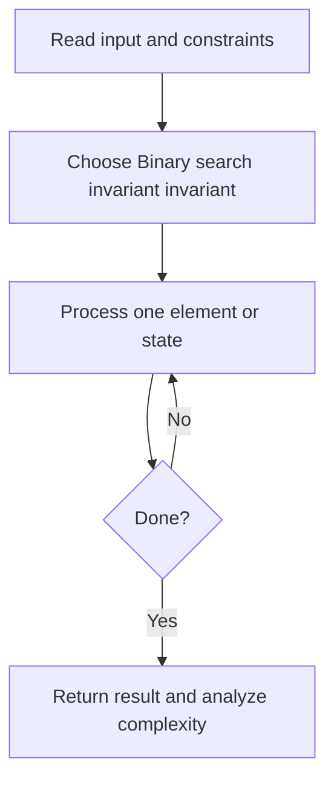
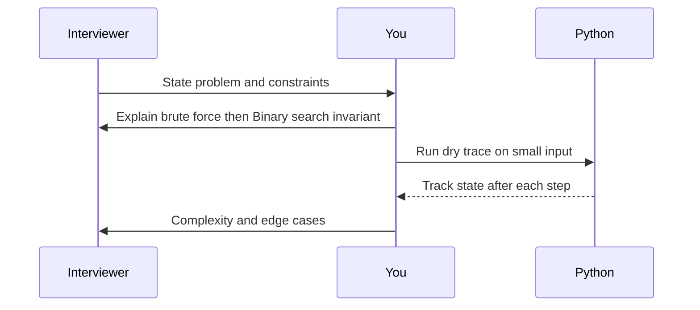

# Day 12 — Search in Rotated Sorted Array

**Pattern:** Binary search invariant · **Time:** 35 minutes · **Track:** Python interview DSA

[Course home](../DSA_README.md) · [Practice file](../practice/day-12.py) · [Commented reference](../solutions/day-12.py)

## What and why (5 minutes)

**Problem:** Find target in rotated ascending unique values.

**Why this pattern:** At least one half is sorted; identify it before shrinking.

**Interview trap:** Assumes all elements are distinct.

## Algorithm flow



## Execution / timing diagram



## Try it yourself (15 minutes)

1. Open `practice/day-12.py`. Write `solve(...)` without looking below.
2. Verbally state the invariant and walk through a sample input.
3. Run `python -m unittest discover -s tests -v` from the repository root (reference tests run against completed solutions).
4. Check your practice implementation with `python scripts/check_practice.py 12` when you finish.

### Sample cases

```python
solve([4, 5, 6, 7, 0, 1, 2], 0)  # 4
```
```python
solve([4, 5, 6, 7, 0, 1, 2], 3)  # -1
```

## Commented solution — reveal after attempting

<details>
<summary>Show Python reference implementation</summary>

```python
def solve(nums, target):
    left, right = 0, len(nums) - 1
    while left <= right:
        mid = (left + right) // 2
        if nums[mid] == target:
            return mid
        if nums[left] <= nums[mid]:  # left half is sorted
            if nums[left] <= target < nums[mid]:
                right = mid - 1
            else:
                left = mid + 1
        else:  # right half is sorted
            if nums[mid] < target <= nums[right]:
                left = mid + 1
            else:
                right = mid - 1
    return -1
```

</details>

## Complexity (5 minutes)

**O(log n) time, O(1) space.** Explain *why*, including auxiliary data structure cost.

## Tricky interview follow-up (10 minutes)

**Question:** What changes when duplicates are allowed?

Before moving on, explain (1) why your implementation is correct, (2) one edge case, (3) a trade-off versus a simpler solution.

**Next:** [Day 13](dsa-day-13.md)
