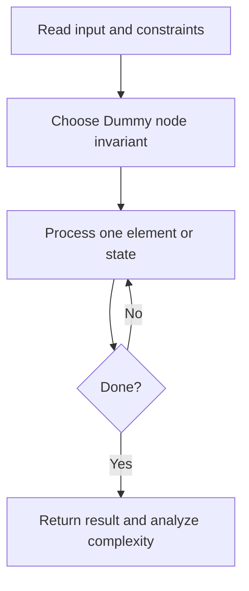
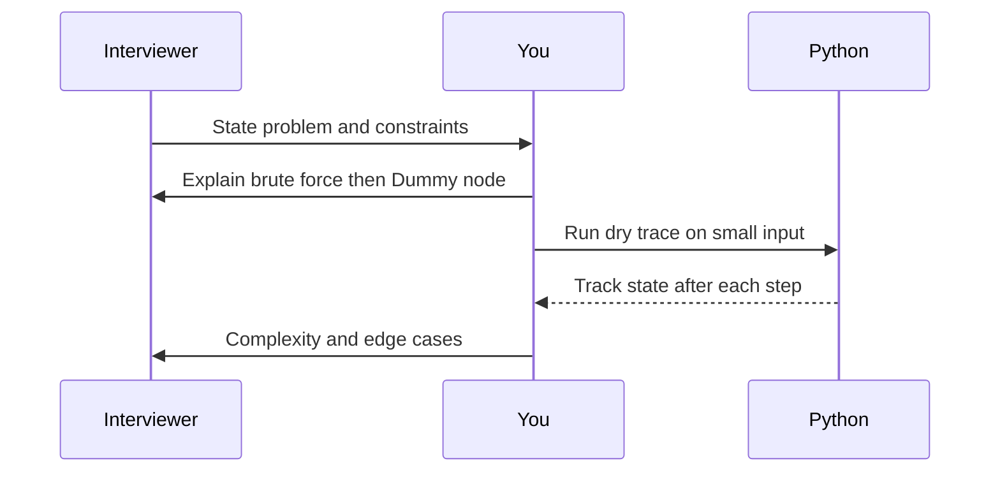

# Day 15 — Merge Two Sorted Lists

**Pattern:** Dummy node · **Time:** 35 minutes · **Track:** Python interview DSA

[Course home](../DSA_README.md) · [Practice file](../practice/day-15.py) · [Commented reference](../solutions/day-15.py)

## What and why (5 minutes)

**Problem:** Merge two sorted linked lists into one sorted chain.

**Why this pattern:** Dummy head reduces pointer edge cases.

**Interview trap:** Reuse nodes safely; preserve access to the next pointer.

## Algorithm flow



## Execution / timing diagram



## Try it yourself (15 minutes)

1. Open `practice/day-15.py`. Write `solve(...)` without looking below.
2. Verbally state the invariant and walk through a sample input.
3. Run `python -m unittest discover -s tests -v` from the repository root (reference tests run against completed solutions).
4. Check your practice implementation with `python scripts/check_practice.py 15` when you finish.

### Sample cases

Build your own small linked-list/tree nodes and test empty, one-node, and multi-node cases.

## Commented solution — reveal after attempting

<details>
<summary>Show Python reference implementation</summary>

```python
class ListNode:
    def __init__(self, val=0, next=None):
        self.val = val
        self.next = next

def solve(a, b):
    dummy = tail = ListNode()
    while a and b:
        if a.val <= b.val:
            tail.next, a = a, a.next
        else:
            tail.next, b = b, b.next
        tail = tail.next
    tail.next = a if a else b
    return dummy.next
```

</details>

## Complexity (5 minutes)

**O(n+m) time, O(1) extra space.** Explain *why*, including auxiliary data structure cost.

## Tricky interview follow-up (10 minutes)

**Question:** Why does a dummy node make edge cases simpler?

Before moving on, explain (1) why your implementation is correct, (2) one edge case, (3) a trade-off versus a simpler solution.

**Next:** [Day 16](dsa-day-16.md)
