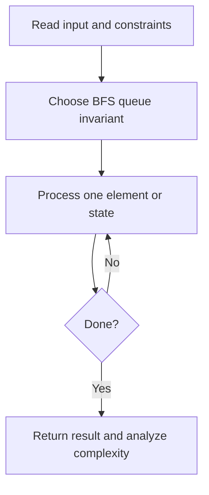
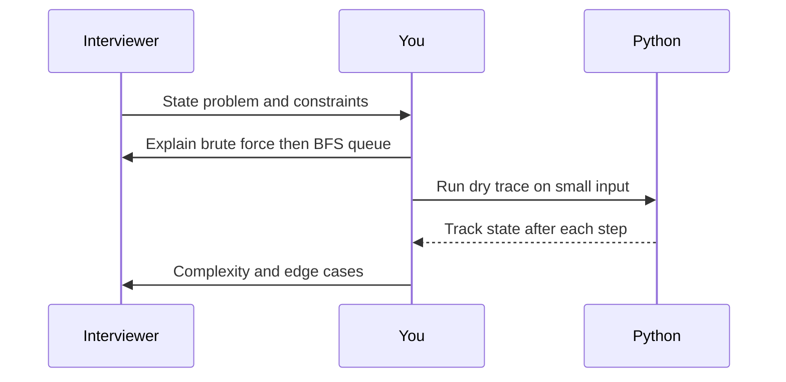

# Day 17 — Binary Tree Level Order Traversal

**Pattern:** BFS queue · **Time:** 35 minutes · **Track:** Python interview DSA

[Course home](../DSA_README.md) · [Practice file](../practice/day-17.py) · [Commented reference](../solutions/day-17.py)

## What and why (5 minutes)

**Problem:** Return a list of values for each depth in a binary tree.

**Why this pattern:** A queue processes a tree breadth-first.

**Interview trap:** Capture the current queue length before processing each level.

## Algorithm flow



## Execution / timing diagram



## Try it yourself (15 minutes)

1. Open `practice/day-17.py`. Write `solve(...)` without looking below.
2. Verbally state the invariant and walk through a sample input.
3. Run `python -m unittest discover -s tests -v` from the repository root (reference tests run against completed solutions).
4. Check your practice implementation with `python scripts/check_practice.py 17` when you finish.

### Sample cases

Build your own small linked-list/tree nodes and test empty, one-node, and multi-node cases.

## Commented solution — reveal after attempting

<details>
<summary>Show Python reference implementation</summary>

```python
from collections import deque

class TreeNode:
    def __init__(self, val=0, left=None, right=None):
        self.val, self.left, self.right = val, left, right

def solve(root):
    if root is None:
        return []
    queue = deque([root])
    levels = []
    while queue:
        level = []
        for _ in range(len(queue)):  # only nodes from this depth
            node = queue.popleft()
            level.append(node.val)
            if node.left:
                queue.append(node.left)
            if node.right:
                queue.append(node.right)
        levels.append(level)
    return levels
```

</details>

## Complexity (5 minutes)

**O(n) time, O(w) queue space.** Explain *why*, including auxiliary data structure cost.

## Tricky interview follow-up (10 minutes)

**Question:** Why is deque.popleft preferable to list.pop(0)?

Before moving on, explain (1) why your implementation is correct, (2) one edge case, (3) a trade-off versus a simpler solution.

**Next:** [Day 18](dsa-day-18.md)
