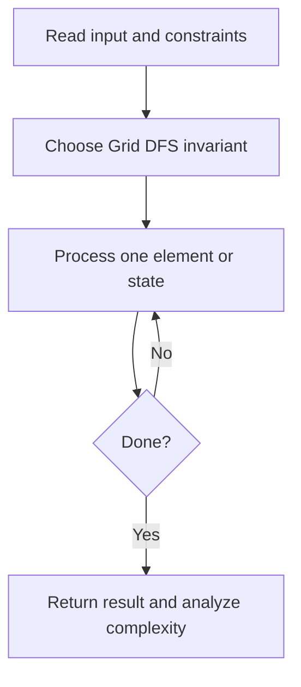
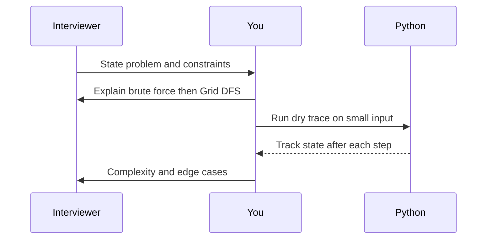

# Day 21 — Number of Islands

**Pattern:** Grid DFS · **Time:** 35 minutes · **Track:** Python interview DSA

[Course home](../DSA_README.md) · [Practice file](../practice/day-21.py) · [Commented reference](../solutions/day-21.py)

## What and why (5 minutes)

**Problem:** Count groups of connected 1 cells (up, down, left, right).

**Why this pattern:** Mark visited cells while exploring one component.

**Interview trap:** Do not traverse diagonals; this implementation mutates the input grid.

## Algorithm flow



## Execution / timing diagram



## Try it yourself (15 minutes)

1. Open `practice/day-21.py`. Write `solve(...)` without looking below.
2. Verbally state the invariant and walk through a sample input.
3. Run `python -m unittest discover -s tests -v` from the repository root (reference tests run against completed solutions).
4. Check your practice implementation with `python scripts/check_practice.py 21` when you finish.

### Sample cases

```python
solve([['1', '1', '0'], ['0', '1', '0'], ['0', '0', '1']])  # 2
```

## Commented solution — reveal after attempting

<details>
<summary>Show Python reference implementation</summary>

```python
def solve(grid):
    if not grid:
        return 0
    rows, cols = len(grid), len(grid[0])
    count = 0
    for r in range(rows):
        for c in range(cols):
            if grid[r][c] != '1':
                continue
            count += 1
            stack = [(r, c)]
            grid[r][c] = '0'  # mark as soon as discovered
            while stack:
                x, y = stack.pop()
                for dx, dy in ((1,0),(-1,0),(0,1),(0,-1)):
                    nx, ny = x + dx, y + dy
                    if 0 <= nx < rows and 0 <= ny < cols and grid[nx][ny] == '1':
                        grid[nx][ny] = '0'
                        stack.append((nx, ny))
    return count
```

</details>

## Complexity (5 minutes)

**O(rows*cols) time, O(rows*cols) worst-case stack.** Explain *why*, including auxiliary data structure cost.

## Tricky interview follow-up (10 minutes)

**Question:** How do you avoid mutating the input?

Before moving on, explain (1) why your implementation is correct, (2) one edge case, (3) a trade-off versus a simpler solution.

**Next:** [Day 22](dsa-day-22.md)
