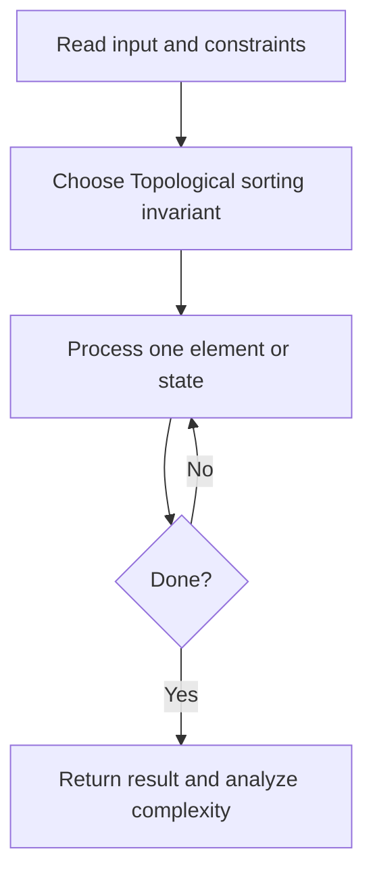
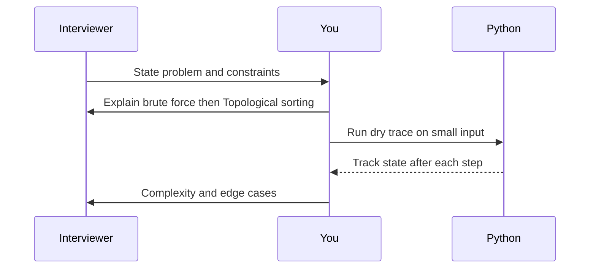

# Day 22 — Course Schedule

**Pattern:** Topological sorting · **Time:** 35 minutes · **Track:** Python interview DSA

[Course home](../DSA_README.md) · [Practice file](../practice/day-22.py) · [Commented reference](../solutions/day-22.py)

## What and why (5 minutes)

**Problem:** Given num_courses and prerequisite pairs [course, prereq], determine whether all courses can be completed.

**Why this pattern:** Kahn BFS finds cycles by counting processed nodes.

**Interview trap:** Edge direction matters: prerequisite -> course.

## Algorithm flow



## Execution / timing diagram



## Try it yourself (15 minutes)

1. Open `practice/day-22.py`. Write `solve(...)` without looking below.
2. Verbally state the invariant and walk through a sample input.
3. Run `python -m unittest discover -s tests -v` from the repository root (reference tests run against completed solutions).
4. Check your practice implementation with `python scripts/check_practice.py 22` when you finish.

### Sample cases

```python
solve(2, [[1, 0]])  # True
```
```python
solve(2, [[1, 0], [0, 1]])  # False
```

## Commented solution — reveal after attempting

<details>
<summary>Show Python reference implementation</summary>

```python
from collections import deque

def solve(num_courses, prerequisites):
    graph = [[] for _ in range(num_courses)]
    indegree = [0] * num_courses
    for course, pre in prerequisites:
        graph[pre].append(course)
        indegree[course] += 1
    queue = deque(i for i, deg in enumerate(indegree) if deg == 0)
    processed = 0
    while queue:
        pre = queue.popleft()
        processed += 1
        for course in graph[pre]:
            indegree[course] -= 1
            if indegree[course] == 0:
                queue.append(course)
    return processed == num_courses
```

</details>

## Complexity (5 minutes)

**O(V+E) time, O(V+E) space.** Explain *why*, including auxiliary data structure cost.

## Tricky interview follow-up (10 minutes)

**Question:** How could you return a valid course order?

Before moving on, explain (1) why your implementation is correct, (2) one edge case, (3) a trade-off versus a simpler solution.

**Next:** [Day 23](dsa-day-23.md)
