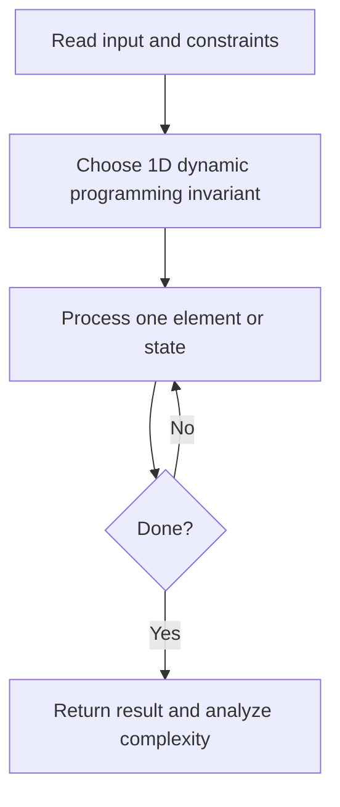
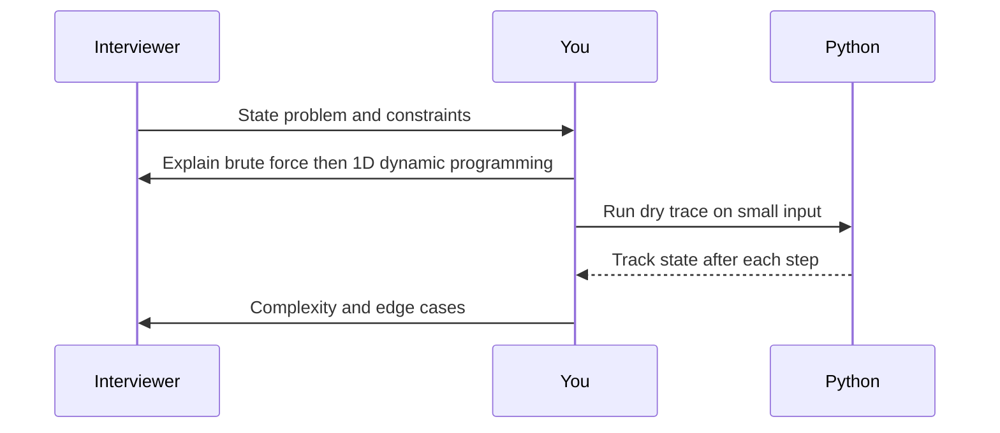

# Day 23 — Climbing Stairs

**Pattern:** 1D dynamic programming · **Time:** 35 minutes · **Track:** Python interview DSA

[Course home](../DSA_README.md) · [Practice file](../practice/day-23.py) · [Commented reference](../solutions/day-23.py)

## What and why (5 minutes)

**Problem:** Count ways to climb n steps using steps of size 1 or 2.

**Why this pattern:** The recurrence is Fibonacci-like; only last two values are needed.

**Interview trap:** Define n=0 as one empty way.

## Algorithm flow



## Execution / timing diagram



## Try it yourself (15 minutes)

1. Open `practice/day-23.py`. Write `solve(...)` without looking below.
2. Verbally state the invariant and walk through a sample input.
3. Run `python -m unittest discover -s tests -v` from the repository root (reference tests run against completed solutions).
4. Check your practice implementation with `python scripts/check_practice.py 23` when you finish.

### Sample cases

```python
solve(0)  # 1
```
```python
solve(2)  # 2
```
```python
solve(5)  # 8
```

## Commented solution — reveal after attempting

<details>
<summary>Show Python reference implementation</summary>

```python
def solve(n):
    if n < 0:
        raise ValueError('n must be nonnegative')
    a, b = 1, 1  # ways for 0 steps and 1 step
    for _ in range(2, n + 1):
        a, b = b, a + b
    return b
```

</details>

## Complexity (5 minutes)

**O(n) time, O(1) space.** Explain *why*, including auxiliary data structure cost.

## Tricky interview follow-up (10 minutes)

**Question:** Explain memoization vs. tabulation and their trade-offs.

Before moving on, explain (1) why your implementation is correct, (2) one edge case, (3) a trade-off versus a simpler solution.

**Next:** [Day 24](dsa-day-24.md)
