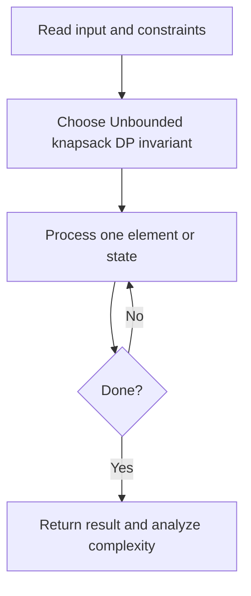
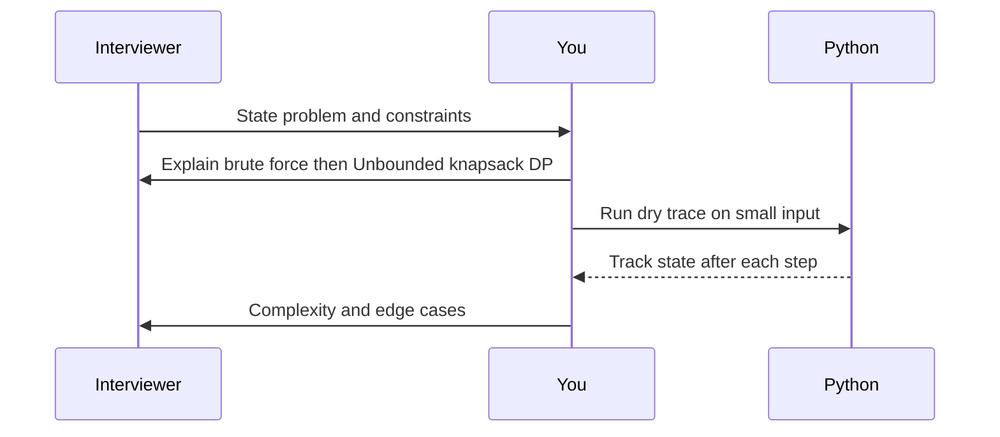

# Day 25 — Coin Change

**Pattern:** Unbounded knapsack DP · **Time:** 35 minutes · **Track:** Python interview DSA

[Course home](../DSA_README.md) · [Practice file](../practice/day-25.py) · [Commented reference](../solutions/day-25.py)

## What and why (5 minutes)

**Problem:** Find fewest coins needed to reach amount; return -1 if impossible.

**Why this pattern:** Build best answer for each amount from previously solved subproblems.

**Interview trap:** Do not use greedy for arbitrary coin denominations.

## Algorithm flow



## Execution / timing diagram



## Try it yourself (15 minutes)

1. Open `practice/day-25.py`. Write `solve(...)` without looking below.
2. Verbally state the invariant and walk through a sample input.
3. Run `python -m unittest discover -s tests -v` from the repository root (reference tests run against completed solutions).
4. Check your practice implementation with `python scripts/check_practice.py 25` when you finish.

### Sample cases

```python
solve([1, 2, 5], 11)  # 3
```
```python
solve([2], 3)  # -1
```
```python
solve([1], 0)  # 0
```

## Commented solution — reveal after attempting

<details>
<summary>Show Python reference implementation</summary>

```python
def solve(coins, amount):
    impossible = amount + 1
    dp = [0] + [impossible] * amount
    for total in range(1, amount + 1):
        for coin in coins:
            if coin > 0 and coin <= total:
                dp[total] = min(dp[total], dp[total - coin] + 1)
    return -1 if dp[amount] == impossible else dp[amount]
```

</details>

## Complexity (5 minutes)

**O(amount * coins) time, O(amount) space.** Explain *why*, including auxiliary data structure cost.

## Tricky interview follow-up (10 minutes)

**Question:** What is different when counting combinations rather than minimum coins?

Before moving on, explain (1) why your implementation is correct, (2) one edge case, (3) a trade-off versus a simpler solution.

**Next:** [Day 26](dsa-day-26.md)
