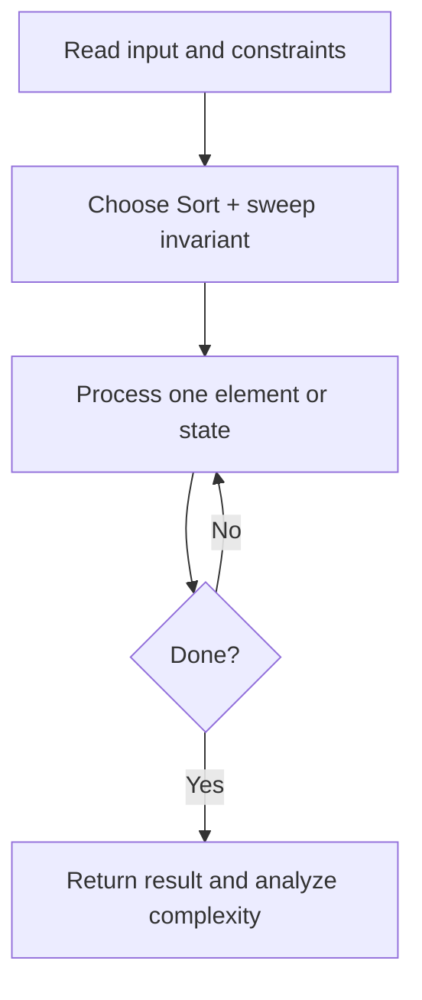
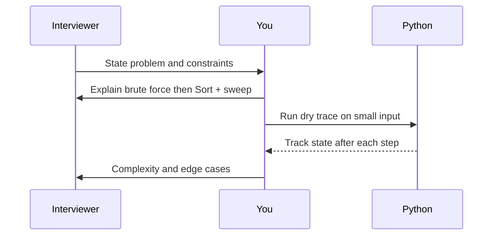

# Day 29 — Merge Intervals

**Pattern:** Sort + sweep · **Time:** 35 minutes · **Track:** Python interview DSA

[Course home](../DSA_README.md) · [Practice file](../practice/day-29.py) · [Commented reference](../solutions/day-29.py)

## What and why (5 minutes)

**Problem:** Merge overlapping intervals, including touching endpoints.

**Why this pattern:** Sort by start time; extend current interval while they overlap.

**Interview trap:** Sort a copy if you do not want to mutate caller input.

## Algorithm flow



## Execution / timing diagram



## Try it yourself (15 minutes)

1. Open `practice/day-29.py`. Write `solve(...)` without looking below.
2. Verbally state the invariant and walk through a sample input.
3. Run `python -m unittest discover -s tests -v` from the repository root (reference tests run against completed solutions).
4. Check your practice implementation with `python scripts/check_practice.py 29` when you finish.

### Sample cases

```python
solve([[1, 3], [2, 6], [8, 10], [15, 18]])  # [[1, 6], [8, 10], [15, 18]]
```
```python
solve([[1, 4], [4, 5]])  # [[1, 5]]
```

## Commented solution — reveal after attempting

<details>
<summary>Show Python reference implementation</summary>

```python
def solve(intervals):
    if not intervals:
        return []
    intervals = sorted(intervals)
    merged = [intervals[0][:]]  # independent mutable copy
    for start, end in intervals[1:]:
        if start <= merged[-1][1]:
            merged[-1][1] = max(merged[-1][1], end)
        else:
            merged.append([start, end])
    return merged
```

</details>

## Complexity (5 minutes)

**O(n log n) time, O(n) output space.** Explain *why*, including auxiliary data structure cost.

## Tricky interview follow-up (10 minutes)

**Question:** What changes if touching intervals should not merge?

Before moving on, explain (1) why your implementation is correct, (2) one edge case, (3) a trade-off versus a simpler solution.

**Next:** [Day 30](dsa-day-30.md)
