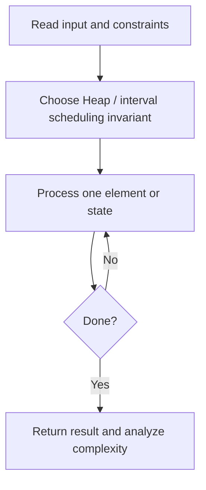
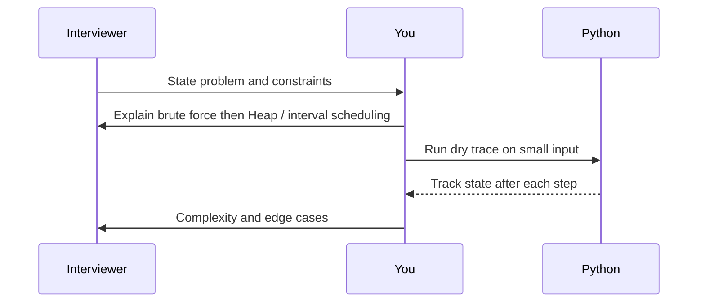

# Day 30 — Meeting Rooms II

**Pattern:** Heap / interval scheduling · **Time:** 35 minutes · **Track:** Python interview DSA

[Course home](../DSA_README.md) · [Practice file](../practice/day-30.py) · [Commented reference](../solutions/day-30.py)

## What and why (5 minutes)

**Problem:** Return minimum rooms needed for [start,end] meeting intervals (end is exclusive).

**Why this pattern:** Sort starts; free rooms whose meetings have ended before allocating new ones.

**Interview trap:** Use <= when a meeting ends exactly when another begins.

## Algorithm flow



## Execution / timing diagram



## Try it yourself (15 minutes)

1. Open `practice/day-30.py`. Write `solve(...)` without looking below.
2. Verbally state the invariant and walk through a sample input.
3. Run `python -m unittest discover -s tests -v` from the repository root (reference tests run against completed solutions).
4. Check your practice implementation with `python scripts/check_practice.py 30` when you finish.

### Sample cases

```python
solve([[0, 30], [5, 10], [15, 20]])  # 2
```
```python
solve([[7, 10], [2, 4]])  # 1
```

## Commented solution — reveal after attempting

<details>
<summary>Show Python reference implementation</summary>

```python
import heapq

def solve(intervals):
    heap = []  # end times of currently occupied rooms
    peak = 0
    for start, end in sorted(intervals):
        while heap and heap[0] <= start:
            heapq.heappop(heap)
        heapq.heappush(heap, end)
        peak = max(peak, len(heap))
    return peak
```

</details>

## Complexity (5 minutes)

**O(n log n) time, O(n) space.** Explain *why*, including auxiliary data structure cost.

## Tricky interview follow-up (10 minutes)

**Question:** Could you solve this using separately sorted start/end arrays?

Before moving on, explain (1) why your implementation is correct, (2) one edge case, (3) a trade-off versus a simpler solution.

**Next:** [Day 31](dsa-day-31.md)
