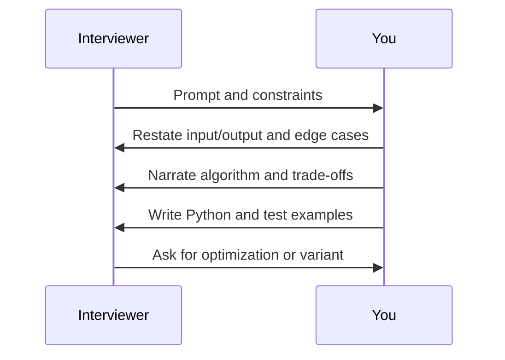

# Day 44 — Mixed mock interview B

**Duration:** 35 minutes · **Format:** recall and timed interview practice

## Goal

Pick unseen variants of trees, graphs, DP; 2 timed prompts.

## Run of show

1. **5 min:** State relevant patterns and invariants without notes.
2. **20 min:** Attempt one or two problems from scratch; use a timer.
3. **5 min:** Compare your code to the commented reference solutions; identify any error.
4. **5 min:** Summarize time/space complexity and your next practice target.

**Earlier lesson references:** 17,21,25.

## Flow diagram

## Timing diagram

## Interview scoring

- **Correctness (0–2):** handles normal and edge inputs.
- **Explanation (0–2):** can state a meaningful invariant.
- **Complexity (0–2):** derives bounds accurately.
- **Execution (0–2):** codes within time.
- **Communication (0–2):** narrates trade-offs and tests.

Record your result in [DSA_PROGRESS.md](../DSA_PROGRESS.md). Target **8/10** repeatedly on unfamiliar problems.

**Next:** [Day 45](dsa-day-45.md)
