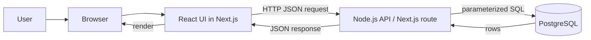
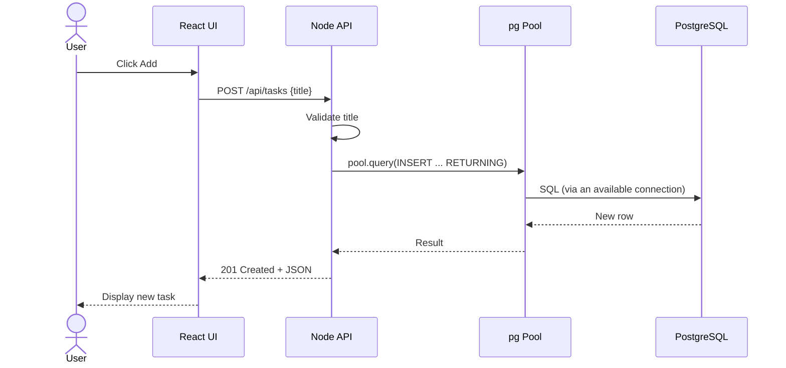
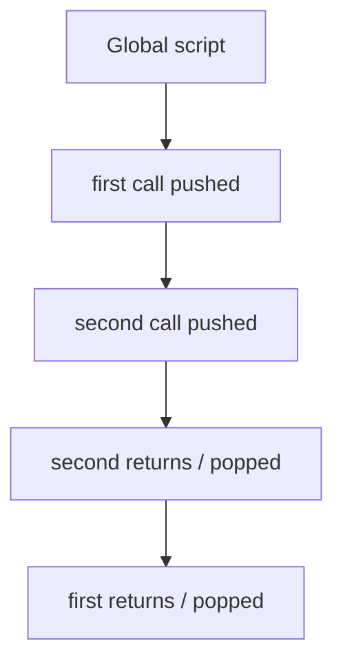
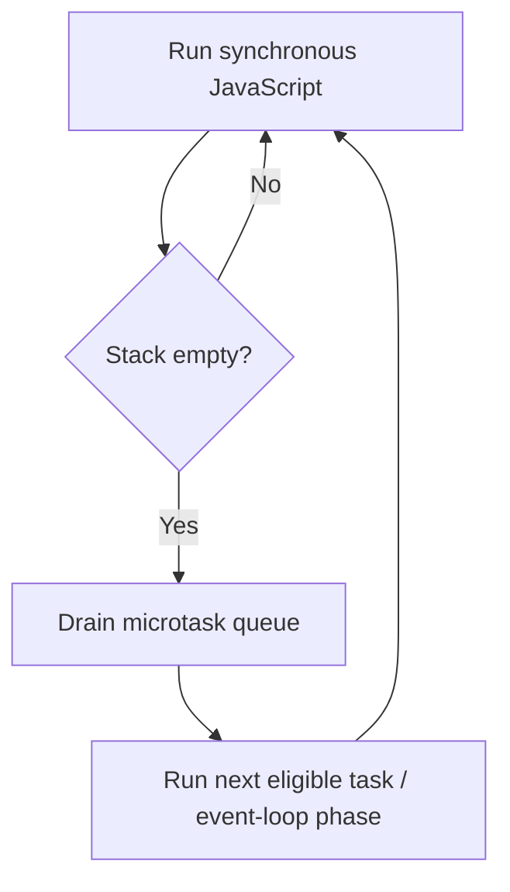
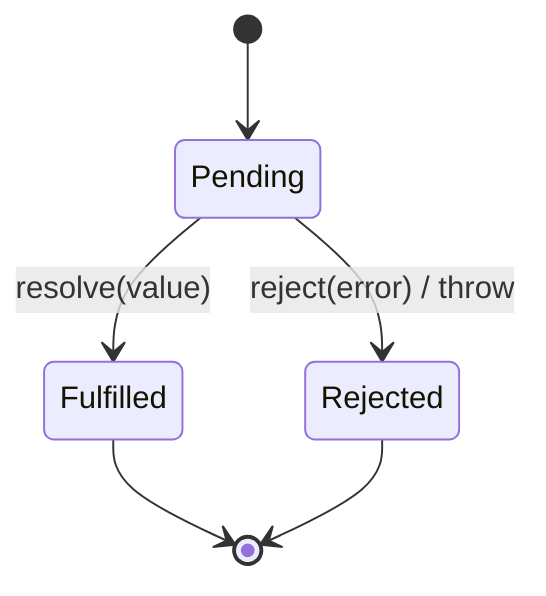
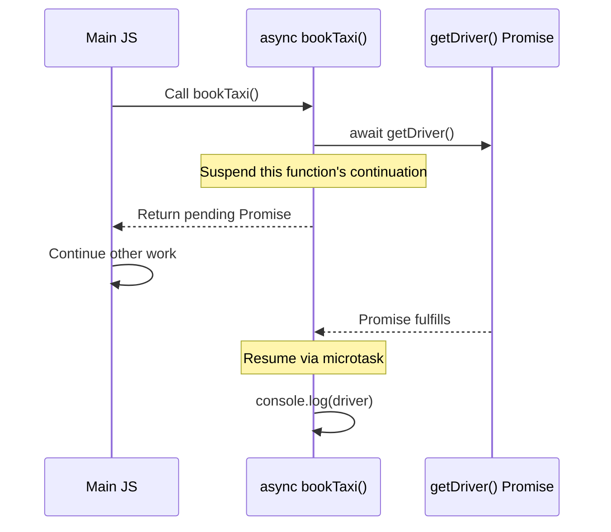
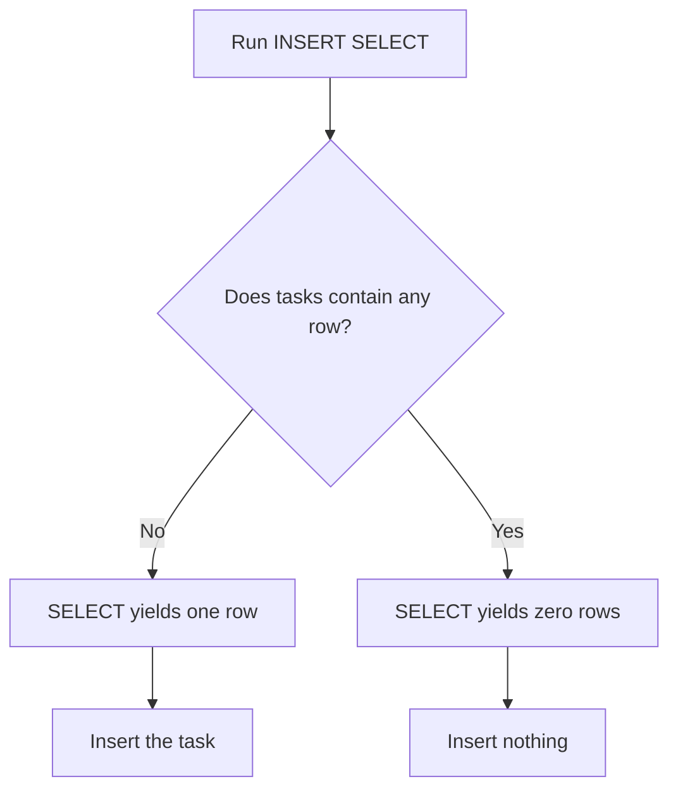
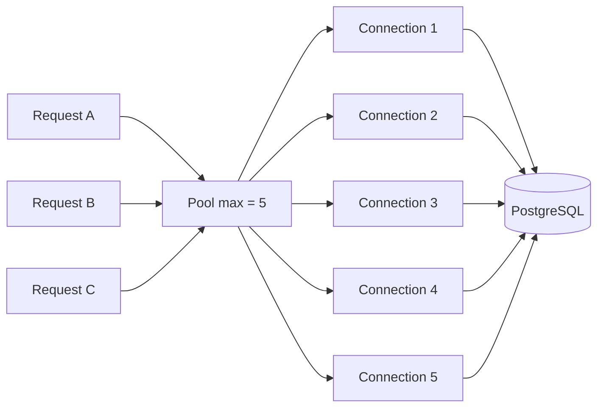
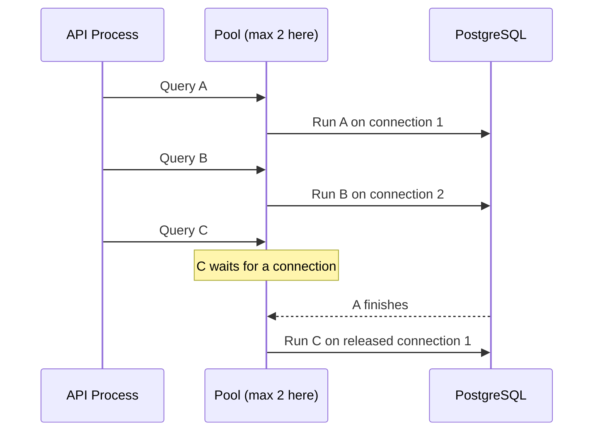

# Full-Stack Concepts — Q&A Revision Guide

**Project context:** MiniTrack, a small task-tracker app using JavaScript, TypeScript, React, Next.js, Node.js, and PostgreSQL.  
**Purpose:** Review the questions you've been asking recently, from beginner explanations to interview follow-ups.  
**How to use:** Read each question, try answering aloud, then check the answer and trace the diagram/code. Code samples are simplified for learning.

## Contents

1. [The big picture: full-stack request flow](#1-the-big-picture-full-stack-request-flow)
2. [JavaScript call stack, event loop, and queues](#2-javascript-call-stack-event-loop-and-queues)
3. [Promises: why, what, and how](#3-promises-why-what-and-how)
4. [async/await, errors, and concurrency](#4-asyncawait-errors-and-concurrency)
5. [Node.js, HTTP, and API behavior](#5-nodejs-http-and-api-behavior)
6. [PostgreSQL setup and SQL](#6-postgresql-setup-and-sql)
7. [Database pools and concurrent requests](#7-database-pools-and-concurrent-requests)
8. [React, Next.js, and TypeScript](#8-react-nextjs-and-typescript)
9. [Putting it together: MiniTrack end-to-end](#9-putting-it-together-minitrack-end-to-end)
10. [Interview challenges and answer key](#10-interview-challenges-and-answer-key)
11. [One-page cheat sheet](#11-one-page-cheat-sheet)

---

# 1. The big picture: full-stack request flow

### Q1. What does a *full-stack* application do?

**Answer:** It includes the user interface (frontend), server-side logic (backend), and data storage (database). MiniTrack lets users create, view, complete, and delete tasks; this small feature set provides a way to study the entire stack.



**Mental model:** React decides *what the user sees*. The API decides *what actions are allowed*. PostgreSQL saves *persistent facts*.

### Q2. What happens when I click “Add task”?

1. A click handler reads the input.
2. The frontend calls `fetch('/api/tasks', { method: 'POST', ... })`.
3. The server parses and validates the request body.
4. The server executes a parameterized `INSERT` query through a database connection.
5. The server responds with a status code and JSON.
6. React updates its state or refetches the list, and the page re-renders.



### Q3. Is Next.js the same as Node.js?

**Answer:** No. **Node.js** is a JavaScript runtime used to execute server-side JS. **Next.js** is a React framework with routing and server-rendering features; its server code can run in Node.js (or another supported runtime depending on deployment). React is the UI library.

---

# 2. JavaScript call stack, event loop, and queues

### Q4. What is the call stack?

**Answer:** The call stack tracks *currently executing* JavaScript function calls, in last-in/first-out order. A function is pushed when called and popped when it returns. Ordinary synchronous statements execute on this stack immediately.

```js
function second() { console.log('B'); }
function first() {
  console.log('A');
  second();
  console.log('C');
}
first(); // A, B, C
```



### Q5. How do the event loop, microtask queue, and task queue differ?

**Answer:** The runtime executes the current synchronous stack first. Promise reaction callbacks (`.then`, `.catch`, `.finally`) and continuations after `await` are **microtasks**. Timer callbacks such as `setTimeout` are **tasks**. At a typical event-loop checkpoint, the runtime drains microtasks before moving to the next task. Exact scheduling details vary between browsers and Node.js phases.



### Q6. Why does this print `Start`, `End`, `Promise`, `Timer`?

```js
console.log('Start');
setTimeout(() => console.log('Timer'), 0);
Promise.resolve().then(() => console.log('Promise'));
console.log('End');
```

**Answer, step by step:**

1. The script logs `Start`.
2. `setTimeout` schedules a timer callback for a later task (zero delay does **not** mean immediate execution).
3. `.then(...)` schedules a microtask because the Promise is already fulfilled.
4. The script logs `End` and finishes.
5. The runtime runs the microtask, logging `Promise`.
6. A later timer task logs `Timer`.

**Output:** `Start → End → Promise → Timer`.

### Q7. How do I know where a piece of JavaScript goes?

| Code | Where/when does the callback or continuation run? |
|---|---|
| `console.log(...)`, ordinary function call | Synchronously on the call stack |
| `new Promise(executor)` | The **executor runs synchronously** on creation |
| `.then(fn)`, `.catch(fn)` | `fn` runs as a microtask after settlement |
| Code after `await` | Continuation runs asynchronously via microtask scheduling |
| `setTimeout(fn, 0)` | Timer callback runs in a later task/phase |
| Browser click event | Event handler runs when the event task is dispatched |
| `process.nextTick(fn)` in Node | Special next-tick queue; often before Promise microtasks in CommonJS, but ordering is context-dependent |
| `setImmediate(fn)` in Node | Check phase; relative ordering with timers depends on context |

### Q8. Is Node.js single-threaded?

**Answer:** JavaScript callbacks in a typical Node.js process execute on one main event-loop thread. But the underlying runtime and OS can overlap I/O operations, and Node also has a worker pool and worker threads. **Non-blocking I/O** is not the same as executing two JavaScript callbacks simultaneously on the main thread. Heavy synchronous CPU work can block other requests.

---

# 3. Promises: why, what, and how

### Q9. Why do we need a Promise?

**Answer:** A Promise represents a result that may be available later—for example, a database query, network request, or file read. It makes asynchronous results and failures composable.



A Promise settles **once**. After fulfillment or rejection, its state cannot change.

### Q10. How is `new Promise(...)` different from `Promise.resolve(...)`?

```js
// Create a Promise and explicitly control its eventual result.
const manual = new Promise((resolve, reject) => {
  // NOTE: This executor runs synchronously right now.
  const ok = true;
  if (ok) resolve('Driver found');
  else reject(new Error('No driver'));
});

// Make a fulfilled Promise from a value (or adopt a thenable/Promise).
const ready = Promise.resolve('Driver found');
```

**Rule of thumb:** Prefer returning an existing Promise, using `Promise.resolve`, or declaring an `async` function. Reach for `new Promise` when adapting an event/callback-based API or explicitly constructing an asynchronous operation. Do not wrap a Promise in another Promise without a reason.

### Q11. Does the `new Promise` executor wait for a later event-loop turn?

**Answer:** No. Its executor runs immediately, synchronously. Handlers attached with `.then` run asynchronously.

```js
console.log('A');
const p = new Promise(resolve => {
  console.log('B'); // immediate
  resolve('done');
});
p.then(() => console.log('D')); // microtask
console.log('C');
// A, B, C, D
```

### Q12. Can I write a Promise-returning function in two ways?

```js
function getDriverManual() {
  return new Promise(resolve => {
    // In production, this might wrap a callback-based service.
    resolve('Rahul');
  });
}

function getDriverSimple() {
  return Promise.resolve('Rahul');
}

async function getDriverAsync() {
  return 'Rahul'; // Automatically becomes a fulfilled Promise.
}
```

All three return a Promise that eventually fulfills with `Rahul`, but `async` is often the cleanest when you need to combine asynchronous operations.

### Q13. Do I have to use `.then()` to receive a Promise result?

**Answer:** No. You can use `.then()` or `await` in a supported `async` context. Calling the Promise-returning function without either is also legal, but then you haven't directly consumed its result or error.

```js
getDriverAsync().then(driver => console.log(driver));

async function main() {
  const driver = await getDriverAsync();
  console.log(driver);
}
main();
```

---

# 4. async/await, errors, and concurrency

### Q14. What does `async` actually change?

**Answer:** Calling an `async` function **always returns a Promise**. A normal `return value` fulfills it. A `throw error` rejects it.

```js
async function ok() { return 'Rahul'; }
async function fail() { throw new Error('No driver'); }

ok().then(console.log);              // Rahul
fail().catch(error => console.log(error.message)); // No driver
```

**Important:** `async function getDriver() { return 'Rahul' }` doesn't randomly reject. It rejects if code inside it throws, or if an awaited operation rejects without being handled.

### Q15. What does `await` do? Does it block all JavaScript?

**Answer:** `await` pauses the *current async function's continuation* until the awaited value settles; it does not freeze the entire event loop. Other runnable code can proceed. The remainder of the function executes asynchronously.



### Q16. Why can I call `bookTaxi()` without `await`?

```js
async function getDriver() { return 'Rahul'; }
async function bookTaxi() {
  const driver = await getDriver();
  console.log(driver);
}
bookTaxi(); // Legal: starts it and returns a Promise to the caller.
```

**Answer:** `await` is about how the **caller consumes** the returned Promise, not whether the callee can run. Calling `bookTaxi()` starts the function; the caller simply does not wait for its result. If the Promise can reject, handle it (for example, `bookTaxi().catch(console.error)`). Top-level `await bookTaxi()` is supported in ES modules and some interactive environments, but not in every script context.

### Q17. Should I `await` sequentially or use `Promise.all()`?

**Answer:** Use sequential `await` when B depends on A. Use `Promise.all` when independent work can overlap.

```js
// Sequential: need the driver ID before looking up their vehicle.
const driver = await getDriver();
const vehicle = await getVehicle(driver.id);

// Concurrent: these requests do not depend on one another.
const [driver2, fare, weather] = await Promise.all([
  getDriver(),
  getFare(),
  getWeather(),
]);
```



```mermaid
gantt
  title Conceptual timing (independent I/O)
  dateFormat X
  axisFormat %s
  section Sequential
  Driver : 0, 3
  Fare : 3, 5
  Weather : 5, 9
  section Concurrent
  Driver : 0, 3
  Fare : 0, 2
  Weather : 0, 4
```

The times above are **illustrative units**, not measured benchmarks. Concurrent wall-clock completion often approaches the slowest independent request rather than the sum, subject to server and resource constraints.

### Q18. Does `Promise.all()` preserve the result order?

**Answer:** Yes. Its resulting array has the **input order**, not the completion order.

### Q19. What happens if one Promise rejects in `Promise.all()`?

**Answer:** The aggregate Promise rejects when its first rejection occurs. **The other operations are not automatically cancelled.** Use `try/catch` to handle the rejection; use `Promise.allSettled` if you need results for every operation regardless of failures.

```js
try {
  const [tasks, profile] = await Promise.all([
    loadTasks(),
    loadProfile(),
  ]);
} catch (error) {
  console.error('At least one request failed', error);
}

const outcomes = await Promise.allSettled([loadTasks(), loadProfile()]);
// Each outcome is {status:'fulfilled', value} or {status:'rejected', reason}.
```

**Database caveat:** `Promise.all` is **not** a transaction. If multiple database writes are involved and one fails, successful writes are not automatically rolled back.

### Q20. How do I catch an exception from an `async` function?

```js
async function getTask(id) {
  if (!id) throw new Error('Missing id');
  return { id, title: 'Study event loop' };
}

async function main() {
  try {
    const task = await getTask('123');
    console.log(task.title);
  } catch (error) {
    console.error('Could not get task:', error);
  }
}
main().catch(console.error);
```

---

# 5. Node.js, HTTP, and API behavior

### Q21. What is an HTTP API?

**Answer:** An API defines a contract: endpoints, methods, input, output, and errors. MiniTrack's possible REST interface:

| Method | URL | Meaning | Typical success |
|---|---|---|---|
| `GET` | `/api/tasks` | Read all tasks | `200 OK` |
| `GET` | `/api/tasks/7` | Read one task | `200 OK` |
| `POST` | `/api/tasks` | Create task | `201 Created` |
| `PATCH` | `/api/tasks/7` | Change selected fields | `200 OK` or `204 No Content` |
| `PUT` | `/api/tasks/7` | Replace target resource representation | `200 OK` or `204 No Content` |
| `DELETE` | `/api/tasks/7` | Delete task | `204 No Content` |

### Q22. Is `POST` idempotent? What about `PUT`?

**Answer:** An operation is **idempotent** when repeating the same request has the same intended effect as doing it once. `PUT` and `DELETE` are defined as idempotent in HTTP semantics; `POST` is not inherently idempotent. A POST endpoint can be made retry-safe using an idempotency key and server-side deduplication.

### Q23. What is a request body? Why might Node process it in chunks?

**Answer:** The request body carries data such as JSON. In low-level Node HTTP APIs, incoming data is a stream and may arrive in multiple chunks. Frameworks usually provide convenient parsing, but parsing has size limits and failure cases.

```js
// Low-level Node example; frameworks usually abstract this.
let body = '';
for await (const chunk of req) {
  body += chunk; // Add size limits and validation in production.
}
const data = JSON.parse(body); // May throw on invalid JSON.
```

### Q24. Does `fetch()` reject automatically on HTTP 404 or 500?

**Answer:** **No.** `fetch()` generally resolves with a `Response` for HTTP errors. Check `response.ok` or `response.status`. It can reject for network failures, aborts, and some other errors.

```js
async function fetchTasks() {
  const response = await fetch('/api/tasks');
  if (!response.ok) {
    throw new Error(`API returned HTTP ${response.status}`);
  }
  return response.json();
}
```

### Q25. What is a parameterized query, and why use one?

```js
// Safe: data is bound separately from SQL structure.
const result = await pool.query(
  'SELECT id, title, done FROM tasks WHERE id = $1',
  [taskId]
);

// Unsafe: never concatenate user input into SQL.
// const sql = `SELECT * FROM tasks WHERE title = '${userInput}'`;
```

**Answer:** Parameters (`$1`, `$2`, …) keep user data separate from the SQL command structure, reducing SQL injection risk and improving clarity. Still validate input types and authorization.

---

# 6. PostgreSQL setup and SQL

### Q26. Why did `createdb minitrack` say “already exists”?

**Answer:** Because the `minitrack` database was already created. It is not evidence of a broken installation. You can connect with `psql -d minitrack` rather than creating it again.

```bash
psql -d minitrack   # Open interactive PostgreSQL shell.
```

Inside `psql`:

```sql
\conninfo  -- Show current connection.
\dt        -- List tables.
\d tasks   -- Describe the tasks table.
SELECT * FROM tasks ORDER BY id;
\q         -- Quit psql.
```

**Environment detail:** Your shell showed `psql (18.6 (Postgres.app))` even though you also installed Homebrew `postgresql@17`. Multiple PostgreSQL installations can coexist. If the CLI and GUI connect to different servers/ports, they may show different databases. Inspect host, port, user, and server version rather than assuming which one you're connected to.

### Q27. Can I use DBeaver to see MiniTrack?

**Answer:** Yes. Create a **PostgreSQL** connection in DBeaver; match `psql`'s actual **host**, **port** (often 5432), **database** (`minitrack`), and **user**. Browse **Schemas → public → Tables → tasks**. If credentials or server do not match, first check `\conninfo` in `psql` and your Postgres server configuration.

### Q28. What does `INSERT ... SELECT ... WHERE NOT EXISTS` mean?

Your example:

```sql
INSERT INTO tasks (title, done)
SELECT 'Learn the JavaScript event loop', TRUE
WHERE NOT EXISTS (SELECT 1 FROM tasks);
```

**Answer:** The `SELECT` produces the row to insert **only when** the table is empty. `EXISTS` tests whether any matching row exists; `SELECT 1` just supplies an arbitrary constant and does not mean “find id 1.”



### Q29. What does `WHERE (SELECT COUNT(*) FROM tasks) = 1` do?

```sql
INSERT INTO tasks (title, done)
SELECT 'Build a full-stack task tracker', FALSE
WHERE (SELECT COUNT(*) FROM tasks) = 1;
```

**Answer:** It inserts the second task **only if exactly one row currently exists**. This is a conditional seed-data trick, not a robust general-purpose deduplication mechanism. If the table contains two rows, no insert occurs.

### Q30. Is `WHERE NOT EXISTS` safe against concurrent duplicate inserts?

**Answer:** Not by itself. Two concurrent transactions can both observe “no matching row” and both insert. For genuine uniqueness, create a **UNIQUE constraint** and use `ON CONFLICT` where appropriate.

```sql
-- Illustrative design if task titles must be unique globally.
ALTER TABLE tasks ADD CONSTRAINT tasks_title_unique UNIQUE (title);

INSERT INTO tasks (title, done)
VALUES ('Learn the JavaScript event loop', TRUE)
ON CONFLICT (title) DO NOTHING;
```

**Design note:** In a real multi-user app, titles often should *not* be globally unique; uniqueness might apply to a stable external ID or `(user_id, request_key)` instead.

### Q31. What is `RETURNING` in PostgreSQL?

```sql
INSERT INTO tasks (title, done)
VALUES ('Learn SQL', FALSE)
RETURNING id, title, done;
```

**Answer:** PostgreSQL sends back the inserted row's selected columns. This is useful when the frontend needs the newly generated task ID immediately.

### Q32. What is an index? Does it make every query faster?

**Answer:** An index is an auxiliary lookup structure that can accelerate some searches, joins, and sorts, depending on the query and data. It consumes storage and adds overhead to writes. A database query planner chooses whether to use it. Use `EXPLAIN (ANALYZE, BUFFERS)` to examine real plans carefully.

### Q33. What is a database transaction?

**Answer:** A transaction groups statements so they **commit together** or **roll back together** if an error occurs. It is needed when multiple related writes must be atomic.

```sql
BEGIN;
UPDATE accounts SET balance = balance - 10 WHERE id = 1;
UPDATE accounts SET balance = balance + 10 WHERE id = 2;
COMMIT;  -- or ROLLBACK on failure
```

The transfer example is simplified: production code must also verify balances, affected rows, isolation/concurrency behavior, and account validity.

---

# 7. Database pools and concurrent requests

### Q34. What is a database connection?

**Answer:** A connection is a live session between the application and the PostgreSQL server. Creating and authenticating new connections costs resources. Queries are sent over connections.

### Q35. Why use a connection pool?

**Answer:** A pool maintains reusable connections so each HTTP request does **not** need to open a new database connection. It enforces a limit on how many connections that particular pool can have and queues/waits when capacity is exhausted.



### Q36. Can you explain *my* `getPool()` code line by line?

```ts
import 'server-only'; // Prevent accidental import from client-side code.
import { Pool } from 'pg'; // PostgreSQL driver pool class.

// Give globalThis an optional property for this app's pool.
const globalForPg = globalThis as typeof globalThis & { taskPool?: Pool };

export function getPool(): Pool {
  // Read the DB connection string from server environment variables.
  const connectionString = process.env.DATABASE_URL;

  if (!connectionString) {
    throw new Error('DATABASE_URL is missing. Copy frontend/.env.local.example to .env.local and edit it.');
  }

  // ??= assigns only if taskPool is null or undefined.
  // Reuse the pool on later calls in the same JS process.
  globalForPg.taskPool ??= new Pool({ connectionString, max: 5 });

  return globalForPg.taskPool;
}
```

**Takeaways:** `getPool()` lazily creates a pool once per running JS process, returns the existing one on later calls, and throws early if configuration is missing. `globalThis` is used here to reduce repeated pool creation during hot reload, especially in development. It does **not** share one pool across separate server processes or machines.

### Q37. What does `max: 5` mean?

**Answer:** At most **five connections per Pool instance**. It does **not** mean only five users can use your website. Requests can wait for an available connection, and lightweight queries can reuse connections rapidly. If you deploy four app processes, each with `max: 5`, they could collectively open up to 20 connections (excluding other applications and operational connections).

### Q38. When do I use `pool.query()` versus `pool.connect()`?

```ts
// One standalone query: pool handles acquisition and release.
const result = await pool.query('SELECT * FROM tasks WHERE id = $1', [id]);

// Multi-statement transaction: explicitly acquire ONE client.
const client = await pool.connect();
try {
  await client.query('BEGIN');
  await client.query('UPDATE tasks SET done = TRUE WHERE id = $1', [id]);
  await client.query('COMMIT');
} catch (error) {
  await client.query('ROLLBACK');
  throw error;
} finally {
  client.release(); // Always return the client to the pool.
}
```

**Reason:** A transaction must use the **same connection/client** for `BEGIN`, every statement, and `COMMIT`/`ROLLBACK`. Do not scatter transaction statements across independent `pool.query()` calls.

### Q39. Can pools solve all database scaling problems?

**Answer:** No. Pools manage connection reuse and limits; they do not remove slow queries, locking, insufficient indexes, database CPU bottlenecks, or global server connection limits. In multi-instance/serverless deployments, watch the sum of all connection limits and consider appropriately designed pooling/proxy infrastructure.

---

# 8. React, Next.js, and TypeScript

> These are part of your MiniTrack study plan and adjacent recent questions. Some are **upcoming learning topics**, not all topics you've already practiced in detail.

### Q40. What is React state?

**Answer:** State is component-owned data that React uses to render the interface. Updating state asks React to render again with new values.

```tsx
'use client';
import { useState } from 'react';

export default function Counter() {
  const [count, setCount] = useState(0);
  return <button onClick={() => setCount(c => c + 1)}>{count}</button>;
}
```

### Q41. Why use `setCount(c => c + 1)` instead of `setCount(count + 1)`?

**Answer:** React state reads are snapshots from a particular render. A functional update receives the latest queued state value, avoiding stale-snapshot bugs when multiple updates are batched.

### Q42. What are `useEffect` and async race conditions?

**Answer:** An effect synchronizes the component with external systems (for example, a request). If the user changes a search term quickly, an older request may finish after the newer one and overwrite the displayed results. Abort old requests or ignore stale results, and clean up correctly.

```tsx
useEffect(() => {
  const controller = new AbortController();

  async function load() {
    try {
      const response = await fetch(`/api/tasks?q=${encodeURIComponent(query)}`, {
        signal: controller.signal,
      });
      if (!response.ok) throw new Error(`HTTP ${response.status}`);
      setTasks(await response.json());
    } catch (error) {
      // An intentional abort does not need a user-facing error.
      if (!controller.signal.aborted) console.error(error);
    }
  }

  load();
  return () => controller.abort(); // Cleanup on dependency change/unmount.
}, [query]);
```

### Q43. What is a React Server Component versus a Client Component in Next.js?

**Answer:** Server Components render on the server and can access server-side resources; Client Components are needed for browser interactivity such as stateful event handlers and effects. `'use client'` declares a client boundary. **Don't send secrets or database credentials to browser code.**

### Q44. What do SSR, CSR, and hydration mean?

- **SSR (server-side rendering):** HTML is generated on the server and sent to the browser.
- **CSR (client-side rendering):** Browser JavaScript produces/updates UI.
- **Hydration:** React attaches interactivity to pre-rendered HTML in the browser.

They can be combined within a Next.js app; “Server Component” and “SSR” are related but not synonymous.

### Q45. Does TypeScript validate JSON from an API at runtime?

**Answer:** No. TypeScript's types are generally removed when code runs. Types help at development time; incoming API data still needs **runtime validation**.

```ts
type Task = { id: number; title: string; done: boolean };

function isTask(value: unknown): value is Task {
  if (typeof value !== 'object' || value === null) return false;
  const x = value as Record<string, unknown>;
  return typeof x.id === 'number'
    && typeof x.title === 'string'
    && typeof x.done === 'boolean';
}
```

### Q46. How do `any` and `unknown` differ?

**Answer:** `any` bypasses most type checking. `unknown` forces you to narrow or validate the value before using it, which makes it preferable at untrusted boundaries.

---

# 9. Putting it together: MiniTrack end-to-end

### Q47. How would I implement a basic `GET /api/tasks` route with a database pool?

The following is a **Next.js App Router illustration**. It assumes `getPool` is exported from your server-only module and a `tasks` table exists.

```ts
// app/api/tasks/route.ts
import { NextResponse } from 'next/server';
import { getPool } from '@/lib/db'; // Adjust path to match your project.

export async function GET() {
  try {
    const pool = getPool();
    const result = await pool.query(
      'SELECT id, title, done FROM tasks ORDER BY id DESC'
    );
    return NextResponse.json(result.rows); // 200 by default.
  } catch (error) {
    console.error('Failed to load tasks:', error);
    return NextResponse.json({ error: 'Internal server error' }, { status: 500 });
  }
}
```

**Trace it:** HTTP request → Next route handler → `getPool()` → PostgreSQL query → `await` resumes after result → JSON response → frontend `fetch()`.

### Q48. What should my API do for a task creation request?

```ts
// app/api/tasks/route.ts, alongside the GET handler
export async function POST(request: Request) {
  try {
    const body: unknown = await request.json();
    if (!body || typeof body !== 'object' || !('title' in body) ||
        typeof body.title !== 'string' || !body.title.trim()) {
      return NextResponse.json({ error: 'A title is required' }, { status: 400 });
    }

    const result = await getPool().query(
      'INSERT INTO tasks (title, done) VALUES ($1, FALSE) RETURNING id, title, done',
      [body.title.trim()]
    );
    return NextResponse.json(result.rows[0], { status: 201 });
  } catch (error) {
    if (error instanceof SyntaxError) {
      return NextResponse.json({ error: 'Invalid JSON' }, { status: 400 });
    }
    console.error(error);
    return NextResponse.json({ error: 'Internal server error' }, { status: 500 });
  }
}
```

**Why this matters:** It combines `async`, `await`, JSON parsing, runtime checks, parameterized SQL, connection pooling, error handling, and HTTP status codes.

### Q49. When is `Promise.all` useful in a full-stack route?

```ts
const [tasksResult, statsResult] = await Promise.all([
  pool.query('SELECT id, title, done FROM tasks ORDER BY id DESC'),
  pool.query('SELECT COUNT(*)::int AS total FROM tasks'),
]);
```

**Answer:** When two **independent reads** can proceed concurrently. Depending on pool capacity, DB load, and query plan, concurrency may help or hurt. Don't use this pattern for operations requiring one atomic transaction.

### Q50. What is the relationship between concurrency and pool capacity?



**Answer:** `Promise.all` starts/collects operations; the pool determines how many queries can get connections concurrently. Even when you request a hundred queries at once, a pool capped at five doesn't provide a hundred simultaneous database connections.

---

# 10. Interview challenges and answer key

Try answering first, then expand the answer mentally or use the reference chapters.

### Q51. Predict the output.

```js
console.log('1');
async function demo() {
  console.log('2');
  await Promise.resolve();
  console.log('4');
}
demo();
console.log('3');
```

**Answer:** `1, 2, 3, 4`. Calling `demo()` executes its synchronous part immediately. `await` suspends it, and `4` executes later in a microtask.

### Q52. Predict the output.

```js
console.log('A');
new Promise(resolve => {
  console.log('B');
  resolve();
}).then(() => console.log('D'));
console.log('C');
```

**Answer:** `A, B, C, D`; the executor is synchronous, `.then` is a microtask.

### Q53. If `getDriver()` returns a Promise, is `getDriver()` a legal call without `await`?

**Answer:** Yes. The call returns a Promise immediately. Use `await`, `.then()`, or another handler when you need its result or rejection.

### Q54. Does `await getDriver()` always create an extra OS thread?

**Answer:** No. `await` is a language-level continuation mechanism; it does not inherently create a thread.

### Q55. Can `Promise.all` undo a successful SQL insert if another insert fails?

**Answer:** No. Use an appropriate database transaction on the same client/connection.

### Q56. Does `max: 5` set a global limit across 10 Node servers?

**Answer:** No; each independent Pool instance may have up to five connections, so the possible aggregate is much larger.

### Q57. Why does a `UNIQUE` constraint matter when you already checked “not exists”?

**Answer:** Two requests can race; the database constraint is the authoritative safeguard against duplicates for that constrained key.

### Q58. Does HTTP status 500 cause `fetch` to throw automatically?

**Answer:** No. Inspect `response.ok`; a network or abort error is different from an HTTP error response.

### Q59. What would you check if `psql` shows `tasks` but DBeaver doesn't?

**Answer:** Compare host, port, database, username, schema, and PostgreSQL server identity/version. Multiple local installations can cause connections to different servers.

### Q60. What is the difference between `pool.query` and `client.query` for transactions?

**Answer:** `pool.query()` is convenient for unrelated standalone statements. For a transaction, acquire one `client` from the pool, run all statements on it, and release it in `finally`.

### Q61. Why might search results show stale data after fast typing in React?

**Answer:** Network responses may arrive out of order. Cancel or ignore obsolete requests; also consider debouncing to avoid unnecessary requests.

### Q62. Which topics should I study next for full-stack interviews?

**Suggested progression from the MiniTrack course plan:** React closures/state and effects → asynchronous race handling → Next.js Server/Client Components, rendering and caching → HTTP/REST/testing → database indexes/transactions/concurrency → authentication/authorization → caching/performance/deployment. Continue short JavaScript/Node output-prediction exercises alongside project coding.

---

# 11. One-page cheat sheet

| Concept | Remember this |
|---|---|
| Call stack | Executes synchronous JS now |
| Microtask | Promise reaction / `await` continuation, generally before next timer task |
| Task/timer | `setTimeout` runs later, not immediately |
| `new Promise(executor)` | Executor runs **synchronously** |
| `Promise.resolve(x)` | Returns a Promise fulfilled with/adopting `x` |
| `async function` | Always returns a Promise; `return` fulfills, `throw` rejects |
| `await` | Suspends current async function, not the whole event loop |
| `Promise.all` | Aggregate independent async work; input-order results; reject fast; no automatic cancellation |
| `Promise.allSettled` | Inspect every outcome, whether fulfilled or rejected |
| `fetch` | Check `response.ok` for HTTP errors |
| SQL `$1` parameters | Data and SQL are separate; helps prevent injection |
| `WHERE NOT EXISTS` | Conditional insert, but not a concurrency-proof uniqueness guarantee |
| `UNIQUE` | Database-enforced uniqueness |
| Transaction | Related statements commit or roll back together |
| DB pool | Reuses bounded number of connections *per process/pool* |
| `globalThis.taskPool ??=` | Lazily reuse one pool within that JS process |
| React state | UI snapshot per render; functional setter helps avoid stale updates |
| `useEffect` cleanup | Prevent leaks and outdated async results |
| TypeScript | Compile-time checks; validate untrusted runtime JSON separately |

## Suggested 20-minute review routine

1. **5 minutes:** Explain one diagram without looking at its answer.
2. **5 minutes:** Predict the output of two JS snippets.
3. **5 minutes:** Trace a browser → API → pool → DB request.
4. **5 minutes:** Answer two interview questions aloud and write one real code example in MiniTrack.

**Self-test:** Can you explain *why* `Start, End, Promise, Timer` occurs, why `bookTaxi()` runs without `await`, why `max: 5` doesn't mean five users, and why `NOT EXISTS` doesn't replace `UNIQUE`? If yes, you have the foundation for the next stage.

---

*Scope note: This guide prioritizes your recent actual questions and includes a clearly labeled preview of nearby MiniTrack course topics. The examples are educational; adapt error handling, validation, authorization, deployment, and monitoring for production.*
