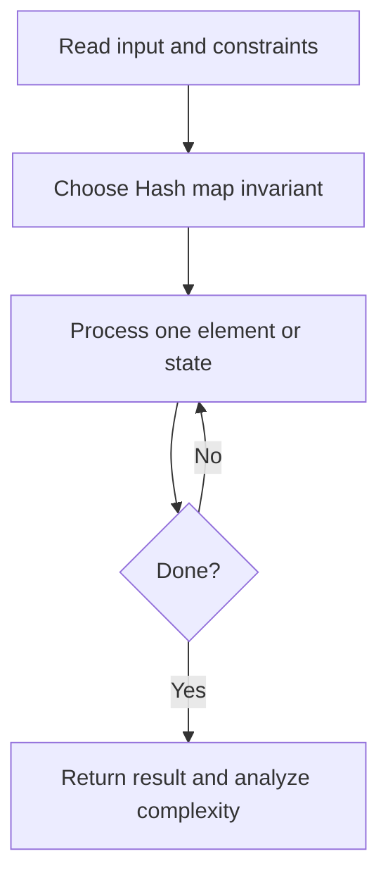
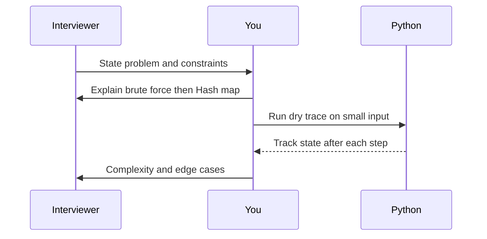

# Day 01 — Two Sum

**Pattern:** Hash map · **Time:** 35 minutes · **Track:** Python interview DSA

[Course home](../README.md) · [Practice file](../practice/day-01.py) · [Commented reference](../solutions/day-01.py)

## What and why (5 minutes)

**Problem:** Return indices of two different elements adding to target.

**Why this pattern:** Store complements while scanning once.

**Interview trap:** Check the map before inserting current value so you cannot reuse the same element.

## Algorithm flow



## Execution / timing diagram



## Try it yourself (15 minutes)

1. Open `practice/day-01.py`. Write `solve(...)` without looking below.
2. Verbally state the invariant and walk through a sample input.
3. Run `python -m unittest discover -s tests -v` from the repository root (reference tests run against completed solutions).
4. Check your practice implementation with `python scripts/check_practice.py 1` when you finish.

### Sample cases

```python
solve([2, 7, 11, 15], 9)  # [0, 1]
```
```python
solve([3, 3], 6)  # [0, 1]
```
```python
solve([1, 2], 7)  # []
```

## Commented solution — reveal after attempting

<details>
<summary>Show Python reference implementation</summary>

```python
def solve(nums, target):
    seen = {}  # number -> its earliest index
    for i, value in enumerate(nums):
        complement = target - value
        if complement in seen:  # use an earlier, distinct element
            return [seen[complement], i]
        seen[value] = i
    return []  # no matching pair
```

</details>

## Complexity (5 minutes)

**O(n) time, O(n) space.** Explain *why*, including auxiliary data structure cost.

## Tricky interview follow-up (10 minutes)

**Question:** How does this change if the array is already sorted?

Before moving on, explain (1) why your implementation is correct, (2) one edge case, (3) a trade-off versus a simpler solution.

**Next:** [Day 02](day-02.md)
