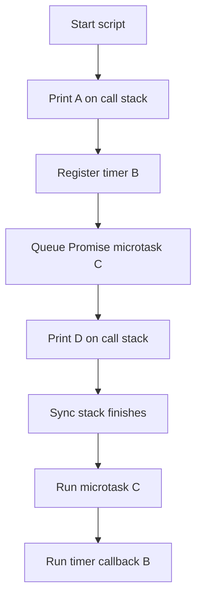
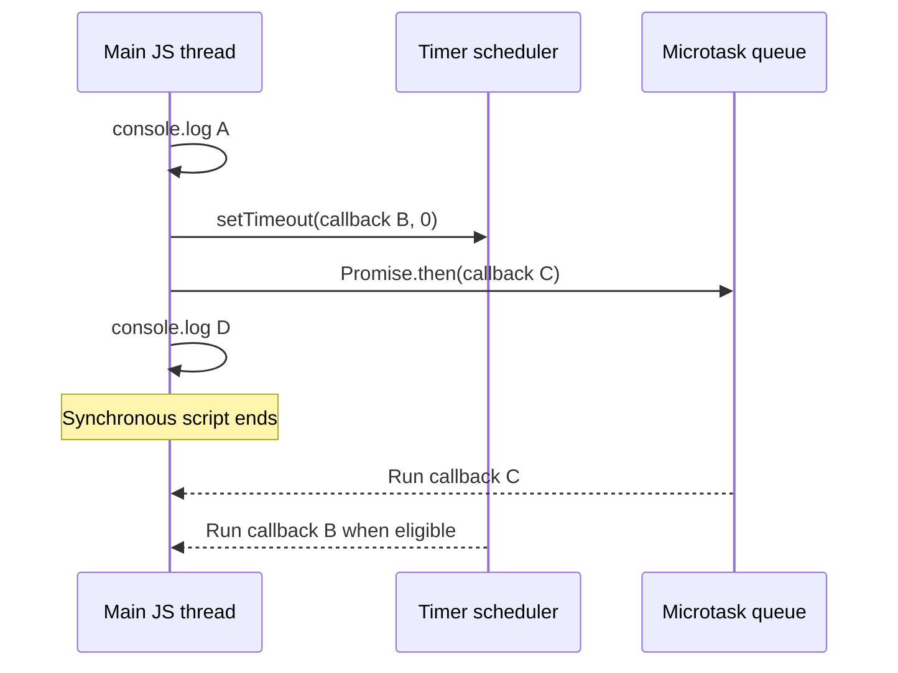

# Day 1 — JavaScript execution + your first HTTP API

**Goal:** run `GET /tasks` returning a JSON array. **Time:** ~90 min. **Today's files:** `checkpoints/day1/server.cjs` (you will write its contents below). **Next:** [Day 2](day-02.md).

## 0. Why we're doing this

Before frameworks, see what Node actually does: a function handles each HTTP request. In the app, a browser will eventually ask for tasks using exactly this contract.

## 1. JavaScript execution model (15 min)

- **Call stack:** the functions executing right now; one frame pushed when a function is called, popped when it returns.
- **Timer:** `setTimeout` registers a callback that may run later; `0` does not mean now.
- **Microtask:** a fulfilled Promise's `.then(...)` callback runs after current synchronous code, before an eligible timer callback in this example.

**Predict before running:**

```js
console.log('A');
setTimeout(() => console.log('B'), 0); // Timer callback: not synchronous.
Promise.resolve().then(() => console.log('C')); // Promise microtask.
console.log('D');
```


**Answer:** `A D C B`. The two `console.log` calls run synchronously; the Promise callback is a microtask; timer callback runs afterward. **Interview trap:** timers don't interrupt synchronous JS, and a zero delay is not an immediate call.

### Execution flow



### Timing / sequence diagram



## 2. Write the server (35 min)

From the extracted repository root:

```bash
mkdir -p checkpoints/day1
code checkpoints/day1/server.cjs  # Or open the file in VS Code manually
```

**Write all of this code into `checkpoints/day1/server.cjs`:**

```js
const http = require('node:http'); // Built-in Node module: no npm package needed.

// In-memory data lasts only until we stop this Node process.
const tasks = [
  { id: 1, title: 'Learn the event loop', done: false },
];

// Node calls this function for each incoming HTTP request.
const server = http.createServer((req, res) => {
  // The method (GET) and path (/tasks) together identify our route.
  if (req.method === 'GET' && req.url === '/tasks') {
    res.writeHead(200, { 'Content-Type': 'application/json' });
    res.end(JSON.stringify(tasks)); // Convert JS array to JSON; finish response.
    return; // Critical: do not fall through and send another response.
  }

  res.writeHead(404, { 'Content-Type': 'application/json' });
  res.end(JSON.stringify({ error: 'Not found' }));
});

// 3001 is the API port; the frontend will later use port 3000.
server.listen(3001, () => console.log('API: http://localhost:3001'));
```


**Why these decisions?** `node:http` shows the HTTP lifecycle without hiding it in a framework. `GET /tasks` only reads data. `JSON.stringify()` serializes JavaScript objects; `res.end()` completes the response; `return` prevents a second response.

## 3. Run and verify (10 min)

```bash
node checkpoints/day1/server.cjs
# In another terminal from anywhere:
curl -i http://localhost:3001/tasks
curl -i http://localhost:3001/unknown
```

Expected: `/tasks` → HTTP **200**, JSON array with one task; `/unknown` → **404**. Stop the server with **Ctrl+C** before Day 2 (same port).

## 4. Debugging experiments (15 min)

1. Temporarily remove `res.end(...)`: does curl finish? Restore it.
2. Change the path check to `/task`: why does `/tasks` now return 404?
3. Add a brief synchronous busy loop before `res.end()`. Can other JS handlers run during it? Remove it afterward.

## 5. Interview practice (15 min)

**Q1. What goes on the call stack?** Function calls that run synchronously, including the HTTP request handler when invoked.

**Q2. What is queued vs immediately executed?** Timer callbacks wait until their scheduling phase; resolved Promise handlers are microtasks; direct `console.log` runs now.

**Q3. Is Node multithreaded?** The main JS execution thread runs callbacks serially, while Node/libuv and the OS enable concurrent I/O; additional worker threads are possible.

**Q4. Why does `res.end()` matter?** It tells Node that the HTTP response is complete.

**Q5. What does status 404 mean?** The requested route/resource isn't found; not a syntax error in JavaScript.

## Exit checklist

- [ ] I predicted `A D C B` correctly (or can explain my correction).
- [ ] I typed and ran the server.
- [ ] I can explain `req`, `res`, and `return`.
- [ ] I wrote a short reflection in `docs/MY_NOTES.md`.

**Commit:** `git add . && git commit -m "day1: HTTP GET and event loop"`

**Continue → [Day 2: POST, promises and closures](day-02.md)**
