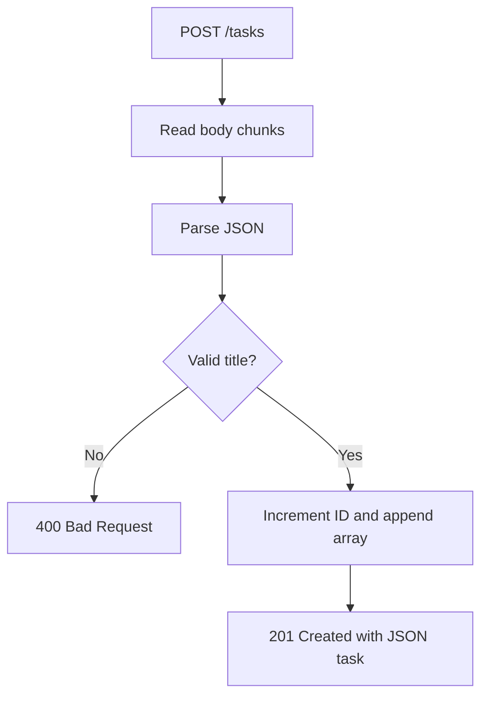
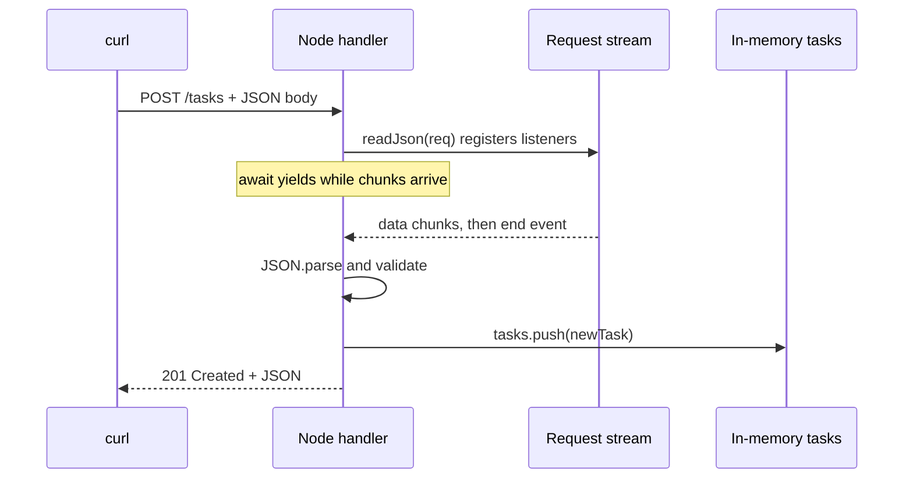

# Day 2 — Promises, async/await, closures + HTTP POST

**Goal:** create a task via `POST /tasks`, still in memory. **Time:** ~90 min. **Today:** replace `checkpoints/day2/server.cjs`. **Next:** [Day 3](day-03.md).

## 1. What and why (15 min)

- **Promise:** represents a result/error available later.
- **`await`:** pauses *one async function* until its Promise settles; it doesn't stop the entire Node event loop.
- **Closure:** the request callback retains access to `tasks` and `nextId` between requests.
- **Stream:** HTTP request bodies arrive in chunks, not magically as a parsed JSON object.

**Predict:**

```js
console.log('one');
async function work() {
  console.log('two'); // Runs before first await.
  await Promise.resolve();
  console.log('four'); // Runs in a Promise continuation.
}
work();
console.log('three');
```

**Answer:** `one two three four`.

### Request flow



### Timing / sequence diagram



## 2. Write the next version (35 min)

Stop the Day 1 server (**Ctrl+C**). Open `checkpoints/day2/server.cjs`; write this code:

```js
const http = require('node:http');

// These variables are captured by the request handler's closure.
const tasks = [{ id: 1, title: 'Learn the event loop', done: false }];
let nextId = 2;

function readJson(req) {
  // HTTP bodies arrive in chunks: read them before parsing JSON.
  return new Promise((resolve, reject) => {
    let raw = '';
    req.setEncoding('utf8');
    req.on('data', chunk => {
      raw += chunk;
      // A small learning-demo limit, not a full production protection scheme.
      if (raw.length > 10_000) {
        reject(Object.assign(new Error('Body too large'), { status: 413 }));
        req.destroy();
      }
    });
    req.on('end', () => {
      try { resolve(JSON.parse(raw)); }
      catch { reject(Object.assign(new Error('Invalid JSON'), { status: 400 })); }
    });
    req.on('error', reject);
  });
}

function sendJson(res, status, data) {
  res.writeHead(status, { 'Content-Type': 'application/json' });
  res.end(JSON.stringify(data)); // One response per request.
}

http.createServer(async (req, res) => {
  if (req.method === 'GET' && req.url === '/tasks') {
    sendJson(res, 200, tasks);
    return;
  }

  if (req.method === 'POST' && req.url === '/tasks') {
    try {
      const body = await readJson(req); // Pauses this async handler, not all Node work.
      const title = typeof body?.title === 'string' ? body.title.trim() : '';
      if (!title || title.length > 200) {
        sendJson(res, 400, { error: 'Title must be 1–200 characters' });
        return;
      }
      const task = { id: nextId++, title, done: false };
      tasks.push(task); // Shared in-memory array: gone on restart.
      sendJson(res, 201, task); // 201 = Created.
    } catch (error) {
      // Invalid JSON has status 400; too-large body is status 413.
      if (!res.destroyed) sendJson(res, error.status || 400, { error: error.message });
    }
    return;
  }
  sendJson(res, 404, { error: 'Not found' });
}).listen(3001, () => console.log('API: http://localhost:3001'));
```


**Why this design?** `readJson` converts an event-driven stream into a Promise so the handler can use `await`. `try/catch` translates bad input into an HTTP error rather than crashing. This example uses a bounded body size to keep the stream example safe enough for local experiments. It is **not** a production security implementation.

## 3. Run and prove behavior (10 min)

```bash
node checkpoints/day2/server.cjs
# In a second terminal:
curl -i http://localhost:3001/tasks
curl -i -X POST http://localhost:3001/tasks \
  -H 'Content-Type: application/json' \
  -d '{"title":"Learn async-await"}'
curl http://localhost:3001/tasks
curl -i -X POST http://localhost:3001/tasks \
  -H 'Content-Type: application/json' -d '{invalid}'
```

Expected: **201** and new row, GET shows the row, malformed JSON → **400**. Restart Node: the new row disappears. This *motivates Day 3*.

## 4. Write one small enhancement (15 min)

Before looking at the finished code, add `GET /count` returning `{"count": tasks.length}`. Put it next to GET `/tasks`; test with curl. **Interview trap:** request handlers are callbacks, but their closure can see the same array; it does not create a new array on every request.

## 5. Interview / debugging (15 min)

1. **Does `await` block Node?** It suspends that async function; other callbacks can run while waiting for I/O.
2. **Can you `await` outside an async function?** Top-level `await` is permitted in ES modules, but not ordinary CommonJS files; inside a function, declare it `async`.
3. **What happens if a Promise rejects?** The awaited expression throws in the async function; handle with `try/catch` or pass rejection to caller.
4. **Is `Promise.all` sequential?** No. It subscribes to multiple already-started async operations and settles when all fulfill or one rejects; it doesn't spawn threads.
5. **What is a closure?** A function retaining access to its lexical environment.
6. **Why not treat HTTP body as a single string?** It is delivered as a stream over time.

## Exit checklist

- [ ] POST 201, GET contains new task, malformed JSON 400.
- [ ] I understand why restart loses memory data.
- [ ] I can explain each `await`, the Promise resolve and reject paths.

**Commit:** `git add . && git commit -m "day2: HTTP POST and async"`

**Continue → [Day 3: PostgreSQL persistence](day-03.md)**
