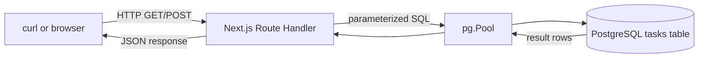
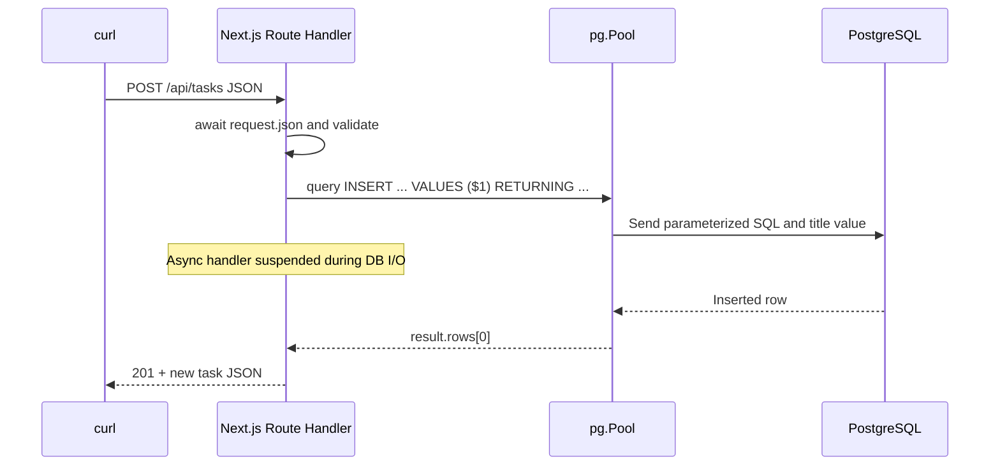

# Day 3 — Create the Next.js app and connect PostgreSQL

**Goal:** start from `create-next-app`, understand the generated files and Tailwind setup, and then save tasks so they survive restarts. **Time:** three focused sessions of about 45 minutes. **Next:** [Day 4](day-04.md).

> **Important learning rule:** The active `frontend/` directory contains only
> the generated Next.js starter at the beginning of this lesson. Build the
> database and API files yourself in the order below. The finished application
> is isolated under `reference/frontend-complete/`; do not copy from it while
> completing the lesson.

## Session 3A — Create and understand the frontend

### 1. Scaffold the Next.js application (15 min)

**What:** `create-next-app` generates the package configuration and minimum App
Router file structure.

**Why:** Starting from the official scaffold shows which files Next.js creates
for us and which application files we add ourselves.

From the repository root, the course used:

```bash
npx create-next-app@latest frontend \
  --typescript \
  --eslint \
  --app \
  --no-src-dir \
  --tailwind \
  --use-npm \
  --import-alias '@/*' \
  --no-react-compiler
```

If `frontend/` already contains the default **Create Next App** screen, this
command has already been completed for you. Do not run it again inside the
existing directory.

Start only the generated application:

```bash
cd frontend
npm run dev
```

Open `http://localhost:3000`, confirm the starter page appears, and then stop
the server with **Ctrl+C**.

### 2. Inspect the generated files (15 min)

Do not change anything yet. Find each item and explain its purpose:

```text
frontend/
├── app/
│   ├── globals.css       # global styles imported by the root layout
│   ├── layout.tsx        # shared HTML shell
│   └── page.tsx          # component for the / URL
├── public/               # files served directly by URL
├── postcss.config.mjs    # runs Tailwind through PostCSS
├── package.json          # dependencies and npm scripts
└── tsconfig.json         # TypeScript configuration
```

Notice what is **not** present yet: there is no `lib/`, task type, database
driver, or `/api/tasks` route. You will create each one below.

Open `frontend/app/globals.css` and find:

```css
/* Tailwind generates utilities such as bg-slate-950 and rounded-2xl. */
@import "tailwindcss";
```

**Why Tailwind?** It provides small utility classes for layout, spacing,
color, responsive breakpoints, and interaction states. We will still explain
the CSS idea behind each group instead of treating the class names as magic.

### 3. Make the first page change (15 min)

Before seeing database code, prove that you understand the route-to-file
relationship. Replace `frontend/app/page.tsx` with:

```tsx
export default function Home() {
  return (
    <main className="flex min-h-screen items-center justify-center bg-slate-950 px-6">
      {/* Tailwind utilities style this card without a page-specific CSS file. */}
      <section className="w-full max-w-xl rounded-2xl border border-slate-700 bg-slate-900 p-8">
        <p className="text-sm font-semibold uppercase tracking-widest text-violet-300">
          MiniTrack course
        </p>
        <h1 className="mt-3 text-3xl font-bold text-white">
          Next.js and Tailwind are ready.
        </h1>
        <p className="mt-4 text-slate-300">
          PostgreSQL and API routes come next.
        </p>
      </section>
    </main>
  );
}
```

Run `npm run dev` again and confirm the browser updates. This is still a
Server Component: it has no `'use client'`, event handler, or React state.
Change one utility at a time—for example, `p-8` to `p-4`—and observe which CSS
property changes.

## Session 3B — Add persistence

### 4. Why PostgreSQL? (10 min)

Day 2's array is local to one Node process and disappears after restart. PostgreSQL gives persistence, indexes, constraints, and concurrency control. We write SQL directly instead of an ORM to make database behavior interview-visible.

### Data flow



### Timing / sequence diagram



### 5. Install and create a database (20 min)

**On macOS with Homebrew** (skip install if Postgres already exists):

```bash
brew install postgresql@17
brew services start postgresql@17
# Homebrew may require adding its postgresql@17/bin to your PATH.
createdb minitrack
```

Postgres user/password configuration varies. Use a valid local role. Then create `backend/sql/schema.sql`:

```sql
-- Re-runnable Week 1 schema. Do not DROP the table each time you run this.
CREATE TABLE IF NOT EXISTS tasks (
  id BIGINT GENERATED ALWAYS AS IDENTITY PRIMARY KEY,
  title TEXT NOT NULL CHECK (char_length(title) BETWEEN 1 AND 200),
  done BOOLEAN NOT NULL DEFAULT FALSE,
  created_at TIMESTAMPTZ NOT NULL DEFAULT now()
);

-- A small starter set, only inserted if the table is still empty.
INSERT INTO tasks (title, done)
SELECT 'Learn the JavaScript event loop', TRUE
WHERE NOT EXISTS (SELECT 1 FROM tasks);
INSERT INTO tasks (title, done)
SELECT 'Build a full-stack task tracker', FALSE
WHERE (SELECT COUNT(*) FROM tasks) = 1;
```


Run this **from repository root**:

```bash
psql -d minitrack -f backend/sql/schema.sql
psql -d minitrack -c 'SELECT id, title, done FROM tasks ORDER BY id;'
```

If authentication fails, use `psql -h localhost -U YOUR_USER -d minitrack` and set the matching credentials in `frontend/.env.local` below. The schema is re-runnable; it does not wipe your tasks.

**Why identity IDs?** PostgreSQL allocates IDs, not each Node instance; sequence values can have gaps. **Why BIGINT?** Supports more IDs, but `pg` gives BIGINT values as strings by default to avoid unsafe JavaScript integer conversion.

### 6. Install the database driver and configure the connection (15 min)

From repository root:

```bash
cd frontend
npm install pg
npm install --save-dev @types/pg
```

`pg` is the PostgreSQL driver. `@types/pg` gives TypeScript the driver's type
definitions.

Create `frontend/.env.local.example`:

```env
DATABASE_URL=postgresql://YOUR_MAC_USER@localhost:5432/minitrack
```

Then create the ignored local copy and replace the placeholder with your
PostgreSQL role:

```bash
cp .env.local.example .env.local
```

Use `psql -d minitrack -c '\conninfo'` to confirm your own role and port,
then build the matching URL. Never commit `.env.local`.

Create `frontend/lib/`, then write `frontend/lib/db.ts`:

```ts
import 'server-only';
import { Pool } from 'pg';

// Cache the pool across Next.js development reloads.
const globalForPg = globalThis as typeof globalThis & { taskPool?: Pool };

export function getPool(): Pool {
  const connectionString = process.env.DATABASE_URL;
  if (!connectionString) {
    throw new Error('DATABASE_URL is missing. Copy frontend/.env.local.example to .env.local and edit it.');
  }
  // Reuse a bounded number of connections instead of reconnecting per request.
  globalForPg.taskPool ??= new Pool({ connectionString, max: 5 });
  return globalForPg.taskPool;
}
```

The `server-only` import prevents this database module from being included in Client Components. The global pool guard avoids creating a new pool on every Next.js development reload.

**Why a pool?** Keeping a small number of reusable PostgreSQL connections is cheaper than making a new connection for each HTTP request. The pool also limits simultaneous database connections.

## Session 3C — Build the collection API

### 7. Add the task type and database functions (20 min)

Create `frontend/app/types.ts`. `pg` returns `BIGINT` IDs as strings, and the API sends timestamps as ISO strings:

```ts
export type Task = {
  id: string;
  title: string;
  done: boolean;
  created_at: string;
};
```

Create `frontend/lib/tasks.ts`. Start with the two operations used today, `listTasks` and `createTask`:

```ts
import type { Task } from '../app/types';
import { getPool } from './db';

// PostgreSQL returns a Date; the browser-facing Task uses an ISO string.
type TaskRow = Omit<Task, 'created_at'> & { created_at: Date };

function toTask(row: TaskRow): Task {
  return { ...row, created_at: row.created_at.toISOString() };
}

export async function listTasks(): Promise<Task[]> {
  const result = await getPool().query<TaskRow>(
    'SELECT id, title, done, created_at FROM tasks ORDER BY id'
  );
  return result.rows.map(toTask);
}

export async function createTask(title: string): Promise<Task> {
  const result = await getPool().query<TaskRow>(
    'INSERT INTO tasks (title) VALUES ($1) RETURNING id, title, done, created_at',
    // Bound values remain separate from SQL syntax.
    [title]
  );
  const row = result.rows[0];
  if (!row) throw new Error('Inserted task was not returned by PostgreSQL');
  return toTask(row);
}
```

`$1` is a parameter placeholder; the title is sent separately from the SQL text. `TaskRow` describes the database timestamp as a `Date`, and `toTask` converts it to a JSON-friendly string.

Create `frontend/lib/validation.ts`. Request JSON is untrusted, so accept `unknown` and narrow it before reading properties:

```ts
export function normalizeTitle(value: unknown): string | null {
  if (typeof value !== 'string') return null;
  const title = value.trim();
  return title.length >= 1 && title.length <= 200 ? title : null;
}

export function isRecord(value: unknown): value is Record<string, unknown> {
  return typeof value === 'object' && value !== null && !Array.isArray(value);
}
```

### 8. Add typed Route Handlers (20 min)

The Day 1–2 checkpoint servers taught the built-in Node HTTP lifecycle. In the actual Next.js app, use **Route Handlers** instead of starting another server. Create `frontend/app/api/tasks/route.ts`; Next maps exported HTTP-method functions to `/api/tasks`:

```ts
import { createTask, listTasks } from '../../../lib/tasks';
import { isRecord, normalizeTitle } from '../../../lib/validation';

// Next.js maps this named export to GET /api/tasks.
export async function GET(): Promise<Response> {
  try {
    return Response.json(await listTasks(), {
      headers: { 'Cache-Control': 'no-store' },
    });
  } catch (error: unknown) {
    console.error('GET /api/tasks failed:', error);
    return Response.json({ error: 'Internal server error' }, { status: 500 });
  }
}

export async function POST(request: Request): Promise<Response> {
  // Network JSON is untrusted, so keep it unknown until validation.
  let body: unknown;
  try {
    body = await request.json();
  } catch {
    return Response.json({ error: 'Invalid JSON' }, { status: 400 });
  }
  const title = normalizeTitle(isRecord(body) ? body.title : undefined);
  if (!title) {
    return Response.json({ error: 'title must be 1–200 characters' }, { status: 400 });
  }
  try {
    return Response.json(await createTask(title), { status: 201 });
  } catch (error: unknown) {
    console.error('POST /api/tasks failed:', error);
    return Response.json({ error: 'Internal server error' }, { status: 500 });
  }
}
```

Also create `frontend/app/api/health/route.ts`:

```ts
export function GET(): Response {
  return Response.json({ ok: true });
}
```

### 9. Run and verify your API (15 min)

Run the app from `frontend`:

```bash
npm run dev
# In another terminal:
curl -i http://localhost:3000/api/tasks
curl -i -X POST http://localhost:3000/api/tasks \
  -H 'Content-Type: application/json' -d '{"title":"Persist in PostgreSQL"}'
```

Stop/restart Next.js and GET again. **The task should still exist.** The API and page run in the same Next.js server; PostgreSQL is the persistent store.

## 10. SQL and interview drill (25 min)

Try:

```sql
-- Select only open tasks; PostgreSQL performs filtering.
SELECT id, title FROM tasks WHERE done = FALSE ORDER BY id;
-- SQL returns the changed row without needing a second SELECT.
UPDATE tasks SET done = TRUE WHERE id = 1 RETURNING *;
-- An aggregate: count rows still open.
SELECT COUNT(*) FROM tasks WHERE done = FALSE;
```

Practice giving the short answer first, then support it with the MiniTrack example.

### Q1. Why use `$1` parameters instead of building SQL with template strings?

**Interview-ready answer:** A parameterized query sends SQL structure and user-supplied values separately. PostgreSQL treats the supplied value as data rather than executable SQL syntax, which prevents SQL injection through that value and also handles escaping correctly.

**Unsafe example:**

```js
const sql = `INSERT INTO tasks (title) VALUES ('${title}')`;
```

An attacker-controlled title could break out of the quoted value and alter the query.

**Safe example:**

```js
await pool.query(
  'INSERT INTO tasks (title) VALUES ($1)',
  [title],
);
```

**Senior follow-up:** Parameters protect values, not dynamic table names, column names, or SQL keywords. Dynamic identifiers must usually be selected from a trusted allowlist rather than copied directly from user input.

### Q2. Why use PostgreSQL's `RETURNING` clause?

**Interview-ready answer:** `RETURNING` gives the application the row created or changed by an `INSERT`, `UPDATE`, or `DELETE` in the same database round trip. It can return generated IDs, defaults, and timestamps without a second `SELECT`.

**Example:**

```sql
INSERT INTO tasks (title)
VALUES ($1)
RETURNING id, title, done, created_at;
```

The response contains the exact inserted row, including its database-generated `id` and default `done = FALSE`. A separate query would add latency and could introduce race conditions if it tried to identify the row indirectly.

### Q3. Is a generated database ID guaranteed to be gap-free?

**Interview-ready answer:** No. A primary key or sequence guarantees identity and uniqueness, not consecutive numbering. Gaps can occur because a transaction rolls back, a row is deleted, or sequence values are cached or allocated by concurrent requests.

**Example:** IDs `1`, `2`, and `3` may be allocated, but the transaction using `2` can fail. The visible rows may then have IDs `1` and `3`.

**Senior follow-up:** IDs should not be used as business-visible sequence numbers such as invoice numbers when the business requires a special gap policy. That requirement needs separate domain logic and careful concurrency design.

### Q4. What happens when the database connection pool is full?

**Interview-ready answer:** A connection pool has a maximum number of active database connections. When all are busy, another query normally waits in the pool's queue until a connection is released or a timeout/error occurs. This applies backpressure and protects PostgreSQL from an unbounded number of connections.

**Example:** With a pool limit of 10, the first 10 long-running queries can use connections while the 11th request waits. If requests arrive faster than queries finish, latency and queue length grow.

**Senior follow-up:** Production configuration should coordinate application-instance count, pool size, PostgreSQL's connection limit, query timeouts, and pool wait timeouts. Scaling to 20 app instances with a pool of 20 could potentially request 400 database connections.

### Q5. Why use `await pool.query(...)`?

**Interview-ready answer:** `pool.query` returns a Promise for an asynchronous database operation. `await` makes the handler wait for that result in readable control flow, but it suspends only that handler; it does not block Node's event loop from processing other ready work.

**Example:**

```js
const result = await pool.query(
  'SELECT id, title FROM tasks ORDER BY id',
);
return Response.json(result.rows);
```

The response must wait because it needs `result.rows`. While PostgreSQL executes the query, Node can serve another request whose work is ready.

### Q6. What should happen if PostgreSQL becomes unavailable?

**Interview-ready answer:** The database operation rejects or times out. The request boundary should catch the failure, log useful diagnostic context on the server, and return a non-sensitive `5xx` response. A production system should also use timeouts, health monitoring, alerts, and an appropriate retry or recovery strategy.

**Example:**

```js
try {
  const tasks = await listTasks();
  return Response.json(tasks);
} catch (error) {
  console.error('Unable to list tasks', error);
  return Response.json(
    { error: 'Service temporarily unavailable' },
    { status: 503 },
  );
}
```

**Senior follow-up:** Retries are safest for transient failures and idempotent operations. Blindly retrying an `INSERT` after an uncertain network failure can create duplicates, so creation APIs may need an idempotency key or another deduplication strategy.

## Exit checklist

- [ ] I ran and understood the original `create-next-app` scaffold before changing it.
- [ ] I can explain the purpose of `page.tsx`, `layout.tsx`, `package.json`, and `tsconfig.json`.
- [ ] I can explain what `@import "tailwindcss"` and a few utility classes do.
- [ ] Schema created; GET reads from Postgres.
- [ ] POST survives Next.js restart.
- [ ] I understand $1 parameters, pooling, and BIGINT strings.

**Commit:** `git add . && git commit -m "day3: persist in Postgres"`

**Continue → [Day 4: Next.js server-rendered task list](day-04.md)**
