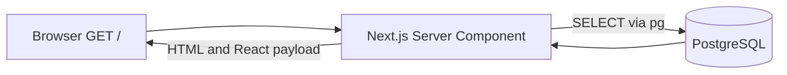
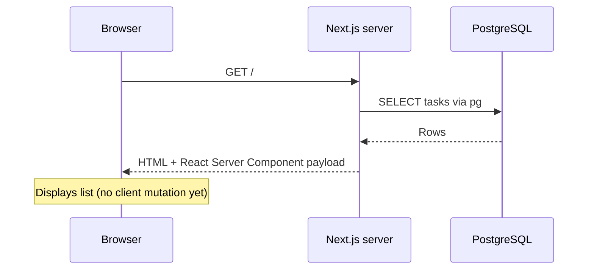

# Day 4 — Next.js + React: display tasks in the browser

**Goal:** open `http://localhost:3000` and see PostgreSQL tasks. **Time:** ~90 min. **Today:** `frontend/app/types.ts`, `frontend/app/layout.tsx`, `frontend/app/page.tsx`. **Next:** [Day 5](day-05.md).

## 1. Read database data in a Server Component (15 min)

The Day 1–2 checkpoint servers taught the built-in Node HTTP lifecycle. From Day 3 onward the app uses Next.js Route Handlers and a PostgreSQL connection pool. A **Server Component** can call server-only database code directly for its initial data; it does not need `useEffect` or an HTTP request back to its own app.

### Browser-to-database flow



### Timing / sequence diagram



## 2. Install and start the Next.js project (15 min)

From the repository root, configure the database URL if you have not already, then run Next.js:

```bash
cd frontend
npm install
cp .env.local.example .env.local
# Set DATABASE_URL in .env.local; it is server-only.
npm run dev
```

This package already has `frontend/package.json` and a minimal Next App Router setup. You do **not** need `create-next-app` again.

## 3. Review the task type (5 min)

Day 3 created `frontend/app/types.ts` for the database-backed API. Read it again before using it here; you do not need to recreate it:

```ts
export type Task = {
  // pg returns BIGINT ids as decimal strings by default; do not assume JS safe integer.
  id: string;
  title: string;
  done: boolean;
  created_at: string;
};
```


**Why a string ID?** PostgreSQL `BIGINT` is returned by `pg` as a string by default. A TypeScript type prevents us from casually assuming it is a safe JS number.

## 4. Create the page (25 min)

Write `frontend/app/layout.tsx` (minimal styling only):

```tsx
import type { ReactNode } from 'react';
export default function RootLayout({ children }: { children: ReactNode }) {
  return <html lang="en"><body style={{fontFamily: 'system-ui, sans-serif', maxWidth: 740, margin: '48px auto', padding: '0 16px'}}>{children}</body></html>;
}
```


Then write `frontend/app/page.tsx`:

```tsx
import { listTasks } from '../lib/tasks';
import type { Task } from './types';

export const dynamic = 'force-dynamic';

export default async function Home() {
  let tasks: Task[] = [];
  let error = '';

  try {
    tasks = await listTasks();
  } catch (err) {
    error = err instanceof Error ? err.message : 'Unknown error';
  }

  return (
    <main>
      <h1>MiniTrack</h1>
      <p>{tasks.length} tasks</p>
      {error ? <p role="alert">Could not load tasks: {error}</p> :
        <ul>{tasks.map(task => (
          // Stable keys let React preserve item identity between renders.
          <li key={task.id}>{task.done ? '✅' : '⬜'} {task.title}</li>
        ))}</ul>}
    </main>
  );
}
```


Open `http://localhost:3000`. Expected: a `MiniTrack` heading, task count, and task list; the Server Component reads from PostgreSQL through the typed `pg` helper.

## 5. Debug + interview (25 min)

- Stop Next.js and observe that the page is unavailable; restart it.
- Insert a task through `POST /api/tasks`; reload the browser. It should appear.
- Compare this direct database call with calling your own app through `fetch`. Why can a Server Component avoid that extra HTTP hop?

**Q1. Server vs Client Component?** Server Components fetch/compose server-side data; Client Components are needed for interactive hooks/event handlers. Client Components can still have server-rendered HTML on initial load.

**Q2. What is hydration?** React connects interactive client code to server-rendered HTML.

**Q3. Why isn't this a `useEffect` fetch?** Initial data is available on the server; fewer loading states and a clearer server data boundary.

**Q4. Why read PostgreSQL directly from a Server Component?** It avoids an unnecessary server-to-self HTTP request. The Route Handler remains available for browser requests and external clients.

**Q5. Why keep secrets out of browser code?** Anything bundled for the client can be inspected; use non-public env vars only on the server.

**Q6. What is the React list key?** Stable identity for each item, not its array index.

## Exit checklist

- [ ] Page shows tasks from PostgreSQL.
- [ ] Task count changes after curl POST + browser refresh.
- [ ] I can explain each hop in the sequence diagram and distinguish direct server data access from an HTTP Route Handler.

**Commit:** `git add . && git commit -m "day4: show tasks in Next"`

**Continue → [Day 5: forms, state and mutations](day-05.md)**
