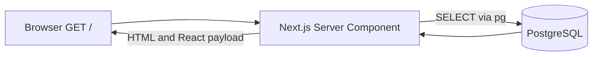
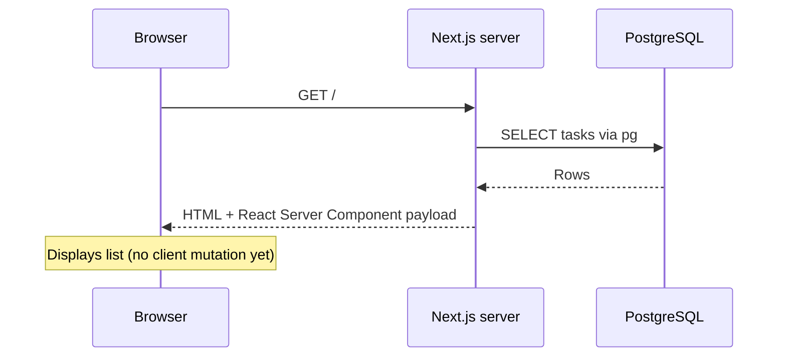

# Day 4 — Next.js + React: display tasks in the browser

**Goal:** open `http://localhost:3000` and see PostgreSQL tasks. **Time:** ~90 min. **Today:** `frontend/app/types.ts`, `frontend/app/layout.tsx`, `frontend/app/page.tsx`. **Next:** [Day 5](day-05.md).

## 1. Read database data in a Server Component (15 min)

The Day 1–2 checkpoint servers taught the built-in Node HTTP lifecycle. From Day 3 onward the app uses Next.js Route Handlers and a PostgreSQL connection pool. A **Server Component** can call server-only database code directly for its initial data; it does not need `useEffect` or an HTTP request back to its own app.

### Browser-to-database flow



### Timing / sequence diagram



## 2. Confirm the Day 3 starting point (10 min)

Do not scaffold another app today. Day 3 already created `frontend/` with
`create-next-app`, then you added the database helpers and collection Route
Handler one file at a time.

Before continuing, confirm you created these files yourself:

```text
frontend/
├── app/
│   ├── api/health/route.ts
│   ├── api/tasks/route.ts
│   └── types.ts
├── lib/
│   ├── db.ts
│   ├── tasks.ts
│   └── validation.ts
└── .env.local
```

If any are missing, return to Day 3 instead of copying the completed reference.
Then start your current project:

```bash
cd frontend
npm run dev
```

Check `GET /api/health` and `GET /api/tasks` before changing the page. This
proves the Day 3 server-side layer works independently of today's UI.

## 3. Review the task type (5 min)

Day 3 created `frontend/app/types.ts` for the database-backed API. Read it again before using it here; you do not need to recreate it:

```ts
export type Task = {
  // pg returns BIGINT ids as decimal strings by default; do not assume JS safe integer.
  id: string;
  title: string;
  done: boolean;
  created_at: string;
};
```


**Why a string ID?** PostgreSQL `BIGINT` is returned by `pg` as a string by default. A TypeScript type prevents us from casually assuming it is a safe JS number.

## 4. Create the page (25 min)

First, attempt the layout yourself: keep the required `<html>` and `<body>`
elements, set `lang="en"`, and render `children`. Then compare it with this
minimal version in `frontend/app/layout.tsx`:

```tsx
import type { ReactNode } from 'react';
import './globals.css';

export default function RootLayout({ children }: { children: ReactNode }) {
  return (
    <html lang="en">
      {/* These Tailwind utilities provide defaults shared by every page. */}
      <body className="min-h-screen bg-slate-950 text-slate-100 antialiased">
        {children}
      </body>
    </html>
  );
}
```


Then write `frontend/app/page.tsx`:

```tsx
import { listTasks } from '../lib/tasks';
import type { Task } from './types';

export const dynamic = 'force-dynamic';

export default async function Home() {
  let tasks: Task[] = [];
  let error = '';

  try {
    tasks = await listTasks();
  } catch (err) {
    error = err instanceof Error ? err.message : 'Unknown error';
  }

  return (
    <main className="mx-auto min-h-screen w-full max-w-3xl px-5 py-12">
      <p className="text-sm font-semibold uppercase tracking-widest text-violet-300">
        Your workspace
      </p>
      <h1 className="mt-3 text-4xl font-bold tracking-tight">MiniTrack</h1>
      <p className="mt-2 text-slate-400">{tasks.length} tasks</p>

      {error ? (
        <p
          className="mt-8 rounded-xl border border-rose-400/30 bg-rose-400/10 p-4 text-rose-200"
          role="alert"
        >
          Could not load tasks: {error}
        </p>
      ) : (
        <ul className="mt-8 overflow-hidden rounded-2xl border border-slate-700 bg-slate-900">
          {tasks.map(task => (
            // Stable keys let React preserve item identity between renders.
            <li
              className="flex items-center gap-3 border-b border-slate-700 px-5 py-4 last:border-b-0"
              key={task.id}
            >
              <span aria-hidden="true">{task.done ? '✅' : '⬜'}</span>
              <span className={task.done ? 'text-slate-500 line-through' : ''}>
                {task.title}
              </span>
            </li>
          ))}
        </ul>
      )}
    </main>
  );
}
```

Tailwind classes are still CSS concepts: `max-w-3xl` constrains width,
`mx-auto` centers the page, `px-5 py-12` adds spacing, and `last:border-b-0`
removes the final divider. Change one utility and inspect the result.


Open `http://localhost:3000`. Expected: a `MiniTrack` heading, task count, and task list; the Server Component reads from PostgreSQL through the typed `pg` helper.

## 5. Debug + interview (25 min)

- Stop Next.js and observe that the page is unavailable; restart it.
- Insert a task through `POST /api/tasks`; reload the browser. It should appear.
- Compare this direct database call with calling your own app through `fetch`. Why can a Server Component avoid that extra HTTP hop?

### Q1. What is the difference between a Server Component and a Client Component?

**Interview-ready answer:** A Server Component executes on the server and can safely access server-side resources such as PostgreSQL and private environment variables. It does not send its component JavaScript to the browser. A Client Component is required when the component needs browser APIs, event handlers, or stateful hooks such as `useState` and `useEffect`.

**Example:**

```tsx
// Server Component: no "use client"
export default async function Page() {
  const tasks = await listTasks();
  return <TaskList tasks={tasks} />;
}
```

The page can query PostgreSQL because it runs on the server. A task form with `onSubmit` and `useState` must be a Client Component because those interactions happen in the browser.

**Important nuance:** `"use client"` marks a client boundary, not necessarily "render only in the browser." Next.js can still include server-generated HTML for Client Components on the initial load, and then hydrate their interactive JavaScript in the browser.

### Q2. What is hydration?

**Interview-ready answer:** Hydration is the process where React loads client-side JavaScript and attaches behavior, state, and event handlers to HTML that was already rendered by the server. It makes the existing page interactive rather than rebuilding all of its visible HTML from nothing.

**Example:** The server may send an already visible **Add task** button. During hydration, React connects that button to its `onClick` or form `onSubmit` handler.

**Common problem:** A hydration mismatch occurs when the client initially renders different content from the server, for example by rendering `Date.now()` or a browser-only value during the first render without handling the difference.

### Q3. Why not load the initial tasks with `useEffect`?

**Interview-ready answer:** The initial task data is already available while the server renders the page, so the Server Component can load it before sending HTML. This avoids shipping an extra client fetch for the first view, reduces the initial loading-state code, keeps database access on the server, and allows the response HTML to contain useful content immediately.

**Client-fetch version:**

```tsx
useEffect(() => {
  fetch('/api/tasks')
    .then(response => response.json())
    .then(setTasks);
}, []);
```

This first renders without the tasks, then waits for hydration and another HTTP request. A client fetch is still appropriate for browser-driven updates, polling, or data that depends on client-only state.

### Q4. Why read PostgreSQL directly from a Server Component instead of fetching your own Route Handler?

**Interview-ready answer:** Both the Server Component and database helper run inside the trusted server application. Calling the helper directly avoids a server-to-itself HTTP hop, duplicate serialization, extra latency, and another failure boundary. Route Handlers are still useful as HTTP boundaries for browser mutations and external consumers.

**Example paths:**

```text
Server Component -> listTasks() -> PostgreSQL
Browser -> fetch('/api/tasks') -> Route Handler -> listTasks() -> PostgreSQL
```

The first path is simpler for server rendering. The second path is necessary when browser code needs to make an HTTP request.

**Senior follow-up:** Keep authorization and business rules in reusable server-side functions rather than implementing them only in the page or only in the Route Handler. Every entry point should enforce the same rules.

### Q5. Why must secrets stay out of browser code?

**Interview-ready answer:** Any value included in a client JavaScript bundle or sent to the browser can be inspected by the user. Database passwords, private API keys, and signing secrets must remain in server-only code and non-public environment variables.

**Example:** `DATABASE_URL` can be read by a server-side database module. It must never be exposed through props or renamed to a public variable such as `NEXT_PUBLIC_DATABASE_URL`, because `NEXT_PUBLIC_` values are intentionally available to browser code.

**Important distinction:** A public key or public configuration value may be safe to expose if the service designed it that way. The variable name does not make a secret safe; the security model of the credential does.

### Q6. What is a React list key, and why should it be stable?

**Interview-ready answer:** A key identifies an item among its siblings so React can match that item between renders. A stable database ID helps React preserve the correct component state and update only the items that were inserted, removed, or reordered.

**Good example:**

```tsx
tasks.map(task => <li key={task.id}>{task.title}</li>)
```

Using the array index can cause state to follow the wrong visible item after a deletion or reorder. If the first item is removed, every later index changes even though those task identities did not.

**Important nuance:** `key` is used internally by React and is not passed to the component as a normal prop. Pass `task.id` separately if the child component needs the ID.

## Exit checklist

- [ ] Page shows tasks from PostgreSQL.
- [ ] Task count changes after curl POST + browser refresh.
- [ ] I can explain each hop in the sequence diagram and distinguish direct server data access from an HTTP Route Handler.

**Commit:** `git add . && git commit -m "day4: show tasks in Next"`

**Continue → [Day 5: forms, state and mutations](day-05.md)**
