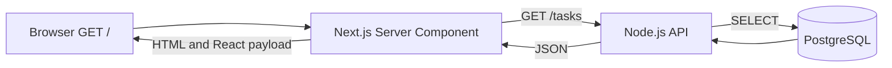
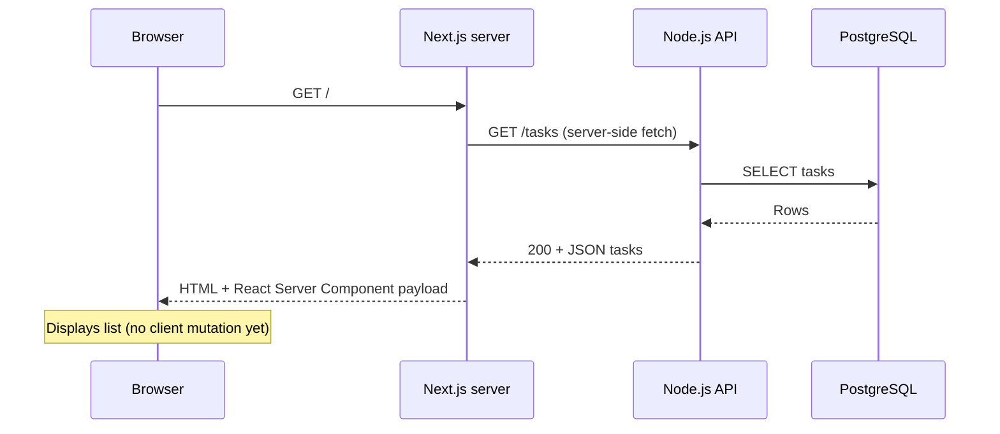

# Day 4 — Next.js + React: display tasks in the browser

**Goal:** open `http://localhost:3000` and see PostgreSQL tasks. **Time:** ~90 min. **Today:** `frontend/app/types.ts`, `frontend/app/layout.tsx`, `frontend/app/page.tsx`. **Next:** [Day 5](day-05.md).

## 1. Why a separate Next.js frontend? (15 min)

We already built Node HTTP endpoints to learn the backend. Next.js will consume them, making the boundary clear. A **Server Component** fetches the initial list on the Next server; it does not need `useEffect` just to fetch on page load. We'll add browser events on Day 5.

### Browser-to-database flow



### Timing / sequence diagram



## 2. Install and start the Next.js project (15 min)

**Leave Day 3 backend running in terminal A.** In terminal B, from repo root:

```bash
cd frontend
npm install
cp .env.local.example .env.local
# API_BASE_URL is read by the Next.js server, not exposed to browser code.
npm run dev
```

This package already has `frontend/package.json` and a minimal Next App Router setup. You do **not** need `create-next-app` again.

## 3. Define the shape of a task (10 min)

Write `frontend/app/types.ts`:

```ts
export type Task = {
  // pg returns BIGINT ids as decimal strings by default; do not assume JS safe integer.
  id: string;
  title: string;
  done: boolean;
  created_at: string;
};
```


**Why a string ID?** PostgreSQL `BIGINT` is returned by `pg` as a string by default. A TypeScript type prevents us from casually assuming it is a safe JS number.

## 4. Create the page (25 min)

Write `frontend/app/layout.tsx` (minimal styling only):

```tsx
import type { ReactNode } from 'react';
export default function RootLayout({ children }: { children: ReactNode }) {
  return <html lang="en"><body style={{fontFamily: 'system-ui, sans-serif', maxWidth: 740, margin: '48px auto', padding: '0 16px'}}>{children}</body></html>;
}
```


Then write `frontend/app/page.tsx`:

```tsx
// Server Component: the initial data fetch happens on the Next.js server.
// It can read API_BASE_URL without exposing a secret to the browser bundle.
import type { Task } from './types';

export default async function Home() {
  const api = process.env.API_BASE_URL || 'http://localhost:3001';
  let tasks: Task[] = [];
  let error = '';

  try {
    // For teaching, always fetch current rows instead of caching the response.
    const response = await fetch(`${api}/tasks`, { cache: 'no-store' });
    // fetch does not reject on 404/500; check the HTTP status explicitly.
    if (!response.ok) throw new Error(`API returned HTTP ${response.status}`);
    tasks = (await response.json()) as Task[];
  } catch (err) {
    error = err instanceof Error ? err.message : 'Unknown error';
  }

  return (
    <main>
      <h1>MiniTrack</h1>
      <p>{tasks.length} tasks</p>
      {error ? <p role="alert">Could not load tasks: {error}</p> :
        <ul>{tasks.map(task => (
          // Stable keys let React preserve item identity between renders.
          <li key={task.id}>{task.done ? '✅' : '⬜'} {task.title}</li>
        ))}</ul>}
    </main>
  );
}
```


Open `http://localhost:3000`. Expected: a `MiniTrack` heading, task count, and task list; the list comes from Postgres by way of Next → Node.

## 5. Debug + interview (25 min)

- Stop Node while Next stays on. Reload: you should get an error paragraph rather than a blank app. Restart Node.
- Insert a task via `curl POST /tasks`; reload the browser. It should appear.
- Remove `if (!response.ok)` and explore why `fetch` does not reject just because a server replied 500.

**Q1. Server vs Client Component?** Server Components fetch/compose server-side data; Client Components are needed for interactive hooks/event handlers. Client Components can still have server-rendered HTML on initial load.

**Q2. What is hydration?** React connects interactive client code to server-rendered HTML.

**Q3. Why isn't this a `useEffect` fetch?** Initial data is available on the server; fewer loading states and a clearer server data boundary.

**Q4. What does `cache: 'no-store'` do?** Requests fresh data rather than using the fetch cache in this teaching setup.

**Q5. Why keep secrets out of browser code?** Anything bundled for the client can be inspected; use non-public env vars only on the server.

**Q6. What is the React list key?** Stable identity for each item, not its array index.

## Exit checklist

- [ ] Page shows tasks from PostgreSQL.
- [ ] Task count changes after curl POST + browser refresh.
- [ ] I can explain each hop in the sequence diagram.

**Commit:** `git add . && git commit -m "day4: show tasks in Next"`

**Continue → [Day 5: forms, state and mutations](day-05.md)**
