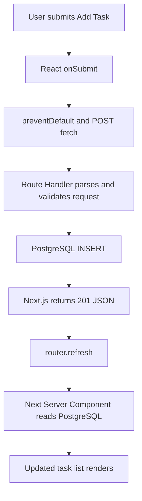

# Day 5 — React state + full task CRUD (the Week 1 milestone)

**Goal:** from the browser create, complete, delete, and filter tasks. **Time:** ~90–110 min (the longest lesson; split it if needed). **Today's files:** Next.js Route Handlers, `frontend/app/TaskBoard.tsx`, and `frontend/app/page.tsx`.

For the complete architecture, request sequence, database relationship, and app-day flow diagrams, see the [Complete MiniTrack app roadmap](../docs/APP_BUILD_ROADMAP.md#visual-guide-how-the-app-fits-together).

## 1. What changes today? (10 min)

Day 4 rendered data but had no interactive controls. Now we use a **Client Component** for input, event handlers, and state. Mutations go from the browser to same-origin Next.js Route Handlers; `router.refresh()` asks the Server Component to read PostgreSQL again. We keep PostgreSQL as the source of truth.

### Full mutation flow



### Timing / sequence diagram

```mermaid
sequenceDiagram
  participant User
  participant Client as React Client Component
  participant API as Next.js Route Handler
  participant DB as PostgreSQL
  participant Next as Next Server Component
  User->>Client: Type title and click Add
  Client->>Client: preventDefault; setBusy(true)
  Client->>API: POST /api/tasks + JSON
  API->>DB: INSERT ... RETURNING row
  DB-->>API: Row
  API-->>Client: 201 Created
  Client->>Next: router.refresh()
  Next->>DB: SELECT rows directly through pg
  DB-->>Next: Rows
  Next-->>Client: Fresh server-rendered task props
  Client->>Client: setBusy(false); render list
```

**Important nuance:** `router.refresh()` requests fresh server data, but doesn't guarantee the just-returned props are available before `setBusy(false)`; this simplified UI is eventual, not an atomic cross-layer transaction.

## 2. Add PATCH and DELETE Route Handlers (30 min)

From Day 3 we already have GET/POST; today we add reusable SQL functions and route handling in TypeScript.

### Step 1: Add the database functions

Replace the contents of `frontend/lib/tasks.ts` with the full CRUD implementation below. It preserves the Day 3 `listTasks` and `createTask` functions, then adds `setDone` and `deleteTask`.

```ts
import type { Task } from '../app/types';
import { getPool } from './db';

type TaskRow = Omit<Task, 'created_at'> & { created_at: Date };

function toTask(row: TaskRow): Task {
  return { ...row, created_at: row.created_at.toISOString() };
}

export async function listTasks(): Promise<Task[]> {
  const result = await getPool().query<TaskRow>(
    'SELECT id, title, done, created_at FROM tasks ORDER BY id'
  );
  return result.rows.map(toTask);
}

export async function createTask(title: string): Promise<Task> {
  const result = await getPool().query<TaskRow>(
    'INSERT INTO tasks (title) VALUES ($1) RETURNING id, title, done, created_at',
    [title]
  );
  const row = result.rows[0];
  if (!row) throw new Error('Inserted task was not returned by PostgreSQL');
  return toTask(row);
}

export async function setDone(id: string, done: boolean): Promise<Task | null> {
  const result = await getPool().query<TaskRow>(
    'UPDATE tasks SET done = $1 WHERE id = $2 RETURNING id, title, done, created_at',
    [done, id]
  );
  const row = result.rows[0];
  return row ? toTask(row) : null;
}

export async function deleteTask(id: string): Promise<boolean> {
  const result = await getPool().query('DELETE FROM tasks WHERE id = $1 RETURNING id', [id]);
  return result.rowCount !== null && result.rowCount > 0;
}
```

`Task` is defined in `frontend/app/types.ts`. A PostgreSQL `BIGINT` ID stays a string so it cannot lose precision, while `created_at` is converted from the database `Date` to the ISO string sent as JSON.

### Step 2: Add ID validation

Replace the contents of `frontend/lib/validation.ts`:

```ts
export function normalizeTitle(value: unknown): string | null {
  if (typeof value !== 'string') return null;
  const title = value.trim();
  return title.length >= 1 && title.length <= 200 ? title : null;
}

export function isValidId(raw: string): boolean {
  return /^[1-9]\d*$/.test(raw) && Number.isSafeInteger(Number(raw));
}

export function isRecord(value: unknown): value is Record<string, unknown> {
  return typeof value === 'object' && value !== null && !Array.isArray(value);
}
```

`normalizeTitle` rejects values that are not strings. `isValidId` rejects malformed, zero, negative, decimal, and unsafe integer IDs. `isRecord` lets the route safely inspect untrusted JSON fields.

### Step 3: Create the item Route Handler

Create `frontend/app/api/tasks/[id]/route.ts`. Next.js provides dynamic route params as a Promise, so await them before validation:

```ts
import { deleteTask, setDone } from '../../../../lib/tasks';
import { isRecord, isValidId } from '../../../../lib/validation';

type RouteContext = { params: Promise<{ id: string }> };

export async function PATCH(request: Request, { params }: RouteContext): Promise<Response> {
  const { id } = await params;
  if (!isValidId(id)) {
    return Response.json({ error: 'Invalid task ID' }, { status: 400 });
  }

  let body: unknown;
  try {
    body = await request.json();
  } catch {
    return Response.json({ error: 'Invalid JSON' }, { status: 400 });
  }
  if (!isRecord(body) || typeof body.done !== 'boolean') {
    return Response.json({ error: 'done must be boolean' }, { status: 400 });
  }

  try {
    const task = await setDone(id, body.done);
    return task
      ? Response.json(task)
      : Response.json({ error: 'Task not found' }, { status: 404 });
  } catch (error: unknown) {
    console.error(`PATCH /api/tasks/${id} failed:`, error);
    return Response.json({ error: 'Internal server error' }, { status: 500 });
  }
}

export async function DELETE(_request: Request, { params }: RouteContext): Promise<Response> {
  const { id } = await params;
  if (!isValidId(id)) {
    return Response.json({ error: 'Invalid task ID' }, { status: 400 });
  }

  try {
    const deleted = await deleteTask(id);
    return deleted
      ? Response.json({ deleted: true })
      : Response.json({ error: 'Task not found' }, { status: 404 });
  } catch (error: unknown) {
    console.error(`DELETE /api/tasks/${id} failed:`, error);
    return Response.json({ error: 'Internal server error' }, { status: 500 });
  }
}
```

The collection Route Handler at `frontend/app/api/tasks/route.ts` was created on Day 3 and already contains `GET` and `POST`. Together, these two route files implement all four HTTP methods. Route Handler functions use the Web `Request` and `Response` APIs; database errors are logged on the server while clients receive a generic 500 response.


**Why no CORS setup?** The browser and API routes are served from the same Next.js origin (`localhost:3000`). Cross-origin rules do not require a separate allow-origin policy for these same-origin requests.

**Check from a terminal:**

```bash
curl -i http://localhost:3000/api/tasks
curl -i -X POST http://localhost:3000/api/tasks \
  -H 'Content-Type: application/json' -d '{"title":"Test PATCH and DELETE"}'
# Replace TASK_ID with the ID returned by the POST request:
curl -i -X PATCH http://localhost:3000/api/tasks/TASK_ID \
  -H 'Content-Type: application/json' -d '{"done":true}'
curl -i -X DELETE http://localhost:3000/api/tasks/TASK_ID
```

## 3. Write the interactive React component (30 min)

Write `frontend/app/TaskBoard.tsx`:

```tsx
'use client';

import { useState } from 'react';
import { useRouter } from 'next/navigation';
import type { Task } from './types';

// Client Component: form events and React state need browser interactivity.
export default function TaskBoard({ tasks }: { tasks: Task[] }) {
  const [title, setTitle] = useState(''); // Controlled input: React owns the value.
  const [filter, setFilter] = useState<'all' | 'open' | 'done'>('all');
  const [busy, setBusy] = useState(false);
  const [error, setError] = useState('');
  const router = useRouter();

  // Derived state: filtering the props doesn't need another useState or useEffect.
  const visible = tasks.filter(task => filter === 'all' || (filter === 'done' ? task.done : !task.done));

  async function request(path: string, options: RequestInit) {
    setError('');
    setBusy(true);
    try {
      const res = await fetch(path, options);
      if (!res.ok) throw new Error(`HTTP ${res.status}`);
      router.refresh(); // Ask Next to re-run the Server Component to get fresh DB data.
      return true;
    } catch (e) {
      setError(e instanceof Error ? e.message : 'Request failed');
      return false;
    } finally {
      setBusy(false); // Runs whether request succeeds or fails.
    }
  }

  async function addTask(event: React.FormEvent<HTMLFormElement>) {
    event.preventDefault(); // Prevent browser's default full-page form submission.
    const normalized = title.trim();
    if (!normalized) return;
    const ok = await request('/api/tasks', {
      method: 'POST', headers: { 'Content-Type': 'application/json' },
      body: JSON.stringify({ title: normalized }),
    });
    if (ok) setTitle('');
  }

  return <section>
    <form onSubmit={addTask} style={{display: 'flex', gap: 8}}>
      <input aria-label="Task title" value={title} onChange={e => setTitle(e.target.value)} placeholder="Add a task" maxLength={200} disabled={busy} style={{padding: 8, flex: 1}} />
      <button disabled={busy || !title.trim()} type="submit">Add</button>
    </form>
    <p><label>Show: <select value={filter} onChange={e => setFilter(e.target.value as 'all' | 'open' | 'done')}>
      <option value="all">All</option><option value="open">Open</option><option value="done">Done</option>
    </select></label></p>
    {error && <p role="alert" style={{color: 'crimson'}}>Request failed: {error}</p>}
    {visible.length === 0 ? <p>No tasks in this filter.</p> :
      <ul style={{padding: 0, listStyle: 'none'}}>{visible.map(task =>
        <li key={task.id} style={{display:'flex', alignItems:'center', gap:10, borderBottom:'1px solid #ddd', padding:'10px 0'}}>
          <input aria-label={`Complete ${task.title}`} type="checkbox" checked={task.done} disabled={busy}
            onChange={e => { void request(`/api/tasks/${task.id}`, {method:'PATCH', headers:{'Content-Type':'application/json'}, body:JSON.stringify({done:e.target.checked})}); }} />
          <span style={{flex:1, textDecoration: task.done ? 'line-through':'none'}}>{task.title}</span>
          <button disabled={busy} type="button" onClick={() => { void request(`/api/tasks/${task.id}`, {method:'DELETE'}); }}>Delete</button>
        </li>
      )}</ul>}
  </section>;
}
```


**Important decisions:**

- `'use client'` enables hooks and event handlers in this component.
- The input is **controlled**: `value` comes from React state and `onChange` updates it.
- We **derive** the visible list from `tasks` and `filter`. No extra `useEffect` or duplicate task state.
- `busy` disables interactions while the request is in flight. This reduces duplicates but is **not** server-side idempotency.
- `finally` clears busy even after an error; `router.refresh()` re-fetches server data.

Update `frontend/app/page.tsx` to read PostgreSQL in the Server Component and render the new component:

```tsx
import TaskBoard from './TaskBoard';
import { listTasks } from '../lib/tasks';
import type { Task } from './types';

export const dynamic = 'force-dynamic';

// Server Component: reads PostgreSQL directly on the Next.js server.
export default async function Home() {
  let tasks: Task[] = [];
  let error: string | null = null;
  try {
    tasks = await listTasks();
  } catch (err) {
    error = err instanceof Error ? err.message : 'Unable to load tasks';
  }
  return <main><h1>MiniTrack</h1><p>Simple tasks. Serious full-stack concepts.</p>{error ? <p role="alert">Could not load tasks: {error}. Check PostgreSQL and DATABASE_URL.</p> : <TaskBoard tasks={tasks} />}</main>;
}
```


## 4. Run the app (10 min)

From the repository root:

```bash
cd frontend
npm run dev
```

Open **http://localhost:3000**. Add a task, mark it done, filter Open/Done, delete it, refresh the page. Every mutation persists in PostgreSQL.

## 5. Debugging + tricky interview questions (20 min)

**Break it on purpose:** remove `event.preventDefault()` and observe traditional form navigation; remove `router.refresh()` and see stale task props; stop PostgreSQL and check error feedback; simulate double submits and explain why UI disabling alone is not a duplicate-proof guarantee.

1. **Why not directly mutate `tasks` prop?** React needs immutable updates/new renders; props are read-only input to a component.
2. **What is a stale closure?** A handler sees values captured during an earlier render; a functional state update can avoid some stale-state bugs.
3. **What does `setState` do?** Schedules a React update; the current handler's variable remains its render snapshot.
4. **What does `event.preventDefault()` prevent?** Browser's default form navigation behavior.
5. **Why use `key={task.id}` rather than index?** Stable identity across reorder/delete.
6. **Why not keep filtered tasks in state?** It's derived from current props plus filter; avoid synchronization bugs.
7. **Why is POST non-idempotent?** Repeating a creation request can insert duplicates. A real system can use idempotency keys.
8. **Why PATCH?** Change only `done`, rather than replace the entire task resource.
9. **Why is no CORS configuration needed?** The browser and Route Handler share the same origin.
10. **What is the full data path?** UI handler → same-origin `fetch` → Route Handler → parameterized SQL → Postgres → JSON → `router.refresh` → Server Component query → fresh props.

## Exit checklist

- [ ] Add, toggle, delete, filter all work in the browser.
- [ ] Reload preserves database data.
- [ ] Errors are visible when API is unavailable.
- [ ] I can trace a POST through the timing diagram without looking at code.
- [ ] I can explain 7 of the 10 interview answers aloud.

**Commit:** `git add . && git commit -m "day5: complete week1 task CRUD"`

**Next week:** authentication, search, database indexing, and deeper Node/React interview scenarios; don't add them to Week 1.
