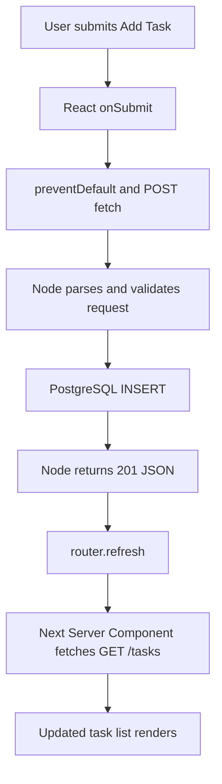

# Day 5 — React state + full task CRUD (the Week 1 milestone)

**Goal:** from the browser create, complete, delete, and filter tasks. **Time:** ~90–110 min (the longest lesson; split it if needed). **Today's files:** backend source, `frontend/app/TaskBoard.tsx`, and `frontend/app/page.tsx`.

## 1. What changes today? (10 min)

Day 4 rendered data but had no interactive controls. Now we use a **Client Component** for input, event handlers, and state. Mutations go directly from the browser to Node; Next's `router.refresh()` asks the server component to fetch again. We keep PostgreSQL as the source of truth.

### Full mutation flow



### Timing / sequence diagram

```mermaid
sequenceDiagram
  participant User
  participant Client as React Client Component
  participant API as Node API
  participant DB as PostgreSQL
  participant Next as Next Server Component
  User->>Client: Type title and click Add
  Client->>Client: preventDefault; setBusy(true)
  Client->>API: POST /tasks + JSON
  API->>DB: INSERT ... RETURNING row
  DB-->>API: Row
  API-->>Client: 201 Created
  Client->>Next: router.refresh()
  Next->>API: GET /tasks
  API->>DB: SELECT rows
  DB-->>API: Rows
  API-->>Next: JSON
  Next-->>Client: Fresh server-rendered task props
  Client->>Client: setBusy(false); render list
```

**Important nuance:** `router.refresh()` requests fresh server data, but doesn't guarantee the just-returned props are available before `setBusy(false)`; this simplified UI is eventual, not an atomic cross-layer transaction.

## 2. Extend Node with PATCH and DELETE (30 min)

From Day 3 we already have GET/POST; today we add reusable SQL functions and route handling.

Write `backend/src/tasks.js`:

```js
const { pool } = require('./db');

async function listTasks() {
  const result = await pool.query('SELECT id, title, done, created_at FROM tasks ORDER BY id');
  return result.rows;
}

async function createTask(title) {
  // $1 is a query parameter, NOT string concatenation. It protects against SQL injection.
  const result = await pool.query(
    'INSERT INTO tasks (title) VALUES ($1) RETURNING id, title, done, created_at',
    [title]
  );
  return result.rows[0];
}

async function setDone(id, done) {
  const result = await pool.query(
    'UPDATE tasks SET done = $1 WHERE id = $2 RETURNING id, title, done, created_at',
    [done, id]
  );
  return result.rows[0] ?? null;
}

async function deleteTask(id) {
  const result = await pool.query('DELETE FROM tasks WHERE id = $1 RETURNING id', [id]);
  return result.rowCount > 0;
}

module.exports = { listTasks, createTask, setDone, deleteTask };
```


Write `backend/src/validation.js`:

```js
// Keep validation small this week; focus on the data flow and HTTP semantics.
function normalizeTitle(value) {
  if (typeof value !== 'string') return null;
  const title = value.trim();
  return title.length >= 1 && title.length <= 200 ? title : null;
}

function isValidId(raw) {
  // Avoid accepting 12abc, negatives, decimals or unsafe JS integers.
  return /^[1-9]\d*$/.test(raw) && Number.isSafeInteger(Number(raw));
}

module.exports = { normalizeTitle, isValidId };
```


Now update `backend/src/server.js` to this complete Week 1 API:

```js
const http = require('node:http');
const { URL } = require('node:url');
require('dotenv').config();
const { pool } = require('./db');
const { listTasks, createTask, setDone, deleteTask } = require('./tasks');
const { normalizeTitle, isValidId } = require('./validation');

const PORT = Number(process.env.PORT || 3001);
const allowedOrigin = process.env.FRONTEND_ORIGIN || 'http://localhost:3000';

function sendJson(res, status, value) {
  res.writeHead(status, { 'Content-Type': 'application/json; charset=utf-8' });
  res.end(JSON.stringify(value)); // Every handled request must end the response.
}

function readJson(req) {
  // Incoming HTTP request bodies are streams, not ready-made JavaScript objects.
  return new Promise((resolve, reject) => {
    let raw = '';
    req.setEncoding('utf8');
    req.on('data', chunk => {
      raw += chunk;
      if (raw.length > 10_000) {
        reject(Object.assign(new Error('Body too large'), { status: 413 }));
        req.destroy();
      }
    });
    req.on('end', () => {
      try { resolve(JSON.parse(raw)); }
      catch { reject(Object.assign(new Error('Invalid JSON'), { status: 400 })); }
    });
    req.on('error', reject);
  });
}

const server = http.createServer(async (req, res) => {
  // The frontend is on port 3000, and the API on 3001; these are different origins.
  if (req.headers.origin === allowedOrigin) {
    res.setHeader('Access-Control-Allow-Origin', allowedOrigin);
    res.setHeader('Vary', 'Origin');
    res.setHeader('Access-Control-Allow-Methods', 'GET, POST, PATCH, DELETE, OPTIONS');
    res.setHeader('Access-Control-Allow-Headers', 'Content-Type');
  }
  if (req.method === 'OPTIONS') { res.writeHead(204); res.end(); return; }

  const path = new URL(req.url, `http://localhost:${PORT}`).pathname;
  try {
    if (req.method === 'GET' && path === '/health') {
      sendJson(res, 200, { ok: true }); return;
    }
    if (req.method === 'GET' && path === '/tasks') {
      sendJson(res, 200, await listTasks()); return;
    }
    if (req.method === 'POST' && path === '/tasks') {
      const data = await readJson(req);
      const title = normalizeTitle(data?.title);
      if (!title) { sendJson(res, 400, { error: 'title must be 1–200 characters' }); return; }
      sendJson(res, 201, await createTask(title)); return;
    }

    const match = path.match(/^\/tasks\/(\d+)$/);
    if (match && isValidId(match[1])) {
      const id = match[1]; // PostgreSQL BIGINT IDs can be passed as decimal strings.
      if (req.method === 'PATCH') {
        const data = await readJson(req);
        if (typeof data?.done !== 'boolean') {
          sendJson(res, 400, { error: 'done must be boolean' }); return;
        }
        const task = await setDone(id, data.done);
        sendJson(res, task ? 200 : 404, task || { error: 'Task not found' }); return;
      }
      if (req.method === 'DELETE') {
        const deleted = await deleteTask(id);
        sendJson(res, deleted ? 200 : 404, deleted ? { deleted: true } : { error: 'Task not found' }); return;
      }
    }
    sendJson(res, 404, { error: 'Route not found' });
  } catch (err) {
    console.error('Request failed:', err);
    if (!res.headersSent && !res.destroyed) {
      sendJson(res, err.status || 500, { error: err.status ? err.message : 'Internal server error' });
    }
  }
});

server.listen(PORT, () => console.log(`MiniTrack API: http://localhost:${PORT}`));

// When this process terminates, release database connections.
process.on('SIGINT', async () => { server.close(); await pool.end(); process.exit(0); });
```


**Why CORS today?** Browser JavaScript running at `localhost:3000` calls the API at `localhost:3001`: same host but **different origin because ports differ**. Browser-enforced CORS needs an allow-origin response header; JSON mutation requests also trigger an `OPTIONS` preflight.

**Check from a terminal:**

```bash
curl -i http://localhost:3001/tasks
curl -i -X POST http://localhost:3001/tasks \
  -H 'Content-Type: application/json' -d '{"title":"Test PATCH and DELETE"}'
# Replace TASK_ID with the ID returned by the POST request:
curl -i -X PATCH http://localhost:3001/tasks/TASK_ID \
  -H 'Content-Type: application/json' -d '{"done":true}'
curl -i -X DELETE http://localhost:3001/tasks/TASK_ID
```

## 3. Write the interactive React component (30 min)

Write `frontend/app/TaskBoard.tsx`:

```tsx
'use client';

import { useState } from 'react';
import { useRouter } from 'next/navigation';
import type { Task } from './types';

const API = process.env.NEXT_PUBLIC_API_BASE_URL || 'http://localhost:3001';

// Client Component: form events and React state need browser interactivity.
export default function TaskBoard({ tasks }: { tasks: Task[] }) {
  const [title, setTitle] = useState(''); // Controlled input: React owns the value.
  const [filter, setFilter] = useState<'all' | 'open' | 'done'>('all');
  const [busy, setBusy] = useState(false);
  const [error, setError] = useState('');
  const router = useRouter();

  // Derived state: filtering the props doesn't need another useState or useEffect.
  const visible = tasks.filter(task => filter === 'all' || (filter === 'done' ? task.done : !task.done));

  async function request(path: string, options: RequestInit) {
    setError('');
    setBusy(true);
    try {
      const res = await fetch(`${API}${path}`, options);
      if (!res.ok) throw new Error(`HTTP ${res.status}`);
      router.refresh(); // Ask Next to re-run the Server Component to get fresh DB data.
      return true;
    } catch (e) {
      setError(e instanceof Error ? e.message : 'Request failed');
      return false;
    } finally {
      setBusy(false); // Runs whether request succeeds or fails.
    }
  }

  async function addTask(event: React.FormEvent<HTMLFormElement>) {
    event.preventDefault(); // Prevent browser's default full-page form submission.
    const normalized = title.trim();
    if (!normalized) return;
    const ok = await request('/tasks', {
      method: 'POST', headers: { 'Content-Type': 'application/json' },
      body: JSON.stringify({ title: normalized }),
    });
    if (ok) setTitle('');
  }

  return <section>
    <form onSubmit={addTask} style={{display: 'flex', gap: 8}}>
      <input aria-label="Task title" value={title} onChange={e => setTitle(e.target.value)} placeholder="Add a task" maxLength={200} disabled={busy} style={{padding: 8, flex: 1}} />
      <button disabled={busy || !title.trim()} type="submit">Add</button>
    </form>
    <p><label>Show: <select value={filter} onChange={e => setFilter(e.target.value as 'all' | 'open' | 'done')}>
      <option value="all">All</option><option value="open">Open</option><option value="done">Done</option>
    </select></label></p>
    {error && <p role="alert" style={{color: 'crimson'}}>Request failed: {error}</p>}
    {visible.length === 0 ? <p>No tasks in this filter.</p> :
      <ul style={{padding: 0, listStyle: 'none'}}>{visible.map(task =>
        <li key={task.id} style={{display:'flex', alignItems:'center', gap:10, borderBottom:'1px solid #ddd', padding:'10px 0'}}>
          <input aria-label={`Complete ${task.title}`} type="checkbox" checked={task.done} disabled={busy}
            onChange={e => { void request(`/tasks/${task.id}`, {method:'PATCH', headers:{'Content-Type':'application/json'}, body:JSON.stringify({done:e.target.checked})}); }} />
          <span style={{flex:1, textDecoration: task.done ? 'line-through':'none'}}>{task.title}</span>
          <button disabled={busy} type="button" onClick={() => { void request(`/tasks/${task.id}`, {method:'DELETE'}); }}>Delete</button>
        </li>
      )}</ul>}
  </section>;
}
```


**Important decisions:**

- `'use client'` enables hooks and event handlers in this component.
- The input is **controlled**: `value` comes from React state and `onChange` updates it.
- We **derive** the visible list from `tasks` and `filter`. No extra `useEffect` or duplicate task state.
- `busy` disables interactions while the request is in flight. This reduces duplicates but is **not** server-side idempotency.
- `finally` clears busy even after an error; `router.refresh()` re-fetches server data.

Update `frontend/app/page.tsx` to render the new component:

```tsx
import TaskBoard from './TaskBoard';
import type { Task } from './types';

// Server Component: executes on the Next.js server, not in the browser.
export default async function Home() {
  const api = process.env.API_BASE_URL || 'http://localhost:3001';
  let tasks: Task[] = [];
  let error: string | null = null;
  try {
    // no-store makes refresh re-fetch from Node, avoiding caching discussion on Day 4.
    const response = await fetch(`${api}/tasks`, { cache: 'no-store' });
    if (!response.ok) throw new Error(`API returned ${response.status}`);
    tasks = (await response.json()) as Task[];
  } catch (err) {
    error = err instanceof Error ? err.message : 'Unable to load tasks';
  }
  return <main><h1>MiniTrack</h1><p>Simple tasks. Serious full-stack concepts.</p>{error ? <p role="alert">Could not load tasks: {error}. Is the backend running?</p> : <TaskBoard tasks={tasks} />}</main>;
}
```


## 4. Run all parts (10 min)

In terminal A (from repository root):

```bash
cd backend
npm run dev
```

In terminal B (from repository root):

```bash
cd frontend
npm run dev
```

Open **http://localhost:3000**. Add a task, mark it done, filter Open/Done, delete it, refresh the page. Every mutation persists in PostgreSQL.

## 5. Debugging + tricky interview questions (20 min)

**Break it on purpose:** remove `event.preventDefault()` and observe traditional form navigation; remove `router.refresh()` and see stale task props; stop backend and check error feedback; simulate double submits and explain why UI disabling alone is not a duplicate-proof guarantee.

1. **Why not directly mutate `tasks` prop?** React needs immutable updates/new renders; props are read-only input to a component.
2. **What is a stale closure?** A handler sees values captured during an earlier render; a functional state update can avoid some stale-state bugs.
3. **What does `setState` do?** Schedules a React update; the current handler's variable remains its render snapshot.
4. **What does `event.preventDefault()` prevent?** Browser's default form navigation behavior.
5. **Why use `key={task.id}` rather than index?** Stable identity across reorder/delete.
6. **Why not keep filtered tasks in state?** It's derived from current props plus filter; avoid synchronization bugs.
7. **Why is POST non-idempotent?** Repeating a creation request can insert duplicates. A real system can use idempotency keys.
8. **Why PATCH?** Change only `done`, rather than replace the entire task resource.
9. **Why CORS here but not for Day 4's server fetch?** Browsers enforce CORS; server-to-server fetch is not governed by browser CORS.
10. **What is the full data path?** UI handler → browser fetch → Node route → parameterized SQL → Postgres → JSON → `router.refresh` → fresh props.

## Exit checklist

- [ ] Add, toggle, delete, filter all work in the browser.
- [ ] Reload preserves database data.
- [ ] Errors are visible when API is unavailable.
- [ ] I can trace a POST through the timing diagram without looking at code.
- [ ] I can explain 7 of the 10 interview answers aloud.

**Commit:** `git add . && git commit -m "day5: complete week1 task CRUD"`

**Next week:** authentication, search, database indexing, and deeper Node/React interview scenarios; don't add them to Week 1.
