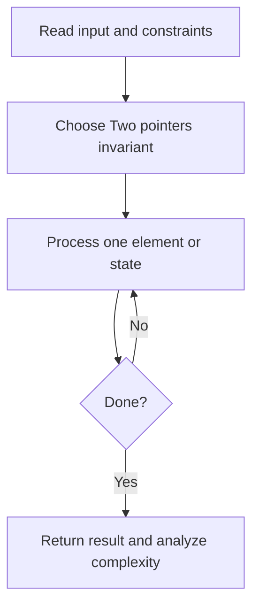
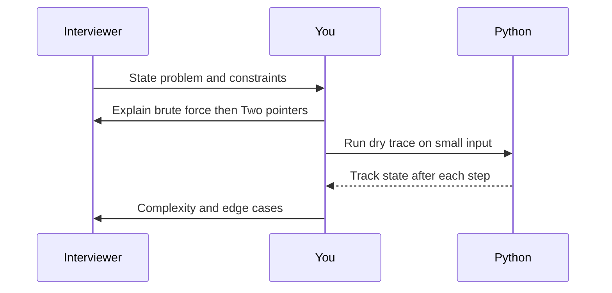

# Day 05 — Valid Palindrome

**Pattern:** Two pointers · **Time:** 35 minutes · **Track:** Python interview DSA

[Course home](../README.md) · [Practice file](../practice/day-05.py) · [Commented reference](../solutions/day-05.py)

## What and why (5 minutes)

**Problem:** Ignoring punctuation and case, check if the string reads the same in either direction.

**Why this pattern:** Use opposing pointers without allocating a cleaned copy.

**Interview trap:** Advance past non-alphanumeric characters before comparing.

## Algorithm flow



## Execution / timing diagram



## Try it yourself (15 minutes)

1. Open `practice/day-05.py`. Write `solve(...)` without looking below.
2. Verbally state the invariant and walk through a sample input.
3. Run `python -m unittest discover -s tests -v` from the repository root (reference tests run against completed solutions).
4. Check your practice implementation with `python scripts/check_practice.py 5` when you finish.

### Sample cases

```python
solve('A man, a plan, a canal: Panama')  # True
```
```python
solve('race a car')  # False
```

## Commented solution — reveal after attempting

<details>
<summary>Show Python reference implementation</summary>

```python
def solve(s):
    left, right = 0, len(s) - 1
    while left < right:
        if not s[left].isalnum():
            left += 1
            continue
        if not s[right].isalnum():
            right -= 1
            continue
        if s[left].lower() != s[right].lower():
            return False
        left += 1
        right -= 1
    return True
```

</details>

## Complexity (5 minutes)

**O(n) time, O(1) extra space.** Explain *why*, including auxiliary data structure cost.

## Tricky interview follow-up (10 minutes)

**Question:** How would you normalize Unicode text?

Before moving on, explain (1) why your implementation is correct, (2) one edge case, (3) a trade-off versus a simpler solution.

**Next:** [Day 06](day-06.md)
