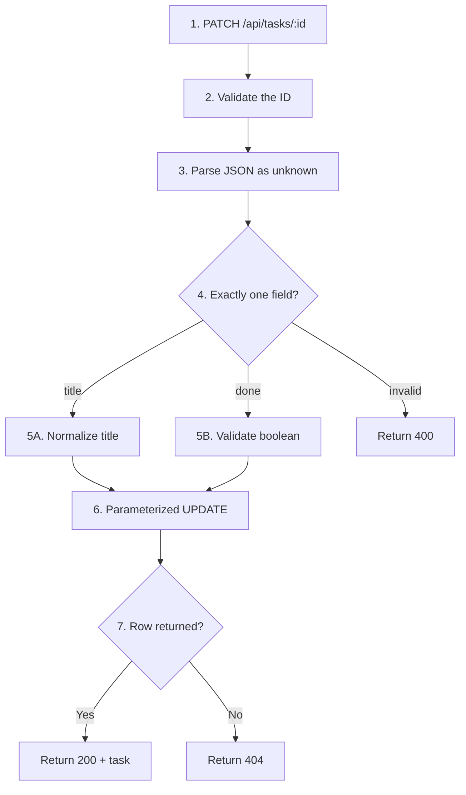
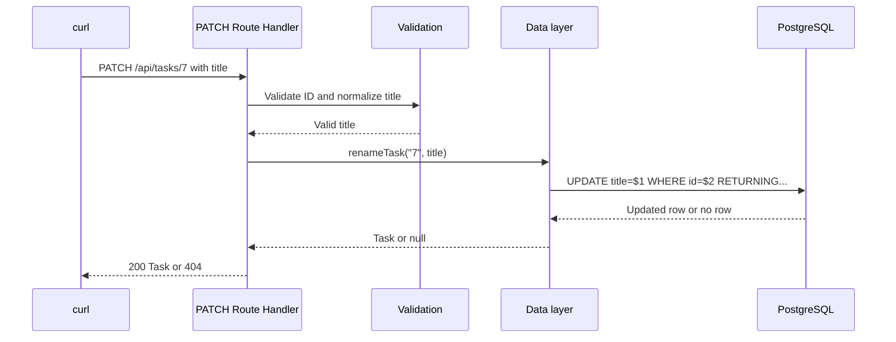

# Day 6 — Edit task titles in PostgreSQL and the API

**Time:** two focused 45-minute sessions

**Starting point:** Complete Day 5 first.

**Goal:** A validated `PATCH /api/tasks/:id` request can rename a task without
breaking completion updates.

[Previous: Day 5](day-05.md) · [Roadmap](../docs/APP_BUILD_ROADMAP.md) ·
[Next: Day 7](day-07.md)

## Learning objectives

By the end of this lesson, you can:

- define a clear partial-update contract;
- use parameterized `UPDATE ... RETURNING`;
- distinguish `400`, `404`, and `500` responses;
- keep database, validation, and HTTP responsibilities separate;
- test title and completion updates from the terminal.

## 1. Understand the update contract

Day 5 accepts:

```json
{ "done": true }
```

Today the same endpoint also accepts:

```json
{ "title": "Review React state" }
```

For this lesson, one request must contain **exactly one** supported field.
Rejecting `{}`, both fields, or unknown shapes keeps the behavior explicit.



## 2. Add the database operation

### Try first

In `frontend/lib/tasks.ts`, write only this signature before opening the
solution:

```ts
export async function renameTask(
  id: string,
  title: string,
): Promise<Task | null>
```

Ask yourself:

1. Which values must be SQL parameters?
2. How will PostgreSQL report a missing ID?
3. How will the database `Date` become the app's ISO string?

### Compare with the implementation

```ts
export async function renameTask(
  id: string,
  title: string,
): Promise<Task | null> {
  const result = await getPool().query<TaskRow>(
    `
      UPDATE tasks
      SET title = $1
      WHERE id = $2
      RETURNING id, title, done, created_at
    `,
    // Values are separate from SQL syntax, preventing value-based injection.
    [title, id],
  );

  const row = result.rows[0];
  // No row is a normal "not found" outcome, not a database failure.
  return row ? toTask(row) : null;
}
```

`RETURNING` avoids a second `SELECT`. PostgreSQL either returns the updated row
or an empty `rows` array.

## 3. Extend the PATCH Route Handler

Keep the existing ID check and JSON parsing. After `isRecord(body)`, decide
which operation the request describes:

```ts
const hasDone = Object.hasOwn(body, 'done');
const hasTitle = Object.hasOwn(body, 'title');

// Both true or both false means the request contract is ambiguous.
if (hasDone === hasTitle) {
  return Response.json(
    { error: 'Provide either done or title' },
    { status: 400 },
  );
}

let updateTask: () => Promise<Task | null>;

if (hasTitle) {
  const title = normalizeTitle(body.title);
  if (!title) {
    return Response.json(
      { error: 'title must be 1–200 characters' },
      { status: 400 },
    );
  }

  updateTask = () => renameTask(id, title);
} else if (typeof body.done === 'boolean') {
  const done = body.done;
  updateTask = () => setDone(id, done);
} else {
  return Response.json(
    { error: 'done must be boolean' },
    { status: 400 },
  );
}
```

Then reuse one response path:

```ts
try {
  const task = await updateTask();

  return task
    ? Response.json(task)
    : Response.json({ error: 'Task not found' }, { status: 404 });
} catch (error: unknown) {
  console.error(`PATCH /api/tasks/${id} failed:`, error);
  return Response.json(
    { error: 'Internal server error' },
    { status: 500 },
  );
}
```

Import `renameTask` and the `Task` type where required. Let TypeScript guide
you instead of suppressing errors with `any`.

## 4. Trace one request



## 5. Verify with curl

Create a task and copy its returned ID:

```bash
curl -i -X POST http://localhost:3000/api/tasks \
  -H 'Content-Type: application/json' \
  -d '{"title":"Original title"}'
```

Then test:

```bash
# Valid rename
curl -i -X PATCH http://localhost:3000/api/tasks/TASK_ID \
  -H 'Content-Type: application/json' \
  -d '{"title":"Updated title"}'

# Existing completion behavior must still work
curl -i -X PATCH http://localhost:3000/api/tasks/TASK_ID \
  -H 'Content-Type: application/json' \
  -d '{"done":true}'

# Invalid: both operations in one request
curl -i -X PATCH http://localhost:3000/api/tasks/TASK_ID \
  -H 'Content-Type: application/json' \
  -d '{"title":"Ambiguous","done":true}'

# Valid ID shape, but no matching row
curl -i -X PATCH http://localhost:3000/api/tasks/999999999 \
  -H 'Content-Type: application/json' \
  -d '{"title":"Missing"}'
```

Expected statuses: `200`, `200`, `400`, and `404`.

## Debugging exercise

Break one behavior at a time, predict the result, then restore it:

1. Swap `$1` and `$2` in the values array.
2. Remove `RETURNING`.
3. Treat `null` as an exception instead of returning `404`.
4. Accept both fields and observe which update silently wins.

Write the root cause in `docs/MY_NOTES.md`, not only the error message.

## Tricky interview questions and answers (20 min)

Practice each answer aloud in 30–60 seconds. Start with the bold answer, then
add the example or trade-off if the interviewer asks for more depth.

### Q1. Why use PATCH instead of PUT?

**Interview-ready answer:** PATCH describes a partial change. The client sends
only `title` or `done`. PUT normally represents creating or replacing the
complete resource at that URI.

**Example:** Sending `{ "title": "New" }` should not accidentally reset
`done` or `created_at`.

**Senior follow-up:** HTTP method semantics do not validate input
automatically. The server must still define allowed fields, reject ambiguous
patches, authenticate the caller, and authorize access to the task.

### Q2. Why distinguish 400, 404, and 500?

**Interview-ready answer:** `400` means the request itself is invalid. `404`
means the request is valid but the task does not exist. `500` means an
unexpected server or database failure occurred. Accurate categories let the
client decide whether to fix input, show not-found UI, or retry later.

**Example:** `{ "title": "" }` is `400`; a valid request for task `999999` is
`404`; a lost database connection is `500`.

**Senior follow-up:** Do not expose raw database errors in the response.
Return a stable public message and log diagnostic context on the server.

### Q3. Why return the changed row?

**Interview-ready answer:** `UPDATE ... RETURNING` gives the exact committed
database values in one round trip. It avoids a second query and lets the client
receive defaults or normalized values from the source of truth.

**Example:**

```sql
UPDATE tasks
SET title = $1
WHERE id = $2
RETURNING id, title, done, created_at;
```

**Senior follow-up:** Without `RETURNING`, a second `SELECT` can observe a
different state if another request changes the row between statements.

### Q4. Would you allow multiple fields in one PATCH?

**Interview-ready answer:** That is a valid design, but it needs a deliberate
validation and SQL strategy. This lesson permits one operation per request so
behavior and errors stay unambiguous. A production API could validate a
complete patch document and update all supplied fields transactionally.

**Example:** `{ "title": "Review SQL", "done": true }` could be valid under a
multi-field contract, but this lesson deliberately returns `400`.

**Senior follow-up:** Dynamic SQL must still use a fixed allowlist for column
names. Bound parameters protect values; they cannot safely substitute SQL
identifiers such as arbitrary column names.

## Complexity

- Validation uses constant extra space and is `O(1)` for the fixed set of
  supported fields; title trimming is `O(k)` for title length `k`.
- A primary-key lookup is typically `O(log n)` with the database index, though
  actual database cost depends on the query plan and storage state.
- The API performs one database round trip.

## Exit checklist

- [ ] Title and completion PATCH requests both work.
- [ ] Empty, oversized, ambiguous, and malformed bodies return `400`.
- [ ] Missing tasks return `404`.
- [ ] All SQL values use bound parameters.
- [ ] I can explain the request flow without reading the code.

**Suggested commit:** `app-day6: add task title update API`
