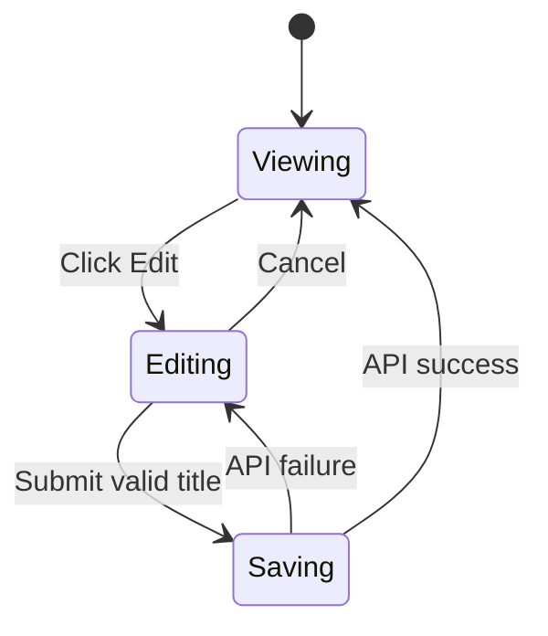
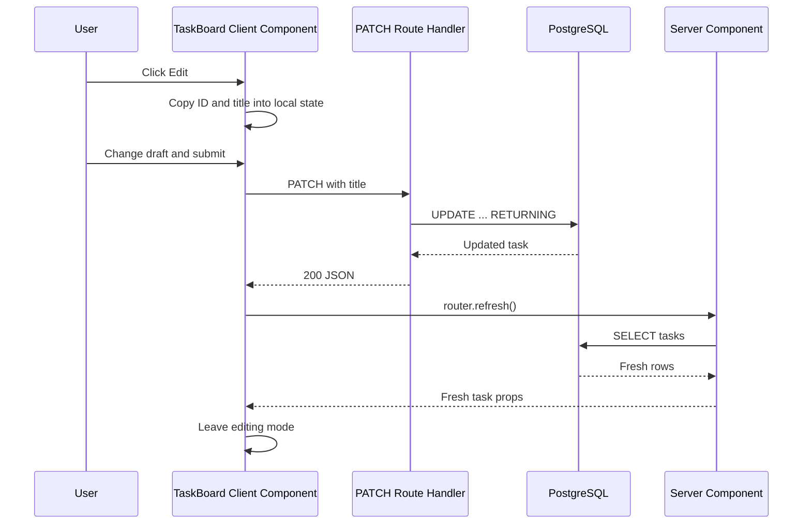

# Day 7 — Build the inline task-edit experience

**Time:** two focused 45-minute sessions

**Starting point:** Day 6 title updates work through curl.

**Goal:** Edit, save, and cancel a task title from the browser with accessible
feedback.

[Previous: Day 6](day-06.md) ·
[Roadmap](../docs/APP_BUILD_ROADMAP.md) ·
[Next: Day 8](day-08.md)

## Learning objectives

You will practice:

- modeling UI modes with explicit React state;
- controlled edit inputs;
- immutable props and server state;
- accessible edit/save/cancel controls;
- handling pending, success, cancellation, and failure transitions.

## 1. Model the states before coding

Add two pieces of temporary UI state to `TaskBoard`:

```ts
const [editingId, setEditingId] = useState<string | null>(null);
const [editTitle, setEditTitle] = useState('');
```

`editingId` answers **which task is being edited**. `editTitle` holds the
uncommitted draft. PostgreSQL remains the source of truth for saved titles.



## 2. Add explicit transition functions

Write small functions rather than placing every state change directly inside
JSX:

```ts
function startEditing(task: Task) {
  setEditingId(task.id);
  setEditTitle(task.title);
  setError('');
}

function cancelEditing() {
  setEditingId(null);
  setEditTitle('');
  setError('');
}
```

Why copy the title into state? The input needs a draft the user can change
without mutating the `task` prop.

## 3. Submit the draft

Reuse the Day 5 request helper:

```ts
async function saveTask(event: React.FormEvent<HTMLFormElement>) {
  event.preventDefault();
  if (!editingId) return;

  const normalized = editTitle.trim();
  if (!normalized) {
    setError('Task title cannot be empty.');
    return;
  }

  const ok = await request(`/api/tasks/${editingId}`, {
    method: 'PATCH',
    headers: { 'Content-Type': 'application/json' },
    body: JSON.stringify({ title: normalized }),
  });

  if (ok) {
    // router.refresh() inside request reloads the PostgreSQL-backed props.
    setEditingId(null);
    setEditTitle('');
  }
}
```

Do not write `task.title = editTitle`. Props describe parent-owned input and
must not become a second writable database.

## 4. Render viewing or editing mode

Inside `visible.map`, replace only the title/action portion:

```tsx
{editingId === task.id ? (
  <form
    className="col-span-2 flex min-w-0 items-center gap-2"
    onSubmit={saveTask}
  >
    <label className="sr-only" htmlFor={`edit-${task.id}`}>
      Edit {task.title}
    </label>
    <input
      id={`edit-${task.id}`}
      className="min-h-10 min-w-0 flex-1 rounded-lg border border-violet-400 bg-slate-950 px-3 outline-none"
      value={editTitle}
      onChange={event => setEditTitle(event.target.value)}
      maxLength={200}
      autoFocus
      disabled={busy}
    />
    <button
      className="rounded-lg px-3 py-2 text-violet-300 hover:bg-slate-800"
      type="submit"
      disabled={busy}
    >
      Save
    </button>
    <button
      className="rounded-lg px-3 py-2 text-slate-300 hover:bg-slate-800"
      type="button"
      disabled={busy}
      onClick={cancelEditing}
    >
      Cancel
    </button>
  </form>
) : (
  <>
    <span className={task.done ? 'flex-1 text-slate-500 line-through' : 'flex-1'}>
      {task.title}
    </span>
    <div className="flex items-center gap-1">
      <button
        className="rounded-lg px-3 py-2 text-sm text-slate-300 hover:bg-slate-800"
        type="button"
        disabled={busy}
        onClick={() => startEditing(task)}
      >
        Edit
      </button>
      {/* Keep the existing Delete button here. */}
    </div>
  </>
)}
```

`sr-only` gives the input an accessible label without adding visible clutter.
`autoFocus` is useful here because entering edit mode is an explicit user
action. Do not add it to every input by default.

## 5. Understand the full interaction



## 6. Keyboard and failure checks

Verify:

1. **Tab** reaches Edit, input, Save, and Cancel.
2. **Enter** submits the edit form.
3. Cancel does not make an API request.
4. Blank input stays in edit mode and shows an error.
5. A server failure keeps the draft available.
6. Starting another edit replaces the previous draft deliberately.

Optional extension after the required behavior works: handle **Escape** on the
input by calling `cancelEditing()`. Explain why keyboard shortcuts should not
replace visible controls.

## Debugging exercise

Introduce and diagnose these bugs:

- Initialize `editTitle` to `''` instead of the current task title.
- Clear editing state before awaiting the API.
- Remove `event.preventDefault()`.
- Use one boolean `isEditing` without storing which task is active.

For each bug, state which transition becomes incorrect.

## Tricky interview questions and answers (20 min)

Practice each answer aloud before reading it.

### Q1. Why use two state values?

**Interview-ready answer:** The UI needs both the identity of the task being
edited and its temporary draft. A boolean says that something is being edited
but cannot identify which task. Keeping the draft separate from saved props
allows Cancel to discard it.

**Example:** `editingId = "7"` selects the row while
`editTitle = "Review closures"` controls the input.

**Senior follow-up:** These values could be represented as one discriminated
state object to make impossible combinations harder to create.

### Q2. Is this optimistic UI?

**Interview-ready answer:** No. The UI waits for the server response and then
refreshes server-rendered data. An optimistic design would show the new title
before confirmation and would need rollback behavior on failure.

**Example:** MiniTrack keeps the draft visible while saving, then calls
`router.refresh()` only after a successful `PATCH`.

**Senior follow-up:** Optimistic updates are useful when latency matters and
failure is rare, but the product must define conflict and rollback behavior.

### Q3. Why not mutate the task prop?

**Interview-ready answer:** Props are parent-owned render input. Mutation does
not persist to PostgreSQL, can violate React's change-detection assumptions,
and creates a UI value that disagrees with the server source of truth.

**Example:** `task.title = editTitle` changes an object in memory but sends no
request and may leave the screen inconsistent after the next render.

**Senior follow-up:** A local immutable copy can support optimistic UI, but it
still needs server reconciliation.

### Q4. What is a stale response problem?

**Interview-ready answer:** Two requests can finish in a different order from
when they started. If response handlers update the same UI state, an older
response can overwrite the result of a newer action.

**Example:** Rename A starts, rename B starts, B finishes first, then A finishes
and incorrectly restores the older title.

**Senior follow-up:** Track request identity, abort superseded requests, or use
version checks when concurrent edits must be supported.

## Complexity

- Finding and rendering the visible task list is `O(n)`.
- Edit state uses `O(1)` additional client memory.
- Saving performs one API request and one indexed database update.

## Exit checklist

- [ ] Edit begins with the current title.
- [ ] Save persists after reload.
- [ ] Cancel makes no request.
- [ ] Blank titles and API failures are visible.
- [ ] Keyboard users can reach every control.
- [ ] I can describe viewing, editing, and saving transitions.

**Suggested commit:** `app-day7: add inline task editing`
