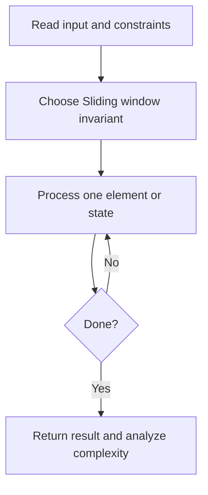
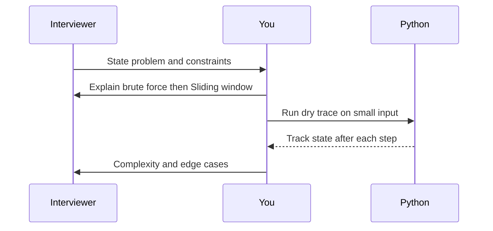

# Day 07 — Longest Substring Without Repeating Characters

**Pattern:** Sliding window · **Time:** 35 minutes · **Track:** Python interview DSA

[Course home](../README.md) · [Practice file](../practice/day-07.py) · [Commented reference](../solutions/day-07.py)

## What and why (5 minutes)

**Problem:** Find length of longest contiguous substring with no repeated character.

**Why this pattern:** Expand right pointer and move left just enough to restore uniqueness.

**Interview trap:** Do not move left backward when a character last appeared before the current window.

## Algorithm flow



## Execution / timing diagram



## Try it yourself (15 minutes)

1. Open `practice/day-07.py`. Write `solve(...)` without looking below.
2. Verbally state the invariant and walk through a sample input.
3. Run `python -m unittest discover -s tests -v` from the repository root (reference tests run against completed solutions).
4. Check your practice implementation with `python scripts/check_practice.py 7` when you finish.

### Sample cases

```python
solve('abcabcbb')  # 3
```
```python
solve('bbbbb')  # 1
```
```python
solve('')  # 0
```

## Commented solution — reveal after attempting

<details>
<summary>Show Python reference implementation</summary>

```python
def solve(s):
    last_seen = {}
    left = 0
    best = 0
    for right, ch in enumerate(s):
        if ch in last_seen and last_seen[ch] >= left:
            left = last_seen[ch] + 1  # discard old duplicate
        last_seen[ch] = right
        best = max(best, right - left + 1)
    return best
```

</details>

## Complexity (5 minutes)

**O(n) time, O(k) space.** Explain *why*, including auxiliary data structure cost.

## Tricky interview follow-up (10 minutes)

**Question:** Can you return the substring as well as its length?

Before moving on, explain (1) why your implementation is correct, (2) one edge case, (3) a trade-off versus a simpler solution.

**Next:** [Day 08](day-08.md)
