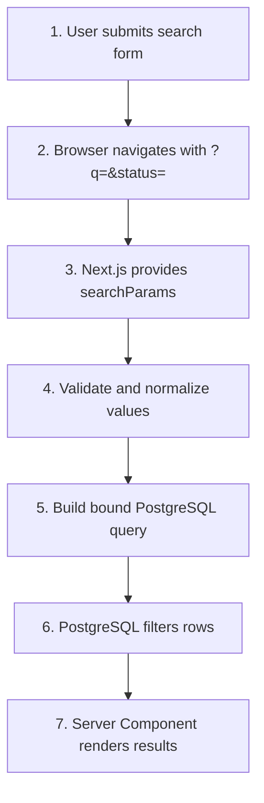
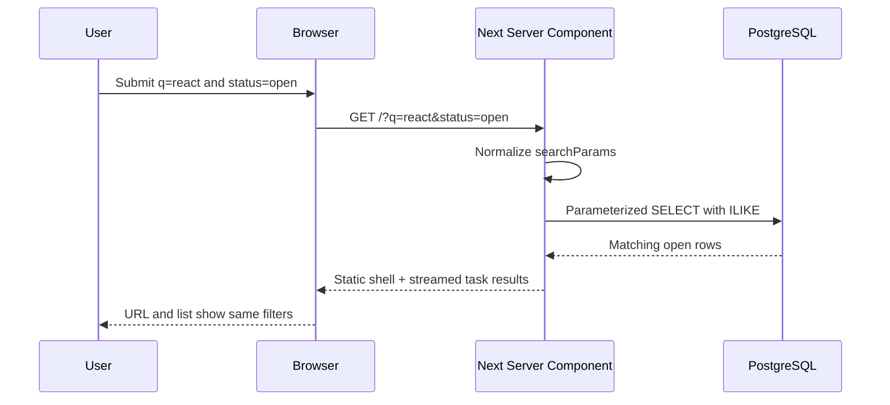

# Day 8 — Add URL search and server-side filters

**Time:** three focused 45-minute sessions

**Starting point:** Day 7 editing works.

**Goal:** Search and status filters survive reloads, can be shared as a URL,
and are applied safely by PostgreSQL.

[Previous: Day 7](day-07.md) ·
[Roadmap](../docs/APP_BUILD_ROADMAP.md) ·
[Next: Day 9](day-09.md)

## Learning objectives

- distinguish temporary component state from URL state;
- validate search parameters at the server boundary;
- use parameterized `ILIKE` safely;
- understand wildcard escaping and index limitations;
- avoid request-race complexity by starting with a GET form.

## 1. Define the URL contract

Use:

```text
/?q=react&status=open
```

Rules:

- `q` is trimmed and limited to 100 characters;
- `status` is `all`, `open`, or `done`;
- missing values mean `q=""` and `status="all"`;
- `%` and `_` are treated as literal characters, not SQL wildcards.



## 2. Create a shared filter type

Add to `frontend/lib/validation.ts`:

```ts
export type TaskStatus = 'all' | 'open' | 'done';

export type TaskFilters = {
  query: string;
  status: TaskStatus;
};

export function normalizeTaskFilters(
  queryValue: unknown,
  statusValue: unknown,
): TaskFilters {
  const query =
    typeof queryValue === 'string'
      ? queryValue.trim().slice(0, 100)
      : '';

  const status: TaskStatus =
    statusValue === 'open' || statusValue === 'done'
      ? statusValue
      : 'all';

  return { query, status };
}
```

Invalid status values fall back to `all`; oversized search values are bounded.
An API could instead return `400`. Documenting the choice matters more than
pretending there is only one valid policy.

## 3. Escape LIKE wildcard characters

Parameterized queries prevent SQL injection, but `%` and `_` still have
special pattern meaning inside `LIKE`/`ILIKE`.

Add to `frontend/lib/tasks.ts`:

```ts
function escapeLike(value: string): string {
  // Escape the escape character first, then PostgreSQL wildcard characters.
  return value.replace(/[\\%_]/g, '\\$&');
}
```

Now create the filtered query:

```ts
import type { TaskFilters } from './validation';

export async function searchTasks(filters: TaskFilters): Promise<Task[]> {
  const pattern = `%${escapeLike(filters.query)}%`;

  const result = await getPool().query<TaskRow>(
    `
      SELECT id, title, done, created_at
      FROM tasks
      WHERE title ILIKE $1 ESCAPE '\\'
        AND (
          $2::text = 'all'
          OR done = ($2::text = 'done')
        )
      ORDER BY id
    `,
    [pattern, filters.status],
  );

  return result.rows.map(toTask);
}
```

The values are bound. The SQL structure is fixed. `ILIKE` performs
case-insensitive matching according to PostgreSQL behavior and collation.

## 4. Read search parameters with Cache Components

Next.js provides page search parameters as a Promise. Keep the static page
shell outside the request-time result component:

```tsx
import { Suspense } from 'react';
import SearchForm from './SearchForm';
import TaskBoard from './TaskBoard';
import { searchTasks } from '../lib/tasks';
import { normalizeTaskFilters } from '../lib/validation';
import type { Task } from './types';

type PageProps = {
  searchParams: Promise<{
    q?: string;
    status?: string;
  }>;
};

async function TaskResults({ searchParams }: PageProps) {
  // Awaiting searchParams makes this subtree request-specific.
  const params = await searchParams;
  const filters = normalizeTaskFilters(params.q, params.status);

  let tasks: Task[] = [];
  let error: string | null = null;
  try {
    tasks = await searchTasks(filters);
  } catch (err) {
    error = err instanceof Error ? err.message : 'Unable to load tasks';
  }

  return (
    <>
      <SearchForm filters={filters} />
      {error ? (
        <p
          className="rounded-xl border border-rose-400/30 bg-rose-400/10 p-4 text-rose-200"
          role="alert"
        >
          Could not load tasks: {error}. Check PostgreSQL and DATABASE_URL.
        </p>
      ) : (
        <TaskBoard tasks={tasks} />
      )}
    </>
  );
}

export default function Home({ searchParams }: PageProps) {
  return (
    <main className="mx-auto min-h-screen w-full max-w-5xl px-5 py-12">
      <header className="mb-8">
        <p className="text-sm font-semibold uppercase tracking-widest text-violet-300">
          Your workspace
        </p>
        <h1 className="mt-3 text-4xl font-bold tracking-tight">MiniTrack</h1>
        <p className="mt-2 text-slate-400">
          Simple tasks. Serious full-stack concepts.
        </p>
      </header>

      <Suspense fallback={<p className="mt-8 text-slate-400">Filtering tasks...</p>}>
        <TaskResults searchParams={searchParams} />
      </Suspense>
    </main>
  );
}
```

You do not need `io()` inside `TaskResults`: `searchParams` is already a
request-time API and creates the suspension point. The header and database
error message are the same as Day 5; only the data source changed.

### Remove the Day 5 client-side filter

PostgreSQL now applies the status filter, so the **Show** dropdown in
`frontend/app/TaskBoard.tsx` would be a second, disconnected filter. In
`TaskBoard.tsx`:

1. Delete `type Filter = 'all' | 'open' | 'done';`.
2. Delete the `filter` state: `const [filter, setFilter] = useState<Filter>('all');`.
3. Replace the `let visibleTasks = tasks;` block and its two `if` statements
   with one line:

   ```ts
   const visibleTasks = tasks; // The server already applied the URL filters.
   ```

4. Delete the `<label>` that contains the **Show:** `<select>`.
5. Change the empty message to `No tasks match these filters.`

Keeping the name `visibleTasks` means the existing `visibleTasks.map(...)`
rendering code stays unchanged.

## 5. Build a no-JavaScript search form first

Create `frontend/app/SearchForm.tsx` as a Server Component:

```tsx
import type { TaskFilters } from '../lib/validation';

export default function SearchForm({ filters }: { filters: TaskFilters }) {
  return (
    <form
      className="my-6 grid gap-3 rounded-2xl border border-slate-700 bg-slate-900 p-4 sm:grid-cols-[1fr_auto_auto]"
      method="GET"
    >
      <label>
        <span className="sr-only">Search task titles</span>
        <input
          className="min-h-11 w-full rounded-lg border border-slate-700 bg-slate-950 px-3"
          type="search"
          name="q"
          defaultValue={filters.query}
          placeholder="Search tasks"
          maxLength={100}
        />
      </label>

      <label>
        <span className="sr-only">Task status</span>
        <select
          className="min-h-11 rounded-lg border border-slate-700 bg-slate-950 px-3"
          name="status"
          defaultValue={filters.status}
        >
          <option value="all">All</option>
          <option value="open">Open</option>
          <option value="done">Done</option>
        </select>
      </label>

      <button className="min-h-11 rounded-lg bg-violet-500 px-5 font-bold">
        Apply
      </button>
    </form>
  );
}
```

Using a GET form gives accessible, bookmarkable behavior without debounce or
client request races. Add live/debounced search only after this version works.

## 6. Update the collection API

For `GET /api/tasks`, read `request.nextUrl.searchParams`, normalize with the
same helper, and call `searchTasks(filters)`. Change the signature to receive a
Next.js request:

```ts
import type { NextRequest } from 'next/server';

export async function GET(request: NextRequest): Promise<Response> {
  const filters = normalizeTaskFilters(
    request.nextUrl.searchParams.get('q'),
    request.nextUrl.searchParams.get('status'),
  );

  try {
    return Response.json(await searchTasks(filters), {
      headers: { 'Cache-Control': 'no-store' },
    });
  } catch (error: unknown) {
    console.error('GET /api/tasks failed:', error);
    return Response.json(
      { error: 'Internal server error' },
      { status: 500 },
    );
  }
}
```

## 7. Trace search timing



## Debugging exercise

Test these cases:

- blank and whitespace-only search;
- `%`, `_`, and `\` in the search box;
- an unknown status in the URL;
- no matches;
- reload and browser Back;
- non-ASCII task titles.

Temporarily remove `escapeLike` and describe the behavior change. Parameter
binding still blocks injection, but wildcard semantics change.

## Tricky interview questions and answers (20 min)

Practice each answer aloud before reading it.

### Q1. Why store filters in the URL?

**Interview-ready answer:** URL state survives reloads, supports browser
history, and can be bookmarked or shared. Local `useState` is better for
temporary values that should not define navigation.

**Example:** `/?q=react&status=open` recreates the same view in a new tab.

**Senior follow-up:** The server must still validate URL values because users
can type or modify them directly.

### Q2. Does parameterization escape LIKE wildcards?

**Interview-ready answer:** Parameterization prevents the value from becoming
SQL syntax, but it does not change `%` and `_` pattern semantics. Escape those
characters separately when the product requires literal substring search.

**Example:** A bound value of `%` is safe from injection but still matches any
sequence unless it is escaped for `ILIKE`.

**Senior follow-up:** SQL-injection safety and product search semantics are
different requirements; both must be handled explicitly.

### Q3. Should we add an index now?

**Interview-ready answer:** Measure first. A normal B-tree generally does not
accelerate a leading-wildcard pattern such as `%react%`. PostgreSQL trigram
indexes can help, but they add storage and write overhead.

**Example:** Use `EXPLAIN (ANALYZE, BUFFERS)` with representative data before
and after adding an index.

**Senior follow-up:** An index that helps reads can slow inserts and updates,
so query frequency and data size determine whether it is worthwhile.

### Q4. Why begin with a GET form instead of debounce?

**Interview-ready answer:** A GET form is accessible, deterministic, and
URL-native. Debounced live search adds timers, cancellation, loading states,
and out-of-order response handling.

**Example:** Submitting the form navigates directly to
`/?q=sql&status=open`, even if JavaScript fails.

**Senior follow-up:** If live search is added, cancel old requests or ignore
responses that no longer match the latest query.

## Complexity

- Normalization is `O(q)` for query length.
- Client rendering is `O(r)` for returned rows.
- `%substring%` search may scan `O(n)` rows without a suitable index.
- Result memory is `O(r)`.

## Exit checklist

- [ ] Search and status appear in the URL.
- [ ] Reload and Back preserve behavior.
- [ ] PostgreSQL, not the browser, applies the filters.
- [ ] `%` and `_` have the documented literal behavior.
- [ ] API and page share normalization rules.
- [ ] I can explain why a B-tree may not help this query.

**Suggested commit:** `app-day8: add URL task search and filters`
