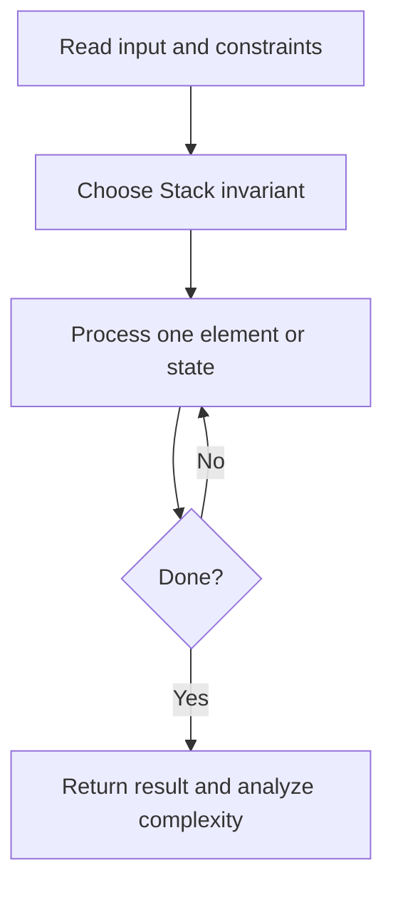
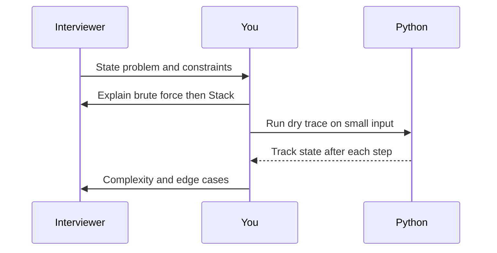

# Day 09 — Valid Parentheses

**Pattern:** Stack · **Time:** 35 minutes · **Track:** Python interview DSA

[Course home](../README.md) · [Practice file](../practice/day-09.py) · [Commented reference](../solutions/day-09.py)

## What and why (5 minutes)

**Problem:** Return whether brackets (), {}, [] are balanced and correctly nested.

**Why this pattern:** Stack captures the last unmatched opener.

**Interview trap:** Matching total counts is not enough: ([)] is invalid.

## Algorithm flow



## Execution / timing diagram



## Try it yourself (15 minutes)

1. Open `practice/day-09.py`. Write `solve(...)` without looking below.
2. Verbally state the invariant and walk through a sample input.
3. Run `python -m unittest discover -s tests -v` from the repository root (reference tests run against completed solutions).
4. Check your practice implementation with `python scripts/check_practice.py 9` when you finish.

### Sample cases

```python
solve('()[]{}')  # True
```
```python
solve('([)]')  # False
```
```python
solve('(((')  # False
```

## Commented solution — reveal after attempting

<details>
<summary>Show Python reference implementation</summary>

```python
def solve(s):
    pairs = {')':'(', ']':'[', '}':'{'}
    opening = set(pairs.values())
    stack = []
    for ch in s:
        if ch in opening:
            stack.append(ch)
        elif ch in pairs:
            if not stack or stack.pop() != pairs[ch]:
                return False
        else:
            return False  # input contract: brackets only
    return not stack
```

</details>

## Complexity (5 minutes)

**O(n) time, O(n) space.** Explain *why*, including auxiliary data structure cost.

## Tricky interview follow-up (10 minutes)

**Question:** How would you report the position of the first mismatch?

Before moving on, explain (1) why your implementation is correct, (2) one edge case, (3) a trade-off versus a simpler solution.

**Next:** [Day 10](day-10.md)
