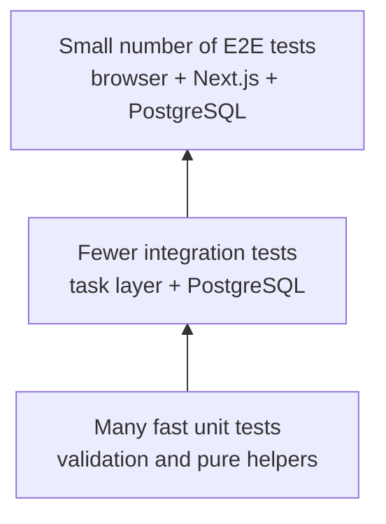
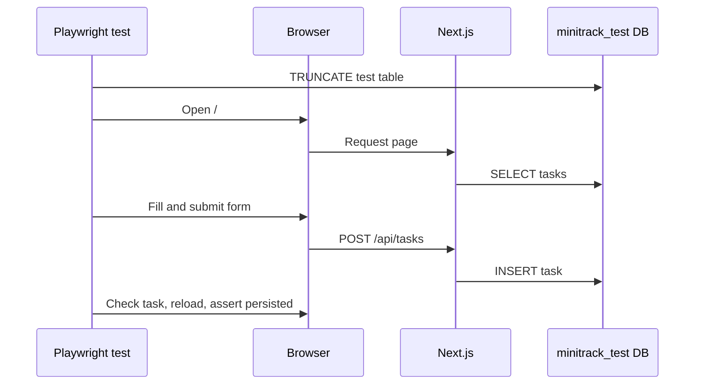

# Day 9 — Add unit, integration, and browser tests

**Time:** three focused 45-minute sessions

**Starting point:** Create, edit, complete, search, filter, and delete work.

**Goal:** Important behavior is repeatable and isolated from personal data.

[Previous: Day 8](day-08.md) ·
[Roadmap](../docs/APP_BUILD_ROADMAP.md) ·
[Next: Day 10](day-10.md)

## Learning objectives

- choose the correct test level;
- isolate database tests from development data;
- test pure validation with Node's test runner;
- test one database operation;
- verify one complete browser journey with Playwright.

## 1. Build a test pyramid



Use the lowest level that proves the behavior. Browser tests are valuable but
slower and more fragile than pure function tests.

## 2. Install and separate the tools

From `frontend/`:

```bash
npm install --save-dev tsx @playwright/test dotenv-cli
npm install server-only
npx playwright install chromium
```

- `tsx` runs TypeScript tests with Node's built-in test runner.
- Playwright controls a real browser.
- `dotenv-cli` loads a dedicated test environment file for spawned processes.
- `server-only` provides the `import 'server-only'` marker used by
  `frontend/lib/db.ts`. Next.js understands it automatically; plain Node needs
  the package installed.

Add scripts:

```json
{
  "scripts": {
    "test": "npm run test:unit",
    "test:unit": "tsx --test test/unit/*.test.ts",
    "test:integration": "dotenv -e .env.test.local -- tsx --conditions=react-server --test test/integration/*.test.ts",
    "test:e2e": "dotenv -e .env.test.local -- playwright test"
  }
}
```

**Why `--conditions=react-server`?** Outside Next.js, `server-only` throws on
purpose to stop accidental client imports. This flag tells Node to load its
empty server version, so integration tests can import the real data layer.

## 3. Create an isolated database

```bash
createdb minitrack_test
psql -d minitrack_test -f ../backend/sql/schema.sql
```

Create ignored `frontend/.env.test.local`:

```env
DATABASE_URL=postgresql://YOUR_USER@localhost:5432/minitrack_test
```

Never use your development or production database for destructive tests.

Create `frontend/test/helpers/test-database.ts` with a guard:

```ts
export function requireTestDatabase(): string {
  const connectionString = process.env.DATABASE_URL;
  if (!connectionString) {
    throw new Error('DATABASE_URL is required for integration tests');
  }

  const databaseName = new URL(connectionString).pathname;
  if (databaseName !== '/minitrack_test') {
    throw new Error(`Refusing to test against ${databaseName}`);
  }

  return connectionString;
}
```

This guard is not a substitute for careful configuration, but it prevents a
common destructive mistake.

## 4. Write a unit test

Move or create `test/unit/validation.test.ts`:

```ts
import assert from 'node:assert/strict';
import test from 'node:test';
import {
  normalizeTaskFilters,
  normalizeTitle,
} from '../../lib/validation';

test('normalizes a valid title', () => {
  assert.equal(normalizeTitle('  Learn testing  '), 'Learn testing');
});

test('rejects invalid titles', () => {
  assert.equal(normalizeTitle('   '), null);
  assert.equal(normalizeTitle(42), null);
  assert.equal(normalizeTitle('x'.repeat(201)), null);
});

test('normalizes search and status', () => {
  assert.deepEqual(
    normalizeTaskFilters('  React  ', 'open'),
    { query: 'React', status: 'open' },
  );

  assert.deepEqual(
    normalizeTaskFilters(undefined, 'unknown'),
    { query: '', status: 'all' },
  );
});
```

Unit tests require no server and no database.

## 5. Write a database integration test

Create `test/integration/tasks.test.ts`:

```ts
import assert from 'node:assert/strict';
import test, { after, beforeEach } from 'node:test';
import { Pool } from 'pg';
import { createTask, renameTask } from '../../lib/tasks';
import { requireTestDatabase } from '../helpers/test-database';

const pool = new Pool({ connectionString: requireTestDatabase() });

beforeEach(async () => {
  // Isolation makes every test independent of execution order.
  await pool.query('TRUNCATE tasks RESTART IDENTITY');
});

after(async () => {
  await pool.end();
});

test('renames a persisted task', async () => {
  const created = await createTask('Before');
  const updated = await renameTask(created.id, 'After');

  assert.equal(updated?.title, 'After');

  const result = await pool.query(
    'SELECT title FROM tasks WHERE id = $1',
    [created.id],
  );
  assert.equal(result.rows[0]?.title, 'After');
});
```

The application helper and assertion pool use the same test connection string.
The direct `SELECT` verifies persistence independently of the returned object.

## 6. Add one browser journey

Create `playwright.config.ts`:

```ts
import { defineConfig } from '@playwright/test';

export default defineConfig({
  testDir: './test/e2e',
  use: {
    baseURL: 'http://127.0.0.1:3000',
  },
  webServer: {
    command: 'npm run dev',
    url: 'http://127.0.0.1:3000',
    reuseExistingServer: false,
  },
});
```

Create `test/e2e/tasks.spec.ts`:

```ts
import { expect, test } from '@playwright/test';
import { Pool } from 'pg';
import { requireTestDatabase } from '../helpers/test-database';

const pool = new Pool({ connectionString: requireTestDatabase() });

test.beforeEach(async () => {
  await pool.query('TRUNCATE tasks RESTART IDENTITY');
});

test.afterAll(async () => {
  await pool.end();
});

test('creates, completes, and persists a task', async ({ page }) => {
  await page.goto('/');

  await page.getByLabel('Task title').fill('Practice testing');
  await page.getByRole('button', { name: /add task/i }).click();

  await expect(page.getByText('Practice testing')).toBeVisible();
  await page.getByLabel('Complete Practice testing').check();
  await page.reload();

  await expect(page.getByLabel('Complete Practice testing')).toBeChecked();
});
```

Role and label queries test the same accessible names users and assistive
technology rely on.

## 7. Understand execution timing



## Debugging exercise

1. Point the test URL at `minitrack` and confirm the guard stops execution.
2. Remove `beforeEach` and observe order-dependent data.
3. Replace label queries with brittle CSS selectors and rename a class.
4. Make a test depend on a fixed task ID and explain why parallel runs fail.

## Tricky interview questions and answers (20 min)

Practice each answer aloud before reading it.

### Q1. What is the difference between unit, integration, and E2E tests?

**Interview-ready answer:** Unit tests isolate pure logic, integration tests
verify connected systems such as the data layer and PostgreSQL, and E2E tests
exercise a user-visible workflow through the browser and server. Each level
catches different failures and has a different cost.

**Example:** Test `normalizeTitle` as a unit, `renameTask` with PostgreSQL as an
integration, and create/complete/reload through Playwright as E2E.

**Senior follow-up:** Prefer the lowest test level that proves the behavior;
failures are faster and easier to diagnose there.

### Q2. Why use a real test database?

**Interview-ready answer:** SQL syntax, constraints, timestamp conversion, and
PostgreSQL behavior cannot be proven by mocking everything. A separate database
provides real behavior without risking development data.

**Example:** A mocked pool may accept SQL that PostgreSQL rejects or fail to
model `RETURNING` and type conversion correctly.

**Senior follow-up:** Use migrations to create the test schema so test and
production structures do not drift.

### Q3. What makes a test deterministic?

**Interview-ready answer:** A deterministic test depends only on controlled
setup, not execution order, wall-clock accidents, network availability, or
leftover data. Reset state, avoid shared fixed IDs, and await observable
outcomes.

**Example:** `TRUNCATE ... RESTART IDENTITY` in `beforeEach` gives each
database test a known starting point.

**Senior follow-up:** Parallel tests need separate schemas, transactions, or
unique data ownership so one worker cannot corrupt another's assumptions.

### Q4. Should every path be an E2E test?

**Interview-ready answer:** No. E2E tests are slower and harder to diagnose.
Use them for a small number of critical journeys and cover edge cases closer
to pure validation or the data layer.

**Example:** One browser journey can prove create/complete/reload, while many
invalid-title combinations remain fast unit tests.

**Senior follow-up:** A healthy test suite balances confidence, speed,
diagnostic clarity, and maintenance cost rather than maximizing one layer.

## Complexity

Test execution cost depends on I/O rather than algorithmic complexity:

- unit tests are usually milliseconds and `O(1)` for these bounded inputs;
- integration tests add database startup/query cost;
- E2E tests add browser, server, and database cost.

## Exit checklist

- [ ] Unit tests run without PostgreSQL.
- [ ] Integration and E2E tests refuse the development database.
- [ ] Every database test resets its own state.
- [ ] One browser test proves persistence across reload.
- [ ] TypeScript and production build still pass.

**Commands:**

```bash
npm run test:unit
npm run test:integration
npm run test:e2e
npx tsc --noEmit
npm run build
```

**Suggested commit:** `app-day9: add isolated automated tests`
