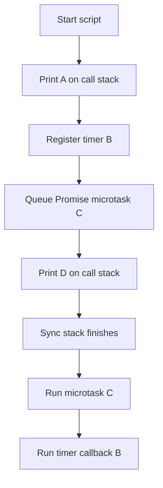
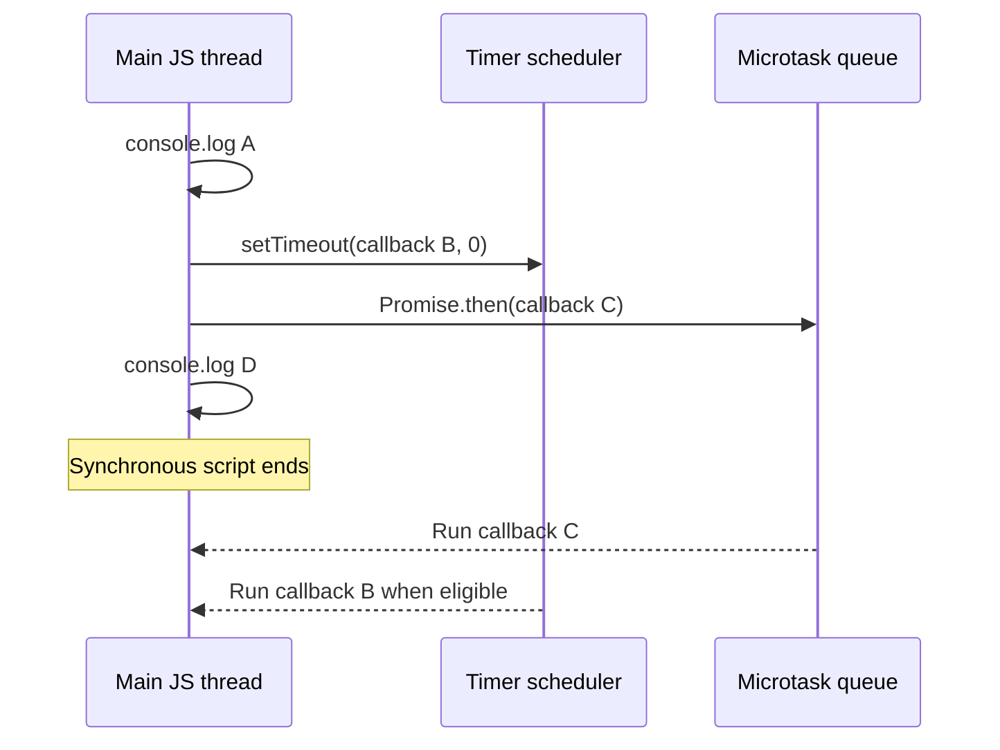

# Day 1 — JavaScript execution + your first HTTP API

**Goal:** run `GET /tasks` returning a JSON array. **Time:** ~90 min. **Today's files:** `checkpoints/day1/server.cjs` (you will write its contents below). **Next:** [Day 2](day-2.md).

For the complete app sequence, progress tracker, concepts, and interview questions for every day, see the [MiniTrack app build roadmap](../docs/APP_BUILD_ROADMAP.md).

## 0. Why we're doing this

Before frameworks, see what Node actually does: a function handles each HTTP request. In the app, a browser will eventually ask for tasks using exactly this contract.

## 1. JavaScript execution model (15 min)

- **Call stack:** the functions executing right now; one frame pushed when a function is called, popped when it returns.
- **Timer:** `setTimeout` registers a callback that may run later; `0` does not mean now.
- **Microtask:** a fulfilled Promise's `.then(...)` callback runs after current synchronous code, before an eligible timer callback in this example.

**Predict before running:**

```js
console.log('A');
setTimeout(() => console.log('B'), 0); // Timer callback: not synchronous.
Promise.resolve().then(() => console.log('C')); // Promise microtask.
console.log('D');
```


**Answer:** `A D C B`. The two `console.log` calls run synchronously; the Promise callback is a microtask; timer callback runs afterward. **Interview trap:** timers don't interrupt synchronous JS, and a zero delay is not an immediate call.

### Execution flow



### Timing / sequence diagram



## 2. Write the server (35 min)

From the extracted repository root:

```bash
mkdir -p checkpoints/day1
code checkpoints/day1/server.cjs  # Or open the file in VS Code manually
```

**Write all of this code into `checkpoints/day1/server.cjs`:**

```js
const http = require('node:http'); // Built-in Node module: no npm package needed.

// In-memory data lasts only until we stop this Node process.
const tasks = [
  { id: 1, title: 'Learn the event loop', done: false },
];

// Node calls this function for each incoming HTTP request.
const server = http.createServer((req, res) => {
  // The method (GET) and path (/tasks) together identify our route.
  if (req.method === 'GET' && req.url === '/tasks') {
    res.writeHead(200, { 'Content-Type': 'application/json' });
    res.end(JSON.stringify(tasks)); // Convert JS array to JSON; finish response.
    return; // Critical: do not fall through and send another response.
  }

  res.writeHead(404, { 'Content-Type': 'application/json' });
  res.end(JSON.stringify({ error: 'Not found' }));
});

// 3001 is the API port; the frontend will later use port 3000.
server.listen(3001, () => console.log('API: http://localhost:3001'));
```


**Why these decisions?** `node:http` shows the HTTP lifecycle without hiding it in a framework. `GET /tasks` only reads data. `JSON.stringify()` serializes JavaScript objects; `res.end()` completes the response; `return` prevents a second response.

## 3. Run and verify (10 min)

```bash
node checkpoints/day1/server.cjs
# In another terminal from anywhere:
curl -i http://localhost:3001/tasks
curl -i http://localhost:3001/unknown
```

Expected: `/tasks` → HTTP **200**, JSON array with one task; `/unknown` → **404**. Stop the server with **Ctrl+C** before Day 2 (same port).

## 4. Debugging experiments (15 min)

1. Temporarily remove `res.end(...)`: does curl finish? Restore it.
2. Change the path check to `/task`: why does `/tasks` now return 404?
3. Add a brief synchronous busy loop before `res.end()`. Can other JS handlers run during it? Remove it afterward.

## 5. Interview practice (15 min)

Practice saying the **direct answer** first. Add the example only after the interviewer asks you to explain further.

### Q1. What goes on the call stack?

**Interview-ready answer:** The call stack contains the execution frames for JavaScript functions that are currently running. It follows last-in, first-out order, and Node runs each synchronous stack to completion before processing another callback.

**Example:** When a request reaches the server, Node calls the request handler and places its frame on the stack. The handler calls `JSON.stringify(tasks)`, so that call is placed above the handler. `JSON.stringify` finishes first, then the handler continues and eventually returns.

```text
Top    JSON.stringify(tasks)
       request handler
Bottom Node internals
```

An asynchronous operation does not remain on the stack while it waits. Its callback is scheduled to run on a future stack when the operation is ready.

### Q2. What is queued versus immediately executed?

**Interview-ready answer:** Ordinary statements and function calls execute immediately on the current call stack. Promise handlers are queued as microtasks, while timers and I/O callbacks are scheduled for later event-loop phases. After the current stack finishes, Node drains eligible microtasks before moving to the next event-loop phase.

**Example:**

```js
console.log('A');
setTimeout(() => console.log('B'), 0);
Promise.resolve().then(() => console.log('C'));
console.log('D');
```

The output is `A D C B`: `A` and `D` run synchronously, the Promise handler runs as a microtask, and the timer callback runs later. A zero-millisecond timer means "not before this delay"; it does not mean "run immediately."

### Q3. Is Node.js multithreaded?

**Interview-ready answer:** JavaScript callbacks normally execute one at a time on Node's main event-loop thread. However, Node itself is not entirely single-threaded: the operating system handles much asynchronous network I/O, libuv has a worker pool for operations such as file system and some crypto work, and an application can explicitly use Worker Threads for CPU-heavy JavaScript.

**Example:** While this server waits for a client or database response, the main JavaScript thread can handle another ready callback. But a large synchronous loop in one request handler blocks that thread and delays every other request.

**Senior follow-up:** Concurrency means tasks can make progress during overlapping periods. Parallelism means tasks literally execute at the same time, which requires multiple threads or processes.

### Q4. Why does `res.end()` matter?

**Interview-ready answer:** `res.end()` tells Node that the HTTP response is complete. It sends any final response data and prevents the client from waiting indefinitely for more bytes.

**Example:**

```js
res.writeHead(200, { 'Content-Type': 'application/json' });
res.end(JSON.stringify(tasks));
return;
```

`res.end()` ends the **response**, but it does not automatically stop the JavaScript function. The `return` stops the handler from falling through and attempting to send the later 404 response. No `return` is needed after the final 404 response because the callback naturally reaches its end there.

### Q5. What does HTTP status 404 mean?

**Interview-ready answer:** `404 Not Found` means the server was reached, understood the request, but could not find a resource or route matching the requested URL. It describes the HTTP result, not a JavaScript syntax error or a server crash.

**Example:** `GET /tasks` matches this server's route and returns `200 OK`. `GET /unknown` reaches the same server but matches no route, so it returns `404 Not Found`.

**Useful comparison:**

- `400 Bad Request`: the client's request data is invalid.
- `404 Not Found`: the requested route or resource does not exist.
- `500 Internal Server Error`: the server failed while processing a valid request.

## Exit checklist

- [ ] I predicted `A D C B` correctly (or can explain my correction).
- [ ] I typed and ran the server.
- [ ] I can explain `req`, `res`, and `return`.
- [ ] I wrote a short reflection in `docs/MY_NOTES.md`.

**Commit:** `git add . && git commit -m "day1: HTTP GET and event loop"`

**Continue → [Day 2: POST, promises and closures](day-2.md)**
