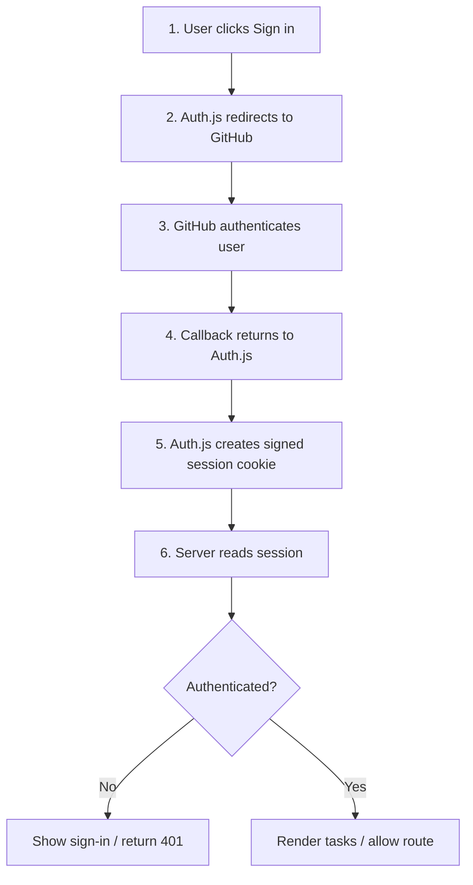
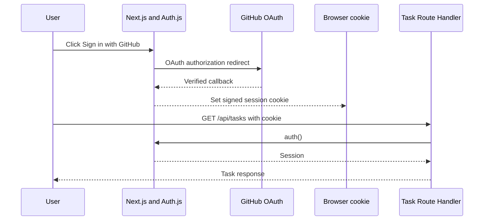

# Day 10 — Add GitHub sign-in with Auth.js

**Time:** three focused 45-minute sessions

**Starting point:** Day 9 tests pass.

**Goal:** Users can sign in and sign out through GitHub, and anonymous requests
cannot read or mutate tasks.

[Previous: Day 9](day-09.md) ·
[Roadmap](../docs/APP_BUILD_ROADMAP.md) ·
[Next roadmap milestone: App Day 11](../docs/APP_BUILD_ROADMAP.md#day-11--associate-tasks-with-owners-and-enforce-authorization)

> Auth.js package and provider instructions can change. This lesson uses the
> current official App Router pattern: `next-auth@beta`, root `auth.ts`, and
> exported route `handlers`. Recheck the
> [official installation guide](https://authjs.dev/getting-started/installation),
> [GitHub provider guide](https://authjs.dev/guides/configuring-github), and
> [server protection guide](https://authjs.dev/getting-started/session-management/protecting)
> when you begin.

## Learning objectives

- distinguish authentication from authorization;
- configure OAuth without exposing secrets;
- read sessions in Server Components and Route Handlers;
- read shared session state in Client Components through Context;
- implement sign-in and sign-out with Server Actions;
- explain why Day 11 must add task ownership.

## 1. Understand the trust boundary



OAuth delegates identity verification to GitHub. Auth.js manages the redirect,
callback, and session. Your application must still check the session on every
private server entry point.

## 2. Install Auth.js and create secrets

From `frontend/`:

```bash
npm install next-auth@beta
npx auth secret
```

`npx auth secret` adds a cryptographically strong `AUTH_SECRET` to the local
environment file. Never copy it into a lesson, commit, browser bundle, log, or
chat.

Create a GitHub OAuth App:

- Homepage URL: `http://localhost:3000`
- Callback URL: `http://localhost:3000/api/auth/callback/github`

Add the issued values to `.env.local`:

```env
AUTH_GITHUB_ID=your-client-id
AUTH_GITHUB_SECRET=your-client-secret
```

Keep the existing `DATABASE_URL`. Confirm `.env.local` remains ignored.

## 3. Create the Auth.js configuration

Create `frontend/auth.ts`:

```ts
import NextAuth from 'next-auth';
import GitHub from 'next-auth/providers/github';

// Auth.js creates the route handlers, server session reader, and server actions.
export const { handlers, auth, signIn, signOut } = NextAuth({
  providers: [GitHub],
});
```

Create `frontend/app/api/auth/[...nextauth]/route.ts`:

```ts
import { handlers } from '@/auth';

// The catch-all route receives Auth.js sign-in, callback, and session requests.
export const { GET, POST } = handlers;
```

The route contains no provider secret. Auth.js reads secrets only from the
server environment.

## 4. Add sign-in and sign-out controls

Create `frontend/app/AuthControls.tsx`:

```tsx
import { auth, signIn, signOut } from '@/auth';

export default async function AuthControls() {
  const session = await auth();

  if (!session?.user) {
    return (
      <form
        action={async () => {
          'use server';
          await signIn('github', { redirectTo: '/' });
        }}
      >
        <button className="rounded-lg bg-violet-500 px-4 py-2 font-bold">
          Sign in with GitHub
        </button>
      </form>
    );
  }

  return (
    <div className="flex items-center gap-3">
      <span className="text-sm text-slate-300">
        {session.user.name ?? session.user.email ?? 'Signed in'}
      </span>
      <form
        action={async () => {
          'use server';
          await signOut({ redirectTo: '/' });
        }}
      >
        <button className="rounded-lg border border-slate-700 px-4 py-2">
          Sign out
        </button>
      </form>
    </div>
  );
}
```

These forms use Server Actions, so provider operations and session logic stay
on the server.

### Read the session from Auth.js Context when a Client Component needs it

Server Components should continue using `auth()`. For an interactive Client
Component that needs the same session, Auth.js provides `SessionProvider`,
which uses React Context internally.

Create `frontend/app/AuthSessionProvider.tsx`:

```tsx
'use client';

import type { Session } from 'next-auth';
import { SessionProvider } from 'next-auth/react';
import type { ReactNode } from 'react';

export default function AuthSessionProvider({
  children,
  session,
}: {
  children: ReactNode;
  session: Session | null;
}) {
  return (
    <SessionProvider session={session}>
      {children}
    </SessionProvider>
  );
}
```

A descendant Client Component can use the Context-backed hook:

```tsx
'use client';

import { useSession } from 'next-auth/react';

export default function ClientSessionSummary() {
  const { data: session, status } = useSession();

  if (status === 'loading') return <p>Checking session...</p>;
  if (!session?.user) return <p>Not signed in</p>;

  return <p>Signed in as {session.user.name ?? session.user.email}</p>;
}
```

Pass the server-verified session into the provider around only the interactive
subtree that needs it:

```tsx
const session = await auth();

<AuthSessionProvider session={session}>
  <ClientSessionSummary />
</AuthSessionProvider>
```

Context avoids passing the session through every intermediate Client Component.
It does **not** protect Route Handlers, and hiding client UI is still not
authorization.

## 5. Protect the page

Wrap request-time authentication inside Suspense. Replace
`frontend/app/page.tsx` with this version, which keeps the Day 8 URL search and
the database error message, and adds the session check before any task read
(the summary component above is `frontend/app/ClientSessionSummary.tsx`):

```tsx
import { Suspense } from 'react';
import { auth } from '@/auth';
import AuthControls from './AuthControls';
import AuthSessionProvider from './AuthSessionProvider';
import ClientSessionSummary from './ClientSessionSummary';
import SearchForm from './SearchForm';
import TaskBoard from './TaskBoard';
import { searchTasks } from '../lib/tasks';
import { normalizeTaskFilters } from '../lib/validation';
import type { Task } from './types';

type PageProps = {
  searchParams: Promise<{
    q?: string;
    status?: string;
  }>;
};

async function PrivateTasks({ searchParams }: PageProps) {
  // auth() reads the signed session cookie on the server.
  const session = await auth();

  if (!session?.user) {
    return (
      <section className="rounded-2xl border border-slate-700 bg-slate-900 p-8">
        <h2 className="text-2xl font-bold">Sign in to open MiniTrack</h2>
        <div className="mt-5">
          <AuthControls />
        </div>
      </section>
    );
  }

  // Only a signed-in request reaches the database read.
  const params = await searchParams;
  const filters = normalizeTaskFilters(params.q, params.status);

  let tasks: Task[] = [];
  let error: string | null = null;
  try {
    tasks = await searchTasks(filters);
  } catch (err) {
    error = err instanceof Error ? err.message : 'Unable to load tasks';
  }

  return (
    <>
      <div className="flex flex-wrap items-center justify-between gap-3">
        {/* Context wraps only the interactive subtree that needs it. */}
        <AuthSessionProvider session={session}>
          <ClientSessionSummary />
        </AuthSessionProvider>
        <AuthControls />
      </div>
      <SearchForm filters={filters} />
      {error ? (
        <p
          className="rounded-xl border border-rose-400/30 bg-rose-400/10 p-4 text-rose-200"
          role="alert"
        >
          Could not load tasks: {error}. Check PostgreSQL and DATABASE_URL.
        </p>
      ) : (
        <TaskBoard tasks={tasks} />
      )}
    </>
  );
}

export default function Home({ searchParams }: PageProps) {
  return (
    <main className="mx-auto min-h-screen w-full max-w-5xl px-5 py-12">
      <header className="mb-8">
        <p className="text-sm font-semibold uppercase tracking-widest text-violet-300">
          Your workspace
        </p>
        <h1 className="mt-3 text-4xl font-bold tracking-tight">MiniTrack</h1>
        <p className="mt-2 text-slate-400">
          Simple tasks. Serious full-stack concepts.
        </p>
      </header>

      <Suspense fallback={<p className="text-slate-400">Checking session...</p>}>
        <PrivateTasks searchParams={searchParams} />
      </Suspense>
    </main>
  );
}
```

`auth()` reads request cookies, so the subtree is request-time work. Do not
cache private session output with `"use cache"`.

## 6. Protect every task API operation

Hiding the page is not security. A caller can send HTTP requests directly.

At the start of every task Route Handler:

```ts
import { auth } from '@/auth';

const session = await auth();
if (!session?.user) {
  return Response.json(
    { error: 'Unauthorized' },
    { status: 401 },
  );
}
```

Apply this to collection `GET`/`POST` and item `PATCH`/`DELETE`.

For repeated checks, extract a small server-only helper, but keep the response
behavior explicit. Do not trust a user ID sent in request JSON.

## 7. Important Day 10 limitation

After this lesson:

- anonymous users cannot access tasks;
- authenticated users can access tasks;
- **all authenticated users still share the same task table**.

Authentication answers **who are you?** It does not yet answer **which rows may
you access?** App Day 11 adds an owner column and enforces ownership in every
query.

## 8. Authentication timing



## 9. Verify behavior

Test in a private/incognito window:

1. Anonymous page shows sign-in.
2. Anonymous `curl http://localhost:3000/api/tasks` returns `401`.
3. GitHub sign-in returns to MiniTrack.
4. Refresh preserves the session.
5. Sign-out removes private access.
6. A direct PATCH/DELETE without a session returns `401`.
7. No token, cookie, secret, or provider response is logged.

Plain curl does not automatically share the browser cookie. That makes it
useful for checking anonymous behavior.

### Update the Day 9 browser test

The Day 9 Playwright test opens `/` without signing in, so it now sees the
sign-in screen. Real GitHub sign-in should not run inside automated tests, so
park that test in `frontend/test/e2e/tasks.spec.ts` until a test-only sign-in
seam exists:

```ts
// Parked until the browser test can sign in; anonymous users now see sign-in.
test.fixme('creates, completes, and persists a task', async ({ page }) => {
```

Then create `frontend/test/e2e/auth.spec.ts` to prove the new signed-out
behavior:

```ts
import { expect, test } from '@playwright/test';

test('anonymous visitors see sign-in and the API returns 401', async ({ page, request }) => {
  await page.goto('/');

  await expect(
    page.getByRole('heading', { name: 'Sign in to open MiniTrack' }),
  ).toBeVisible();
  await expect(page.getByRole('button', { name: 'Sign in with GitHub' })).toBeVisible();
  // No task form is rendered for an anonymous visitor.
  await expect(page.getByLabel('Task title')).toHaveCount(0);

  // `request` sends HTTP without the browser's cookies.
  const response = await request.get('/api/tasks');
  expect(response.status()).toBe(401);
});
```

Run the checks from `frontend/`:

```bash
npm run test:unit
npm run test:integration
npm run test:e2e
npm run build
```

If `auth.spec.ts` fails with `MissingSecret`, the dev server cannot read
`AUTH_SECRET`; confirm it is in `frontend/.env.local`.

## Debugging exercise

- Use the wrong callback URL and inspect the provider error without exposing secrets.
- Remove one API session check and explain the authorization gap.
- Read `process.env.AUTH_GITHUB_SECRET` in a Client Component and explain why
  that boundary is invalid.
- Hide the task button but leave the route open; call it directly with curl.

## Tricky interview questions and answers (20 min)

Practice each answer aloud before reading it.

### Q1. What is authentication versus authorization?

**Interview-ready answer:** Authentication establishes identity. Authorization
determines which actions and resources that identity may access. Day 10
authenticates; Day 11 adds row-level authorization.

**Example:** A valid GitHub session proves who the user is but does not prove
that task `42` belongs to that user.

**Senior follow-up:** Authorization should be enforced in the data query, not
only after loading an unscoped row.

### Q2. Why use a maintained provider?

**Interview-ready answer:** OAuth validation, session cookies, callback checks,
token handling, and security updates are easy to implement incorrectly. A
maintained library reduces custom sensitive code, though the application still
owns correct configuration and authorization.

**Example:** Auth.js supplies the callback route, signed session handling, and
server `auth()` interface instead of MiniTrack inventing each piece.

**Senior follow-up:** A library reduces risk; it does not eliminate the need to
patch dependencies, protect secrets, and review provider settings.

### Q3. Why is a hidden UI control not protection?

**Interview-ready answer:** Browsers are not trusted enforcement points.
Attackers can call HTTP endpoints directly. Every private server route and
data query must verify the session and, later, resource ownership.

**Example:** Removing the Delete button does not stop
`DELETE /api/tasks/42` from curl.

**Senior follow-up:** Client checks improve UX; server checks enforce security.
Use both for different purposes.

### Q4. Why use an HttpOnly session cookie?

**Interview-ready answer:** HttpOnly cookies are unavailable to ordinary
browser JavaScript, reducing token theft through XSS. They still require
Secure, SameSite, CSRF, expiry, and server-validation decisions.

**Example:** React code cannot read an HttpOnly session cookie with
`document.cookie`, but the browser can attach it to eligible requests.

**Senior follow-up:** HttpOnly mitigates token exfiltration; it does not prevent
an XSS payload from making authenticated requests in the user's browser.

### Q5. What is the difference between 401 and 403?

**Interview-ready answer:** `401 Unauthorized` means valid authentication is
missing. `403 Forbidden` means identity is known but lacks permission for the
operation.

**Example:** An anonymous task request returns `401`; after Day 11, a signed-in
user requesting another user's task should receive the chosen not-authorized
response, commonly `403` or a non-enumerating `404`.

**Senior follow-up:** Be consistent and consider whether revealing resource
existence creates an information leak.

### Q6. Can React Context handle authentication?

**Interview-ready answer:** Context can distribute already established session
state to Client Components. It does not verify identity or authorize server
operations; Auth.js and server checks perform those security responsibilities.

**Example:** `SessionProvider` and `useSession()` can render an account menu,
while the task Route Handler still calls `auth()`.

**Senior follow-up:** Client session state improves UI behavior but is not a
trusted enforcement boundary because clients can be modified or bypassed.

## Complexity

Application-level session checks are `O(1)`, but real latency is dominated by
cookie verification, optional database/session storage, and OAuth network
redirects. Security correctness matters more than micro-optimizing this path.

## Exit checklist

- [ ] Auth.js secrets exist only in ignored environment files.
- [ ] GitHub sign-in and sign-out work.
- [ ] A Client Component can read the session through `SessionProvider`.
- [ ] Anonymous page access shows sign-in.
- [ ] Every task API method rejects anonymous requests.
- [ ] I can explain why task ownership is still missing.
- [ ] Unit and integration tests pass; the anonymous browser test passes and
      the parked task test is marked `test.fixme`.
- [ ] TypeScript and the production build pass.

**Suggested commit:** `app-day10: add Auth.js GitHub sign-in`
