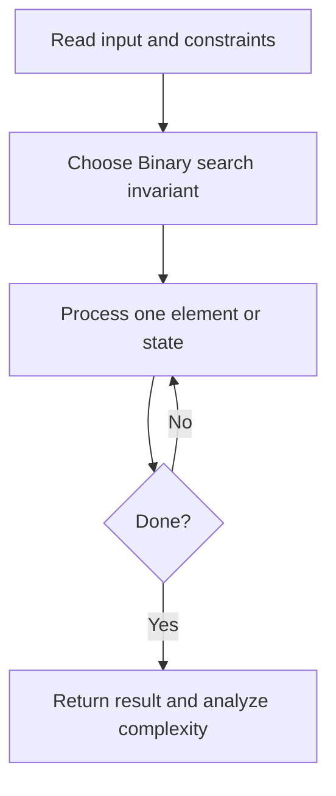
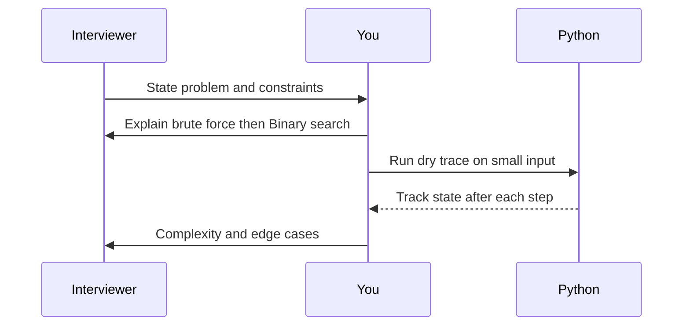

# Day 11 — Binary Search

**Pattern:** Binary search · **Time:** 35 minutes · **Track:** Python interview DSA

[Course home](../README.md) · [Practice file](../practice/day-11.py) · [Commented reference](../solutions/day-11.py)

## What and why (5 minutes)

**Problem:** Return index of target in ascending sorted array, else -1.

**Why this pattern:** Halve the search space with a clear invariant.

**Interview trap:** Off-by-one errors: ensure left <= right and remove the checked midpoint.

## Algorithm flow



## Execution / timing diagram



## Try it yourself (15 minutes)

1. Open `practice/day-11.py`. Write `solve(...)` without looking below.
2. Verbally state the invariant and walk through a sample input.
3. Run `python -m unittest discover -s tests -v` from the repository root (reference tests run against completed solutions).
4. Check your practice implementation with `python scripts/check_practice.py 11` when you finish.

### Sample cases

```python
solve([-1, 0, 3, 5, 9, 12], 9)  # 4
```
```python
solve([-1, 0, 3, 5, 9, 12], 2)  # -1
```

## Commented solution — reveal after attempting

<details>
<summary>Show Python reference implementation</summary>

```python
def solve(nums, target):
    left, right = 0, len(nums) - 1
    while left <= right:
        mid = left + (right - left) // 2
        if nums[mid] == target:
            return mid
        if nums[mid] < target:
            left = mid + 1
        else:
            right = mid - 1
    return -1
```

</details>

## Complexity (5 minutes)

**O(log n) time, O(1) space.** Explain *why*, including auxiliary data structure cost.

## Tricky interview follow-up (10 minutes)

**Question:** How do you find the first index greater than or equal to target?

Before moving on, explain (1) why your implementation is correct, (2) one edge case, (3) a trade-off versus a simpler solution.

**Next:** [Day 12](day-12.md)
