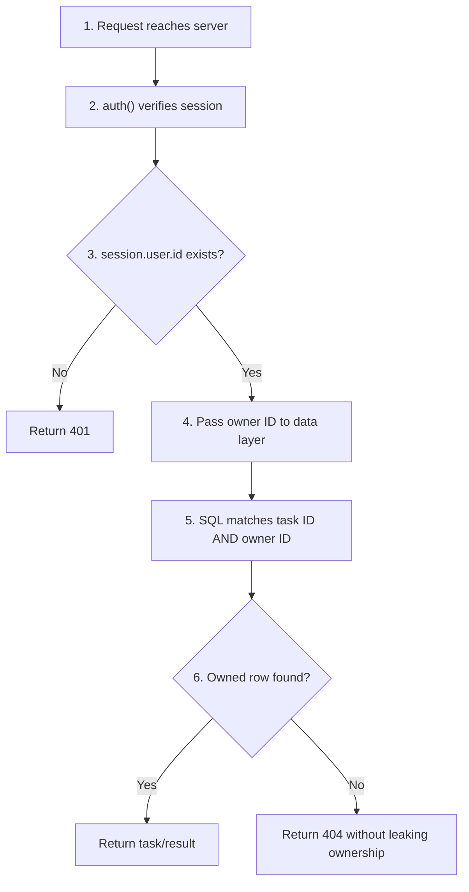
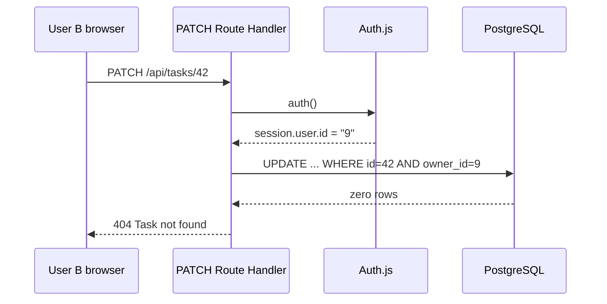

# Day 11 — Add task ownership and authorization

**Time:** three focused 45-minute sessions

**Starting point:** Day 10 authentication works and anonymous task requests
return `401`.

**Goal:** Every task belongs to an Auth.js user, and every read or mutation is
restricted to that owner.

[Previous: Day 10](day-10.md) ·
[Roadmap](../docs/APP_BUILD_ROADMAP.md) ·
[Next: Day 12](day-12.md)

> Recheck the
> [official Auth.js PostgreSQL adapter guide](https://authjs.dev/getting-started/adapters/pg)
> before installing. Adapter packages and schemas can change.

## Learning objectives

- distinguish authenticated identity from resource authorization;
- add the Auth.js PostgreSQL adapter and user tables;
- migrate tasks to a required owner safely;
- scope every SQL operation by `owner_id`;
- prevent insecure direct object reference (IDOR) bugs.

## 1. Model the authorization boundary

Day 10 answers **who is this user?** Day 11 answers **may this user access this
task?**



Never read `ownerId` from request JSON or a query string. The verified session
is the authority.

## 2. Persist Auth.js users in PostgreSQL

From `frontend/`:

```bash
npm install @auth/pg-adapter
```

Use the schema from the current official adapter guide to create `users`,
`accounts`, `sessions`, and `verification_tokens`. Save the reviewed SQL as a
numbered migration such as:

```text
backend/sql/migrations/002-auth-users.sql
```

Reuse the existing server-only pool in `frontend/auth.ts`:

```ts
import PostgresAdapter from '@auth/pg-adapter';
import NextAuth from 'next-auth';
import GitHub from 'next-auth/providers/github';
import { getPool } from './lib/db';

export const { handlers, auth, signIn, signOut } = NextAuth({
  adapter: PostgresAdapter(getPool()),
  providers: [GitHub],
  callbacks: {
    session({ session, user }) {
      // The database adapter supplies the stable Auth.js user ID.
      session.user.id = user.id;
      return session;
    },
  },
});
```

Add TypeScript module augmentation in `frontend/types/next-auth.d.ts`:

```ts
import 'next-auth';

declare module 'next-auth' {
  interface Session {
    user: {
      id: string;
      name?: string | null;
      email?: string | null;
      image?: string | null;
    };
  }
}
```

After restarting Next.js, sign out and sign in so Auth.js creates the database
user and session.

## 3. Add `owner_id` to tasks

For this local learning database, choose an explicit existing-row policy. The
simplest policy is to delete sample tasks before adding the required column:

```sql
BEGIN;

-- Learning-only choice: remove unowned sample data.
DELETE FROM tasks;

ALTER TABLE tasks
ADD COLUMN owner_id INTEGER NOT NULL
REFERENCES users(id)
ON DELETE CASCADE;

CREATE INDEX tasks_owner_id_id_idx
ON tasks (owner_id, id);

COMMIT;
```

Save it as `backend/sql/migrations/003-task-owners.sql`.

For production data, do **not** delete rows. Add a nullable column, backfill it
with an approved mapping, verify there are no nulls, then add `NOT NULL`.

## 4. Scope every data function

Make ownership a required argument:

```ts
export async function searchTasks(
  ownerId: string,
  filters: TaskFilters,
): Promise<Task[]> {
  const pattern = `%${escapeLike(filters.query)}%`;

  const result = await getPool().query<TaskRow>(
    `
      SELECT id, title, done, created_at
      FROM tasks
      WHERE owner_id = $1
        AND title ILIKE $2 ESCAPE '\\'
        AND (
          $3::text = 'all'
          OR done = ($3::text = 'done')
        )
      ORDER BY id
    `,
    [ownerId, pattern, filters.status],
  );

  return result.rows.map(toTask);
}
```

Create with the owner:

```ts
export async function createTask(
  ownerId: string,
  title: string,
): Promise<Task> {
  const result = await getPool().query<TaskRow>(
    `
      INSERT INTO tasks (owner_id, title)
      VALUES ($1, $2)
      RETURNING id, title, done, created_at
    `,
    [ownerId, title],
  );

  return toTask(result.rows[0]);
}
```

Every item mutation must match both identifiers:

```sql
UPDATE tasks
SET title = $1
WHERE id = $2 AND owner_id = $3
RETURNING id, title, done, created_at;
```

Use the same `id AND owner_id` rule for completion and deletion.

## 5. Derive ownership in server entry points

```ts
const session = await auth();
if (!session?.user?.id) {
  return Response.json({ error: 'Unauthorized' }, { status: 401 });
}

const task = await renameTask(session.user.id, id, title);
return task
  ? Response.json(task)
  : Response.json({ error: 'Task not found' }, { status: 404 });
```

Use `session.user.id` in the page's task query too. Do not fetch all tasks and
filter in React; unauthorized rows must never leave PostgreSQL.

## 6. Trace an attempted cross-user update



Even if task `42` exists for User A, User B cannot update it.

## Debugging exercise

1. Remove `owner_id` from one `DELETE` predicate and explain the vulnerability.
2. Accept `ownerId` from request JSON and show how it can be forged.
3. Filter by owner only after querying and explain the data leak.
4. Attempt to apply `NOT NULL` while unowned rows exist.

## Tricky interview questions and answers (20 min)

### Q1. Where should an owner ID come from?

**Interview-ready answer:** It must come from a verified server-side session,
not client-controlled input. Request bodies, headers, and URLs can be forged.

**Example:** `createTask(session.user.id, title)` is safe; reading
`body.ownerId` is not.

**Senior follow-up:** Authentication proves identity, but each operation still
needs authorization for its specific resource.

### Q2. Why include the owner in the SQL predicate?

**Interview-ready answer:** It makes authorization part of the atomic database
operation. The query can affect only a row owned by the authenticated user.

**Example:** `WHERE id = $1 AND owner_id = $2` prevents a guessed task ID from
crossing user boundaries.

**Senior follow-up:** Fetch-then-check can create race windows and is easier to
forget on one mutation path.

### Q3. What is IDOR?

**Interview-ready answer:** Insecure direct object reference occurs when a user
changes an identifier and accesses another user's object because the server
checks identity but not ownership.

**Example:** Changing `/api/tasks/41` to `/api/tasks/42` must not reveal or
mutate task `42`.

**Senior follow-up:** Use opaque IDs only as defense in depth; unpredictable IDs
do not replace authorization.

### Q4. How do you add a required owner to existing rows?

**Interview-ready answer:** Use a staged migration: add the column as nullable,
backfill with an approved mapping, verify every row, then add the foreign key
and `NOT NULL` constraint.

**Example:** Local sample data can be deleted deliberately, but production data
needs an accountable migration plan.

**Senior follow-up:** Plan rollback and backup before irreversible cleanup or
constraint changes.

## Complexity

- Owner lookup remains an indexed point operation, typically `O(log n)`.
- `(owner_id, id)` and owner/filter indexes trade extra write cost for scoped reads.
- Authorization adds constant application work but is mandatory correctness,
  not an optional optimization.

## Exit checklist

- [ ] Auth.js users persist in PostgreSQL.
- [ ] `session.user.id` is typed and available on the server.
- [ ] Every task row has a required owner.
- [ ] Every read and mutation scopes SQL by owner.
- [ ] A guessed task ID cannot cross user boundaries.
- [ ] I can explain authentication versus authorization.

**Suggested commit:** `day11: add owner-scoped task authorization`
