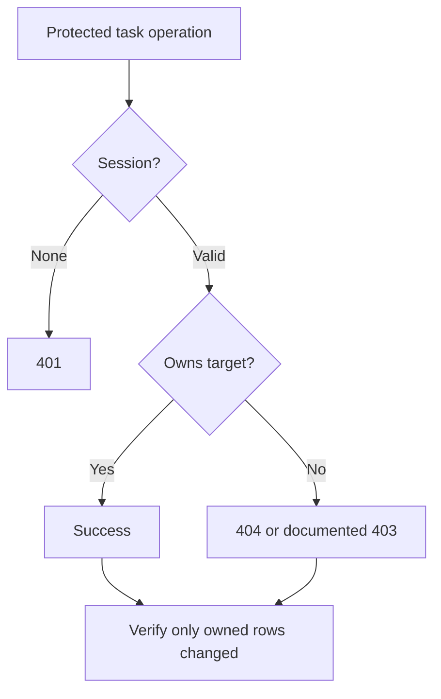
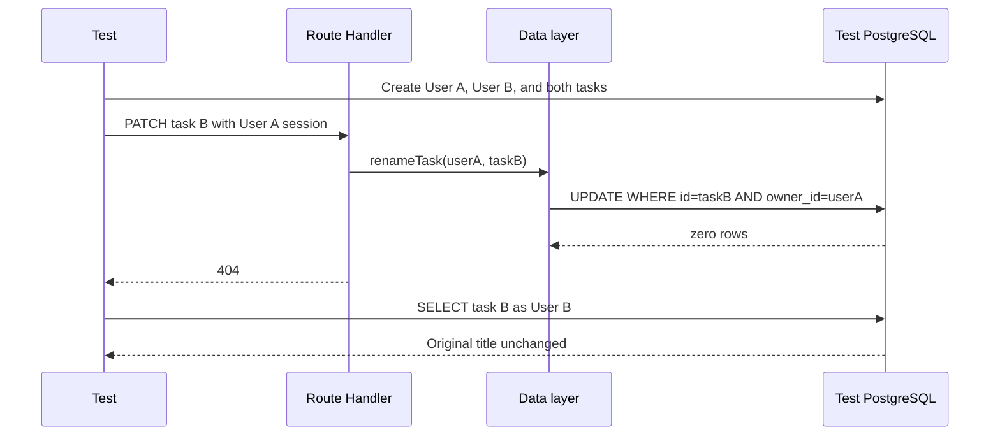

# Day 12 — Test authentication and user isolation

**Time:** three focused 45-minute sessions

**Starting point:** Day 11 scopes every task query by `session.user.id`.

**Goal:** Automated tests prove anonymous requests fail and one user cannot
read or mutate another user's tasks.

[Previous: Day 11](day-11.md) ·
[Roadmap](../docs/APP_BUILD_ROADMAP.md) ·
[Next: Day 13](day-13.md)

## Learning objectives

- design an authorization test matrix;
- test negative security behavior, not only happy paths;
- create isolated users and tasks in PostgreSQL;
- test server behavior without real OAuth credentials;
- keep sessions, tokens, cookies, and secrets out of logs.

## 1. Write the security matrix first



Cover collection read/create and item update/delete:

| Actor | Operation | Expected |
|---|---|---|
| Anonymous | list/create/update/delete | `401` |
| User A | own task | success |
| User A | User B task | no data and no mutation |
| User B | search/list | only User B rows |

## 2. Add database fixtures

Create `frontend/test/helpers/owners.ts`:

```ts
import type { Pool } from 'pg';

export async function createTestUser(
  pool: Pool,
  email: string,
): Promise<string> {
  const result = await pool.query<{ id: string }>(
    `
      INSERT INTO users (email)
      VALUES ($1)
      RETURNING id
    `,
    [email],
  );

  return result.rows[0].id;
}
```

Reset only the isolated `minitrack_test` database:

```ts
beforeEach(async () => {
  await pool.query(
    'TRUNCATE tasks, sessions, accounts, users RESTART IDENTITY CASCADE',
  );
});
```

Keep the Day 9 database-name safety guard.

## 3. Prove data-layer isolation

Create `frontend/test/integration/authorization.test.ts`:

```ts
import assert from 'node:assert/strict';
import test from 'node:test';
import {
  createTask,
  deleteTask,
  renameTask,
  searchTasks,
} from '../../lib/tasks';

test('users cannot read or mutate one another tasks', async () => {
  const userA = await createTestUser(pool, 'a@example.test');
  const userB = await createTestUser(pool, 'b@example.test');
  const taskA = await createTask(userA, 'A private task');
  const taskB = await createTask(userB, 'B private task');

  const visibleToA = await searchTasks(userA, {
    query: '',
    status: 'all',
  });
  assert.deepEqual(visibleToA.map(task => task.id), [taskA.id]);

  assert.equal(await renameTask(userA, taskB.id, 'Stolen'), null);
  assert.equal(await deleteTask(userA, taskB.id), false);

  const stillVisibleToB = await searchTasks(userB, {
    query: '',
    status: 'all',
  });
  assert.equal(stillVisibleToB[0]?.title, 'B private task');
});
```

The most important assertion is not only the response—it is that User B's row
remains unchanged.

## 4. Make Route Handlers testable

Do not add a test-only authentication bypass to production code. Extract a
small handler that receives a session reader:

```ts
type SessionReader = typeof auth;

export async function handleGetTasks(
  request: NextRequest,
  readSession: SessionReader = auth,
): Promise<Response> {
  const session = await readSession();
  if (!session?.user?.id) {
    return Response.json({ error: 'Unauthorized' }, { status: 401 });
  }

  const filters = normalizeTaskFilters(
    request.nextUrl.searchParams.get('q'),
    request.nextUrl.searchParams.get('status'),
  );

  return Response.json(
    await searchTasks(session.user.id, filters),
  );
}

export const GET = handleGetTasks;
```

Tests can pass an in-memory session reader without GitHub:

```ts
test('anonymous list returns 401', async () => {
  const request = new NextRequest('http://localhost/api/tasks');
  const response = await handleGetTasks(request, async () => null);

  assert.equal(response.status, 401);
});
```

Use the same seam to supply User A or User B sessions.

## 5. Test migrations on a clean database

In CI or a local reset script:

1. Create an empty temporary database.
2. Apply migrations in numeric order.
3. Run integration tests.
4. Destroy only that temporary database.

Never use GitHub production credentials or real session cookies in tests.

## 6. Trace the cross-user test



## Debugging exercise

1. Reuse one owner for both fixtures and observe the false confidence.
2. Assert only `404` without checking the row and explain what is missing.
3. Remove the isolated database guard and explain the risk.
4. Log the fake session object and identify fields that should remain private.

## Tricky interview questions and answers (20 min)

### Q1. Why test forbidden access?

**Interview-ready answer:** Authorization is a negative property: the system
must prevent actions. Happy-path tests prove allowed behavior but cannot prove
another user is blocked.

**Example:** A successful rename test says nothing about whether User A can
rename User B's task.

**Senior follow-up:** Assert both the response and unchanged persistent state.

### Q2. How do you test tenant isolation?

**Interview-ready answer:** Create at least two distinct owners with distinct
data, execute every read and mutation as each owner, and verify no operation
reveals or changes the other owner's rows.

**Example:** User A's search results must exclude User B even when titles match.

**Senior follow-up:** Include guessed IDs, list endpoints, exports, background
jobs, and caches—not only detail routes.

### Q3. Should tests bypass authentication?

**Interview-ready answer:** Tests may inject a controlled session reader at a
documented seam, but production behavior must still call the real auth system.
Never add an environment flag that silently grants access.

**Example:** Pass `async () => fakeUserASession` directly to a handler helper.

**Senior follow-up:** Keep a small deployed smoke test for the real OAuth flow
because injected sessions do not verify provider configuration.

### Q4. What must not appear in test logs?

**Interview-ready answer:** Session tokens, cookies, OAuth access or refresh
tokens, provider secrets, passwords, and unnecessary personal data.

**Example:** Log a generated request ID and error category, not the full cookie
header.

**Senior follow-up:** Test artifacts, screenshots, traces, and CI output have
retention and access controls too.

## Complexity

- The authorization matrix grows with actors × resources × operations.
- Each isolated integration case adds database I/O.
- Security tests favor explicit coverage over algorithmic optimization.

## Exit checklist

- [ ] Anonymous reads and mutations return `401`.
- [ ] Owner operations succeed.
- [ ] Cross-owner reads reveal no rows.
- [ ] Cross-owner mutations change no data.
- [ ] Tests use only `minitrack_test`.
- [ ] Logs and artifacts contain no secrets.

**Suggested commit:** `day12: test task authorization boundaries`
