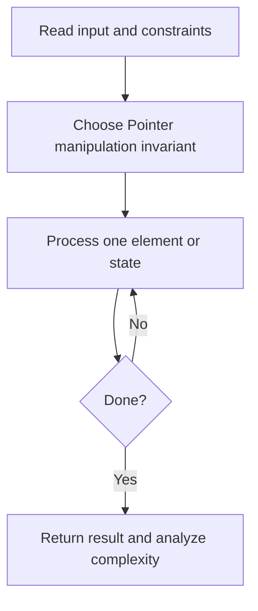
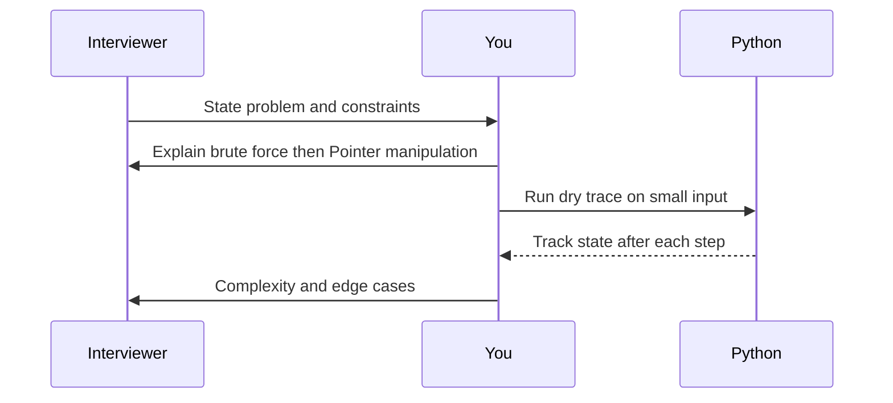

# Day 13 — Reverse Linked List

**Pattern:** Pointer manipulation · **Time:** 35 minutes · **Track:** Python interview DSA

[Course home](../README.md) · [Practice file](../practice/day-13.py) · [Commented reference](../solutions/day-13.py)

## What and why (5 minutes)

**Problem:** Reverse a singly linked list and return its new head.

**Why this pattern:** Change links one at a time without losing the remaining chain.

**Interview trap:** Store next node before modifying current.next.

## Algorithm flow



## Execution / timing diagram



## Try it yourself (15 minutes)

1. Open `practice/day-13.py`. Write `solve(...)` without looking below.
2. Verbally state the invariant and walk through a sample input.
3. Run `python -m unittest discover -s tests -v` from the repository root (reference tests run against completed solutions).
4. Check your practice implementation with `python scripts/check_practice.py 13` when you finish.

### Sample cases

Build your own small linked-list/tree nodes and test empty, one-node, and multi-node cases.

## Commented solution — reveal after attempting

<details>
<summary>Show Python reference implementation</summary>

```python
class ListNode:
    def __init__(self, val=0, next=None):
        self.val = val
        self.next = next

def solve(head):
    previous = None
    current = head
    while current:
        following = current.next  # save rest before changing link
        current.next = previous
        previous = current
        current = following
    return previous
```

</details>

## Complexity (5 minutes)

**O(n) time, O(1) space.** Explain *why*, including auxiliary data structure cost.

## Tricky interview follow-up (10 minutes)

**Question:** Can you explain recursive reversal and its stack use?

Before moving on, explain (1) why your implementation is correct, (2) one edge case, (3) a trade-off versus a simpler solution.

**Next:** [Day 14](day-14.md)
