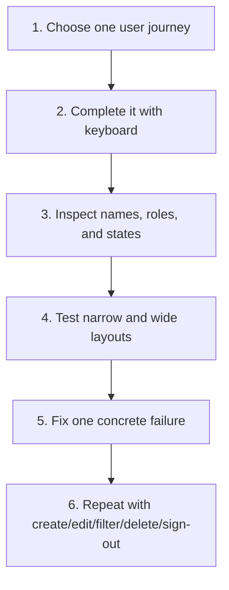
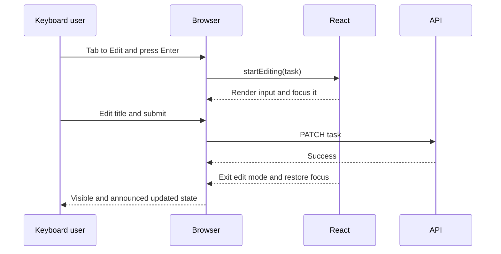

# Day 13 — Improve accessibility and responsive design

**Time:** three focused 45-minute sessions

**Starting point:** The authenticated, owner-scoped app passes Day 12 tests.

**Goal:** The complete task flow works with a keyboard, assistive technology,
and narrow or wide screens.

[Previous: Day 12](day-12.md) ·
[Roadmap](../docs/APP_BUILD_ROADMAP.md) ·
[Next: Day 14](day-14.md)

## Learning objectives

- use semantic regions and native controls;
- provide accessible names, errors, and status announcements;
- manage focus during editing and async work;
- explain the Auth.js session Context introduced on Day 10;
- measure before applying `useMemo`, `useCallback`, or `React.memo`;
- build mobile-first layouts without horizontal overflow;
- verify behavior instead of judging only appearance.

## 1. Audit the interaction, not only the colors



Check:

- Can Tab reach controls in a logical order?
- Is focus visible?
- Does each input have a label?
- Are errors announced and visible?
- Is completion communicated beyond color?
- Do controls remain usable at 320 CSS pixels?

## 2. Add semantic page regions

```tsx
export default function TaskWorkspace() {
  return (
    <>
      <header className="border-b border-slate-800">
        <nav
          aria-label="Account"
          className="mx-auto flex max-w-5xl items-center justify-between px-4 py-4"
        >
          <a className="font-bold" href="/">MiniTrack</a>
          <AuthControls />
        </nav>
      </header>

      <main
        className="mx-auto w-full max-w-5xl px-4 py-8 sm:px-6"
        id="main-content"
      >
        <h1 className="text-3xl font-bold sm:text-4xl">My tasks</h1>
        <TaskContent />
      </main>
    </>
  );
}
```

Prefer `button`, `input`, `select`, `form`, `nav`, and headings over generic
elements with click handlers.

## 3. Make forms and errors perceivable

```tsx
const titleErrorId = 'task-title-error';

<label className="font-medium" htmlFor="task-title">
  Task title
</label>
<input
  aria-describedby={error ? titleErrorId : undefined}
  aria-invalid={Boolean(error)}
  className="min-h-11 rounded-lg border border-slate-600 bg-slate-950 px-3 focus-visible:outline-none focus-visible:ring-2 focus-visible:ring-violet-400"
  id="task-title"
  name="title"
/>
{error ? (
  <p className="text-rose-300" id={titleErrorId} role="alert">
    {error}
  </p>
) : null}
```

Use `role="alert"` for an important newly rendered error. Use
`aria-live="polite"` or `role="status"` for non-urgent progress and success.
Do not announce every keystroke.

## 4. Manage edit focus

When editing begins, move focus to the edit input. After save or cancel, return
focus to the Edit button for that task.

```tsx
const editInputRef = useRef<HTMLInputElement>(null);

useEffect(() => {
  if (editingId) {
    editInputRef.current?.focus();
  }
}, [editingId]);
```

Use this effect because focus is synchronization with the DOM, not derived
render data.

Give icon-only controls explicit names:

```tsx
<button aria-label={`Delete ${task.title}`} type="button">
  <TrashIcon aria-hidden="true" />
</button>
```

## 5. Build mobile-first task rows

```tsx
<li className="grid gap-3 rounded-xl border border-slate-700 p-4 sm:grid-cols-[auto_1fr_auto] sm:items-center">
  <input
    aria-label={`Complete ${task.title}`}
    checked={task.done}
    className="size-5"
    type="checkbox"
  />

  <span className={task.done ? 'line-through text-slate-400' : ''}>
    {task.title}
    <span className="sr-only">
      {task.done ? ' (completed)' : ' (open)'}
    </span>
  </span>

  <div className="flex flex-wrap gap-2">
    <button className="min-h-11 rounded-lg px-4">Edit</button>
    <button className="min-h-11 rounded-lg px-4">Delete</button>
  </div>
</li>
```

Start with one column. Add `sm:` layout only when enough width exists.

## 6. Trace an accessible edit



## 7. Add a focused React interview lab

Day 10 uses Auth.js `SessionProvider` and `useSession()` as the practical
Context example. Context distributes the client-visible session without prop
drilling, but `auth()` still protects server entry points.

Do not move PostgreSQL tasks into Context because that would duplicate server
state. Use this lesson's extra lab for measured memoization instead.

### Measure memoization instead of guessing

Use the React Profiler before and after this small experiment:

```tsx
import { memo, useCallback, useMemo } from 'react';

const counts = useMemo(() => {
  return {
    open: tasks.filter(task => !task.done).length,
    done: tasks.filter(task => task.done).length,
  };
}, [tasks]);
```

This avoids recalculating the counts when unrelated local state changes while
the `tasks` array reference stays the same. For a small list, the calculation
is cheap and plain rendering may be clearer.

To explore stable props:

```tsx
const startEditing = useCallback((task: Task) => {
  setEditingId(task.id);
  setEditTitle(task.title);
}, []);

const TaskRow = memo(function TaskRow({
  task,
  onEdit,
}: {
  task: Task;
  onEdit: (task: Task) => void;
}) {
  return (
    <li>
      <span>{task.title}</span>
      <button type="button" onClick={() => onEdit(task)}>
        Edit
      </button>
    </li>
  );
});
```

`React.memo` performs a shallow prop comparison. `useCallback` keeps the
callback reference stable so it does not defeat that comparison. A refreshed
server result may create new task objects, so memoization cannot prevent every
row render.

Keep these optimizations only when profiling shows a useful improvement.

## 8. Verify with tools and people

Run:

```bash
npm run lint
npx tsc --noEmit
npm run test:e2e
```

Then verify manually:

1. Zoom to 200%.
2. Use keyboard only.
3. Test 320px, tablet, and desktop widths.
4. Inspect the accessibility tree in browser developer tools.
5. If available, test VoiceOver or another screen reader.
6. Use the React Profiler to compare the memoization experiment.

Automated tools help find issues; they do not prove usability.

## Debugging exercise

1. Remove an input label and inspect its accessible name.
2. Remove focus styles and navigate by keyboard.
3. Communicate completion only with green/gray colors.
4. Use `div onClick` instead of a button and test Enter/Space.
5. Force task actions into one fixed-width row and test 320px.
6. Put `tasks` into Context and identify the duplicated source of truth.
7. Pass a new inline callback into `TaskRow` and observe why `React.memo` no
   longer skips the render.

## Tricky interview questions and answers (20 min)

### Q1. Why prefer native semantic controls?

**Interview-ready answer:** Native controls provide keyboard behavior, focus,
roles, states, and platform conventions by default. Recreating them on generic
elements is easy to get wrong.

**Example:** A button responds to Enter and Space without custom key handlers.

**Senior follow-up:** ARIA supplements semantics; it does not repair every
behavior missing from the wrong HTML element.

### Q2. How should async errors be exposed?

**Interview-ready answer:** Show persistent visible text near the relevant
control and use an appropriate live region so assistive technology perceives
the new message.

**Example:** Connect the input with `aria-describedby` and render the error
with `role="alert"`.

**Senior follow-up:** Move focus only when necessary; unexpected focus jumps
can be disorienting.

### Q3. What does responsive design require?

**Interview-ready answer:** Content, controls, reading order, touch targets,
and feedback must remain understandable and operable across viewport sizes,
zoom levels, and input modes.

**Example:** Task actions wrap below the title on mobile instead of overflowing.

**Senior follow-up:** Test content expansion, long words, localization, and
browser text zoom—not only common device presets.

### Q4. Can automated accessibility tests prove compliance?

**Interview-ready answer:** No. They detect a useful subset of machine-testable
issues, but they cannot judge logical focus, understandable wording, or whether
a real workflow is usable.

**Example:** A button can have a technically valid but meaningless name such as
“Click here.”

**Senior follow-up:** Combine automated checks, keyboard testing, accessibility
tree inspection, and testing with disabled users when possible.

### Q5. When should you use Context?

**Interview-ready answer:** Use Context for values needed by distant
descendants when repeatedly passing props would obscure the component API.
Context is not automatically a replacement for application or server state.

**Example:** Auth.js session display is suitable; PostgreSQL-backed tasks are
not duplicated into Context.

**Senior follow-up:** Context value changes rerender consumers. Split contexts
by responsibility and keep values stable when measurement justifies it.

### Q6. What is the difference between `useMemo`, `useCallback`, and `React.memo`?

**Interview-ready answer:** `useMemo` caches a computed value, `useCallback`
caches a function reference, and `React.memo` may skip rendering a component
when its props are shallowly equal.

**Example:** A memoized `TaskRow` can still rerender if it receives a newly
created callback on every parent render.

**Senior follow-up:** They are performance tools, not correctness tools. Their
dependency arrays must be accurate, and their overhead can exceed the saved
work.

### Q7. When should you avoid `useEffect`?

**Interview-ready answer:** Avoid it for values that can be calculated during
rendering or for event-specific logic that belongs in the event handler.
Effects synchronize React with external systems.

**Example:** Focus synchronization needs an effect; filtering `tasks` does not.

**Senior follow-up:** Incorrect dependencies can produce stale closures,
repeated work, or loops. Removing an unnecessary effect is often better than
fixing it.

## Complexity

- Rendering remains `O(n)` for `n` visible tasks.
- The count calculation is `O(n)` and `useMemo` reuses it only while the
  `tasks` dependency remains referentially equal.
- Context updates rerender consuming components.
- Accessibility usually adds semantics and verification, not meaningful
  algorithmic cost.
- Responsive CSS adds no JavaScript state when layout can be expressed in CSS.

## Exit checklist

- [ ] Every control has a meaningful accessible name.
- [ ] The complete flow works with keyboard only.
- [ ] Focus is visible and logical.
- [ ] Errors and status changes are perceivable.
- [ ] Client auth UI uses Context without replacing server `auth()` checks.
- [ ] I can distinguish `useMemo`, `useCallback`, and `React.memo`.
- [ ] I used the Profiler before deciding whether memoization helps.
- [ ] Completion is not communicated by color alone.
- [ ] No horizontal overflow appears at narrow widths or 200% zoom.

**Suggested commit:** `day13: improve accessibility and responsive layout`
