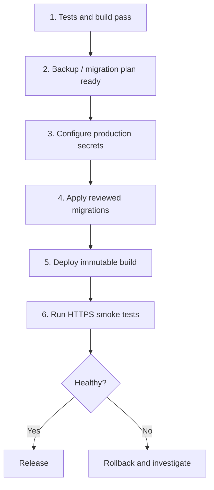
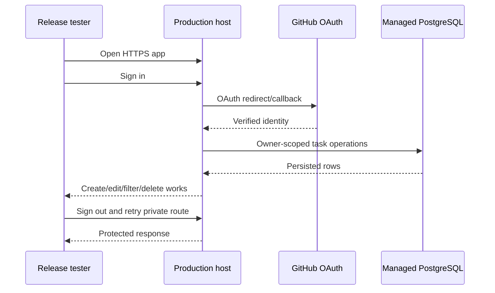

# Day 14 — Deploy with production services

**Time:** three focused 45-minute sessions

**Starting point:** The complete local app passes tests and accessibility checks.

**Goal:** Deploy a production build with managed PostgreSQL, GitHub OAuth, HTTPS,
and separately managed secrets.

[Previous: Day 13](day-13.md) ·
[Roadmap](../docs/APP_BUILD_ROADMAP.md) ·
[Next: Day 15](day-15.md)

> Hosting products change frequently. Choose a current Next.js-compatible host
> and managed PostgreSQL service, then follow their official documentation.
> Keep this lesson's security and verification requirements regardless of vendor.

## Learning objectives

- separate build-time and runtime configuration;
- manage development, test, and production secrets independently;
- apply migrations deliberately before serving traffic;
- configure the production OAuth callback;
- run a production smoke test and plan rollback.

## 1. Define the production contract

Record these values without recording secret contents:

| Setting | Purpose |
|---|---|
| Production app URL | HTTPS origin users visit |
| `DATABASE_URL` | Managed production PostgreSQL |
| `AUTH_SECRET` | Production-only session secret |
| `AUTH_GITHUB_ID` | Production GitHub OAuth app ID |
| `AUTH_GITHUB_SECRET` | Production GitHub OAuth secret |
| Node.js version | Runtime compatible with the app |

Use the host's secret manager. Never upload `.env.local`.



## 2. Create production services

1. Create a managed PostgreSQL database.
2. Require encrypted connections according to provider guidance.
3. Create a separate GitHub OAuth app for production.
4. Register:

```text
Homepage: https://YOUR_PRODUCTION_DOMAIN
Callback: https://YOUR_PRODUCTION_DOMAIN/api/auth/callback/github
```

Localhost and production must not share secrets.

## 3. Apply migrations deliberately

Create a non-interactive migration command appropriate for the repository. At
minimum, document the exact ordered SQL files:

```bash
psql "$DATABASE_URL" -v ON_ERROR_STOP=1 \
  -f backend/sql/schema.sql
psql "$DATABASE_URL" -v ON_ERROR_STOP=1 \
  -f backend/sql/migrations/002-auth-users.sql
psql "$DATABASE_URL" -v ON_ERROR_STOP=1 \
  -f backend/sql/migrations/003-task-owners.sql
```

The Day 11 learning migration deletes unowned sample tasks. It is acceptable
only while initializing this brand-new empty production database. Never rerun
that destructive step after users have data; replace it with the staged
nullable/backfill/constraint plan from Day 11.

Do not automatically run destructive migrations on every application startup.
Capture a backup or provider restore point before production schema changes.

## 4. Run the release gate locally

From `frontend/`:

```bash
npm ci
npm run test:unit
npm run test:integration
npm run test:e2e
npx tsc --noEmit
npm run build
```

`npm run build` proves compilation and bundling. It does not prove production
secrets, database reachability, OAuth callbacks, or cookies.

## 5. Deploy and verify configuration

Configure secrets in the selected host, deploy the tested revision, and inspect
the build logs. Logs may show variable **names**, but must not print values.

Verify:

- production uses HTTPS;
- callback returns to the production origin;
- cookies have the expected secure attributes;
- the app connects to production PostgreSQL;
- server errors do not include credentials;
- no browser bundle contains database or OAuth secrets.

## 6. Run a production smoke test



Test one critical journey, owner isolation with a second account, sign-out, and
the health endpoint. Do not experiment with destructive SQL in production.

## 7. Write the rollback trigger

Rollback when:

- migrations fail or data checks fail;
- authentication callbacks loop or reject valid users;
- owner scoping is broken;
- error rate rises materially;
- the application cannot reach PostgreSQL.

Document who rolls back the app, how the previous build is restored, and how a
schema migration is recovered. Application rollback and database rollback are
different operations.

## Debugging exercise

1. Use a localhost callback in production and trace the redirect failure.
2. Omit one runtime secret and identify where the failure appears.
3. Point a preview build at production data and explain the isolation risk.
4. Run a build successfully with PostgreSQL stopped and explain why build is
   not a complete smoke test.

## Tricky interview questions and answers (20 min)

### Q1. Why separate credentials by environment?

**Interview-ready answer:** Separation limits blast radius and prevents local
or test mistakes from touching production resources.

**Example:** `minitrack_test` can be truncated safely; production cannot.

**Senior follow-up:** Use distinct accounts, permissions, rotation, auditing,
and secret-manager access policies—not only different variable values.

### Q2. What is build-time versus runtime configuration?

**Interview-ready answer:** Build-time values affect compilation or generated
assets. Runtime values are read by the deployed server while handling requests.
Secrets should remain server-side runtime configuration unless the framework
explicitly requires otherwise.

**Example:** `DATABASE_URL` belongs on the server and must never become a
publicly prefixed browser variable.

**Senior follow-up:** Know whether the hosting platform bakes variables into an
image or injects them when an instance starts.

### Q3. What is a deployment smoke test?

**Interview-ready answer:** It is a small, fast set of checks against the real
deployed environment that verifies critical paths such as health, sign-in,
database access, and one core user journey.

**Example:** Sign in, create a task, reload, and sign out.

**Senior follow-up:** Smoke tests complement—not replace—the deeper pre-release
test suite.

### Q4. Why separate app rollback from schema rollback?

**Interview-ready answer:** Reverting application code does not automatically
undo a database schema or data transformation. Database changes need their own
compatibility and recovery plan.

**Example:** Old code may fail after a column is dropped even if deployment
rollback succeeds.

**Senior follow-up:** Expand-and-contract migrations keep old and new versions
compatible during rolling releases.

## Complexity

Deployment work is operational rather than algorithmic. Risk grows with the
number of environments, external services, schema changes, and manual steps.
Automate repeatable checks while keeping destructive actions reviewed.

## Exit checklist

- [ ] Production and local services use separate credentials.
- [ ] Production OAuth callback uses HTTPS and the deployed domain.
- [ ] Migrations ran with a backup or recovery point.
- [ ] Tests, type checking, and production build passed first.
- [ ] Sign-in and owner-scoped CRUD pass in production.
- [ ] A rollback trigger and procedure are documented.

**Suggested commit:** `day14: document and verify production deployment`
