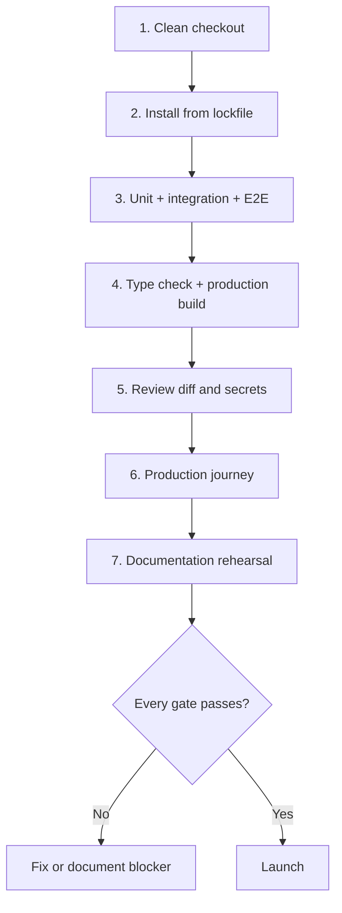
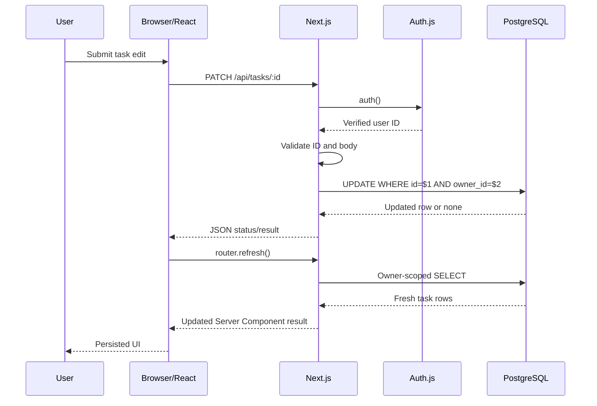

# Day 15 — Verify, document, and launch MiniTrack

**Time:** three focused 45-minute sessions

**Starting point:** Day 14 deployed the application and production smoke tests
work.

**Goal:** Finish a reproducible release, document operations, and explain the
entire system confidently.

[Previous: Day 14](day-14.md) ·
[Roadmap](../docs/APP_BUILD_ROADMAP.md)

## Learning objectives

- run one repeatable release checklist;
- verify critical flows and cross-user isolation;
- document setup, migration, deployment, and recovery;
- review privacy-safe operational behavior;
- explain the complete request path in an interview.

## 1. Run the release gate from a clean checkout

```bash
npm ci
npm run test:unit
npm run test:integration
npm run test:e2e
npx tsc --noEmit
npm run build
git status --short
```

Expected:

- every check passes;
- no secret or generated local file is staged;
- installation follows the lockfile;
- another developer does not need undocumented machine state.



## 2. Walk the deployed acceptance journey

As User A:

1. Sign in.
2. Create a task.
3. Rename and complete it.
4. Search and filter through a shareable URL.
5. Reload and confirm persistence.

As User B:

1. Sign in separately.
2. Confirm User A's tasks are absent.
3. Attempt User A's known task ID and confirm no data leaks.

Finally, sign out and confirm private page and API access are blocked.

## 3. Document the operating interface

The main README should contain:

- supported Node.js and PostgreSQL versions;
- local database and migration commands;
- environment variable **names**, never values;
- development and test commands;
- GitHub OAuth callback format;
- deployment and smoke-test steps;
- known limitations.

Add an API summary:

| Route | Authentication | Authorization |
|---|---|---|
| `GET /api/health` | Public | No task data |
| `GET /api/tasks` | Required | Owner-scoped list |
| `POST /api/tasks` | Required | Owner from session |
| `PATCH /api/tasks/:id` | Required | ID and owner predicate |
| `DELETE /api/tasks/:id` | Required | ID and owner predicate |

## 4. Document recovery

Record:

- database backup and restore expectations;
- how to roll back the application revision;
- how migrations are applied and recovered;
- who can access production secrets and logs;
- which logs and metrics identify failed requests;
- what user-visible limitations remain.

Avoid success-shaped fallbacks. If PostgreSQL is unavailable, return a clear
error and log a request identifier without task contents or secrets.

## 5. Rehearse the full request path



Explain the responsibility of each boundary:

- browser: interaction and temporary UI state;
- Route Handler: HTTP validation and status mapping;
- Auth.js: verified identity and session;
- data layer: parameterized, owner-scoped SQL;
- PostgreSQL: constraints, persistence, and transactions;
- tests: regression and isolation evidence;
- deployment: configuration, observability, and recovery.

## 6. Capture known limitations

Possible honest limitations:

- no task sharing or teams;
- no pagination for very large lists;
- no optimistic concurrency/version column;
- limited rate limiting and abuse protection;
- basic operational monitoring;
- one OAuth provider.

Known limitations are not failures when they are explicit and appropriate for
the product stage.

## Debugging exercise

1. Follow setup instructions from a fresh clone and record every hidden step.
2. Break one environment variable and judge whether the error is actionable.
3. Simulate PostgreSQL unavailability and inspect the public response and logs.
4. Rehearse a failed migration response without running destructive SQL.

## Tricky interview questions and answers (20 min)

### Q1. How would you debug a production-only failure?

**Interview-ready answer:** Compare configuration and runtime differences,
inspect privacy-safe logs and request IDs, reproduce with a production-like
data shape, and narrow the failure boundary before changing code.

**Example:** If OAuth works locally but not in production, compare the callback
origin, HTTPS, secrets, and cookie behavior.

**Senior follow-up:** Avoid logging secrets or copying production personal data
into development while investigating.

### Q2. What is the recovery plan for a bad migration?

**Interview-ready answer:** Stop further rollout, preserve evidence, restore or
roll forward using the reviewed recovery plan, and verify data integrity before
reopening traffic.

**Example:** Use a provider restore point if a migration corrupted data; do not
improvise an unreviewed reverse query.

**Senior follow-up:** Prefer backward-compatible migrations and rehearse restore
procedures before an incident.

### Q3. How do you explain MiniTrack end to end?

**Interview-ready answer:** The browser sends same-origin requests to Next.js.
Route Handlers authenticate with Auth.js, validate untrusted input, and call a
typed data layer. Parameterized SQL includes the owner predicate, PostgreSQL
persists the change, and React refreshes server-rendered data.

**Example:** Trace one `PATCH` through the sequence diagram above.

**Senior follow-up:** Mention failure behavior, test evidence, deployment
configuration, and trade-offs—not only the happy path.

### Q4. What makes documentation part of the system interface?

**Interview-ready answer:** Setup, migration, testing, deployment, and recovery
instructions determine whether another engineer can operate the software
correctly. Undocumented requirements are hidden dependencies.

**Example:** A missing OAuth callback instruction can make correct code
undeployable.

**Senior follow-up:** Validate documentation from a clean environment and keep
it versioned with the behavior it describes.

### Q5. When is the project complete?

**Interview-ready answer:** It is complete for the agreed scope when critical
user journeys, authorization boundaries, tests, accessibility checks,
deployment, documentation, and recovery expectations all meet acceptance
criteria.

**Example:** “It runs on my laptop” is not enough if another user can read
someone else's tasks or deployment cannot be recovered.

**Senior follow-up:** Completion is scope-specific; optional features should
not delay a reliable release without a clear product requirement.

## Complexity

Release verification is dominated by external systems and test duration rather
than algorithmic complexity. A checklist reduces omission risk; automation
reduces variance; human review remains important for security and recovery.

## Exit checklist

- [ ] Clean-install tests, type checking, and build pass.
- [ ] Production sign-in and owner-scoped CRUD pass.
- [ ] A second user cannot access the first user's tasks.
- [ ] Keyboard and narrow-screen flows pass.
- [ ] Setup, migrations, environment names, tests, and deployment are documented.
- [ ] Backup, rollback, and migration recovery expectations are documented.
- [ ] No secrets or personal data appear in source, logs, or test artifacts.
- [ ] I can explain the system without reading the lesson.

**Suggested commit:** `day15: complete MiniTrack release verification`
