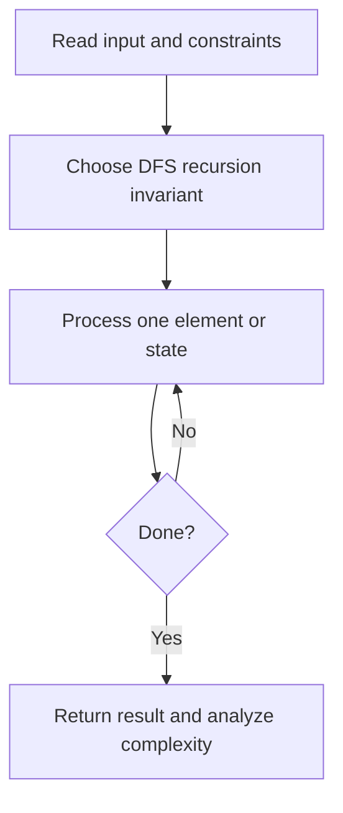
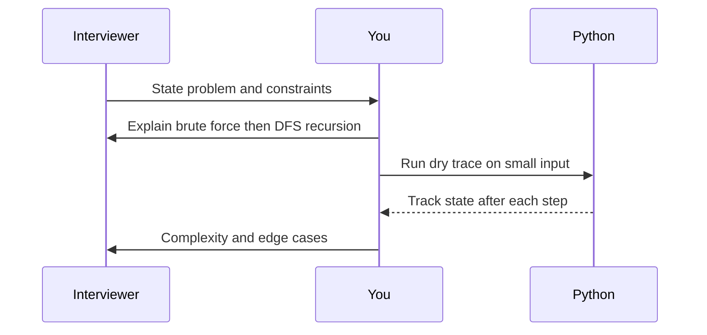

# Day 16 — Maximum Depth of Binary Tree

**Pattern:** DFS recursion · **Time:** 35 minutes · **Track:** Python interview DSA

[Course home](../README.md) · [Practice file](../practice/day-16.py) · [Commented reference](../solutions/day-16.py)

## What and why (5 minutes)

**Problem:** Return the maximum root-to-leaf node count.

**Why this pattern:** Recurrence: depth = 1 + max(left, right).

**Interview trap:** Null nodes have depth zero.

## Algorithm flow



## Execution / timing diagram



## Try it yourself (15 minutes)

1. Open `practice/day-16.py`. Write `solve(...)` without looking below.
2. Verbally state the invariant and walk through a sample input.
3. Run `python -m unittest discover -s tests -v` from the repository root (reference tests run against completed solutions).
4. Check your practice implementation with `python scripts/check_practice.py 16` when you finish.

### Sample cases

Build your own small linked-list/tree nodes and test empty, one-node, and multi-node cases.

## Commented solution — reveal after attempting

<details>
<summary>Show Python reference implementation</summary>

```python
class TreeNode:
    def __init__(self, val=0, left=None, right=None):
        self.val, self.left, self.right = val, left, right

def solve(root):
    if root is None:
        return 0
    return 1 + max(solve(root.left), solve(root.right))
```

</details>

## Complexity (5 minutes)

**O(n) time, O(h) recursion stack.** Explain *why*, including auxiliary data structure cost.

## Tricky interview follow-up (10 minutes)

**Question:** What happens for a very deep skewed tree in Python?

Before moving on, explain (1) why your implementation is correct, (2) one edge case, (3) a trade-off versus a simpler solution.

**Next:** [Day 17](day-17.md)
