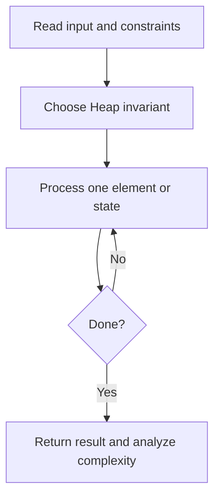
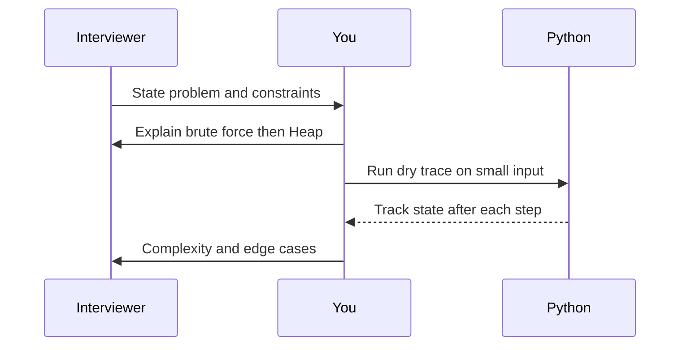

# Day 19 — Kth Largest Element

**Pattern:** Heap · **Time:** 35 minutes · **Track:** Python interview DSA

[Course home](../README.md) · [Practice file](../practice/day-19.py) · [Commented reference](../solutions/day-19.py)

## What and why (5 minutes)

**Problem:** Return kth largest number, counting duplicates.

**Why this pattern:** Maintain a min-heap of the k largest values seen so far.

**Interview trap:** kth largest is not the kth distinct value.

## Algorithm flow



## Execution / timing diagram



## Try it yourself (15 minutes)

1. Open `practice/day-19.py`. Write `solve(...)` without looking below.
2. Verbally state the invariant and walk through a sample input.
3. Run `python -m unittest discover -s tests -v` from the repository root (reference tests run against completed solutions).
4. Check your practice implementation with `python scripts/check_practice.py 19` when you finish.

### Sample cases

```python
solve([3, 2, 1, 5, 6, 4], 2)  # 5
```
```python
solve([3, 2, 3, 1, 2, 4, 5, 5, 6], 4)  # 4
```

## Commented solution — reveal after attempting

<details>
<summary>Show Python reference implementation</summary>

```python
import heapq

def solve(nums, k):
    if not (1 <= k <= len(nums)):
        raise ValueError('k must be in [1, len(nums)]')
    heap = []
    for value in nums:
        if len(heap) < k:
            heapq.heappush(heap, value)
        elif value > heap[0]:
            heapq.heapreplace(heap, value)
    return heap[0]
```

</details>

## Complexity (5 minutes)

**O(n log k) time, O(k) space.** Explain *why*, including auxiliary data structure cost.

## Tricky interview follow-up (10 minutes)

**Question:** Compare heap vs. quickselect vs. sorting.

Before moving on, explain (1) why your implementation is correct, (2) one edge case, (3) a trade-off versus a simpler solution.

**Next:** [Day 20](day-20.md)
