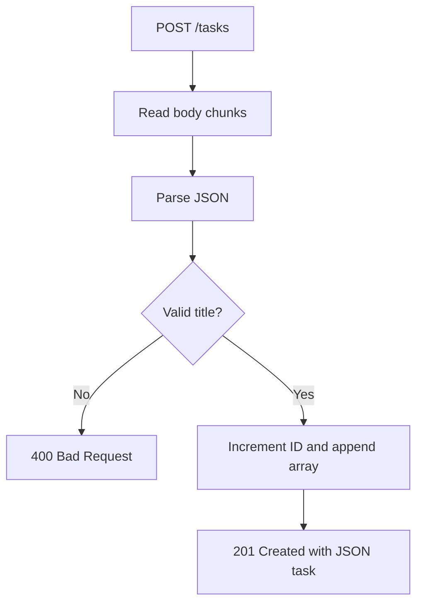
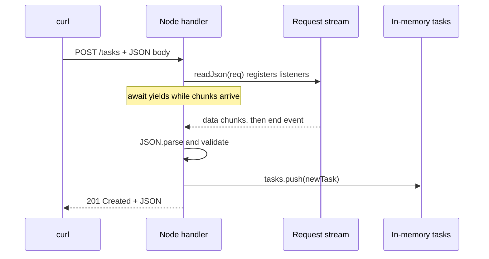

# Day 2 — Promises, async/await, closures + HTTP POST

**Goal:** create a task via `POST /tasks`, still in memory. **Time:** ~90 min. **Today:** replace `checkpoints/day2/server.cjs`. **Next:** [Day 3](day-3.md).

## 1. What and why (15 min)

- **Promise:** represents a result/error available later.
- **`await`:** pauses *one async function* until its Promise settles; it doesn't stop the entire Node event loop.
- **Closure:** the request callback retains access to `tasks` and `nextId` between requests.
- **Stream:** HTTP request bodies arrive in chunks, not magically as a parsed JSON object.

**Predict:**

```js
console.log('one');
async function work() {
  console.log('two'); // Runs before first await.
  await Promise.resolve();
  console.log('four'); // Runs in a Promise continuation.
}
work();
console.log('three');
```

**Answer:** `one two three four`.

### Request flow



### Timing / sequence diagram



## 2. Write the next version (35 min)

Stop the Day 1 server (**Ctrl+C**). Open `checkpoints/day2/server.cjs`; write this code:

```js
const http = require('node:http');

// These variables are captured by the request handler's closure.
const tasks = [{ id: 1, title: 'Learn the event loop', done: false }];
let nextId = 2;

function readJson(req) {
  // HTTP bodies arrive in chunks: read them before parsing JSON.
  return new Promise((resolve, reject) => {
    let raw = '';
    req.setEncoding('utf8');
    req.on('data', chunk => {
      raw += chunk;
      // A small learning-demo limit, not a full production protection scheme.
      if (raw.length > 10_000) {
        reject(Object.assign(new Error('Body too large'), { status: 413 }));
        req.destroy();
      }
    });
    req.on('end', () => {
      try { resolve(JSON.parse(raw)); }
      catch { reject(Object.assign(new Error('Invalid JSON'), { status: 400 })); }
    });
    req.on('error', reject);
  });
}

function sendJson(res, status, data) {
  res.writeHead(status, { 'Content-Type': 'application/json' });
  res.end(JSON.stringify(data)); // One response per request.
}

http.createServer(async (req, res) => {
  if (req.method === 'GET' && req.url === '/tasks') {
    sendJson(res, 200, tasks);
    return;
  }

  if (req.method === 'POST' && req.url === '/tasks') {
    try {
      const body = await readJson(req); // Pauses this async handler, not all Node work.
      const title = typeof body?.title === 'string' ? body.title.trim() : '';
      if (!title || title.length > 200) {
        sendJson(res, 400, { error: 'Title must be 1–200 characters' });
        return;
      }
      const task = { id: nextId++, title, done: false };
      tasks.push(task); // Shared in-memory array: gone on restart.
      sendJson(res, 201, task); // 201 = Created.
    } catch (error) {
      // Invalid JSON has status 400; too-large body is status 413.
      if (!res.destroyed) sendJson(res, error.status || 400, { error: error.message });
    }
    return;
  }
  sendJson(res, 404, { error: 'Not found' });
}).listen(3001, () => console.log('API: http://localhost:3001'));
```


**Why this design?** `readJson` converts an event-driven stream into a Promise so the handler can use `await`. `try/catch` translates bad input into an HTTP error rather than crashing. This example uses a bounded body size to keep the stream example safe enough for local experiments. It is **not** a production security implementation.

## 3. Run and prove behavior (10 min)

```bash
node checkpoints/day2/server.cjs
# In a second terminal:
curl -i http://localhost:3001/tasks
curl -i -X POST http://localhost:3001/tasks \
  -H 'Content-Type: application/json' \
  -d '{"title":"Learn async-await"}'
curl http://localhost:3001/tasks
curl -i -X POST http://localhost:3001/tasks \
  -H 'Content-Type: application/json' -d '{invalid}'
```

Expected: **201** and new row, GET shows the row, malformed JSON → **400**. Restart Node: the new row disappears. This *motivates Day 3*.

## 4. Write one small enhancement (15 min)

Before looking at the finished code, add `GET /count` returning `{"count": tasks.length}`. Put it next to GET `/tasks`; test with curl. **Interview trap:** request handlers are callbacks, but their closure can see the same array; it does not create a new array on every request.

## 5. Interview / debugging (15 min)

Practice answering two or three aloud today. Lead with the first paragraph and use the example if the interviewer asks a follow-up.

### Q1. Does `await` block Node.js?

**Interview-ready answer:** `await` pauses only the current `async` function until its Promise settles. It does not block Node's event loop, so other ready callbacks and requests can run while the operation is waiting. Synchronous CPU-heavy work is what blocks the main JavaScript thread.

**Example:**

```js
const task = await readTaskFromDatabase();
```

While the database is working, this handler is suspended. Node can process another request. When the Promise settles, the rest of the handler is scheduled as a microtask.

**Important distinction:** `await slowDatabaseQuery()` is non-blocking when the database client performs asynchronous I/O. `await` cannot make a synchronous busy loop non-blocking.

### Q2. Can you use `await` outside an `async` function?

**Interview-ready answer:** Inside a function, `await` normally requires that function to be declared `async`. Top-level `await` is supported in ES modules, but not in an ordinary CommonJS file such as this lesson's `.cjs` server.

**Example:**

```js
async function loadTasks() {
  const tasks = await fetchTasks();
  return tasks;
}
```

Adding `async` also means the function always returns a Promise. Returning `tasks` therefore fulfills that Promise with the task array.

### Q3. What happens when a Promise rejects?

**Interview-ready answer:** A rejected Promise represents an asynchronous failure. If I `await` it, JavaScript throws the rejection reason at that line, so I can handle it with `try/catch`; otherwise the Promise returned by the surrounding `async` function also rejects.

**Example:**

```js
try {
  const body = await readJsonBody(req);
  res.end(JSON.stringify(body));
} catch (error) {
  res.writeHead(400);
  res.end(JSON.stringify({ error: 'Invalid JSON' }));
}
```

Malformed JSON causes `JSON.parse` to throw, which rejects `readJsonBody`. The handler catches that failure and translates it into an HTTP response instead of leaving the request unresolved.

**Senior follow-up:** Catch an error only where you can recover, add context, or translate it into the boundary's error format. Do not silently swallow it.

### Q4. Is `Promise.all` sequential?

**Interview-ready answer:** No. `Promise.all` observes several Promises together and fulfills when all of them fulfill. It rejects as soon as one input rejects. The operations can overlap if their Promises were started before or while constructing the input array, but `Promise.all` does not create threads.

**Example:**

```js
const [tasks, profile] = await Promise.all([
  fetchTasks(),
  fetchProfile(),
]);
```

If both operations are independent and each takes about 100 ms, overlapping them can finish in roughly 100 ms rather than the roughly 200 ms of awaiting one and then starting the other.

**Do not use it blindly:** If the second operation depends on the first result, they must remain sequential. Use `Promise.allSettled` when every outcome is needed even if one operation fails.

### Q5. What is a closure?

**Interview-ready answer:** A closure is a function together with access to the lexical variables from the scope where the function was created, even after that outer scope has finished executing.

**Example:** The HTTP request handler closes over the module-level `tasks` array:

```js
const tasks = [];

const server = http.createServer((req, res) => {
  tasks.push({ id: tasks.length + 1, title: 'New task' });
});
```

Node does not create a new `tasks` array for every request. Every invocation of the handler accesses the same in-memory array while that process is running.

**Senior follow-up:** Closures are useful for encapsulation and callbacks, but they can also keep large objects alive longer than expected or capture stale values in UI code.

### Q6. Why shouldn't you treat the HTTP request body as one immediately available string?

**Interview-ready answer:** An HTTP body arrives as a stream of byte chunks over time. The server must collect or process those chunks and wait for the stream's `end` event before it can parse the complete JSON document.

**Example:**

```js
let body = '';
req.on('data', chunk => {
  body += chunk;
});
req.on('end', () => {
  const value = JSON.parse(body);
});
```

A small body may happen to arrive in one chunk, but the API does not guarantee that. Production code should also enforce a body-size limit so a client cannot exhaust server memory by sending an unbounded payload.

## Exit checklist

- [ ] POST 201, GET contains new task, malformed JSON 400.
- [ ] I understand why restart loses memory data.
- [ ] I can explain each `await`, the Promise resolve and reject paths.

**Commit:** `git add . && git commit -m "day2: HTTP POST and async"`

**Continue → [Day 3: PostgreSQL persistence](day-3.md)**
